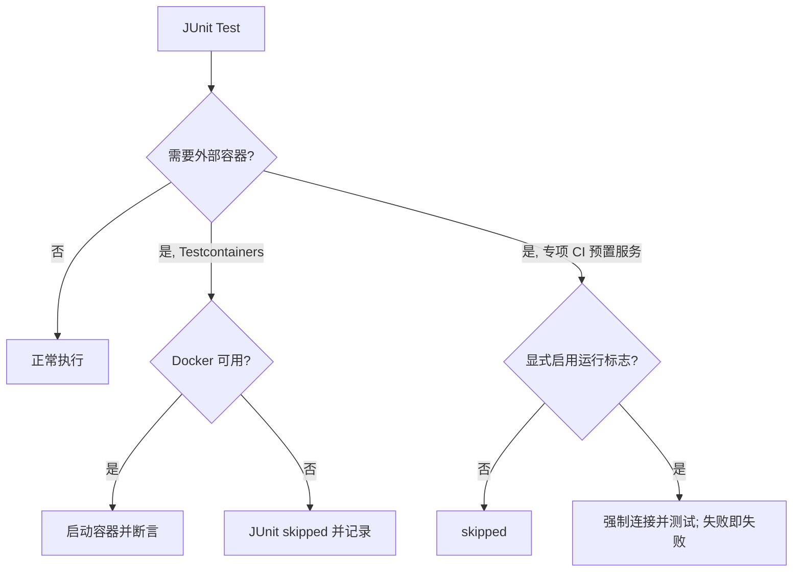

# Peach Cloud Maven 依赖与启动契约整改记录

> Issue #172 · 单 PR 整改 · 基线 main: `91b6d92e` · Java 21 / Spring Boot 3.5.4

## 目标与验证边界

通过调整 POM `scope`、`optional`、Spring 自动配置 Bean 条件和编译器进程，减少无意义的类路径依赖，修复“类存在但 Bean 未创建”以及“Starter 只有 optional AutoConfigure、运行时缺少 SDK”的启动故障。**本轮不改变业务契约或生产中间件部署配置。**

代码编译成功只代表 Reactor 成功；需结合 Quickstart Spring 上下文和有 Docker 的集成测试检查真正的运行时依赖。对八个独立业务服务的生产集群启动仍需要目标环境验收。

## Maven 依赖原则

| 位置 | 约束 |
| --- | --- |
| `peach-dependencies` | BOM 只集中管理版本，不通过 BOM 传递依赖；Mongo PageHelper 核心版本独立管理 |
| `*-autoconfigure` | 只有条件功能可以 optional；运行时代码所需的公共 API 类型不能因为 optional 而消失 |
| `*-starter` | 打包启用默认功能所需的 **全部** 客户端、模板和 Spring Boot Starter；不能要求每个业务另行补齐 |
| `*-quickstart` | 消除额外添加的“补丁型依赖”，让 Spring Boot 启动测试校验 Starter 自身是否完整 |
| 业务 `*-launch` | JDBC Driver 仅运行期引入，Lombok 仅编译期提供；保持当前业务装配所需依赖 |
| 公共基础模块 | 编译处理器 `provided + optional`；公共 API 的运行库在做全仓调用方分析前不得盲目 optional |

### 实施并可验证的变动

1. Mongo：`peach-mongo-starter` 带 MongoDB Spring Data 实现；`MongoService` 的 `PageInfo` 从 PageHelper 核心 `6.1.0` 获取，不再通过 MyBatis Spring Boot Starter 间接使用。Mongo AutoConfigure 受 `MongoClient` 和 `MongoTemplate` 类存在条件保护。
2. OpenFeign：Starter 明确声明 `spring-cloud-starter-openfeign`；命名客户端合并器等待 Feign AutoConfiguration 并校验 `FeignClientProperties` **Bean** 已注册，避免只判断 Classpath 后强制注入 Bean。
3. Email / Captcha：Starter 自带默认 SMTP/FreeMarker 及验证码实际实现的运行依赖；Quickstart 不再隐含补齐相关 SDK，现有功能测试直接检验 Starter 依赖闭包。
4. Code：MySQL 发号移除无用 `StringRedisTemplate` 构造参数和 Spring Data Redis 依赖；只有存在 `JdbcTemplate` Bean 时才创建 `CodeGenerator`，按 JDBC 自动配置顺序执行。新增无需 Docker 的 Bean 条件测试；数据库事务管理器仍是发号业务必需条件。
5. Redis/Sa-Token：独立 Redis 组件采用 Jedis，不从其默认 Spring Data Redis Starter 传递 Lettuce；Sa-Token AutoConfigure 仅依赖 Spring Data Redis API，应用 Starter 从 `peach-redis-starter` 获得实际客户端。**Gateway WebFlux 自己的 Reactive Redis/Lettuce 不做改变。**
6. Launch：将只由运行期加载的 MySQL JDBC Driver 改为 `runtime`，整理重复包装插件配置。RocketMQ Topic 管理工具仍保留在运行期，以保证 `peach.rocket.topic.auto-create` 现有能力。
7. Maven：根编译器不再对每个模块独立 fork javac；UTF-8 由编译器的 `encoding` 及 `.mvn/jvm.config` 保证；CI 全 Reactor 验证所有子模块。

## Docker 测试行为



- Testcontainers 用例统一使用 `@Testcontainers(disabledWithoutDocker = true)`；网关 `RateLimitRedisIntegrationTest` 已补齐。
- 外部已创建 Redis 的测试保留 `RUN_REDIS_CLIENT_IT`、`RUN_REDIS_TOPOLOGY_IT`、`RUN_REDIS_DELAYQUEUE_IT` 开关。这些测试不是 Testcontainers 自己拉容器，不应因本机 Docker 不可用而跳过已配置的真实远程服务。
- 专项 Redis / 延迟队列 CI 使用独立的 Docker 服务及 Surefire 执行数断言。普通单元测试不受 Docker 可用性影响。

## 测试与验收

在仓库根目录执行 `mvn -B -ntp verify`（完整 144 模块 Reactor）；需要局部验证可使用：

```bash
mvn -B -ntp -pl peach-middleware/peach-mongo/peach-mongo-quickstart -am verify
mvn -B -ntp -pl peach-middleware/peach-openfeign/peach-openfeign-quickstart -am verify
mvn -B -ntp -pl peach-component/peach-email/peach-email-quickstart -am verify
mvn -B -ntp -pl peach-component/peach-code/peach-code-quickstart -am verify
```

- **必须成功：** 144 模块 Maven 验证、Quickstart Spring 上下文、OpenFeign 本地调用、独立 Redis/Sa-Token/DelayQueue 拓扑专项（由适用工作流负责）。
- **不可误报：** Testcontainers 在无 Docker 环境自动 skipped 不代表功能成功；必须保留成功/失败/跳过计数。
- **仍需目标环境验证：** 各生产 Launch 连接真实 Nacos、数据库、Redis、RocketMQ 的启动与业务链路、所有云厂商 SDK 以及生成的服务 Jar 体积/启动时延。

## 未做的高风险改动及原因

暂不将 Storage 全部云厂商 SDK 直接设为 optional。当前 SPI 注册包含多种 Provider，简单修改 POM 会导致工厂类链接失败或用户配置的 Provider 找不到。安全拆分需要独立 Provider Module、服务发现 SPI 与多供应商回归测试，不能为了缩小依赖树而破坏旧配置。

同理，不删除 `rocketmq-tools` 的**运行时**能力：当 `peach.rocket.topic.auto-create=true` 时，`RocketMqTopicAdmin` 直接使用管理 API。减少运行时 SDK 需要配套功能拆分，不能仅靠 scope 变化。

本次关闭标准：保持**一个 Issue / 一个 PR**，在最终 PR Head 的所有适用 CI 成功后合并 main；未部署的生产环境事项明确记作未验证。
