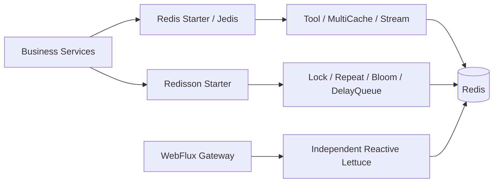

# Peach Cloud Redis / Redisson migration and acceptance

English | [中文](acceptance-and-rollout.md)

> **Status: implementation and specific CI scenarios validated, not full production failover acceptance.** This runbook tracks [Epic #18](https://github.com/Ryan-Guizhou/peach-cloud/issues/18). Source code and passing CI on the selected branch take precedence; operations must approve production rollout, rollback, and data migration.

## 1. Starter selection and ownership

| Need | `com.peach` artifactId | Client | Key limitation |
| --- | --- | --- | --- |
| Redis connection only | `peach-redis-starter` | Spring Data Redis / Jedis | Factory/templates; user-defined beans take priority |
| Redis KV / Hash / Set / SCAN | `peach-redis-tool-starter` | Jedis | SCAN is not a consistent snapshot or hot-path mass lookup |
| L1 + L2 caching | `peach-redis-multicache-starter` | Caffeine + Jedis | Best-effort Pub/Sub invalidation, possibly stale after disconnect |
| Redis Stream | `peach-redis-stream-starter` | Jedis | XACK on success; Pending recovery/DLQ opt-in disabled by default |
| Redisson connection only | `peach-redisson-starter` | Redisson | Does not create a Jedis factory |
| Distributed lock | `peach-redission-distributedlock-starter` | Redisson | Not a substitute for transactions, unique constraints or external fencing |
| Repeat guard | `peach-redission-repeat-starter` | Redisson | Failed marker persistence yields uncertain outcome, not safe blind retry |
| Segmented Bloom | `peach-redission-bloomfilter-starter` | Redisson | False positives; validate against authoritative data |
| Delay queue | `peach-redission-delayqueue-starter` | Redisson | reliable queue opt-in and isolated from legacy queue protocol |

The historical mixed `peach-redis-common` artifact stays in the reactor/BOM for external legacy deployments and rollback, but internal direct Maven consumers were removed in [PR #54](https://github.com/Ryan-Guizhou/peach-cloud/pull/54). Do not add it to new services. Historical `redission` is preserved only for existing paths/artifactIds. Gateway uses separate reactive Lettuce; do not block WebFlux EventLoops with Jedis.



## 2. CI-backed capabilities

| Area | Tests actually performed | Not established by those tests |
| --- | --- | --- |
| Independent clients / authentication | Real Redis 7.2 Jedis-only, Redisson-only, Redis Tool, Sa-Token login → authorization → logout ([#42](https://github.com/Ryan-Guizhou/peach-cloud/pull/42), [#44](https://github.com/Ryan-Guizhou/peach-cloud/pull/44)) | Mixed-version persisted old sessions |
| Business dependency migration | Six launch modules and final three direct legacy dependencies removed; governance guard ([#46](https://github.com/Ryan-Guizhou/peach-cloud/pull/46), [#54](https://github.com/Ryan-Guizhou/peach-cloud/pull/54)) | Safe retirement of the old artifact |
| Sentinel / Cluster / TLS | Redis 7.2 three-topology real KV/TTL, cross-slot Cluster SCAN/delete ([#48](https://github.com/Ryan-Guizhou/peach-cloud/pull/48)) | Failover, production CA/certificate rotation |
| ACL + Nacos | Separate Sentinel auth for Jedis/Redisson, nonzero Cluster DB rejection, synchronized templates ([#50](https://github.com/Ryan-Guizhou/peach-cloud/pull/50)) | Live ACL credential rotation |
| Stream | Success XACK, failure PEL, opt-in XPENDING/XCLAIM/backoff/DLQ and 3 real Redis tests ([#52](https://github.com/Ryan-Guizhou/peach-cloud/pull/52)) | Non-atomic DLQ write versus source ACK |
| Multi-instance cache / Bloom | Two independent Jedis clients invalidate L1/refill L2; two RedissonClients see Bloom scaling ([#56](https://github.com/Ryan-Guizhou/peach-cloud/pull/56)) | Missed Pub/Sub events during disconnect |
| DelayQueue reliable queue | Lua atomic claim, lease/fencing/DLQ, two-worker lease-loss recovery, 64 parallel tasks, 7 real tests ([#40](https://github.com/Ryan-Guizhou/peach-cloud/pull/40), [#60](https://github.com/Ryan-Guizhou/peach-cloud/pull/60)) | Real process kill -9, Redis failover, 10k soak |
| Sa-Token administrative search | Bounded SCAN, pagination, all Cluster masters and 50,000 match limit ([PR #58](https://github.com/Ryan-Guizhou/peach-cloud/pull/58)) | Merged and real Redis 7.2 standalone/Sentinel/Cluster/TLS tests passed; legacy-session rolling acceptance still pending |
| Legacy/new Redis JSON | Equal value/hash-value bytes, bidirectional reads and TTL for Map values using both current-repository serializer configurations | [PR #66](https://github.com/Ryan-Guizhou/peach-cloud/pull/66) under CI; not real released SaSession fixtures |

## 3. Nacos and persisted-data compatibility

Sources: `deploy/nacos/config/peach-redis.yml` and `deploy-pipline/init/nacos/config/peach-redis.yml`. Verify those against the effective Nacos settings per target environment. Example values contain no production credentials:

```yaml
peach:
  redis:
    mode: standalone          # standalone / sentinel / cluster
    host: "${REDIS_HOST:127.0.0.1:6379}"
    username: ""
    password: "${REDIS_PASSWORD:}"
    sentinelMaster: master
    sentinel-username: ""
    sentinel-password: ""
    ssl-enabled: false        # Jedis TLS
    database: 0               # Cluster requires database zero
    jedis:
      max-total: 128
    redisson:
      enabled: true
      ssl-enable: false       # independent Redisson TLS flag
```

Before migration, record Redis topology/DB, bean names and resource ownership, key naming and tenancy isolation, Jackson2JsonRedisSerializer values/hash values, SaToken SaSession JSON and TTL, Redisson JsonJacksonCodec, legacy Bloom counters and queue keys. Old and new instances must share the same persisted protocol. Never silently change codecs or key prefixes. User-provided `RedisConnectionFactory` or `RedissonClient` wins; do not close clients you do not own.

## 4. Phased rollout and rollback

1. **Preflight:** Independently validate Jedis, Redisson and dual-client usage outside production. Export target Nacos profiles, sample scrubbed Redis keys/TTL, Stream PEL and delay queue scheduled/processing/DLQ. Have operations back up Redis; never run production `KEYS *` or mass deletion.
2. **Bidirectional session compatibility:** Write scrubbed real-format sessions with an actual old release and verify the new release can read/extend/logout. Verify the old release can read sessions written by the new release with equivalent TTL and types. **This full rolling acceptance is not yet evidenced and must not be skipped.**
3. **Canary:** Deploy one stateless instance, verify auth/CAPTCHA, Gateway reactive Lettuce, scheduler locks, cache and Stream behavior before scaling. Observe Redis pool utilization and error rates.
4. **Streams and queues:** Enable Stream Pending recovery only with durable business idempotency. reliable queue does not import legacy `RDelayedQueue`/`RBlockingQueue`; stop old producers and drain or explicitly migrate legacy jobs under approval before switching; never execute one business job through both protocols concurrently.
5. **Rollback:** Stop canary promotion, restore the old binary and the matching Nacos snapshot, retain legacy Common, and never clear Redis. Disable opt-in Stream recovery and reliable queue new production/consumption, reconcile durable business state with completed/processing/DLQ before any manual replay.

Authentication failures must fail closed. Ordinary caches may fall back to authoritative storage, but Pub/Sub is neither reliable delivery nor strong consistency. Positive Bloom checks need source-of-truth verification.

## 5. CI and reproducible tests

Use JDK 21, Maven and Node.js. The topology commands require **isolated Linux Docker host networking**, provision Redis 7.2 test containers, and must never connect to production:

```bash
node scripts/verify-changes.mjs
bash scripts/ci/redis-topology-integration.sh sentinel
bash scripts/ci/redis-topology-integration.sh cluster
bash scripts/ci/redis-topology-integration.sh tls
```

`.github/workflows/redis-client-integration.yml` covers standalone clients/Sa-Token/Stream/multi-instance tests with Redis 7.2; `.github/workflows/delayqueue-integration.yml` tests reliable queue Lua. Surefire XML gates ensure executed tests have zero failures/errors/skips. Generic `mvn -B -ntp verify` validates only what executes; `@Testcontainers(disabledWithoutDocker=true)` or opt-in test environment switches can cause integration tests to skip, which is **not** acceptance evidence.

- **MultiCache subscription recovery (#67):** confirmed re-subscription clears this JVM's L1, forcing Redis L2 refresh. Stale reads remain possible while offline. The real integration test is tracked in [PR #68](https://github.com/Ryan-Guizhou/peach-cloud/pull/68); this does not establish strong consistency.

- **Long-lived Sentinel recovery ([#69](https://github.com/Ryan-Guizhou/peach-cloud/issues/69)):** CI stops the test master while retaining existing Jedis/Redisson objects and attempts post-promotion round trips. This is client reconnect evidence only, not business transaction or message crash-window safety. Verify the PR CI before marking accepted.

- **Actual remaining L2 TTL (Issue #71):** regression verifies that the in-JVM L1 cannot outlive Redis PTTL, even after a late refill. See [Issue #71](https://github.com/Ryan-Guizhou/peach-cloud/issues/71) for PR/CI evidence. This does not guarantee strong consistency for external Redis writes.

- **Redis Cluster master recovery (Issue #73):** CI injects a real primary outage, validates replica promotion/full slot recovery and reruns new-client suites. It does not establish safety of long-lived clients or in-flight business messages; acceptance requires a fully green CI run.

- **Real Redis ACL (Issue #75):** a CI topology disables the default user and tests named-user credentials across clients, plus rejection of invalid/anonymous access. Production credential rotation is not covered; check the actual CI results for acceptance.

- **Real JVM crash recovery for DelayQueue reliable queue ([#77](https://github.com/Ryan-Guizhou/peach-cloud/issues/77)):** force-kill the claimant subprocess, then verify lease recovery and fencing with a second client in Redis 7.2 CI. This does not cover Redis infrastructure failover or cross-store transactions.

## 6. Epic blockers—not yet complete

- Real Redis Sentinel/Cluster master failover and client reconnection, live TLS/ACL rotation.
- Actual legacy Redis key/codec/Sa-Token Session two-way rolling upgrade and rollback, legacy Bloom/queue migration.
- Cache Pub/Sub disconnect invalidation compensation, Stream PEL operator-safe replay, crash between DLQ append and XACK.
- DelayQueue reliable queue real process `kill -9`, external database fencing, Redis failover and sustained high-load soak; durable application idempotency remains essential.

**Acceptance rule:** Record exact release, topology, traceable CI run URL, data scale, canary and rollback evidence for each production rollout. Keep Stream recovery disabled by default; do not switch the queue runtime until legacy messages are drained and deployment gates are approved. Keep Epic #18 open.
