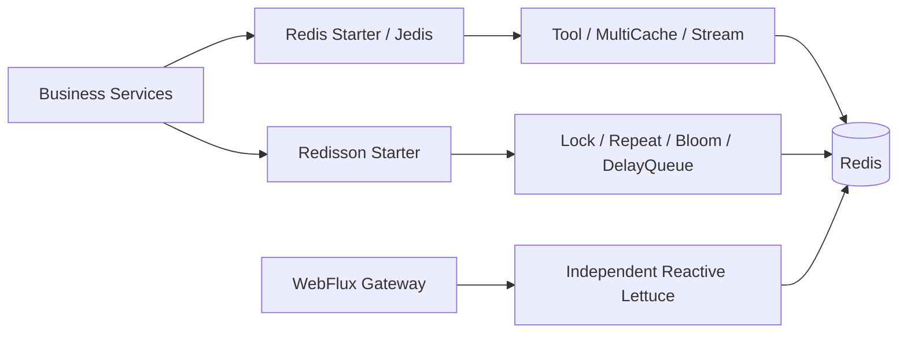

# Peach Cloud Redis / Redisson migration and acceptance

English | [中文](acceptance-and-rollout.md)

> **Status: implementation and specific CI scenarios validated, not full production failover acceptance.** This runbook tracks [Epic #18](https://github.com/Ryan-Guizhou/peach-cloud/issues/18). Source code and passing CI on the selected branch take precedence; operations must approve production rollout, rollback, and data migration.

## 1. Starter selection and ownership

| Need | `com.peach` artifactId | Client | Key limitation |
| --- | --- | --- | --- |
| Redis connection only | `peach-redis-starter` | Spring Data Redis / Jedis | Factory/templates; user-defined beans take priority |
| Redis KV / Hash / Set / SCAN | `peach-redis-tool-starter` | Jedis | SCAN is not a consistent snapshot or hot-path mass lookup |
| L1 + L2 caching | `peach-redis-multicache-starter` | Caffeine + Jedis | Best-effort Pub/Sub invalidation, possibly stale after disconnect |
| Redis Stream | `peach-redis-stream-starter` | Jedis | XACK on success; Pending recovery/DLQ opt-in disabled by default |
| Redisson connection only | `peach-redisson-starter` | Redisson | Does not create a Jedis factory |
| Distributed lock | `peach-redission-distributedlock-starter` | Redisson | Not a substitute for transactions, unique constraints or external fencing |
| Repeat guard | `peach-redission-repeat-starter` | Redisson | Failed marker persistence yields uncertain outcome, not safe blind retry |
| Segmented Bloom | `peach-redission-bloomfilter-starter` | Redisson | False positives; validate against authoritative data |
| Delay queue | `peach-redission-delayqueue-starter` | Redisson | Current single Lua runtime; `peach.delay.queue.enabled=true` by default when the Starter is present; drain historical protocol before rollout |

The historical mixed `peach-redis-common` artifact stays in the reactor/BOM for external legacy deployments and rollback, but internal direct Maven consumers were removed in [PR #54](https://github.com/Ryan-Guizhou/peach-cloud/pull/54). Do not add it to new services. Historical `redission` is preserved only for existing paths/artifactIds. Gateway uses separate reactive Lettuce; do not block WebFlux EventLoops with Jedis.



## 2. CI-backed capabilities

| Area | Tests actually performed | Not established by those tests |
| --- | --- | --- |
| Independent clients / authentication | Real Redis 7.2 Jedis-only, Redisson-only, Redis Tool, Sa-Token login → authorization → logout ([#42](https://github.com/Ryan-Guizhou/peach-cloud/pull/42), [#44](https://github.com/Ryan-Guizhou/peach-cloud/pull/44)) | Mixed-version persisted old sessions |
| Business dependency migration | Six launch modules and final three direct legacy dependencies removed; governance guard ([#46](https://github.com/Ryan-Guizhou/peach-cloud/pull/46), [#54](https://github.com/Ryan-Guizhou/peach-cloud/pull/54)) | Safe retirement of the old artifact |
| Sentinel / Cluster / TLS | Redis 7.2 KV/TTL and cross-slot Cluster SCAN ([#48](https://github.com/Ryan-Guizhou/peach-cloud/pull/48)); real Sentinel primary outage with **same** Jedis/Redisson clients ([#70](https://github.com/Ryan-Guizhou/peach-cloud/pull/70)); actual Cluster primary outage, replica promotion and fresh-client recovery ([#74](https://github.com/Ryan-Guizhou/peach-cloud/pull/74)) | Long-lived Cluster client recovery, in-flight business transactions, production CA/certificate rotation |
| ACL + Nacos | Separate Sentinel auth for Jedis/Redisson, nonzero Cluster DB rejection, synchronized templates ([#50](https://github.com/Ryan-Guizhou/peach-cloud/pull/50)) | Live ACL credential rotation |
| Stream | XACK/PEL/XPENDING/XCLAIM/DLQ; **4 real Redis recovery cases** and manually invoked counters/replay ([#88](https://github.com/Ryan-Guizhou/peach-cloud/pull/88)), replayable original fields after source trim ([#90](https://github.com/Ryan-Guizhou/peach-cloud/pull/90)), bounded read-only DLQ/XACK reconciliation ([#94](https://github.com/Ryan-Guizhou/peach-cloud/pull/94)) | Cross-key XADD and XACK not atomic; business idempotency, real failover and production reconciliation still required |
| Multi-instance cache / Bloom | Two independent Jedis clients invalidate L1/refill L2; two RedissonClients see Bloom scaling ([#56](https://github.com/Ryan-Guizhou/peach-cloud/pull/56)) | Missed Pub/Sub events during disconnect |
| DelayQueue reliable queue | Single Lua runtime with lease/fencing/DLQ, 64-message two-worker run, **8 actual Redis tests** including forcibly killed JVM and recovery ([#78](https://github.com/Ryan-Guizhou/peach-cloud/pull/78)); legacy backlog preflight for direct APIs ([#92](https://github.com/Ryan-Guizhou/peach-cloud/pull/92)) | Redis infrastructure failover, real historical queue drain/rollback, external business fencing and sustained load soak |
| Sa-Token administrative search | Bounded SCAN, pagination, all Cluster masters, 50,000-match cap ([#58](https://github.com/Ryan-Guizhou/peach-cloud/pull/58)); real Standalone/Sentinel/Cluster/TLS tests passed | Mixed-version persisted SaSession compatibility from a genuinely old released binary and rollout not verified |
| Legacy/new Redis JSON | Identical value/hash-value bytes, bidirectional read/write and TTL for Map data using **both serializers in this repository** ([#66](https://github.com/Ryan-Guizhou/peach-cloud/pull/66), merged) | Not an actual old released SaSession fixture nor a mixed-binary production rollout |

## 3. Nacos and persisted-data compatibility

Sources: `deploy/nacos/config/peach-redis.yml` and `deploy-pipline/init/nacos/config/peach-redis.yml`. Verify those against the effective Nacos settings per target environment. Example values contain no production credentials:

```yaml
peach:
  redis:
    mode: standalone          # standalone / sentinel / cluster
    host: "${REDIS_HOST:127.0.0.1:6379}"
    username: ""
    password: "${REDIS_PASSWORD:}"
    sentinelMaster: master
    sentinel-username: ""
    sentinel-password: ""
    ssl-enabled: false        # Jedis TLS
    database: 0               # Cluster requires database zero
    jedis:
      max-total: 128
    redisson:
      enabled: true
      ssl-enable: false       # independent Redisson TLS flag
```

Before migration, record Redis topology/DB, bean names and resource ownership, key naming and tenancy isolation, Jackson2JsonRedisSerializer values/hash values, SaToken SaSession JSON and TTL, Redisson JsonJacksonCodec, legacy Bloom counters and queue keys. Old and new instances must share the same persisted protocol. Never silently change codecs or key prefixes. User-provided `RedisConnectionFactory` or `RedissonClient` wins; do not close clients you do not own.

## 4. Phased rollout and rollback

1. **Preflight:** Independently validate Jedis, Redisson and dual-client usage outside production. Export target Nacos profiles, sample scrubbed Redis keys/TTL, Stream PEL and delay queue scheduled/processing/DLQ. Have operations back up Redis; never run production `KEYS *` or mass deletion.
2. **Bidirectional session compatibility:** Write scrubbed real-format sessions with an actual old release and verify the new release can read/extend/logout. Verify the old release can read sessions written by the new release with equivalent TTL and types. **This full rolling acceptance is not yet evidenced and must not be skipped.**
3. **Canary:** Deploy one stateless instance, verify auth/CAPTCHA, Gateway reactive Lettuce, scheduler locks, cache and Stream behavior before scaling. Observe Redis pool utilization and error rates.
4. **Streams and queues:** Enable Stream Pending recovery only with durable business idempotency. reliable queue does not import legacy `RDelayedQueue`/`RBlockingQueue`; stop old producers and drain or explicitly migrate legacy jobs under approval before switching; never execute one business job through both protocols concurrently.
5. **Rollback:** Stop canary promotion, restore the old binary and the matching Nacos snapshot, retain legacy Common, and never clear Redis. Disable opt-in Stream recovery and set `peach.delay.queue.enabled=false` to stop the current queue's new production/consumption, reconcile durable business state with completed/processing/DLQ before any manual replay.

Authentication failures must fail closed. Ordinary caches may fall back to authoritative storage, but Pub/Sub is neither reliable delivery nor strong consistency. Positive Bloom checks need source-of-truth verification.

## 5. CI and reproducible tests

Use JDK 21, Maven and Node.js. The topology commands require **isolated Linux Docker host networking**, provision Redis 7.2 test containers, and must never connect to production:

```bash
node scripts/verify-changes.mjs
bash scripts/ci/redis-topology-integration.sh sentinel
bash scripts/ci/redis-topology-integration.sh cluster
bash scripts/ci/redis-topology-integration.sh tls
```

`.github/workflows/redis-client-integration.yml` covers standalone clients/Sa-Token/Stream/multi-instance tests with Redis 7.2; `.github/workflows/delayqueue-integration.yml` tests reliable queue Lua. Surefire XML gates ensure executed tests have zero failures/errors/skips. Generic `mvn -B -ntp verify` validates only what executes; `@Testcontainers(disabledWithoutDocker=true)` or opt-in test environment switches can cause integration tests to skip, which is **not** acceptance evidence.

- **MultiCache subscription recovery (#67):** confirmed re-subscription clears this JVM's L1, forcing Redis L2 refresh. Stale reads remain possible while offline. The real integration test is tracked in [PR #68](https://github.com/Ryan-Guizhou/peach-cloud/pull/68); this does not establish strong consistency.

- **Long-lived Sentinel recovery ([#70](https://github.com/Ryan-Guizhou/peach-cloud/pull/70), passed):** actual test master shutdown with the same Jedis/Redisson clients and post-promotion SET/GET/TTL; not business transaction or message crash-window safety.

- **Actual remaining L2 TTL (Issue #71):** regression verifies that the in-JVM L1 cannot outlive Redis PTTL, even after a late refill. See [Issue #71](https://github.com/Ryan-Guizhou/peach-cloud/issues/71) for PR/CI evidence. This does not guarantee strong consistency for external Redis writes.

- **Redis Cluster master recovery ([#74](https://github.com/Ryan-Guizhou/peach-cloud/pull/74), passed):** actual isolated primary outage, replica promotion/full-slot recovery and fresh-client test; long-lived Cluster client/in-flight message safety remains unverified.

- **Real Redis ACL ([#76](https://github.com/Ryan-Guizhou/peach-cloud/pull/76), passed):** isolated named-user authentication after disabling the default user, including rejection of invalid/anonymous connections; production credential rotation remains unverified.

- **Real JVM crash recovery for DelayQueue reliable queue ([#77](https://github.com/Ryan-Guizhou/peach-cloud/issues/77)):** force-kill the claimant subprocess, then verify lease recovery and fencing with a second client in Redis 7.2 CI. This does not cover Redis infrastructure failover or cross-store transactions.

## 6. Epic blockers—not yet complete

- Isolated Sentinel and Cluster outage tests have passed; **production** master failover, long-lived Cluster reconnection, TLS/ACL credential and certificate rotation remain unverified.
- Actual legacy Redis key/codec/Sa-Token Session two-way rolling upgrade and rollback, legacy Bloom/queue migration. The current reliable queue preflight blocks startup if old delayed/ready/processing/dead-letter records remain.
- MultiCache clears L1 after confirmed re-subscription and Stream supports explicit replay plus read-only DLQ/XACK reconciliation; still **not guaranteed**: stale reads during Pub/Sub disconnect, durable idempotent business processing, and crash-window behavior during infrastructure failure.
- DelayQueue **Redis infrastructure** failover, external database fencing, real historical queue draining and sustained high-load soak remain unverified; an independent JVM force-kill recovery test has already passed. Durable application idempotency remains essential.

**Acceptance rule:** Record exact release, topology, traceable CI run URL, data scale, canary and rollback evidence for each production rollout. Keep Stream recovery disabled by default; do not switch the queue runtime until legacy messages are drained and deployment gates are approved. Keep Epic #18 open.

### Current queue cutover guard

The runtime now checks the previous Redisson delayed, ready, processing and dead-letter structures before starting a subscribed consumer; a producer also checks every partition once before its first send. A non-empty historical queue raises an explicit exception rather than silently dropping jobs. These read-only checks are not a distributed write fence: **stop all old producers, reconcile old dead letters, drain old queues, then stop old consumers before starting the replacement**. Do not deploy old and new consumers concurrently. Keep the persisted Lua-state namespace unchanged for existing reliable messages. CI success alone does not authorize production cutover.

### Stream DLQ payload retention for manual replay (Issue #89)

Current DLQ records retain the existing `sourceStream`, `sourceGroup`, `sourceId`, `attempts` and display-only `payload` fields. Newly written DLQ records additionally store each original Stream field as `originalField:<base64url-encoded field name>` with marker `originalFieldsStored=true`. This additive format preserves original String values and allows explicit `RedisStreamPendingRecovery.replayDeadLetter(dlqRecordId)` even after the original Stream entry has been trimmed. Historical DLQ entries without these extra fields still require the original source entry; a missing entry fails without fabricated payload. Verify any external consumers that assume exactly five fields. A retry after a crash between DLQ XADD and source XACK can still create duplicate dead letters; maintain durable business idempotency and reconcile source IDs before manual replay. No production data is migrated automatically.

### Legacy delay queue preflight for direct callers (Issue #91)

The queue Starter exposes **one current runtime**. It defaults to enabled when installed; prior to an actual migration set `peach.delay.queue.enabled=false` in environments with historic pending work. After freezing all old producers, query each physical partition using `RedisDelayQueue.legacyBacklog(partitionTopic)` and require `drained()==true` (delayed/ready/processing/dead letters all zero, with DLQ disposition explicitly reconciled). Direct `offer`, `claim` and `start` now fail closed on the first use of a physical topic, and `start` checks again before subscribing; business `DelayQueueContext` still checks all configured partitions. Preflight is read-only and cached per instance for throughput, **not** a distributed fencing barrier against old producers restarting. Do not deploy old and current producers concurrently. Continue to retain persisted `peach:dq2:{topic}:*` Lua data for existing in-flight reliable messages.

### Read-only Stream DLQ-to-XACK reconciliation (Issue #93)

For a known DLQ RecordId, `RedisStreamPendingRecovery.deadLetterTransferState(id)` reads one DLQ entry, the exact source ID's Consumer Group PEL entry (at most one), and the exact original Stream entry. Its result reports **DLQ persisted with source still Pending** versus **source no longer present in the PEL**; PEL absence alone does not prove an XACK occurred, with a separate flag for source availability after trim. The method makes **no Redis write** and must not be used as automatic ACK or proof of business completion. Freeze all instances consuming/recovering this group before operator reconciliation; consult durable application idempotency and the DLQ audit record. DLQ XADD + source XACK remain cross-key non-atomic. Inflight races invalidate the snapshot. This is an operational aid, not production disaster-recovery certification.
