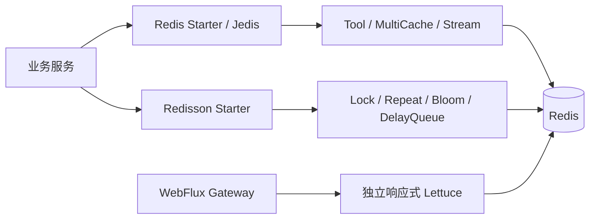

# Peach Cloud Redis / Redisson 迁移与验收手册

[English](acceptance-and-rollout.en-US.md) | 中文

> **状态：功能与指定 CI 场景已验证，不代表完整生产故障容灾验收。** 本手册对应 [Epic #18](https://github.com/Ryan-Guizhou/peach-cloud/issues/18)。以目标分支源码和通过的 CI 为准；灰度、回滚和生产数据迁移必须经运维确认。

## 1. 接入选型和边界

| 业务场景 | `com.peach` 依赖 artifactId | 底层 | 核心限制 |
| --- | --- | --- | --- |
| 只连接 Redis | `peach-redis-starter` | Spring Data Redis / Jedis | 创建连接工厂/模板，用户自定义 Bean 优先 |
| Redis KV / Hash / Set / SCAN | `peach-redis-tool-starter` | Jedis | SCAN 无一致性快照，不适合在线全量扫键 |
| L1 + L2 缓存 | `peach-redis-multicache-starter` | Caffeine + Jedis | Pub/Sub 尽力失效；断线时短暂陈旧 |
| Redis Stream | `peach-redis-stream-starter` | Jedis | XACK 只在成功后；Pending 自动恢复/DLQ 默认关闭 |
| 只连接 Redisson | `peach-redisson-starter` | Redisson | 不创建 Jedis 工厂 |
| 分布式锁 | `peach-redission-distributedlock-starter` | Redisson | 锁不替代事务、唯一约束、外部 fencing |
| 防重复提交 | `peach-redission-repeat-starter` | Redisson | 成功标记失败抛不确定结果；禁止直接重试 |
| 分段 Bloom | `peach-redission-bloomfilter-starter` | Redisson | 假阳性，必须回查业务真值 |
| 延迟队列 | `peach-redission-delayqueue-starter` | Redisson | 新 V2 默认关闭，与旧消息协议不混用 |

`peach-redis-common` 旧混合装配保留于 reactor 与 BOM，供外部旧版与回滚使用，但内部 Maven 直接依赖已清零（[PR #54](https://github.com/Ryan-Guizhou/peach-cloud/pull/54)）；**不作为新增服务依赖**。历史 `redission` 拼写仅兼容既有 artifactId/目录。WebFlux 网关使用独立响应式 Lettuce，不能在事件循环中引入同步 Jedis。



## 2. 已实施的回归证据

| 验收域 | CI 已运行的内容 | 仍不能据此保证 |
| --- | --- | --- |
| 独立客户端、认证 | Redis-only/Redisson-only/Tool + Sa-Token Redis 7.2 登录→鉴权→退出（[#42](https://github.com/Ryan-Guizhou/peach-cloud/pull/42)、[#44](https://github.com/Ryan-Guizhou/peach-cloud/pull/44)） | 旧版真实登录会话混合版本滚动兼容 |
| 业务解耦 | 6 个业务启动模块+剩余 3 个 POM 迁移；旧依赖回归门禁（[#46](https://github.com/Ryan-Guizhou/peach-cloud/pull/46)、[#54](https://github.com/Ryan-Guizhou/peach-cloud/pull/54)） | 不能安全删除旧 Common 工件 |
| Sentinel/Cluster/TLS | Redis 7.2 三拓扑独立客户端 KV/TTL、Cluster 跨槽 SCAN/删除（[#48](https://github.com/Ryan-Guizhou/peach-cloud/pull/48)） | 主从故障切换、证书轮换与生产 CA |
| ACL + Nacos | Jedis/Redisson Sentinel 独立认证、Cluster DB=0、两份模板（[#50](https://github.com/Ryan-Guizhou/peach-cloud/pull/50)） | 线上 ACL 用户/密码轮换 |
| Stream | 业务成功 XACK、失败 PEL、可选 XPENDING/XCLAIM/退避/DLQ；真实 3 测试（[#52](https://github.com/Ryan-Guizhou/peach-cloud/pull/52)） | DLQ 写入和源 XACK 非原子，故障时可能重复 |
| 多实例缓存与 Bloom | 双 Jedis Client L1 失效/L2 回填，双 RedissonClient 扩段/计数（[#56](https://github.com/Ryan-Guizhou/peach-cloud/pull/56)） | 缓存订阅断线不能强一致 |
| DelayQueue V2 | 原子 Lua、租约/fencing/DLQ，双 Worker 租约失效恢复、64 条并发、6 真实测试（[#40](https://github.com/Ryan-Guizhou/peach-cloud/pull/40)、[#60](https://github.com/Ryan-Guizhou/peach-cloud/pull/60)） | 真实进程强杀、Redis 故障切换、10k soak |
| Sa-Token 管理检索 | 有界 SCAN、分页/排序、Cluster 全部主节点与默认 50,000 结果限制（[PR #58](https://github.com/Ryan-Guizhou/peach-cloud/pull/58)） | 已合并且单机/Sentinel/Cluster/TLS 真实 Redis 7.2 CI 通过；旧会话滚动升级尚未验收 |
| 旧/新 Redis JSON | 当前仓库旧 `RedisConfig` / 新 `PeachRedisAutoConfiguration` Map 的 value/hash-value 字节相等、双向读写、TTL | [PR #66](https://github.com/Ryan-Guizhou/peach-cloud/pull/66) 验证中；不是历史发行版的真实 SaSession fixture |

## 3. 配置与兼容性核对

配置事实源：`deploy/nacos/config/peach-redis.yml` 与 `deploy-pipline/init/nacos/config/peach-redis.yml`，运行时通过 Nacos 向对应环境发布。示例为非生产占位：

```yaml
peach:
  redis:
    mode: standalone          # standalone / sentinel / cluster
    host: "${REDIS_HOST:127.0.0.1:6379}"
    username: ""
    password: "${REDIS_PASSWORD:}"
    sentinelMaster: master
    sentinel-username: ""
    sentinel-password: ""
    ssl-enabled: false        # Jedis TLS
    database: 0               # Cluster 必须 0
    jedis:
      max-total: 128
    redisson:
      enabled: true
      ssl-enable: false       # Redisson TLS 独立开关
```

切换前固定并比对：Redis 节点与 DB、Bean 名和所有权、key 命名和租户隔离、Jackson2JsonRedisSerializer 的 value/hash-value、Sa-Token SaSession JSON 与 TTL、Redisson JsonJacksonCodec、旧 Bloom 计数和队列内部 key。新旧实例使用同一组业务 key 的序列化约定，不能单方面改 codec 或 key 前缀。用户自定义 `RedisConnectionFactory` / `RedissonClient` 优先，不重复关闭非自身创建的客户端。

## 4. 分阶段灰度与回滚

1. **准备**：隔离环境验证独立 Redis Starter、Redisson Starter 和两者共存；记录当前 Nacos 导出的快照、脱敏 Redis 数据样本/TTL、Stream PEL、延迟队列 scheduled/processing/DLQ。管理员先备份，不能在生产执行 `KEYS *` 或破坏性清理。
2. **Session 双向兼容**：用真实旧发行版本写入脱敏 Token/Session，新版本完成读取、续期、退出；反方向验证旧版本可读取新版本数据。记录 key/TTL/对象类型。**没有此验收证据，不得宣布存量登录零感知升级。**
3. **灰度业务**：单台无状态服务先上线，验证认证/验证码、限流网关 Lettuce、调度锁、缓存、Stream 消费者后再扩大实例数；同时观察连接池和 Redis 端日志。
4. **Stream / 延迟队列**：Stream 恢复启用前完成业务侧幂等，保留 PEL/DLQ 与消息 ID。V2 不自动导入旧 `RDelayedQueue` / `RBlockingQueue`；先停旧生产、待旧任务排空或经审核迁移，再启用 V2，绝不让两个协议处理同一业务消息。
5. **回滚**：停止灰度放量，恢复旧二进制与 Nacos 配置快照；暂留 `peach-redis-common` 工件；禁止清空 Redis。出错时先关闭可选 Stream 恢复、V2 新生产/消费，对账业务幂等记录、完成/待处理/DLQ 后再决定消息重放，不得盲目反向重放。

认证故障必须 fail-closed；缓存可以按业务回源，但 Pub/Sub 不能当作可靠消息或强一致机制。Bloom 的“可能存在”要回源，不用于余额/鉴权/唯一性最终判定。

## 5. CI 与本地验收入口

需要 JDK 21、Maven 和可执行 Node.js；下面三条拓扑脚本只支持**隔离 Linux Docker host network** 测试环境，自己启动 Redis 7.2，避免连接生产实例：

```bash
node scripts/verify-changes.mjs
bash scripts/ci/redis-topology-integration.sh sentinel
bash scripts/ci/redis-topology-integration.sh cluster
bash scripts/ci/redis-topology-integration.sh tls
```

`.github/workflows/redis-client-integration.yml` 用 Redis 7.2 服务容器执行客户端、Sa-Token、Stream、双实例测试；`.github/workflows/delayqueue-v2-integration.yml` 执行 V2 Lua 集成。测试报告通过 Surefire XML 验证**测试数非零、失败/跳过为零**。普通 `mvn -B -ntp verify` 只能说明对应构建/普通单测；若运行时 opt-in 变量未打开、Testcontainers 无 Docker，则实际集成测试可能跳过，不计入生产验收。

- **多级缓存订阅恢复（#67）：** 重订阅确认后清空当前 JVM 的 L1，再从 Redis L2 读取；订阅离线期间仍可能读取旧缓存。真实测试在 [PR #68](https://github.com/Ryan-Guizhou/peach-cloud/pull/68) 验收，不能当作强一致性承诺。

- **Sentinel 原位恢复（[#69](https://github.com/Ryan-Guizhou/peach-cloud/issues/69)）：** CI 真正关闭测试主节点，在不重建 Jedis/Redisson 实例的情况下尝试读写恢复；仅验收基础客户端重连，不代表业务事务和消息故障窗口安全。以 PR CI 运行结果为准。

- **缓存剩余 TTL（Issue #71）：** 已增加按真实 Redis PTTL 限制本地 L1 有效期的回归，避免 Redis 键过期后本地缓存继续命中；CI 以 [Issue #71](https://github.com/Ryan-Guizhou/peach-cloud/issues/71) 的 PR 实际结果为准。此机制并非外部 L2 写入强一致。

- **真实 Redis ACL（Issue #75）：** 增加禁用 default 用户、临时专用账户的正反例集成矩阵，验证 Jedis、Redisson、Tool、Sa-Token 真实登录与错误认证拒绝；还不涉及生产密钥轮换。是否通过以实际 CI 结果为准。

## 6. Epic 未完成项（不得提前勾选）

- 真实 Redis 主从/Cluster 故障切换与客户端重连，TLS/ACL 密钥更新及证书轮换。
- 真实旧 Redis 数据/Sa-Token Session 双向滚动升级与回滚，以及旧 Bloom / 延迟队列历史数据迁移。
- 缓存 Pub/Sub 订阅断线的失效补偿；Stream PEL 运维安全重放、DLQ 与 XACK 非原子窗口故障注入。
- DelayQueue V2 真实进程 `kill -9`、外部数据库 fencing、Redis 故障切换和持续大负载 soak；业务层幂等不可省略。

**验收准则**：每个生产发布必须保存具体版本、拓扑、CI Run 链接、测试数据规模、灰度和回滚演练证据。高风险场景未验证时，保持 Stream 恢复和 V2 默认关闭，总任务 #18 继续开放。
