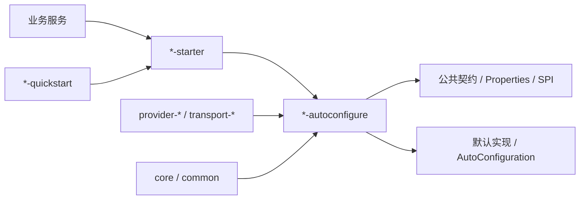
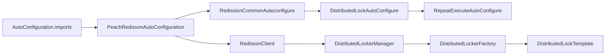

# Peach Cloud Starter 结构规范

本文面向维护 `peach-component` 与 `peach-middleware` 的开发者，说明 Starter 家族为什么统一为 `autoconfigure + starter + quickstart`，以及额外模块何时应该保留。

## 1. 目标

Starter 家族需要同时解决三个不同问题：框架如何装配、业务如何依赖、开发者如何快速验证。把三者混在一个模块会造成依赖污染、示例代码进入生产 classpath、README 与实现边界模糊。



## 2. 三层职责

| 模块 | 负责 | 不负责 |
| --- | --- | --- |
| `*-autoconfigure` | 配置绑定、条件装配、公共契约、默认 Bean、SPI/Provider 装配、metadata | demo、业务启动类、生产部署配置 |
| `*-starter` | 最小依赖聚合和对外接入入口 | 复杂业务逻辑、复制默认实现、示例代码 |
| `*-quickstart` | 可运行的最小集成样例、必要配置、典型覆盖方式 | 被生产模块依赖、真实 secret、完整生产部署 |

## 3. 额外模块

`core`、`common`、`provider-*`、`transport-*` 只有满足至少一个条件时保留：

- 被两个及以上实现共享且有稳定公共契约。
- 需要隔离可选第三方 SDK，避免无关应用承担依赖。
- 具有独立资源生命周期或可替换 Provider/Transport 职责。
- 可以被单独测试、版本治理或在未来提供替代实现。

仅为了目录对称、文件数量或“以后可能用到”不得新增空聚合模块。

## 4. Quickstart 原则

Quickstart 是可执行文档，不是第二套业务系统。

- 只依赖目标 Starter 和完成启动所需的最小 Spring Boot 依赖。
- 使用独立 `@SpringBootApplication` 入口。
- 真实 Redis、Mongo、SMTP、MQ 等外部依赖由本地环境变量/配置提供，不提交凭据。
- 示例必须与当前公共 API 对齐；高级场景进入家族 README 或 `docs/`。
- 非业务 Starter 禁止使用 `example` / `*-example` 命名。

## 5. 文档职责

Starter 家族根目录的 `README.md` 是中文主入口，`README.en-US.md` 是英文等价入口。README 说明定位、模块关系、最小依赖、关键边界和 Quickstart；复杂设计、完整 Reference、迁移和排障按实际复杂度进入 `docs/`。

不要求 `autoconfigure` 和 `starter` 各复制一份 README。只有子模块存在独立使用方式或独立维护者心智模型时才增加子模块文档。

## 6. 自动装配与依赖边界

auth、fileservice、gateway、generator、message、monitor、setting 的启动入口统一使用：

```java
@SpringBootApplication(scanBasePackages = "com.peach")
```

保留现有业务包覆盖范围，不额外声明 `@ComponentScan`。显式声明会覆盖 Boot 组合注解中的扫描设置，丢失 `AutoConfigurationExcludeFilter` 和 `TypeExcludeFilter`，使 classpath 内的自动配置提前按普通配置处理。`@AutoConfigureAfter` 不能修复通过普通扫描加载的顺序。

锁 Starter 的隔离回归测试已复现：旧扫描方式下，最终存在 `RedissonClient`，但早先的 `@ConditionalOnBean` 判断未通过，导致 `DistributedLockTemplate` 缺失；恢复 Boot 扫描过滤器后，以下装配链完整注册。



网关的 `GatewaySaTokenAutoConfiguration` 仍由网关 core 的 imports 文件注册；原来仅针对这个类的扫描排除，由 Boot 默认自动配置排除过滤器统一承担，不等于禁用该配置。

依赖由使用能力的模块持有：

- auth-service 声明多级缓存、分布式锁、验证码等实际使用的 Starter；auth-launch 经 auth-rest/service 获取这些能力，删除重复声明。
- Redis Tool、MultiCache、Stream Starter 获取独立 Jedis 底座；锁、Repeat、Bloom、DelayQueue Starter 获取独立 Redisson 底座。两类客户端可以在业务中同时使用，但底座不互相引入。
- MultiCache 与 Repeat 的 autoconfigure 依赖所需的 autoconfigure 契约，不通过其他能力的 Starter 引入整套运行依赖。MultiCache 直接声明其消息编解码所用的 Jackson；锁 Starter 直接声明切面使用的 Commons Lang。
- `optional` 依赖可用于 autoconfigure 编译，但不会自动传递给业务应用；对应 Starter 必须提供完整运行依赖。用户自定义 Bean 按现有类型条件覆盖默认实现；Bloom 不要求自定义客户端使用固定 Bean 名。

遇到缺少 Bean 时，按以下顺序定位：

1. 检查最终运行类路径是否包含能力 Starter、客户端及自动配置工件；`dependencyManagement` 只管理版本，不引入依赖。
2. 检查 imports 文件及启动入口的扫描边界，避免通过普通扫描提前加载自动配置。
3. 检查配置开关、自定义 Bean、排除项和条件评估报告，再核对底层 Redis 连接配置。

关闭 `peach.redis.redisson.enabled` 只关闭默认客户端创建。如果仍使用必需的锁能力，需要提供自定义 `RedissonClient`；不会自动改用本地锁。此次治理不更改配置键、公共 API 或 Redis 数据格式，无需数据迁移。

实现和测试证据：

- [分布式锁 Starter 回归测试](../peach-middleware/peach-redission/peach-redission-distributedlock-starter/src/test/java/com/peach/bootregression/DistributedLockStarterTest.java)：扫描顺序、独立类路径、用户覆盖、开关与客户端关闭。
- [Bloom Starter 回归测试](../peach-middleware/peach-redission/peach-redission-bloomfilter-starter/src/test/java/com/peach/bootregression/BloomFilterStarterTest.java)：自定义客户端名、用户服务覆盖和禁用场景。
- [装配与依赖静态检查](../scripts/check-spring-wiring.mjs)：应用入口扫描、Redis/Redisson 必要依赖路径、客户端隔离及 imports 注册。检查覆盖仓库直接声明的生产依赖、optional、scope 和 exclusions；不替代 Maven 对第三方 POM、profiles 或最终运行环境的解析。

## 7. 结构门禁

仓库级门禁会验证：

- 每个 `*-starter` 都存在同前缀 `*-autoconfigure` 与 `*-quickstart`。
- Quickstart POM 依赖对应 Starter。
- Starter 家族存在中英文主 README。
- `peach-component` / `peach-middleware` 不出现新的 `example` 模块。
- 应用启动类不额外声明 `@ComponentScan`；Redis/Redisson Starter 满足必要依赖与自动配置注册约束。

具体执行入口只由根 `AGENTS.md` 维护，避免 Rules、Skills 和文档重复绑定脚本名称。
