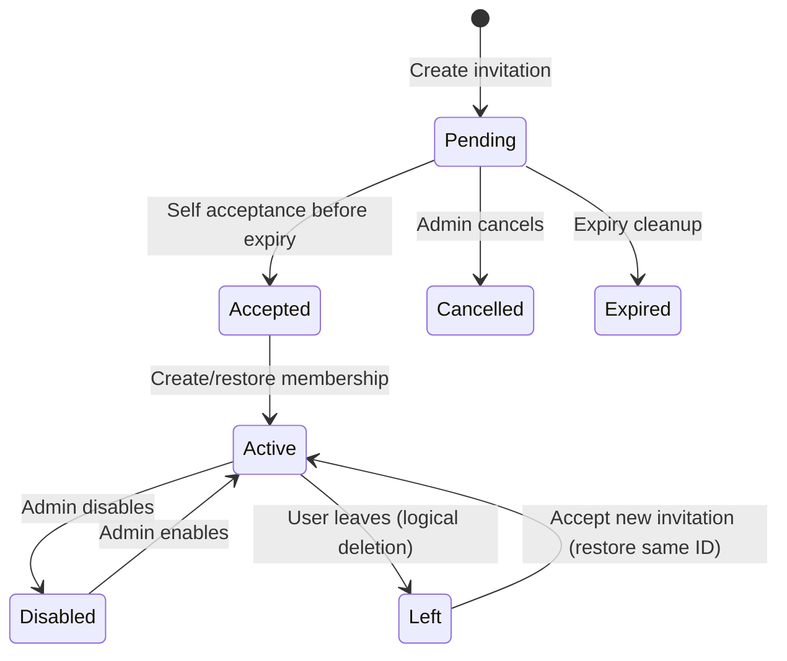

# peach-auth

English | [中文](README.md)

## Purpose

`peach-auth` is the authentication and authorization domain. It manages users, roles, menus, resources, login state, route permissions, and user operation logs. It provides REST APIs, domain services, entity models, external OpenFeign clients, and a launch module.

## Submodules

| Submodule | Responsibility |
| --- | --- |
| `peach-auth-service` | Domain services for users, roles, menus, resources, permissions, and login |
| `peach-auth-rest` | REST APIs for login, users, roles, resources, menus, and routes |
| `peach-auth-launch` | Runtime application module |
| `peach-auth-common` | Shared auth-domain objects and utilities |
| `peach-auth-entity` | DO/DTO/QO/VO models |
| `peach-auth-external/peach-auth-openfeign-external` | OpenFeign clients for other services |
| `peach-auth-external/peach-auth-log-external` | `@UserOperLog` operation-log capability |

## Main Capabilities

- User, role, menu, and resource management.
- Login APIs and route permission lookup.
- Separation between internal REST APIs and external OpenFeign APIs.
- Operation-log annotation and log service.
- MyBatis DAO based persistence.

## Key Entrypoints

- Application: `peach-auth-launch/src/main/java/com/peach/auth/launch/PeachAuthServiceApplication.java`
- REST package: `peach-auth-rest/src/main/java/com/peach/auth/rest`
- Service interfaces: `peach-auth-service/src/main/java/com/peach/auth/service`
- Feign clients: `peach-auth-external/peach-auth-openfeign-external/src/main/java/com/peach/auth/openfeign`

## Verification

```bash
mvn -f "peach-auth/pom.xml" -DskipTests package
```

## Boundaries

- Gateway authentication filters are handled by `peach-gateway` and `peach-satoken`.
- Permission cache and session persistence depend on external Redis/Sa-Token configuration.
- Production environments must define password, token, audit, and rate-limit policies explicitly.


## Project conventions

- Backend documentation follows the current peach-cloud baseline: Java 21, Spring Boot 3.5.4, Spring Cloud 2025.0.0, and Spring Cloud Alibaba 2025.0.0.0.
- Frontend documentation applies only to peach-cloud-front, which is a separate Vue 3 + Vite + TypeScript project and is not part of the Maven reactor.
- Source, scripts, SQL, and Markdown files must stay UTF-8 without BOM. Do not document generated output such as 	arget/, .flattened-pom.xml, dependency caches, or IDE files as source layout.
- Commands and examples must be verifiable against the current repository. Do not include real secrets, tokens, private keys, production passwords, signed URLs, or complete sensitive payloads.

## SaaS identity and soft-delete foundation (release development in progress)

Within [#202](https://github.com/Ryan-Guizhou/peach-cloud/issues/202) on `release_20261117_v1.0.0`, 16 core authentication-domain tables use a single physical primary key named `ID`, generated by `UniqueIdFacade.nextId()` by default. Domain identifiers such as `USER_ID`, `ORG_ID`, and `ROLE_ID` remain permanent business IDs protected by unique constraints. `AuthBusinessIdGenerator` delegates new business ID allocation to the `peach-code` `PLATFORM` namespace. Initialize `sql/PEACH_CODE_RULE.sql` and `sql/INIT.sql` before allocation and never reset a committed sequence watermark.

Authentication mappers perform logical deletion by updating `IS_DELETE=1` and recording `DELETED_AT`. Reusable business codes use an active-only `ACTIVE_SLOT` unique constraint; permanent business IDs remain reserved after deletion. Ordinary updates, deletes, and lookups use the physical `ID`; frontend CRUD pages use `id` for row keys and display business IDs separately.

**Not yet implemented end-to-end:** `PEACH_TENANT_MEMBER`, cross-tenant login, `XXX_REF_ID` relationship migration, removal of legacy `FISCAL`, scoped RBAC and row/field rules, complete Gateway/Feign authorization, and migration testing are tracked by [#204–#211](https://github.com/Ryan-Guizhou/peach-cloud/issues/204). This section documents the current release increment, not a production-ready SaaS authorization guarantee.


## SaaS tenant membership, invitations and hierarchy (#205 integration baseline)

This increment adds `PEACH_TENANT_MEMBER`, `PEACH_TENANT_INVITATION`, their MyBatis mappers, and `TenantMemberLifecycleService`. Permanent `MEMBER_ID/INVITATION_ID` values use platform-level allocation; relationships use physical `*_REF_ID` references. A tenant-user membership has a **permanent unique pair**: accepting a later invitation after leaving restores the original member row rather than allocating a second permanent member ID. The invitation active-slot constraint permits at most one `PENDING` invitation per tenant and user; expired pending invitations are marked `EXPIRED` before issuing a new invitation.



Security boundary: `TenantMembershipPolicy` validates the current server-side Sa-Token user for self-acceptance and departure. Trusted tenant administration RBAC is not available yet: `requireTenantAdministrator` **fails closed** for invitation creation/cancellation and member disable/enable. Do not expose these service methods as unguarded REST endpoints. The member-list lookup is only for server-side use after credential verification and does not require an organization assignment. These service/DAO foundations have been committed to the development branch, but login and tenant switching, token revocation, role-scoped authorization, organization tree, frontend, and actual database acceptance remain outstanding in #204 and #206–#211. This increment is not production-ready.

### Organization hierarchy and integration boundary

`OrganizationHierarchyService.move` takes physical tenant, member, organization and parent IDs. It first invokes the trusted `TenantMembershipPolicy`, then locks the enabled `PEACH_TENANT` row, translates its existing business tenant ID, verifies every ancestor belongs to that tenant, detects cycles and excessive depth, and updates `PARENT_ORG_REF_ID` using the `VERSION` optimistic lock. The current organization table still uses historical `TENANT_ID` business IDs; full conversion to `TENANT_REF_ID` belongs to #209/#211. Existing schema migrations, delete-dependency checks, complete owner bootstrap, REST API contracts, and authorization revocation remain prerequisites for production. Administrators are deliberately denied until tenant RBAC is implemented in #206, and login integration is tracked by #204/#208.

This is a release integration baseline with intentionally restricted capabilities; it is not a completed production SaaS IAM system.

## Global account password hashing foundation (#204 in progress)

The backend retains RSA protection for transport, decrypts on the server, and verifies salted BCrypt(12) password hashes. Login does not query Base64-equivalent passwords; `PEACH_USER.PASSWORD` now uses `VARCHAR(255)`. User creation and password updates store hashes only, and newly created accounts without a credential default to disabled. `@JsonIgnore` prevents serializing password hashes. Missing accounts and malformed legacy Base64 values perform dummy BCrypt work and are denied rather than silently falling back to reversible credentials.

**Migration and security boundary:** Legacy Base64 passwords cannot be automatically converted into secure BCrypt hashes. Deploy a verified credential-reset process before migration; sample development credentials must not be used in production. Legacy organization/fiscal login and switching remain and are not production-ready SaaS authorization. Member-scoped authentication, organization-optional tenant login, revocation and security acceptance remain outstanding under #204, #206, #208 and #211.


### Member-version scoped Sa-Token session foundation (#204 in progress)

`TenantSessionContext` and `TenantSessionService` bind physical `userRefId/tenantRefId/memberRefId/appRefId` and membership version to the **per-token session (not a globally shared account session)** only after a trusted credential login. The server verifies that the Sa-Token principal maps from permanent business `USER_ID` to the expected physical user, that the tenant and app are enabled, and that the membership is ACTIVE. `requireCurrent` rechecks these constraints and the member version on every invocation, so a disabled/left member cannot reuse an old context. `switchTenant` validates the destination membership for the same authenticated user and requires no organization assignment.

This is a **SaaS session guard foundation** and does not yet replace the legacy FISCAL login controllers or gateway caches. Role/permission versioning (#206), fail-closed gateway verification (#208), Feign/frontend contract migration (#209/#210), and revoking legacy tokens remain prerequisites before production use.
