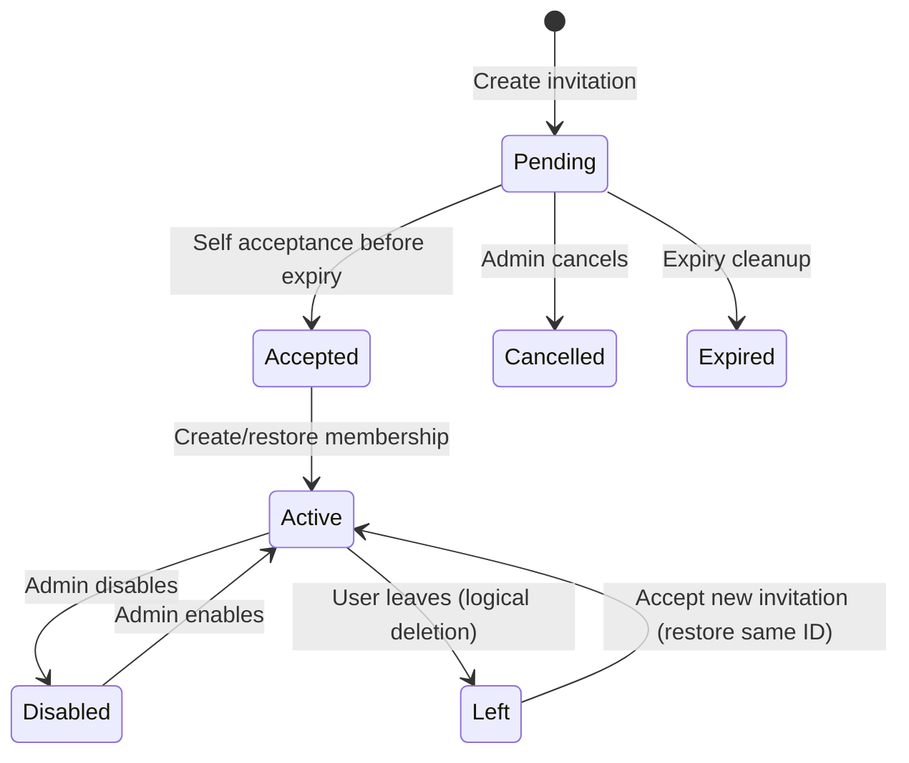
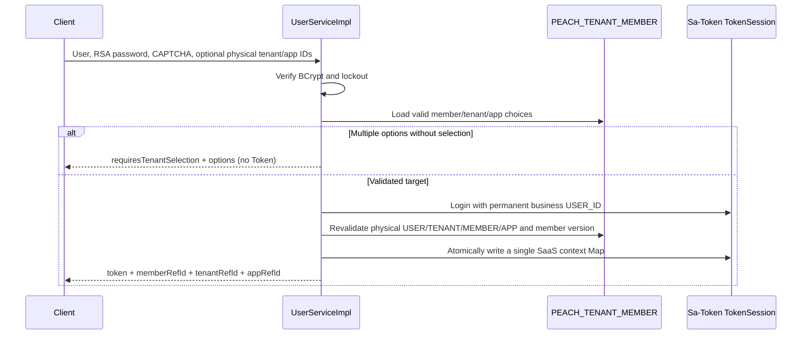
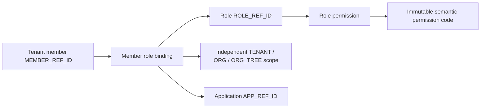
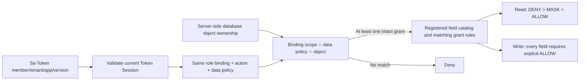
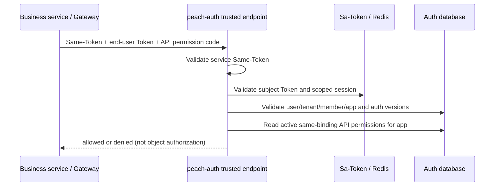
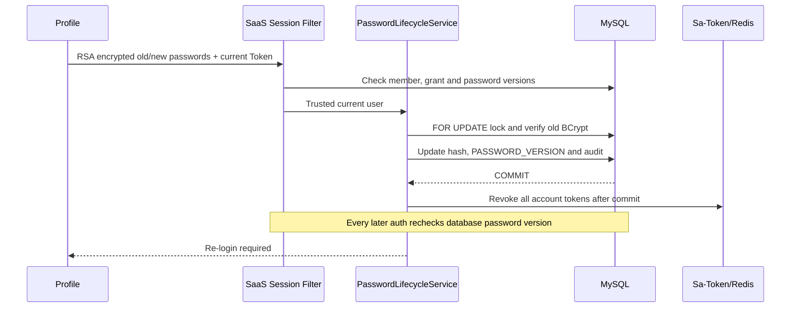

# peach-auth

> **Current status (2026-11-20):** The staged implementation notes below retain historical descriptions such as “not implemented”, “Draft” and “empty permissions” from earlier development steps. They do **not** describe the current release branch. As of November 19, the core tenant/member identity, trusted login permission snapshot, scoped roles and resources, row/field policies, Gateway/Feign enforcement, protected administration UI, tenant provisioning and file physical-scope authorization have been merged into `release_20261117_v1.0.0`. **Still outstanding:** real MySQL data migration, legacy data mapping, Redis/Nacos/Gateway/Feign end-to-end integration, and cross-tenant security acceptance, tracked in [#211](https://github.com/Ryan-Guizhou/peach-cloud/issues/211). A successful CI run is not production acceptance. No annual authorization dimension exists in the current model.


English | [中文](README.md)

## Purpose

`peach-auth` is the authentication and authorization domain. It manages users, roles, menus, resources, login state, route permissions, and user operation logs. It provides REST APIs, domain services, entity models, external OpenFeign clients, and a launch module.

## Submodules

| Submodule | Responsibility |
| --- | --- |
| `peach-auth-service` | Domain services for users, roles, menus, resources, permissions, and login |
| `peach-auth-rest` | REST APIs for login, users, roles, resources, menus, and routes |
| `peach-auth-launch` | Runtime application module |
| `peach-auth-common` | Shared auth-domain objects and utilities |
| `peach-auth-entity` | DO/DTO/QO/VO models |
| `peach-auth-external/peach-auth-openfeign-external` | OpenFeign clients for other services |
| `peach-auth-external/peach-auth-log-external` | `@UserOperLog` operation-log capability |

## Main Capabilities

- User, role, menu, and resource management.
- Login APIs and route permission lookup.
- Separation between internal REST APIs and external OpenFeign APIs.
- Operation-log annotation and log service.
- MyBatis DAO based persistence.

## Key Entrypoints

- Application: `peach-auth-launch/src/main/java/com/peach/auth/launch/PeachAuthServiceApplication.java`
- REST package: `peach-auth-rest/src/main/java/com/peach/auth/rest`
- Service interfaces: `peach-auth-service/src/main/java/com/peach/auth/service`
- Feign clients: `peach-auth-external/peach-auth-openfeign-external/src/main/java/com/peach/auth/openfeign`

## Verification

```bash
mvn -f "peach-auth/pom.xml" -DskipTests package
```

## Boundaries

- Gateway authentication filters are handled by `peach-gateway` and `peach-satoken`.
- Permission cache and session persistence depend on external Redis/Sa-Token configuration.
- Production environments must define password, token, audit, and rate-limit policies explicitly.


## Project conventions

- Backend documentation follows the current peach-cloud baseline: Java 21, Spring Boot 3.5.4, Spring Cloud 2025.0.0, and Spring Cloud Alibaba 2025.0.0.0.
- Frontend documentation applies only to peach-cloud-front, which is a separate Vue 3 + Vite + TypeScript project and is not part of the Maven reactor.
- Source, scripts, SQL, and Markdown files must stay UTF-8 without BOM. Do not document generated output such as 	arget/, .flattened-pom.xml, dependency caches, or IDE files as source layout.
- Commands and examples must be verifiable against the current repository. Do not include real secrets, tokens, private keys, production passwords, signed URLs, or complete sensitive payloads.

## SaaS identity and soft-delete foundation (release development in progress)

Within [#202](https://github.com/Ryan-Guizhou/peach-cloud/issues/202) on `release_20261117_v1.0.0`, 16 core authentication-domain tables use a single physical primary key named `ID`, generated by `UniqueIdFacade.nextId()` by default. Domain identifiers such as `USER_ID`, `ORG_ID`, and `ROLE_ID` remain permanent business IDs protected by unique constraints. `AuthBusinessIdGenerator` delegates new business ID allocation to the `peach-code` `PLATFORM` namespace. Initialize `sql/PEACH_CODE_RULE.sql` and `sql/INIT.sql` before allocation and never reset a committed sequence watermark.

Authentication mappers perform logical deletion by updating `IS_DELETE=1` and recording `DELETED_AT`. Reusable business codes use an active-only `ACTIVE_SLOT` unique constraint; permanent business IDs remain reserved after deletion. Ordinary updates, deletes, and lookups use the physical `ID`; frontend CRUD pages use `id` for row keys and display business IDs separately.

**Not yet implemented end-to-end:** `PEACH_TENANT_MEMBER`, cross-tenant login, `XXX_REF_ID` relationship migration, removal of legacy `FISCAL`, scoped RBAC and row/field rules, complete Gateway/Feign authorization, and migration testing are tracked by [#204–#211](https://github.com/Ryan-Guizhou/peach-cloud/issues/204). This section documents the current release increment, not a production-ready SaaS authorization guarantee.


## SaaS tenant membership, invitations and hierarchy (#205 integration baseline)

This increment adds `PEACH_TENANT_MEMBER`, `PEACH_TENANT_INVITATION`, their MyBatis mappers, and `TenantMemberLifecycleService`. Permanent `MEMBER_ID/INVITATION_ID` values use platform-level allocation; relationships use physical `*_REF_ID` references. A tenant-user membership has a **permanent unique pair**: accepting a later invitation after leaving restores the original member row rather than allocating a second permanent member ID. The invitation active-slot constraint permits at most one `PENDING` invitation per tenant and user; expired pending invitations are marked `EXPIRED` before issuing a new invitation.



Security boundary: `TenantMembershipPolicy` validates the current server-side Sa-Token user for self-acceptance and departure. Trusted tenant administration RBAC is not available yet: `requireTenantAdministrator` **fails closed** for invitation creation/cancellation and member disable/enable. Do not expose these service methods as unguarded REST endpoints. The member-list lookup is only for server-side use after credential verification and does not require an organization assignment. These service/DAO foundations have been committed to the development branch, but login and tenant switching, token revocation, role-scoped authorization, organization tree, frontend, and actual database acceptance remain outstanding in #204 and #206–#211. This increment is not production-ready.

### Organization hierarchy and integration boundary

`OrganizationHierarchyService.move` takes physical tenant, member, organization and parent IDs. It first invokes the trusted `TenantMembershipPolicy`, then locks the enabled `PEACH_TENANT` row, translates its existing business tenant ID, verifies every ancestor belongs to that tenant, detects cycles and excessive depth, and updates `PARENT_ORG_REF_ID` using the `VERSION` optimistic lock. The current organization table still uses historical `TENANT_ID` business IDs; full conversion to `TENANT_REF_ID` belongs to #209/#211. Existing schema migrations, delete-dependency checks, complete owner bootstrap, REST API contracts, and authorization revocation remain prerequisites for production. Administrators are deliberately denied until tenant RBAC is implemented in #206, and login integration is tracked by #204/#208.

This is a release integration baseline with intentionally restricted capabilities; it is not a completed production SaaS IAM system.

## Global account password hashing foundation (#204 in progress)

The backend retains RSA protection for transport, decrypts on the server, and verifies salted BCrypt(12) password hashes. Login does not query Base64-equivalent passwords; `PEACH_USER.PASSWORD` now uses `VARCHAR(255)`. User creation and password updates store hashes only, and newly created accounts without a credential default to disabled. `@JsonIgnore` prevents serializing password hashes. Missing accounts and malformed legacy Base64 values perform dummy BCrypt work and are denied rather than silently falling back to reversible credentials.

**Migration and security boundary:** Legacy Base64 passwords cannot be automatically converted into secure BCrypt hashes. Deploy a verified credential-reset process before migration; sample development credentials must not be used in production. Legacy organization/fiscal login and switching remain and are not production-ready SaaS authorization. Member-scoped authentication, organization-optional tenant login, revocation and security acceptance remain outstanding under #204, #206, #208 and #211.


### Member-version scoped Sa-Token session foundation (#204 in progress)

`TenantSessionContext` and `TenantSessionService` bind physical `userRefId/tenantRefId/memberRefId/appRefId` and membership version to the **per-token session (not a globally shared account session)** only after a trusted credential login. The server verifies that the Sa-Token principal maps from permanent business `USER_ID` to the expected physical user, that the tenant and app are enabled, and that the membership is ACTIVE. `requireCurrent` rechecks these constraints and the member version on every invocation, so a disabled/left member cannot reuse an old context. `switchTenant` validates the destination membership for the same authenticated user and requires no organization assignment.

This is a **SaaS session guard foundation** and does not yet replace the legacy FISCAL login controllers or gateway caches. Role/permission versioning (#206), fail-closed gateway verification (#208), Feign/frontend contract migration (#209/#210), and revoking legacy tokens remain prerequisites before production use.

## #204 Global account and tenant-member login (development branch; basic path, not accepted yet)

Login no longer derives tenant membership from `USER_ORG` or `FISCAL`. The server checks RSA-protected credentials, BCrypt, CAPTCHA and account lockout first, then loads enabled tenants, `ACTIVE` members and enabled apps via `TenantMemberDao.selectLoginTargets`. No available options means denial. A unique option may be auto-selected. Multiple options return `requiresTenantSelection=true` and `tenantOptions` **without any Token**; the client must resubmit valid credentials with `tenantRefId` and `appRefId`. The server reauthenticates and validates the requested pair, avoiding unscoped temporary sessions.



`switchContext` accepts only destination **physical tenant and application IDs**, checks the current authenticated user context, and validates destination membership and app availability; the client cannot supply a different user identity. `logout` revokes only the current Token rather than every device session for the account. Users without any organization can still log into a tenant; `orgRefId` is not required. The development seed now initializes a tenant member for the default demo account.

**Authorization boundary:** The new member login does **not reuse** legacy `ROLE_CODE+ORG_ID+FISCAL` permissions. Until the scoped RBAC (#206), gateway enforcement (#208), cross-service contracts (#209), and frontend (#210) are complete, it returns **empty menu, button and API authorization results**. The legacy gateway is not yet migrated; passing Maven/Redis CI is not proof of end-to-end authorization.

**Outstanding acceptance:** Multi-device behavior, real MySQL/Redis tenant selection and logout, legacy credential reset, protected password changes, role `authVersion` revocation, and old-token cleanup. Registration/reset stubs must not falsely report success.

### Tenant and application authorization isolation

Authorization has no calendar-year dimension. Both legacy `FISCAL` and mistakenly introduced `AUTH_YEAR` are removed from schemas, login contracts, role bindings, trusted sessions, cache keys and management UI. Effective permissions are scoped by verified tenant, member, application, grant scope and membership/authorization versions. Historical year-bearing tokens are rejected and require a new login; no legacy authorization fallback is permitted. Real database and cross-service acceptance remain outstanding.

## Independent SaaS RBAC grant source (#206 development branch; not merged)

This increment introduces `PEACH_PERMISSION_DEFINITION`, `PEACH_ROLE_PERMISSION`, `PEACH_MEMBER_ROLE_BINDING` and `PEACH_IAM_AUTH_AUDIT`. The existing `PEACH_ROLE` schema gains physical tenant/app references and version fields. Tenant members gain an `AUTH_VERSION` for revoking stale session grants. The new decision path joins **active membership, enabled tenant/app, active roles, active role permissions, and each individual binding**. Legacy `PEACH_AUTH_PARTY` and `PEACH_AUTH_FUNCTION` are not considered sources of new authorizations.



`ScopedPermissionService.hasTenantPermission` returns true only when **one valid role binding** provides both the requested action and TENANT scope. It never combines an action from one binding with the data scope of another. `listGrantedBindings` returns independent grant evidence for later object-level enforcement, not a completed row/field authorization decision.

**Current implementation is an initial SQL/read-only decision foundation, not completed RBAC.** Transactional grant writes/revocations, `AUTH_VERSION` invalidation, administrator authorization, gateway integration, and real database acceptance are still required in this PR. Platform SYSTEM permissions need strict server-side protection; tenant-owned definitions cannot impersonate protected platform codes. Historical `FISCAL/ORG_ID` columns must be retired during cross-module migration #209 and SQL cleanup #211; they must not grant access in the new model.


### #206 Transactional role binding and security limits (current development branch)

`ScopedRoleBindingService.grant/revoke` provides server-side transactions for separate member role bindings. The implementation verifies the Sa-Token principal's physical member, tenant and application, then checks the `TENANT.ROLE.MANAGE` permission, serializes administration writes with a tenant-row lock, then locks the target member to read its prior `AUTH_VERSION`. The binding write, version increment, and append-only `PEACH_IAM_AUTH_AUDIT` record are committed atomically. Version conflicts, audit errors, or unauthorized requests roll back. Revoked bindings are logically deleted and retained for history.

A tenant administrator may only delegate permissions that are simultaneously delegable and already held by the administrator at full TENANT scope in the selected app. Cross-tenant roles, disabled users, foreign organization scopes, and unheld permissions are rejected. Self-assignment/revocation is currently prohibited to avoid escalation and lockout. Organization hierarchy changes require their own `TENANT.ORG.MANAGE` grant. Tenant-owned permission definitions may not impersonate reserved `TENANT.*` or `SYSTEM.*` codes.

Development `sql/INIT.sql` bootstraps three protected semantic permission codes and a single TENANT-scope administrator role for the current application. This is a development seed, **not** verified production administrator onboarding.

**Outstanding acceptance:** Real MySQL/Redis role revocation integration, protected administrator bootstrap, and legacy schema/gateway migration. Gateway/Feign and frontend security enforcement remain separately tracked in #208/#209/#210, with final acceptance in #211.


### #206 Guarded role-management APIs (current development branch)

`SaasRoleController` requires a valid Token bound to a physical member, app, and authorization version. The server always derives `tenantRefId/memberRefId/appRefId` from the Token rather than trusting client identity fields. Domain services recheck `TENANT.ROLE.MANAGE`:

| API | Purpose | Body |
| --- | --- | --- |
| `POST /auth/saas/roles` | Create a tenant role for the current application | `{"roleCode":"ROLE_EDITOR","roleName":"Editor"}` |
| `PUT /auth/saas/roles/{roleRefId}/permissions` | Diff-sync all active role permissions | `{"permissionRefIds":["<physical-permission-id>"]}` |
| `POST /auth/saas/roles/bindings` | Grant a single member role and scope | `{"targetMemberRefId":"<physical-member-id>","roleRefId":"<physical-role-id>","scopeType":"TENANT"}` |
| `DELETE /auth/saas/roles/bindings/{bindingRefId}` | Soft-revoke an individual binding | No body |

New roles receive a permanent global `ROLE_ID` and are bound to a physical tenant and application. Only tenant-created TENANT roles may be edited; SYSTEM roles and non-delegable permissions are protected. Edits use tenant/role locks, version CAS, tenant-wide member `AUTH_VERSION` increments, and audit records in one transaction. Legacy `/auth/role`, `/auth/authParty`, `/auth/authFunction`, and `/auth/authResource` interfaces now reject access rather than bypassing the new authorization source.

**Remaining production acceptance:** Real MySQL 8.4 concurrency/audit/DDL/seed verification, protected platform administrator bootstrap, permission resource and row/field enforcement (#207), gateway (#208), cross-service/front-end (#209/#210), and schema migration/rollback (#211). This increment is not an end-to-end secured SaaS product.


### Member lifecycle and organization-tree authorization invalidation

When a member leaves, is disabled/re-enabled, or rejoins by accepting a new invitation while retaining the original member ID, `TenantMemberLifecycleService` atomically soft-revokes **all** previously active `PEACH_MEMBER_ROLE_BINDING` entries, increments the member's `AUTH_VERSION`, and appends authorization audit evidence. Rejoining never resurrects prior role privileges: a tenant administrator must explicitly grant new bindings. Any failure rolls back the member status change and invalidation together.

After a successful organization-tree move, `OrganizationHierarchyService` increments authorization versions for all tenant members in the same transaction. This prevents stale `ORG_TREE` scope caches from staying valid. #208 must still enforce membership status and version on every protected gateway request; the current implementation guards its own domain services but does not secure every cross-service entry point.


## #207 Row and field authorization (development branch, not accepted)

The incremental backend introduces `PEACH_ROLE_DATA_POLICY`, `PEACH_FIELD_DEFINITION`, `PEACH_ROLE_FIELD_POLICY` and `ScopedDataAuthorizationService`. It currently supports decisions for **one authenticated database object** and field projection, not SQL-safe list pagination or integration across all services. **It is not approved for production business-data exposure.**



| Capability | Current implementation | Safety limitation |
| --- | --- | --- |
| Row scopes | Independently intersect `SELF/ORG/ORG_TREE/TENANT_ALL` data policies with `TENANT/ORG/ORG_TREE` role binding scopes, then union intact grants | Object tenant, app and owner must come from real database rows, never client-supplied claims |
| Organization trees | `DatabaseOrganizationScopeMatcher` traverses active ancestors within the verified tenant with cycle/depth rejection | Per-object only; lists and pagination need database predicates and indexes |
| Field reads | `ALLOW/MASK/DENY`, exclude unregistered fields, FULL/PHONE/EMAIL masks | Explicit DENY overrides ALLOW; do not mix field rules from distinct grants |
| Field writes | `requireWritableFields` rejects the entire update when any submitted field lacks explicit write permission | Business code must lock the real row and perform checks in the same transaction before UPDATE |
| File and other objects | `requireObjectAction` validates actions without field projection | Cross-service Feign, storage objects, background tasks remain under #209 |

**Security contract:** Callers provide server-defined actions and trusted row ownership. Never apply post-page filtering as a substitute for SQL-level security; it leaks counts and breaks pagination. Each grant must independently contain the action, role, binding scope, and data scope. A second grant cannot contribute missing pieces. Policy administration, field catalog bootstrapping, complete downstream integration, and real multi-tenant MySQL acceptance remain outstanding in #207.

### SQL-level list prefiltering (#207, downstream integration pending)

`ScopedDataQueryScopeService.requireScope(permissionCode)` now returns a trusted `AuthorizedDataQueryScope` using the revalidated Token's physical tenant and application. Each independent grant is computed as **the same role binding scope intersected with that action's data-policy scope**. The organization tree is expanded with bounded MySQL recursion over active nodes; a cycle, more than 512 organizations, or no valid grant fails closed. A `RowClause` combines its organization set and optional SELF owner constraint with AND; multiple clauses are then joined with OR. The active field-definition uniqueness slot is released after soft deletion, while historical `FIELD_ID` values stay globally unique.

Business MyBatis mappers **must** bind `tenantRefId`, `appRefId`, `IS_DELETE=0`, and all `clauses` inside SQL `WHERE` for `COUNT/SELECT/EXPORT/UPDATE/DELETE`. Within one clause, organization `IN (#{...})` and owner `= #{...}` use AND, while different clauses use OR; an unrestricted organization applies only to its own clause. Never interpolate `\$\{\}` SQL fragments, mix owner and organization restrictions from different bindings, or filter only after pagination. **Downstream business modules are not yet wired to this contract**. #209/#211 must complete integration and acceptance before list/export endpoints are considered secure.

### Policy administration API and permission-revocation safety (#207, integration pending)

`PUT /auth/saas/roles/{roleRefId}/permissions/{permissionRefId}/data-policies` replaces all row policies for one action with `{"policies":[{"dataScope":"SELF","orgRefId":null}]}`. Valid scopes are `SELF/ORG/ORG_TREE/TENANT_ALL`; an organization anchor must be an active physical ID in the current tenant. An empty list revokes all policies, whereas null is rejected. Maximum 32 policies.

`PUT /auth/saas/roles/{roleRefId}/permissions/{permissionRefId}/field-policies` replaces all field rules for one action with `{"resourceCode":"DOC","policies":[{"fieldRefId":"<physical ID>","readEffect":"MASK","writeEffect":"DENY"}]}`. Maximum 128 rules. Each field must belong to an active, delegable server-side resource field directory; SYSTEM fields are non-delegable by default and require an explicitly trusted migration with `DELEGABLE=1`. Only the server-side directory determines masking strategies.

Neither endpoint accepts a browser-supplied operator, tenant or application. The current Token must hold tenant-wide administration, the target action must be delegable and held by the operator; SYSTEM actions additionally require an effective `TENANT + TENANT_ALL` row grant for the operator. Without trusted bootstrap evidence access is denied. The transaction locks tenant and role, compares the policy set, retires old rows, creates new rows, increments role and tenant member `AUTH_VERSION` and appends an audit record; all steps roll back together on failure. **Revoking an action from a role also retires its data and field policies, preventing stale privilege resurrection when that action is later reassigned.**

This completes the protected policy-configuration path, not the downstream access-control rollout. Field directory bootstrapping/creation, real MySQL concurrency validation and business SQL `COUNT/SELECT/EXPORT/UPDATE` integration are still required before declaring every business endpoint safe.

## #209 Trusted cross-service IAM contract (in progress)

`SaasIamFeignClient` in `peach-auth-openfeign-external` has a separate `contextId` from the legacy router/role client. Internal calls require **two independent credentials**: a Sa-Token Same-Token service credential added by the existing Feign interceptor and the actual end-user token obtained from the authenticated request, passed only in the `X-Peach-Subject-Token` private header. The Auth endpoints `POST /auth/external/iam/check-api` and `POST /auth/external/iam/context` explicitly enforce Same-Token again even if the global interceptor is misconfigured. Browser-supplied tenant/member values can never replace revalidation.

The permission query uses `{"permissionCode":"GET:/api/documents"}`. Auth revalidates the token-specific SaaS context and current user, tenant, member, application and authorization versions from its database, then queries only active binding-level permissions of `RESOURCE_TYPE=API`. **Only exact METHOD:PATH codes are currently supported**; dynamic URI templates and automatic route normalization remain pending and missing definitions fail closed. `SaasIamPermissionDecisionVO.allowed=true` means the **API action** is permitted, never that a document, file, business row or field can be accessed. Downstream services must independently enforce physical-object row and field constraints in SQL. Feign failures/timeouts/circuit breakers yield `allowed=false`; a failed context query throws rather than fabricating a tenant identity.



Prerequisites: the consumer depends on `peach-auth-openfeign-external`, has a real authenticated user token and enables Feign and Same-Token; Auth, Redis and MySQL must be available. The endpoints are internal only; deployment must enforce private networking/TLS and keep them off public gateway routes. #208 must still connect `GatewayIamDecisionVerifier` to the contract, while #207/#211 must complete physical-object SQL authorization and end-to-end verification.


#### Sa-Token filter adapter

The Auth service `application.yml` explicitly registers only the four internal IAM POST endpoints under `peach.satoken.user-context.service-token-only-endpoints` (empty by default). These endpoints do not load legacy `USER_PROFILE` data using `userId/tenantId/orgId/fiscal`. Instead, the Servlet filter **requires Same-Token** before reaching the controller, where Same-Token is checked again and the end-user token is revalidated against the database. This is not a public allowlist: missing or invalid trusted service credentials are rejected. Other application routes continue their existing user-context flow until migrated and must not use this narrowly scoped mechanism as a general authentication bypass.


#### Minimal trusted directory batch lookups (#209)

Two internal APIs, `POST /auth/external/iam/directory/members` and `POST /auth/external/iam/directory/organizations`, accept only `{"ids":["<physical ID>"]}` (at most 100 non-duplicate IDs). Each enforces both Same-Token service authentication and a valid end-user token, plus full-tenant `TENANT.MEMBER.MANAGE` or `TENANT.ORG.MANAGE` permission respectively. MyBatis queries are scoped to the verified physical `tenantRefId`, active tenant/user/member or tenant/organization records, and return no disabled, deleted or cross-tenant records. The response exposes only `id/memberId/userRefId` for members and `id/orgId/parentOrgRefId` for organizations, without names, contacts or password hashes. Feign fallback throws on directory failures, never turning service unavailability into a seemingly valid empty directory. These results do not replace #207 row-level authorization.

### API route catalog resolution (#209 incremental)

Auth now loads the **complete active API permission catalog visible to the verified tenant and application** for the request method (up to 513 rows; more than 512 fails closed), selects one uniquely most-specific `METHOD:/path` route, and only then checks the member's effective role grant. It never filters to the member's grants before choosing the route, which would let a broad template mask an ungranted exact resource. Supports exact paths and full-segment placeholders such as `GET:/api/users/{id}`; exact matches take precedence. Equal-specificity overlapping templates are denied, as are `*`, `**`, embedded regular expressions, encoded paths, duplicate slashes, traversal, and cross-method matches. Catalog queries scope physical tenant/application, owner, active status, and soft deletion. This only grants coarse API actions, not access to underlying business rows or fields, and does not register the API catalog automatically; unregistered routes stay denied.

#### Development API catalog for SaaS role management

The development seed `sql/INIT.sql` now registers six SaaS role-management public-gateway route actions under `/api/auth/saas/roles` (create, update permission assignment, grant binding, revoke binding, and #207 data/field policy replacement), and grants them to the sample 2026 tenant administrator. Exact routes and `{roleRefId}/{bindingRefId}` placeholders use the server-side trusted catalog matcher. **This is for development database initialization only**, not production provisioning. No internal `/auth/external/iam/**` endpoint receives a public-gateway permission. If the Nacos route uses a different public prefix from `/api/auth`, register the exact effective public paths in the trusted catalog instead of granting `**` wildcards.

#### Ownership constraint for platform APIs

Protected platform namespaces include `/api/auth/`, `/api/setting/`, `/api/file/`, `/api/fileservice/`, `/api/message/`, `/api/monitor/`, `/api/generator/`, `/api/scheduled/`, `/api/gateway/` and their matching internal service prefixes. For these requests, Auth SQL must require an API permission definition owned by `SYSTEM`; a tenant cannot create and grant an identically named custom resource to override a platform security boundary. Tenant-defined custom API permissions remain available in non-reserved route namespaces, scoped to the verified tenant/application; downstream services must still enforce physical-object authorization.

#### Trusted service-only endpoint configuration boundary

`peach.satoken.user-context.service-token-only-endpoints` now accepts **an explicit HTTP method and an exactly equal canonical Servlet URI**. `ANY`, Ant `*`/`**` patterns, URI templates, encoded paths, and traversal segments cannot activate the privileged service-only channel. This setting only bypasses legacy USER_PROFILE cache restoration; it never bypasses Same-Token or Auth's actual end-user token and database member-version validation. Regression tests cover overly broad Nacos route configuration.

#### Verified token handling for protected Auth SaaS role endpoints

The new SaaS login stores the token-specific membership snapshot and no longer creates the old user-level Redis `USER_PROFILE` Hash. Previously the shared filter could reject legitimate role-management requests before they reached their controllers. The Auth-only `SaasAuthSessionFilter` now applies to `/auth/saas/roles`, `/auth/saas/tenants`, `/auth/saas/platform` and the existing `/auth/organization` endpoints, and first enforces the service Same-Token, the real end-user Sa-Token login, and `TenantSessionService.requireCurrent()` database checks for tenant, member, application, and both authorization versions. Only successful verification sets a server-side Servlet request attribute to bypass legacy Profile loading for that request; the attribute is cleared after completion. Other services retain the original path, and domain services still enforce operation-specific role, row, and field permissions. No endpoint is made anonymous and business IDs are never substituted for verified physical identity.

The Auth-only filter also explicitly rejects percent-encoded paths, semicolon matrix parameters, duplicate separators, backslashes, and `.`/`..` segments in SaaS role requests. Servlet path normalization therefore cannot reinterpret a dangerous URI as an already verified role request, including on direct-to-Auth calls that bypass the public gateway.

#### Authenticated tenant switching

`POST /auth/switchContext` now shares Auth's dedicated `SaasAuthSessionFilter`: service Same-Token, actual end-user login, and fresh database member/authorization versions are required before a server-only per-request `VERIFIED_SAAS_AUTH_REQUEST` attribute permits skipping legacy user-level Redis Profile loading. `TenantSessionService.switchTenant()` independently verifies the selected target tenant and application. Gateway #208 exposes an exact **authenticated-only self-service** action, never an anonymous allowlist entry, so each business role need not be assigned switching permission. Logout revokes only the caller's current token.

The login-bootstrap response and login/switch payloads no longer contain `year` or `fiscal`. Tenant and application are selected explicitly and independently verified by Auth.

### #225 Verified member login menus and permission snapshot

`SaasLoginSnapshotService` verifies the current token-specific physical user/tenant/member/application, member version and authorization version after login and tenant switching. `SaasLoginSnapshotDao` retrieves at most 1,024 active grants in a single bounded SQL query, failing closed on an overflow. Only a granted MENU permission with an explicitly registered `PEACH_SAAS_UI_RESOURCE.PERMISSION_REF_ID` pointing to that exact physical permission ID can produce `menuList/routerList`. Neither legacy FISCAL role links nor old Redis profile sets are used. API and BUTTON codes are returned separately for display purposes, while **every actual API, row-level and field-level access still requires server-side authorization**; browser snapshots are never access credentials.

The trusted UI directory requires canonical paths and component identifiers. Multiple different permission owners for one frontend route fail closed. Users without grants receive empty lists and the frontend keeps its protected `/no-access` state. The development `sql/INIT.sql` seeds only three MENU resources (workspace, tenant roles, authorization) for the example administrator; production permissions are not auto-provisioned. Install the corresponding `PEACH_SAAS_UI_RESOURCE.sql` DDL or aggregate schema before seeding, and validate the actual MySQL/Redis/Nacos deployment under #211.

### #227 Tenant role and delegable-permission directory

`SaasRoleCatalogController` exposes protected paginated `GET /auth/saas/roles/catalog/{roles,permissions,members,organizations}` plus current role permission IDs and member binding reads. All paths are covered by Auth's `SaasAuthSessionFilter`: **service Same-Token, real subject login, current membership/authorization versions, and a full tenant-scope `TENANT.ROLE.MANAGE` grant are required** before any directory query. Pages are limited to 50 rows and 1,000 page indices; role permission and member binding lists are capped at 200. Member choices expose only physical ID and permanent member business ID, not passwords, phone, email or identity attributes. Delegable entries must be both `DELEGABLE=1` and held by the administrator through an active full-tenant role binding. Writes still re-check permissions transactionally.

The development `sql/INIT.sql` seeds six explicitly protected GET API permissions for the sample administrator. **None are anonymous.** Live MySQL/Nacos/gateway integration remains part of #211.

### #229 Protected row/field policy readback and delegable field directory

`SaasPolicyCatalogController` and `SaasPolicyCatalogService` expose complete stored data-scope rules (up to 32), field read/write rules (up to 128), and a bounded trusted `PEACH_FIELD_DEFINITION` directory only after validating the real token-specific tenant/member/application identity, full tenant role-management rights, delegable target action, and the administrator's own effective grant. System-owned actions additionally require a single complete `TENANT + TENANT_ALL` row-grant fact. The field `RESOURCE_CODE` must match the delegated action's semantic prefix, preventing unrelated actions from granting sensitive fields. Oversized, duplicate, missing, undelegable or otherwise untrusted policies fail closed rather than being represented as an empty policy set. Three explicit protected GET API actions are registered in development SQL only, without anonymous allowlist entries.

The new `SaasPolicyEditor.vue` loads the full existing policy and trusted field catalog before any complete replacement is enabled. A successful transaction invalidates the operator's current authorization version, so the frontend clears its old session and requires re-login. Actual business SQL enforcement for SELECT/COUNT/EXPORT/UPDATE remains an independent #211 acceptance item; management UI alone does not secure underlying data.

### #219 Trusted platform tenant provisioning and protected membership administration

- **Deployment prerequisite:** A privileged operator must separately initialize the actual `TENANT_CODE=PLATFORM` control tenant, valid platform member/application, and protected `PLATFORM.TENANT.CREATE` grant through an active SYSTEM role. That semantic permission must be non-delegable. A normal tenant, request-supplied ID, or development `INIT.sql` must never become a platform-bootstrap backdoor. Production-only permission definitions are provided by `sql/PEACH_TENANT_ONBOARDING_PERMISSIONS.sql`; this script deliberately grants no initial administrator.
- **Provisioning:** `POST /auth/saas/platform/tenants` requires Same-Token, authenticated end-user membership with current database versions, a locked platform-control tenant and a freshly verified protected SYSTEM grant. One database transaction creates a UUID physical tenant, permanently unique business tenant ID, initial application and root organization, owner membership, protected SYSTEM owner role, valid delegable SYSTEM permission set, owner binding and append-only audit. Missing permissions or an inconsistent write fails closed.
- **Membership:** `/auth/saas/tenants/members` provides invitation creation/cancellation, self-acceptance, enable/disable and departure. An **existing global account with no tenant membership yet** can enter an optional invitation physical ID at the normal login screen; standard password, CAPTCHA and lock controls are reused. An invitation is consumed only when it belongs to that authenticated account. Temporary global-login tokens are never returned, and actual SaaS access still requires a bound tenant/application session.
- **Organizations:** `/auth/saas/tenants/organizations` provides scoped create, rename, dependency-checked deletion and hierarchy movement. Existing `/auth/organization/**` UI paths now delegate to the same verified SaaS organization service, ignoring client-supplied tenant IDs. Mutations lock the tenant, revalidate `TENANT.ORG.MANAGE`, use entity versions and invalidate member authorization versions with audit.
- **Owner and administrator safeguards:** The protected `ROLE_TENANT_OWNER` is not a tenant-delegable role and cannot be disabled, departed or revoked by ordinary managers. A tenant's last effective full-tenant administrator may not leave, be disabled or lose the final administrator binding.
- **Acceptance boundary:** The Auth filter enforces Same-Token, real end-user identity and current membership versions on new and existing organization paths even when Auth is reached directly. Public gateway routes still require protected SYSTEM API permission definitions and must not use a blanket allowlist. Live MySQL, Nacos, Redis, gateway, tenant-isolation and transactional rollback acceptance remains tracked by #211; green CI is not production acceptance. No authorization-year dimension exists.

### #221 Trusted SaaS code-rule management and watermark safety

- **Endpoints:** `/auth/saas/code-rules` offers bounded listings, details, side-effect-free previews, and status/format/watermark mutations with `expectedVersion`. `SaasAuthSessionFilter` checks Same-Token, the end-user token and current database membership/authorization versions. Caller-supplied namespaces, tenants and operator IDs are never accepted.
- **Platform rules:** Only the actual `TENANT_CODE=PLATFORM` control tenant with a non-delegable SYSTEM `PLATFORM.CODE.RULE.MANAGE` grant can administer global USER/TENANT/ORG/ROLE sequences in the `PLATFORM` namespace.
- **Tenant rules:** A full-TENANT SYSTEM-defined `TENANT.CODE.RULE.MANAGE` grant is required. The permanent business `TENANT_ID` namespace comes from the authenticated physical tenant, and operations only touch **existing** `SCOPE_TYPE=TENANT` rules. No arbitrary rule creation or cross-tenant lookups are exposed.
- **Transactions:** Writes lock the physical tenant and re-authorize. `CodeRuleMaintenance` uses rule locks, optimistic versions and `PEACH_CODE_RULE_AUDIT` in the same transaction. Once issued, code formats cannot change and watermarks may only advance within the configured width. Preview **never reserves a code**. `peach-code` now accepts the underscore in permanent business namespaces such as `TENANT_...` while retaining strict prefix validation.
- **Deployment:** Review and apply `sql/PEACH_SAAS_CODE_RULE_PERMISSIONS.sql` for SYSTEM permission definitions only. It never grants an initial PLATFORM administrator. Trusted DBA provisioning must separately bind protected PLATFORM SYSTEM roles, install matching Gateway API resources and invalidate prior auth versions. Developer `sql/INIT.sql` is not a production bootstrap. Live MySQL concurrency, historical Redis watermarks and Nacos/Redis/Gateway end-to-end checks remain with #211.


### #220 Global account password changes, credential versions and multi-device revocation

**Current implementation:** `POST /auth/changePassword` accepts RSA-OAEP encrypted old and new passwords only for the current authenticated SaaS principal. The frontend exposes a Change Password form in Profile. `SaasAuthSessionFilter` enforces Same-Token, current Sa-Token login and database membership/authorization versions. The service locks the trusted `PEACH_USER` row and verifies the old BCrypt hash. Strong passwords must be 12–72 printable ASCII characters with upper/lowercase letters, numbers and symbols. Incorrect credentials are rate-limited using the Redis login lock. Same-password reuse and concurrent version conflicts are rejected.

The new BCrypt hash, global `PEACH_USER.PASSWORD_VERSION + 1` and `USER_PASSWORD_CHANGE` audit record commit in the same transaction. After commit, Sa-Token attempts global account token revocation for all devices. **If Redis revocation fails**, `TenantSessionService.requireCurrent/requireForToken` still checks the physical user ID, permanent business USER_ID and database credential version for every SaaS request. Older tokens and changes racing between password verification and tenant-session binding are rejected. The frontend clears local session data and navigates to login after success. Generic profile edits cannot update passwords.

**Deployment prerequisites:** On an existing schema, apply `sql/PEACH_USER_PASSWORD_VERSION.sql` once before deploying updated Auth instances. Then apply `sql/PEACH_PASSWORD_SECURITY_PERMISSIONS.sql` and use normal version-invalidating role management to grant `POST:/api/auth/changePassword` to eligible active roles. For fresh databases, use the updated `sql/PEACH_USER.sql` / `sql/ALL_TABLE_CREATE.sql` and **do not apply the add-column migration again**. Revoke legacy sessions and avoid mixed old/new Auth instances during rollout. The development-only `sql/INIT.sql` is not a production grant. Verify MySQL, Gateway, Redis, cross-device/tenant behavior and transaction rollback in the live environment (#211).

**Still unavailable:** `/auth/register`, `/auth/forget` and `/auth/reset` remain fail-closed. Do not enable anonymous recovery or reset without independently verified identity, high-entropy one-time tickets and a secure delivery channel. Legacy Base64/plaintext credentials are not accepted; migrate them through a controlled reset process.




### Legacy global user administration boundary (#240)

The `/auth/user/*` API manages global accounts, not tenant-local members. Every request must pass Same-Token service identity checks, an authenticated SaaS user session and live tenant/member/application version validation. Each controller action also requires the real `PLATFORM` control tenant and the protected, non-delegable `PLATFORM.TENANT.CREATE` SYSTEM-role grant. Tenant-level administrators cannot use this legacy API merely because they hold an old user-management route permission. Use the scoped SaaS member/organization APIs for tenant administration. Provisioning and end-to-end validation of the trusted platform operator remain tracked in #211.

### Legacy global catalog PLATFORM boundary (#246)

The compatibility CRUD endpoints at `/auth/menu/*`, `/auth/function/*`, `/auth/resource/*`, and `/auth/router/*` operate on legacy global system catalogs, **not** the new tenant-local SaaS role/resource authorization source. Each direct Auth request requires Same-Token service identity, an authenticated end-user token, and live tenant/member/application and authorization versions. Every list, detail, insert, update and delete additionally requires the real PLATFORM control tenant and a protected non-delegable SYSTEM administrator grant, checked by `PlatformAdministrationAuthorizationService`. Tenant admins and stale or untrusted sessions are denied. The existing PLATFORM administrator grant is reused until separately scoped platform privileges are defined. Real deployment acceptance remains under #211.

### Legacy global audit log protection (#249)

The legacy `/auth/authLog/pageList` and `/auth/operLog/pageList` queries can otherwise expose global activity across tenants. Both require Same-Token, live database-verified tenant/member/application and authorization versions, and an administrator grant from the real PLATFORM control tenant's protected non-delegable SYSTEM role before querying. Ordinary tenant administrators cannot use these global log endpoints. This is not a tenant-scoped audit catalog; real integration and per-tenant logging remain under #211.

### Trusted SaaS identity for personal profiles (#248)

The `/auth/profile` and avatar endpoints no longer rely on the old `USER_PROFILE` Redis Hash. Each request requires Same-Token and end-user Token checks plus live tenant/member/application, credential and authorization version validation. The trusted physical `userRefId` is mapped in the database to the permanent business `USER_ID` for profile and avatar history operations; no client-provided identity is used. Revoked sessions or missing mappings fail closed and profile updates no longer write the obsolete user cache. Real Fileservice and cross-tenant integration remain tracked in #211.

### Legacy operation audit integrity and sensitive-data protection (#254)

The legacy `USER_OPER_LOG` persistence now matches the SQL schema. The historical business `TENANT_ID/ORG_ID` columns are nullable because organization-less SaaS membership is valid. Auth verifies the service and end-user tokens, tenant, member, application and versions before placing **physical** `TENANT_REF_ID/APP_REF_ID/MEMBER_REF_ID` in server-only Servlet request attributes. Logging cannot derive trusted scope from browser headers or payloads.

Audit records contain module/action codes, short static operation labels, request URI without query parameters, duration and success/failure status. Parameter SpEL expansion, raw request DTO serialization, response payloads and potentially sensitive dynamic error messages are no longer persisted. Rejected operations are audited without masking the original business exception. The old `RESPONSE_DATA` column remains for historical compatibility but is not populated for new records. The asynchronous queue is still best-effort and is **not** a guarantee of durable, lossless audit; IAM grant changes use a separate append-only audit table.

Fresh environments use the updated `ALL_TABLE_CREATE.sql`. For existing databases, the DBA must back up and inspect columns/indexes before manually running `sql/USER_OPER_LOG_TRUSTED_CONTEXT_MIGRATION.sql` exactly once. Historical owner/member identities must not be guessed or backfilled without evidence. Historical `RESPONSE_DATA` may require a separate sensitive-data cleanup review. Live acceptance remains tracked under #211.

### Protected fields in legacy global user maintenance (#256)

The compatibility `/auth/user/add` and `/auth/user/update` operations are restricted to trusted PLATFORM administrators and ordinary account metadata. Callers may not supply `isDelete`, `isModify`, `passwdModifyTime`, `errorCount`, `unlockTime`, `lastestLogin`, `invlidate`, or `authMode` through a generic create/update request. The service rejects such changes, and the generic MyBatis update fragments no longer write these fields or the stored password hash. New account lifecycle flags are initialized server-side. Deletion must use the dedicated soft-delete operation that sets `DELETED_AT`; credentials must follow the separate protected password-change lifecycle.

This guard does **not** implement all account `VERSION` concurrency checks or `DELETED_BY` actor auditing, and does not replace real MySQL 8.4 migration and service integration checks. Those remain tracked in [#211](https://github.com/Ryan-Guizhou/peach-cloud/issues/211).
