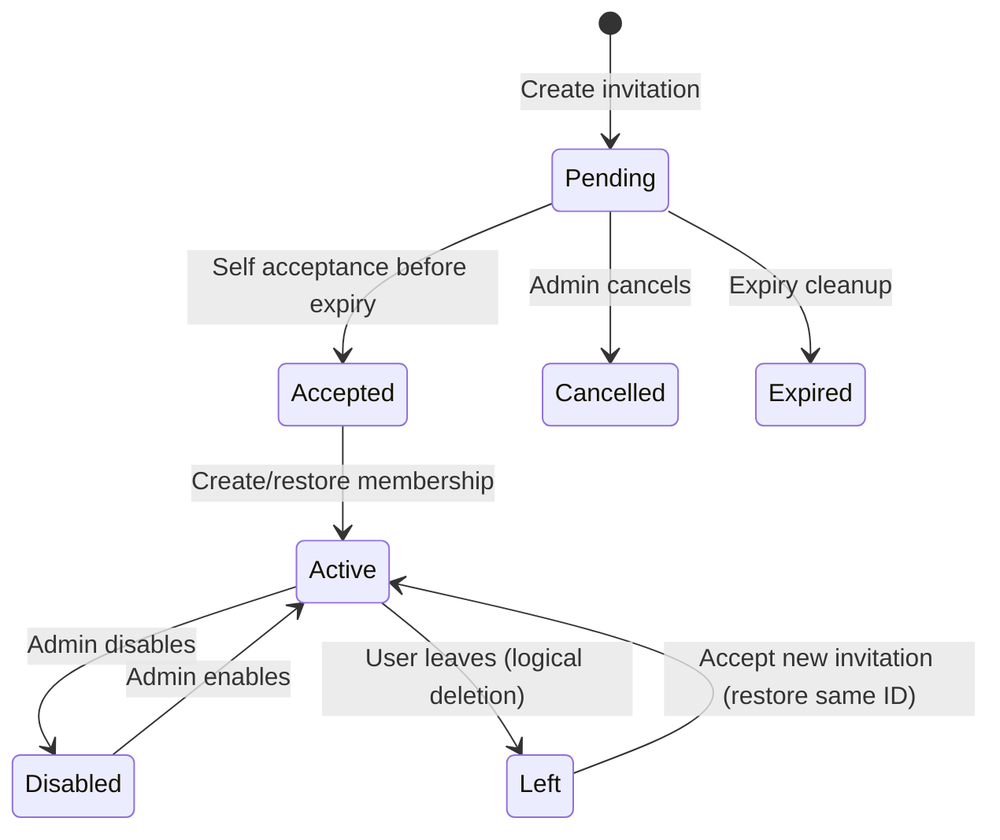
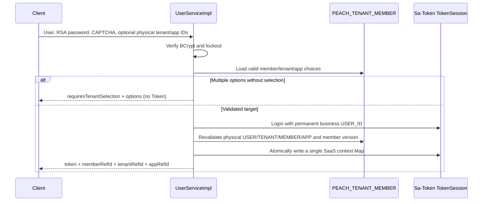
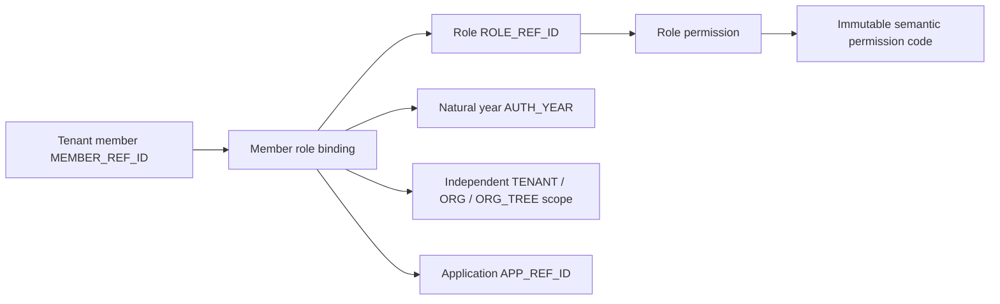
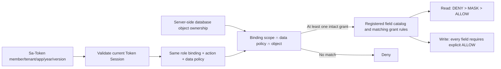

# peach-auth

English | [中文](README.md)

## Purpose

`peach-auth` is the authentication and authorization domain. It manages users, roles, menus, resources, login state, route permissions, and user operation logs. It provides REST APIs, domain services, entity models, external OpenFeign clients, and a launch module.

## Submodules

| Submodule | Responsibility |
| --- | --- |
| `peach-auth-service` | Domain services for users, roles, menus, resources, permissions, and login |
| `peach-auth-rest` | REST APIs for login, users, roles, resources, menus, and routes |
| `peach-auth-launch` | Runtime application module |
| `peach-auth-common` | Shared auth-domain objects and utilities |
| `peach-auth-entity` | DO/DTO/QO/VO models |
| `peach-auth-external/peach-auth-openfeign-external` | OpenFeign clients for other services |
| `peach-auth-external/peach-auth-log-external` | `@UserOperLog` operation-log capability |

## Main Capabilities

- User, role, menu, and resource management.
- Login APIs and route permission lookup.
- Separation between internal REST APIs and external OpenFeign APIs.
- Operation-log annotation and log service.
- MyBatis DAO based persistence.

## Key Entrypoints

- Application: `peach-auth-launch/src/main/java/com/peach/auth/launch/PeachAuthServiceApplication.java`
- REST package: `peach-auth-rest/src/main/java/com/peach/auth/rest`
- Service interfaces: `peach-auth-service/src/main/java/com/peach/auth/service`
- Feign clients: `peach-auth-external/peach-auth-openfeign-external/src/main/java/com/peach/auth/openfeign`

## Verification

```bash
mvn -f "peach-auth/pom.xml" -DskipTests package
```

## Boundaries

- Gateway authentication filters are handled by `peach-gateway` and `peach-satoken`.
- Permission cache and session persistence depend on external Redis/Sa-Token configuration.
- Production environments must define password, token, audit, and rate-limit policies explicitly.


## Project conventions

- Backend documentation follows the current peach-cloud baseline: Java 21, Spring Boot 3.5.4, Spring Cloud 2025.0.0, and Spring Cloud Alibaba 2025.0.0.0.
- Frontend documentation applies only to peach-cloud-front, which is a separate Vue 3 + Vite + TypeScript project and is not part of the Maven reactor.
- Source, scripts, SQL, and Markdown files must stay UTF-8 without BOM. Do not document generated output such as 	arget/, .flattened-pom.xml, dependency caches, or IDE files as source layout.
- Commands and examples must be verifiable against the current repository. Do not include real secrets, tokens, private keys, production passwords, signed URLs, or complete sensitive payloads.

## SaaS identity and soft-delete foundation (release development in progress)

Within [#202](https://github.com/Ryan-Guizhou/peach-cloud/issues/202) on `release_20261117_v1.0.0`, 16 core authentication-domain tables use a single physical primary key named `ID`, generated by `UniqueIdFacade.nextId()` by default. Domain identifiers such as `USER_ID`, `ORG_ID`, and `ROLE_ID` remain permanent business IDs protected by unique constraints. `AuthBusinessIdGenerator` delegates new business ID allocation to the `peach-code` `PLATFORM` namespace. Initialize `sql/PEACH_CODE_RULE.sql` and `sql/INIT.sql` before allocation and never reset a committed sequence watermark.

Authentication mappers perform logical deletion by updating `IS_DELETE=1` and recording `DELETED_AT`. Reusable business codes use an active-only `ACTIVE_SLOT` unique constraint; permanent business IDs remain reserved after deletion. Ordinary updates, deletes, and lookups use the physical `ID`; frontend CRUD pages use `id` for row keys and display business IDs separately.

**Not yet implemented end-to-end:** `PEACH_TENANT_MEMBER`, cross-tenant login, `XXX_REF_ID` relationship migration, removal of legacy `FISCAL`, scoped RBAC and row/field rules, complete Gateway/Feign authorization, and migration testing are tracked by [#204–#211](https://github.com/Ryan-Guizhou/peach-cloud/issues/204). This section documents the current release increment, not a production-ready SaaS authorization guarantee.


## SaaS tenant membership, invitations and hierarchy (#205 integration baseline)

This increment adds `PEACH_TENANT_MEMBER`, `PEACH_TENANT_INVITATION`, their MyBatis mappers, and `TenantMemberLifecycleService`. Permanent `MEMBER_ID/INVITATION_ID` values use platform-level allocation; relationships use physical `*_REF_ID` references. A tenant-user membership has a **permanent unique pair**: accepting a later invitation after leaving restores the original member row rather than allocating a second permanent member ID. The invitation active-slot constraint permits at most one `PENDING` invitation per tenant and user; expired pending invitations are marked `EXPIRED` before issuing a new invitation.



Security boundary: `TenantMembershipPolicy` validates the current server-side Sa-Token user for self-acceptance and departure. Trusted tenant administration RBAC is not available yet: `requireTenantAdministrator` **fails closed** for invitation creation/cancellation and member disable/enable. Do not expose these service methods as unguarded REST endpoints. The member-list lookup is only for server-side use after credential verification and does not require an organization assignment. These service/DAO foundations have been committed to the development branch, but login and tenant switching, token revocation, role-scoped authorization, organization tree, frontend, and actual database acceptance remain outstanding in #204 and #206–#211. This increment is not production-ready.

### Organization hierarchy and integration boundary

`OrganizationHierarchyService.move` takes physical tenant, member, organization and parent IDs. It first invokes the trusted `TenantMembershipPolicy`, then locks the enabled `PEACH_TENANT` row, translates its existing business tenant ID, verifies every ancestor belongs to that tenant, detects cycles and excessive depth, and updates `PARENT_ORG_REF_ID` using the `VERSION` optimistic lock. The current organization table still uses historical `TENANT_ID` business IDs; full conversion to `TENANT_REF_ID` belongs to #209/#211. Existing schema migrations, delete-dependency checks, complete owner bootstrap, REST API contracts, and authorization revocation remain prerequisites for production. Administrators are deliberately denied until tenant RBAC is implemented in #206, and login integration is tracked by #204/#208.

This is a release integration baseline with intentionally restricted capabilities; it is not a completed production SaaS IAM system.

## Global account password hashing foundation (#204 in progress)

The backend retains RSA protection for transport, decrypts on the server, and verifies salted BCrypt(12) password hashes. Login does not query Base64-equivalent passwords; `PEACH_USER.PASSWORD` now uses `VARCHAR(255)`. User creation and password updates store hashes only, and newly created accounts without a credential default to disabled. `@JsonIgnore` prevents serializing password hashes. Missing accounts and malformed legacy Base64 values perform dummy BCrypt work and are denied rather than silently falling back to reversible credentials.

**Migration and security boundary:** Legacy Base64 passwords cannot be automatically converted into secure BCrypt hashes. Deploy a verified credential-reset process before migration; sample development credentials must not be used in production. Legacy organization/fiscal login and switching remain and are not production-ready SaaS authorization. Member-scoped authentication, organization-optional tenant login, revocation and security acceptance remain outstanding under #204, #206, #208 and #211.


### Member-version scoped Sa-Token session foundation (#204 in progress)

`TenantSessionContext` and `TenantSessionService` bind physical `userRefId/tenantRefId/memberRefId/appRefId` and membership version to the **per-token session (not a globally shared account session)** only after a trusted credential login. The server verifies that the Sa-Token principal maps from permanent business `USER_ID` to the expected physical user, that the tenant and app are enabled, and that the membership is ACTIVE. `requireCurrent` rechecks these constraints and the member version on every invocation, so a disabled/left member cannot reuse an old context. `switchTenant` validates the destination membership for the same authenticated user and requires no organization assignment.

This is a **SaaS session guard foundation** and does not yet replace the legacy FISCAL login controllers or gateway caches. Role/permission versioning (#206), fail-closed gateway verification (#208), Feign/frontend contract migration (#209/#210), and revoking legacy tokens remain prerequisites before production use.

## #204 Global account and tenant-member login (development branch; basic path, not accepted yet)

Login no longer derives tenant membership from `USER_ORG` or `FISCAL`. The server checks RSA-protected credentials, BCrypt, CAPTCHA and account lockout first, then loads enabled tenants, `ACTIVE` members and enabled apps via `TenantMemberDao.selectLoginTargets`. No available options means denial. A unique option may be auto-selected. Multiple options return `requiresTenantSelection=true` and `tenantOptions` **without any Token**; the client must resubmit valid credentials with `tenantRefId` and `appRefId`. The server reauthenticates and validates the requested pair, avoiding unscoped temporary sessions.



`switchContext` accepts only destination **physical tenant and application IDs**, checks the current authenticated user context, and validates destination membership and app availability; the client cannot supply a different user identity. `logout` revokes only the current Token rather than every device session for the account. Users without any organization can still log into a tenant; `orgRefId` is not required. The development seed now initializes a tenant member for the default demo account.

**Authorization boundary:** The new member login does **not reuse** legacy `ROLE_CODE+ORG_ID+FISCAL` permissions. Until the scoped RBAC (#206), gateway enforcement (#208), cross-service contracts (#209), and frontend (#210) are complete, it returns **empty menu, button and API authorization results**. The legacy gateway is not yet migrated; passing Maven/Redis CI is not proof of end-to-end authorization.

**Outstanding acceptance:** Multi-device behavior, real MySQL/Redis tenant selection and logout, legacy credential reset, protected password changes, role `authVersion` revocation, and old-token cleanup. Registration/reset stubs must not falsely report success.

### Natural-year authorization isolation

The legacy `FISCAL` field is removed, but the **natural calendar year** remains an explicit SaaS authorization dimension. The new APIs select `year` (for example 2026), and `TenantSessionContext` stores it atomically with tenant, member, app, and membership version. #206 must bind role/resource assignments separately to each year; until that is implemented the effective permissions are empty. Permissions from different years must never be merged. Historic year-grant migration remains subject to #211 database acceptance.

## Independent SaaS RBAC grant source (#206 development branch; not merged)

This increment introduces `PEACH_PERMISSION_DEFINITION`, `PEACH_ROLE_PERMISSION`, `PEACH_MEMBER_ROLE_BINDING` and `PEACH_IAM_AUTH_AUDIT`. The existing `PEACH_ROLE` schema gains physical tenant/app references, natural-year `AUTH_YEAR`, and version fields. Tenant members gain an `AUTH_VERSION` for revoking stale session grants. The new decision path joins **active membership, enabled tenant/app, active roles, active role permissions, and each individual binding**. Legacy `PEACH_AUTH_PARTY` and `PEACH_AUTH_FUNCTION` are not considered sources of new authorizations.



`ScopedPermissionService.hasTenantPermission` returns true only when **one valid role binding** provides both the requested action and TENANT scope. It never combines an action from one binding with the data scope of another. `listGrantedBindings` returns independent grant evidence for later object-level enforcement, not a completed row/field authorization decision.

**Current implementation is an initial SQL/read-only decision foundation, not completed RBAC.** Transactional grant writes/revocations, `AUTH_VERSION` invalidation, administrator authorization, gateway integration, and real database acceptance are still required in this PR. Platform SYSTEM permissions need strict server-side protection; tenant-owned definitions cannot impersonate protected platform codes. Historical `FISCAL/ORG_ID` columns must be retired during cross-module migration #209 and SQL cleanup #211; they must not grant access in the new model.


### #206 Transactional role binding and security limits (current development branch)

`ScopedRoleBindingService.grant/revoke` provides server-side transactions for separate member role bindings. The implementation verifies the Sa-Token principal's physical member, tenant, app, and natural year against the `TENANT.ROLE.MANAGE` permission, serializes administration writes with a tenant-row lock, then locks the target member to read its prior `AUTH_VERSION`. The binding write, version increment, and append-only `PEACH_IAM_AUTH_AUDIT` record are committed atomically. Version conflicts, audit errors, or unauthorized requests roll back. Revoked bindings are logically deleted and retained for history.

A tenant administrator may only delegate permissions that are simultaneously delegable and already held by the administrator at full TENANT scope in the selected app and year. Cross-tenant roles, wrong years, disabled users, foreign organization scopes, and unheld permissions are rejected. Self-assignment/revocation is currently prohibited to avoid escalation and lockout. Organization hierarchy changes require their own `TENANT.ORG.MANAGE` grant. Tenant-owned permission definitions may not impersonate reserved `TENANT.*` or `SYSTEM.*` codes.

Development `sql/INIT.sql` bootstraps three protected semantic permission codes and a single TENANT-scope administrator role for year 2026 only. This is a development seed, **not** verified production administrator onboarding.

**Outstanding acceptance:** Real MySQL/Redis role revocation integration, protected administrator bootstrap, and legacy schema/gateway migration. Gateway/Feign and frontend security enforcement remain separately tracked in #208/#209/#210, with final acceptance in #211.


### #206 Guarded role-management APIs (current development branch)

`SaasRoleController` requires a valid Token bound to a physical member, app, natural year, and authorization version. The server always derives `tenantRefId/memberRefId/appRefId/year` from the Token rather than trusting client identity fields. Domain services recheck `TENANT.ROLE.MANAGE`:

| API | Purpose | Body |
| --- | --- | --- |
| `POST /auth/saas/roles` | Create a tenant role for the current app and year | `{"roleCode":"ROLE_EDITOR","roleName":"Editor"}` |
| `PUT /auth/saas/roles/{roleRefId}/permissions` | Diff-sync all active role permissions | `{"permissionRefIds":["<physical-permission-id>"]}` |
| `POST /auth/saas/roles/bindings` | Grant a single member role and scope | `{"targetMemberRefId":"<physical-member-id>","roleRefId":"<physical-role-id>","scopeType":"TENANT"}` |
| `DELETE /auth/saas/roles/bindings/{bindingRefId}` | Soft-revoke an individual binding | No body |

New roles receive a permanent global `ROLE_ID` and are bound to a physical tenant, app, and natural year. Only tenant-created TENANT roles may be edited; SYSTEM roles and non-delegable permissions are protected. Edits use tenant/role locks, version CAS, tenant-wide member `AUTH_VERSION` increments, and audit records in one transaction. Legacy `/auth/role`, `/auth/authParty`, `/auth/authFunction`, and `/auth/authResource` interfaces now reject access rather than bypassing the new authorization source.

**Remaining production acceptance:** Real MySQL 8.4 concurrency/audit/DDL/seed verification, protected platform administrator bootstrap, permission resource and row/field enforcement (#207), gateway (#208), cross-service/front-end (#209/#210), and schema migration/rollback (#211). This increment is not an end-to-end secured SaaS product.


### Member lifecycle and organization-tree authorization invalidation

When a member leaves, is disabled/re-enabled, or rejoins by accepting a new invitation while retaining the original member ID, `TenantMemberLifecycleService` atomically soft-revokes **all** previously active `PEACH_MEMBER_ROLE_BINDING` entries, increments the member's `AUTH_VERSION`, and appends authorization audit evidence. Rejoining never resurrects prior role privileges: a tenant administrator must explicitly grant new bindings. Any failure rolls back the member status change and invalidation together.

After a successful organization-tree move, `OrganizationHierarchyService` increments authorization versions for all tenant members in the same transaction. This prevents stale `ORG_TREE` scope caches from staying valid. #208 must still enforce membership status and version on every protected gateway request; the current implementation guards its own domain services but does not secure every cross-service entry point.


## #207 Row and field authorization (development branch, not accepted)

The incremental backend introduces `PEACH_ROLE_DATA_POLICY`, `PEACH_FIELD_DEFINITION`, `PEACH_ROLE_FIELD_POLICY` and `ScopedDataAuthorizationService`. It currently supports decisions for **one authenticated database object** and field projection, not SQL-safe list pagination or integration across all services. **It is not approved for production business-data exposure.**



| Capability | Current implementation | Safety limitation |
| --- | --- | --- |
| Row scopes | Independently intersect `SELF/ORG/ORG_TREE/TENANT_ALL` data policies with `TENANT/ORG/ORG_TREE` role binding scopes, then union intact grants | Object tenant, app, year and owner must come from real database rows, never client-supplied claims |
| Organization trees | `DatabaseOrganizationScopeMatcher` traverses active ancestors within the verified tenant with cycle/depth rejection | Per-object only; lists and pagination need database predicates and indexes |
| Field reads | `ALLOW/MASK/DENY`, exclude unregistered fields, FULL/PHONE/EMAIL masks | Explicit DENY overrides ALLOW; do not mix field rules from distinct grants |
| Field writes | `requireWritableFields` rejects the entire update when any submitted field lacks explicit write permission | Business code must lock the real row and perform checks in the same transaction before UPDATE |
| File and other objects | `requireObjectAction` validates actions without field projection | Cross-service Feign, storage objects, background tasks remain under #209 |

**Security contract:** Callers provide server-defined actions and trusted row ownership. Never apply post-page filtering as a substitute for SQL-level security; it leaks counts and breaks pagination. Each grant must independently contain the action, role, year, binding scope, and data scope. A second grant cannot contribute missing pieces. Policy administration, field catalog bootstrapping, complete downstream integration, and real multi-tenant MySQL acceptance remain outstanding in #207.

### SQL-level list prefiltering (#207, downstream integration pending)

`ScopedDataQueryScopeService.requireScope(permissionCode)` now returns a trusted `AuthorizedDataQueryScope` using the revalidated Token's physical tenant, application and calendar year. Each independent grant is computed as **the same role binding scope intersected with that action's data-policy scope**. The organization tree is expanded with bounded MySQL recursion over active nodes; a cycle, more than 512 organizations, or no valid grant fails closed. A `RowClause` combines its organization set and optional SELF owner constraint with AND; multiple clauses are then joined with OR. The active field-definition uniqueness slot is released after soft deletion, while historical `FIELD_ID` values stay globally unique.

Business MyBatis mappers **must** bind `tenantRefId`, `appRefId`, `year`, `IS_DELETE=0`, and all `clauses` inside SQL `WHERE` for `COUNT/SELECT/EXPORT/UPDATE/DELETE`. Within one clause, organization `IN (#{...})` and owner `= #{...}` use AND, while different clauses use OR; an unrestricted organization applies only to its own clause. Never interpolate `\$\{\}` SQL fragments, mix owner and organization restrictions from different bindings, or filter only after pagination. **Downstream business modules are not yet wired to this contract**. #209/#211 must complete integration and acceptance before list/export endpoints are considered secure.
