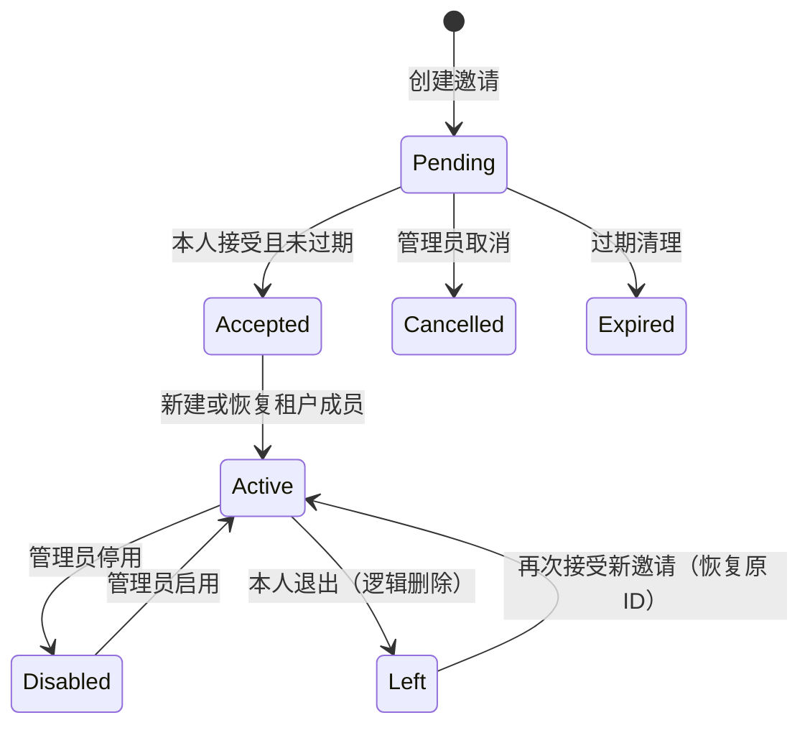

# peach-auth

[English](README.en-US.md) | 中文

最后更新时间：2026-07-03  
artifactId：`peach-auth`  
类型：认证与权限业务域聚合模块

## 模块定位

`peach-auth` 承载用户、角色、菜单、资源、路由权限、登录态和用户操作日志相关能力。它提供实体模型、领域服务、REST 接口、OpenFeign 外部接口、操作日志注解能力和可启动服务。

本模块解决：

- 认证域核心数据模型和服务分层。
- 登录、用户、角色、菜单、资源、路由等 REST 入口。
- 面向其他服务的角色、路由等外部查询接口。
- `@UserOperLog` 操作日志采集入口。

本模块不解决：

- 网关过滤、统一鉴权拦截和网关路由转发，相关逻辑位于 `peach-gateway` 与 `peach-satoken`。
- Sa-Token、Redis、数据库等基础设施部署。
- 生产密码策略、限流、风控、审计归档等完整安全治理。

## 子模块

| 子模块 | 职责 |
| --- | --- |
| `peach-auth-common` | 认证域公共常量、工具和共享对象 |
| `peach-auth-entity` | DO、DTO、QO、VO 等认证域模型 |
| `peach-auth-service` | 用户、角色、菜单、资源、登录、权限等领域服务 |
| `peach-auth-rest` | 内部 REST 接口和外部 REST 适配入口 |
| `peach-auth-external/peach-auth-openfeign-external` | 面向其他模块的 OpenFeign 客户端 |
| `peach-auth-external/peach-auth-log-external` | 用户操作日志注解、枚举和外部能力 |
| `peach-auth-launch` | Spring Boot 启动模块 |

## 关键入口

| 类型 | 路径 |
| --- | --- |
| 启动类 | `peach-auth-launch/src/main/java/com/peach/auth/launch/PeachAuthServiceApplication.java` |
| 配置文件 | `peach-auth-launch/src/main/resources/application-dev.yml` |
| REST 包 | `peach-auth-rest/src/main/java/com/peach/auth/rest` |
| 服务接口 | `peach-auth-service/src/main/java/com/peach/auth/service` |
| 实体模型 | `peach-auth-entity/src/main/java/com/peach/auth/entity` |
| OpenFeign | `peach-auth-external/peach-auth-openfeign-external/src/main/java/com/peach/auth/openfeign` |

## REST 能力

当前 REST 控制器覆盖以下入口：

| 控制器 | 路径前缀 | 说明 |
| --- | --- | --- |
| `LoginController` | `/auth` | 登录和认证相关入口 |
| `UserController` | `/auth` | 用户相关接口 |
| `RoleController` | `/auth/role` | 角色管理 |
| `MenuController` | `/auth/menu` | 菜单管理 |
| `ResourceController` | `/auth/resource` | 资源管理 |
| `RouterController` | `/auth/router` | 路由权限 |
| `FileController` | `/auth/file` | 认证域文件相关入口 |
| `RoleExternalController` | `/auth/external` | 外部角色查询接口 |
| `RouterExternalController` | `/auth/external` | 外部路由查询接口 |

## 运行机制

1. `peach-auth-launch` 启动服务并加载当前 profile 的配置。
2. REST 层接收登录、用户、角色、菜单、资源、路由等请求。
3. Service 层组织认证域业务逻辑，并通过 DAO 访问数据库。
4. 外部模块通过 `peach-auth-openfeign-external` 或网关路由访问认证能力。
5. 使用 `@UserOperLog` 的业务动作会进入操作日志链路，具体持久化依赖服务实现和数据库配置。

## 配置说明

- 启动配置位于 `peach-auth-launch/src/main/resources/application-*.yml`。
- 本地、Docker、生产环境分别使用 `dev`、`docker`、`prod` profile。
- 数据库、Redis、Nacos、Sa-Token 参数需要结合运行环境配置，不能把生产密钥写入仓库。
- 权限缓存和会话持久化依赖外部 Redis / Sa-Token 配置是否正确。

## 边界与限制

- 认证域提供权限数据和登录接口，但网关侧鉴权是否放行由网关和 Sa-Token 配置决定。
- 外部接口面向服务间调用，不应直接暴露为无鉴权公网接口。
- 操作日志只能记录进入注解切面的调用，无法覆盖绕过 Spring Bean 或未标注注解的行为。
- 登录失败重试、验证码、密码复杂度、账号锁定等生产安全策略需要按业务补齐。

## 构建与验证

```bash
mvn -f "peach-auth/pom.xml" clean package -DskipTests -Pdevelopment
mvn -pl peach-auth/peach-auth-launch -am clean package -DskipTests -Pdevelopment
mvn -pl peach-auth/peach-auth-launch -am -Dspring-boot.run.profiles=dev spring-boot:run
```

## 排障指南

| 现象 | 检查点 | 处理方式 |
| --- | --- | --- |
| 登录接口不可用 | `peach-auth-launch` 是否启动；网关路由是否指向认证服务 | 先直连认证服务端口验证，再检查 `peach-gateway` 路由 |
| 权限数据为空 | 数据库脚本是否执行；用户、角色、资源关系是否存在 | 检查 `sql/` 初始化脚本和认证域表数据 |
| OpenFeign 调用失败 | 服务名、Nacos 注册、Feign 配置是否正确 | 确认认证服务已注册，调用方引入 `peach-auth-openfeign-external` |
| 操作日志未记录 | 是否使用 `@UserOperLog`；调用是否经过 Spring 代理 | 检查注解位置、AOP 生效条件和日志服务实现 |
| 会话或权限缓存异常 | Redis、Sa-Token、序列化配置是否一致 | 检查 Redis 连接和 `peach-satoken` 相关配置 |


## 项目约定

- 后端文档统一遵循当前 peach-cloud 基线：Java 21、Spring Boot 3.5.4、Spring Cloud 2025.0.0、Spring Cloud Alibaba 2025.0.0.0。
- 前端文档仅适用于 peach-cloud-front，该目录是独立的 Vue 3 + Vite + TypeScript 工程，不属于 Maven reactor。
- 源码、脚本、SQL 和 Markdown 均保持 UTF-8 无 BOM；不要把 	arget/、.flattened-pom.xml、依赖缓存或 IDE 文件写入源码结构。
- README 中的命令、类名、配置项和示例必须能从当前仓库验证；不得写入真实密钥、token、私钥、生产密码、签名 URL 或完整敏感报文。

## SaaS 标识及逻辑删除基础改造（当前 release 研发阶段）

在 `release_20261117_v1.0.0` 的 [#202](https://github.com/Ryan-Guizhou/peach-cloud/issues/202) 中，认证域 16 张核心表的单列物理主键统一为 `ID`，默认使用 `UniqueIdFacade.nextId()`，领域 `USER_ID`、`ORG_ID`、`ROLE_ID` 等不再兼作物理主键，而保留为带永久唯一索引的业务标识。新增实体由 `AuthBusinessIdGenerator` 调用 `peach-code` 的 `PLATFORM` 规则生成业务编号。该规则需要先完成 `sql/PEACH_CODE_RULE.sql`、`sql/INIT.sql` 初始化，且不能重置发号水位。

本阶段的 Mapper 删除操作改为 `IS_DELETE=1` 的更新，并在 `DELETED_AT` 记录删除时间；可重用的机构、角色等业务编码使用 `ACTIVE_SLOT` 有效记录唯一索引，用户等永久业务编号不因逻辑删除而释放。普通更新、删除、查询均按物理 `ID` 定位；前端 CRUD 用 `id` 作为行键，业务 ID 只用于展示。

**未完成的 SaaS 全链路能力：** `PEACH_TENANT_MEMBER`、跨租户全局登录、`XXX_REF_ID` 关联转换、移除旧 `FISCAL`、新的角色作用域和行/字段权限、全链路网关/Feign 权限及真实数据库迁移，分别由 [#204–#211](https://github.com/Ryan-Guizhou/peach-cloud/issues/204) 后续 Issue 实现。此处只说明当前 release 的增量行为，不表示已达到生产可用的 SaaS 授权安全级别。


## SaaS 租户成员与邀请生命周期（#205 开发分支，未合并）

本阶段新增 `PEACH_TENANT_MEMBER`、`PEACH_TENANT_INVITATION`、MyBatis Mapper 和 `TenantMemberLifecycleService`。永久 `MEMBER_ID/INVITATION_ID` 由平台命名空间发号，物理关联统一使用 `*_REF_ID`。成员（租户、用户）组合具有永久唯一约束，退出后再次接受邀请是**恢复原成员记录**，不会分配第二个永久成员编号。邀请活动槽位限制同一租户对同一用户同时最多一条 `PENDING` 邀请；已过期邀请在重新邀请前标记为 `EXPIRED`。



安全边界：`TenantMembershipPolicy` 强制校验当前 Sa-Token 用户身份，令邀请接受和主动退出仅能操作本人；平台尚未实现可信的租户管理员 RBAC，`requireTenantAdministrator` **默认拒绝**邀请创建、取消与成员停用/启用，不能把这些服务方法直接暴露为无保护 REST 接口。登录流程的成员查询只允许在服务器完成密码校验后调用，不要求用户属于某个机构。仅服务和 DAO 的基础闭环已写入开发分支，登录/切租户、Token 版本失效、角色授权、机构树、前端和真实数据库集成仍待 #204、#206–#211 完成，当前不能用于生产。
