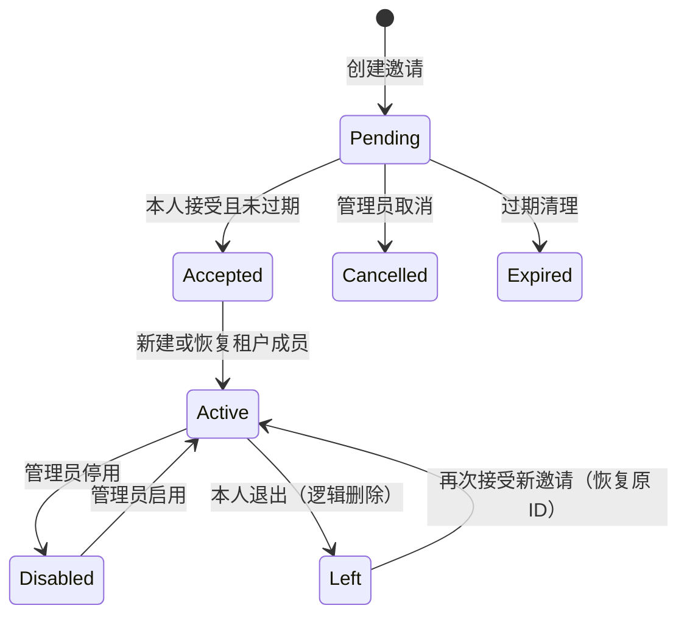
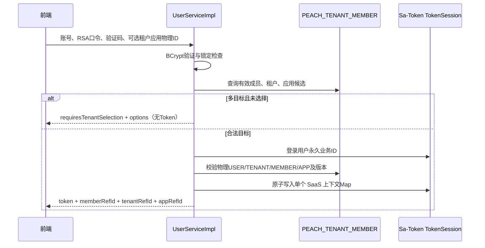
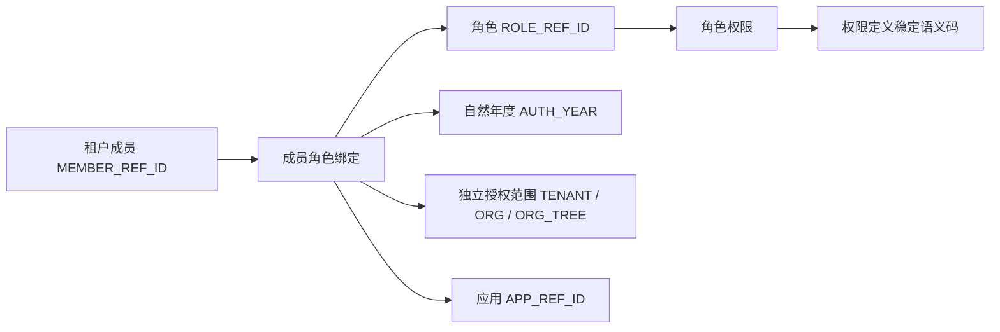
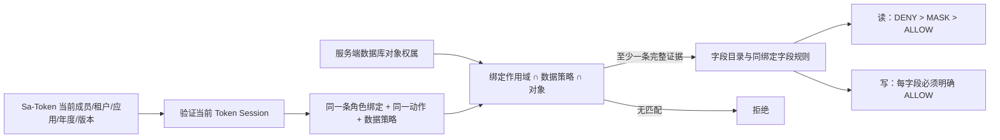

# peach-auth

[English](README.en-US.md) | 中文

最后更新时间：2026-07-03  
artifactId：`peach-auth`  
类型：认证与权限业务域聚合模块

## 模块定位

`peach-auth` 承载用户、角色、菜单、资源、路由权限、登录态和用户操作日志相关能力。它提供实体模型、领域服务、REST 接口、OpenFeign 外部接口、操作日志注解能力和可启动服务。

本模块解决：

- 认证域核心数据模型和服务分层。
- 登录、用户、角色、菜单、资源、路由等 REST 入口。
- 面向其他服务的角色、路由等外部查询接口。
- `@UserOperLog` 操作日志采集入口。

本模块不解决：

- 网关过滤、统一鉴权拦截和网关路由转发，相关逻辑位于 `peach-gateway` 与 `peach-satoken`。
- Sa-Token、Redis、数据库等基础设施部署。
- 生产密码策略、限流、风控、审计归档等完整安全治理。

## 子模块

| 子模块 | 职责 |
| --- | --- |
| `peach-auth-common` | 认证域公共常量、工具和共享对象 |
| `peach-auth-entity` | DO、DTO、QO、VO 等认证域模型 |
| `peach-auth-service` | 用户、角色、菜单、资源、登录、权限等领域服务 |
| `peach-auth-rest` | 内部 REST 接口和外部 REST 适配入口 |
| `peach-auth-external/peach-auth-openfeign-external` | 面向其他模块的 OpenFeign 客户端 |
| `peach-auth-external/peach-auth-log-external` | 用户操作日志注解、枚举和外部能力 |
| `peach-auth-launch` | Spring Boot 启动模块 |

## 关键入口

| 类型 | 路径 |
| --- | --- |
| 启动类 | `peach-auth-launch/src/main/java/com/peach/auth/launch/PeachAuthServiceApplication.java` |
| 配置文件 | `peach-auth-launch/src/main/resources/application-dev.yml` |
| REST 包 | `peach-auth-rest/src/main/java/com/peach/auth/rest` |
| 服务接口 | `peach-auth-service/src/main/java/com/peach/auth/service` |
| 实体模型 | `peach-auth-entity/src/main/java/com/peach/auth/entity` |
| OpenFeign | `peach-auth-external/peach-auth-openfeign-external/src/main/java/com/peach/auth/openfeign` |

## REST 能力

当前 REST 控制器覆盖以下入口：

| 控制器 | 路径前缀 | 说明 |
| --- | --- | --- |
| `LoginController` | `/auth` | 登录和认证相关入口 |
| `UserController` | `/auth` | 用户相关接口 |
| `RoleController` | `/auth/role` | 角色管理 |
| `MenuController` | `/auth/menu` | 菜单管理 |
| `ResourceController` | `/auth/resource` | 资源管理 |
| `RouterController` | `/auth/router` | 路由权限 |
| `FileController` | `/auth/file` | 认证域文件相关入口 |
| `RoleExternalController` | `/auth/external` | 外部角色查询接口 |
| `RouterExternalController` | `/auth/external` | 外部路由查询接口 |

## 运行机制

1. `peach-auth-launch` 启动服务并加载当前 profile 的配置。
2. REST 层接收登录、用户、角色、菜单、资源、路由等请求。
3. Service 层组织认证域业务逻辑，并通过 DAO 访问数据库。
4. 外部模块通过 `peach-auth-openfeign-external` 或网关路由访问认证能力。
5. 使用 `@UserOperLog` 的业务动作会进入操作日志链路，具体持久化依赖服务实现和数据库配置。

## 配置说明

- 启动配置位于 `peach-auth-launch/src/main/resources/application-*.yml`。
- 本地、Docker、生产环境分别使用 `dev`、`docker`、`prod` profile。
- 数据库、Redis、Nacos、Sa-Token 参数需要结合运行环境配置，不能把生产密钥写入仓库。
- 权限缓存和会话持久化依赖外部 Redis / Sa-Token 配置是否正确。

## 边界与限制

- 认证域提供权限数据和登录接口，但网关侧鉴权是否放行由网关和 Sa-Token 配置决定。
- 外部接口面向服务间调用，不应直接暴露为无鉴权公网接口。
- 操作日志只能记录进入注解切面的调用，无法覆盖绕过 Spring Bean 或未标注注解的行为。
- 登录失败重试、验证码、密码复杂度、账号锁定等生产安全策略需要按业务补齐。

## 构建与验证

```bash
mvn -f "peach-auth/pom.xml" clean package -DskipTests -Pdevelopment
mvn -pl peach-auth/peach-auth-launch -am clean package -DskipTests -Pdevelopment
mvn -pl peach-auth/peach-auth-launch -am -Dspring-boot.run.profiles=dev spring-boot:run
```

## 排障指南

| 现象 | 检查点 | 处理方式 |
| --- | --- | --- |
| 登录接口不可用 | `peach-auth-launch` 是否启动；网关路由是否指向认证服务 | 先直连认证服务端口验证，再检查 `peach-gateway` 路由 |
| 权限数据为空 | 数据库脚本是否执行；用户、角色、资源关系是否存在 | 检查 `sql/` 初始化脚本和认证域表数据 |
| OpenFeign 调用失败 | 服务名、Nacos 注册、Feign 配置是否正确 | 确认认证服务已注册，调用方引入 `peach-auth-openfeign-external` |
| 操作日志未记录 | 是否使用 `@UserOperLog`；调用是否经过 Spring 代理 | 检查注解位置、AOP 生效条件和日志服务实现 |
| 会话或权限缓存异常 | Redis、Sa-Token、序列化配置是否一致 | 检查 Redis 连接和 `peach-satoken` 相关配置 |


## 项目约定

- 后端文档统一遵循当前 peach-cloud 基线：Java 21、Spring Boot 3.5.4、Spring Cloud 2025.0.0、Spring Cloud Alibaba 2025.0.0.0。
- 前端文档仅适用于 peach-cloud-front，该目录是独立的 Vue 3 + Vite + TypeScript 工程，不属于 Maven reactor。
- 源码、脚本、SQL 和 Markdown 均保持 UTF-8 无 BOM；不要把 	arget/、.flattened-pom.xml、依赖缓存或 IDE 文件写入源码结构。
- README 中的命令、类名、配置项和示例必须能从当前仓库验证；不得写入真实密钥、token、私钥、生产密码、签名 URL 或完整敏感报文。

## SaaS 标识及逻辑删除基础改造（当前 release 研发阶段）

在 `release_20261117_v1.0.0` 的 [#202](https://github.com/Ryan-Guizhou/peach-cloud/issues/202) 中，认证域 16 张核心表的单列物理主键统一为 `ID`，默认使用 `UniqueIdFacade.nextId()`，领域 `USER_ID`、`ORG_ID`、`ROLE_ID` 等不再兼作物理主键，而保留为带永久唯一索引的业务标识。新增实体由 `AuthBusinessIdGenerator` 调用 `peach-code` 的 `PLATFORM` 规则生成业务编号。该规则需要先完成 `sql/PEACH_CODE_RULE.sql`、`sql/INIT.sql` 初始化，且不能重置发号水位。

本阶段的 Mapper 删除操作改为 `IS_DELETE=1` 的更新，并在 `DELETED_AT` 记录删除时间；可重用的机构、角色等业务编码使用 `ACTIVE_SLOT` 有效记录唯一索引，用户等永久业务编号不因逻辑删除而释放。普通更新、删除、查询均按物理 `ID` 定位；前端 CRUD 用 `id` 作为行键，业务 ID 只用于展示。

**未完成的 SaaS 全链路能力：** `PEACH_TENANT_MEMBER`、跨租户全局登录、`XXX_REF_ID` 关联转换、移除旧 `FISCAL`、新的角色作用域和行/字段权限、全链路网关/Feign 权限及真实数据库迁移，分别由 [#204–#211](https://github.com/Ryan-Guizhou/peach-cloud/issues/204) 后续 Issue 实现。此处只说明当前 release 的增量行为，不表示已达到生产可用的 SaaS 授权安全级别。


## SaaS 租户成员、邀请与机构树（#205 集成基础）

本阶段新增 `PEACH_TENANT_MEMBER`、`PEACH_TENANT_INVITATION`、MyBatis Mapper 和 `TenantMemberLifecycleService`。永久 `MEMBER_ID/INVITATION_ID` 由平台命名空间发号，物理关联统一使用 `*_REF_ID`。成员（租户、用户）组合具有永久唯一约束，退出后再次接受邀请是**恢复原成员记录**，不会分配第二个永久成员编号。邀请活动槽位限制同一租户对同一用户同时最多一条 `PENDING` 邀请；已过期邀请在重新邀请前标记为 `EXPIRED`。



安全边界：`TenantMembershipPolicy` 强制校验当前 Sa-Token 用户身份，令邀请接受和主动退出仅能操作本人；平台尚未实现可信的租户管理员 RBAC，`requireTenantAdministrator` **默认拒绝**邀请创建、取消与成员停用/启用，不能把这些服务方法直接暴露为无保护 REST 接口。登录流程的成员查询只允许在服务器完成密码校验后调用，不要求用户属于某个机构。仅服务和 DAO 的基础闭环已写入开发分支，登录/切租户、Token 版本失效、角色授权、机构树、前端和真实数据库集成仍待 #204、#206–#211 完成，当前不能用于生产。

### 机构树与集成边界

`OrganizationHierarchyService.move` 采用租户、成员、机构、父机构物理 ID；先验证可信的 `TenantMembershipPolicy`，再通过锁定有效 `PEACH_TENANT` 行序列化同租户移动，根据已存在的业务租户 ID 验证所有祖先归属，并检测循环和过深层级，最后使用 `VERSION` 乐观锁更新 `PARENT_ORG_REF_ID`。当前机构表仍以旧 `TENANT_ID` 业务号保存租户归属，全部转为 `TENANT_REF_ID` 由 #209/#211 接续完成。存量数据库迁移、机构删除依赖检查、完整租户所有者初始化、REST 管理接口和授权撤销仍是生产前置条件。#206 实现管理员租户 RBAC 之前，管理操作有意默认拒绝；登录集成属于 #204/#208。

本段是受限的 release 集成基础，并不意味着生产级 SaaS IAM 已完成。

## 全局账号密码散列安全基础（#204 仍在开发）

登录保留客户端 RSA 传输保护，服务端解密后使用 BCrypt(12) 比对随机盐密码散列。数据库不再以 Base64 明文等效值做 SQL 匹配，`PEACH_USER.PASSWORD` 改为 `VARCHAR(255)`。用户创建/修改密码后仅持久化散列；新增未设置密码的账号默认停用。密码哈希被 `@JsonIgnore` 排除 JSON 序列化；未知账号和旧 Base64 格式均执行占位 BCrypt 计算后拒绝，避免静默降级到旧弱口令。

**迁移与安全边界：** 旧 Base64 密码不会自动转换为 BCrypt，也不能在不验证原始密码时安全反向恢复。必须提前提供经验证的重置凭证流程；开发样例口令仅用于测试，禁止生产使用。此阶段仍存在旧组织/年度登录和切换逻辑；多租户成员认证、无机构租户登录、租户撤权等必须由 #204、#206、#208 和 #211 完成后才能投入使用。


### 成员版本绑定的 Sa-Token 会话基础（#204 开发中）

新增 `TenantSessionContext` 与 `TenantSessionService`，在后端完成用户名/密码验证后，将物理 `userRefId/tenantRefId/memberRefId/appRefId` 及成员乐观版本绑定到 **Token Session（不是账号全局共享 Session）**。调用 `bindAfterAuthentication` 前必须先完成可信用户认证；服务通过 Sa-Token 的不可由客户端修改的登录 ID 与数据库 `USER_ID → ID` 关系确认身份，确保已启用租户、ACTIVE 成员和已启用应用。后续每次调用 `requireCurrent` 都重新校验成员状态与版本，停用/退出/恢复后旧上下文拒绝；`switchTenant` 必须基于同一个真实登录用户重新校验目标成员，不要求机构关系。

本服务是 **SaaS 会话校验基础**，当前仍未取代旧 FISCAL 登录控制器与旧网关缓存。#206 的角色资源授权版本、#208 的网关 Fail-Closed 校验和 #209/#210 的 Feign/前端契约完成前，不能仅凭此服务认定全链路登录权限已安全。旧 Token 需要部署迁移时清理。

## #204 全局用户与租户成员登录（开发分支：已实现基本路径，尚未验收）

登录不再从 `USER_ORG` 或 `FISCAL` 推断可用租户。后端先校验 RSA 传输的口令密文、BCrypt 哈希、验证码及账号锁定状态，再通过 `TenantMemberDao.selectLoginTargets` 读取启用租户下的 `ACTIVE` 成员和已启用应用。无可用目标拒绝登录，只有一个目标可自动选择，多个目标返回 `requiresTenantSelection=true` 和 `tenantOptions`，**不会返回 Token**。客户端选择 `tenantRefId` + `appRefId` 后须重新提交凭据，服务端重新认证并校验目标资格，避免在选择阶段建立不受租户限制的临时凭证。



`switchContext` 仅接收目标租户和应用的**物理 ID**，先基于当前已认证用户复查旧上下文，再验证目标成员与应用，不能凭前端提交的 `USER_ID` 切换身份。`logout` 仅退出当前 Token，避免误退同账号的其他设备。用户没有任何机构关系时仍可作为租户成员登录；`orgRefId` 不是此阶段登录必要条件。示例初始化数据已补充默认账号的 `PEACH_TENANT_MEMBER` 记录。

**权限边界：** 新成员会话暂不复用旧 `ROLE_CODE+ORG_ID+FISCAL` 的授权结果，而是返回**空菜单、空按钮、空 API 权限**，避免越权。新 RBAC (#206)、网关的请求期强制成员/版本校验 (#208)、跨服务契约 (#209) 和前端适配 (#210) 必须一起完成后才能生产启用。旧网关尚未统一，因此不能将通过的 Maven/Redis CI 解释为端到端鉴权通过。

**尚待验证：** 多终端、真实 MySQL/Redis 选择与注销集成、遗留用户密码重置、密码修改权限、角色与资源撤权后的 `authVersion` 校验、存量 Token 清理。禁止将未实现的重置、注册接口返回伪成功。

### 年度选择与权限隔离说明

历史 `FISCAL` 字段被移除，但**自然年度**仍然属于已确认的 SaaS 授权维度。新接口通过 `year`（例如 2026）显式选择年度，`TenantSessionContext` 将 `year` 与租户、成员、应用、版本放在同一个 Token 快照中。不同年度的角色和资源权限必须由 #206 绑定到独立的授权记录，尚未实现前一律为空权限；不得把不同年度的授权合并。当前接口未提供历史年度授权迁移，属于 #211 数据验收内容。

## SaaS RBAC 独立授权事实源（#206 开发分支，尚未合并）

本阶段新增 `PEACH_PERMISSION_DEFINITION`、`PEACH_ROLE_PERMISSION`、`PEACH_MEMBER_ROLE_BINDING` 和 `PEACH_IAM_AUTH_AUDIT`。角色在现有 `PEACH_ROLE` 中增加租户/应用物理关联、`AUTH_YEAR` 和版本字段；成员新增 `AUTH_VERSION`，用于角色变更后的旧凭证失效。新授权决策只查询**有效成员、已启用租户/应用、有效角色、有效角色权限和单条绑定**，不会把旧 `PEACH_AUTH_PARTY`、`PEACH_AUTH_FUNCTION` 等表作为新授权事实源。



`ScopedPermissionService.hasTenantPermission` 仅在**同一条有效角色绑定**同时包含目标权限和完整 TENANT 作用域时允许，否则默认拒绝。不同机构的两个角色不能将 A 角色的操作权限与 B 角色的数据范围交叉合成新权限。`listGrantedBindings` 返回供后续对象级授权校验的独立证据，不能直接把它们当作已完成行/字段授权。

当前开发进度为**数据库与只读校验基础**，并非最终可用 RBAC：旧角色增删改界面、授权管理写事务、角色权限撤销时的 `AUTH_VERSION` 原子失效、租户管理员权限、请求期网关验证与真实 SQL 集成仍待本 PR 继续实现。平台 SYSTEM 权限必须由服务端保护，租户自定义权限不可冒充平台代码。存量旧 `FISCAL/ORG_ID` 角色列需要在跨模块适配 #209 与 SQL 收敛 #211 中清理，不得作为新模型的授予依据。


### #206 事务授权与安全限制（当前开发分支）

`ScopedRoleBindingService.grant/revoke` 是独立成员角色绑定的服务端事务入口。操作时先将 Sa-Token 绑定的物理成员、租户、应用、自然年度与 `TENANT.ROLE.MANAGE` 角色权限匹配，再使用租户行锁序列化管理写入；按目标成员行锁获取旧 `AUTH_VERSION`。所有变更在同一事务内完成关系写入、版本递增和 `PEACH_IAM_AUTH_AUDIT` 追加。出现任何版本冲突、审计写入失败或权限不足时回滚，历史角色绑定以逻辑删除方式保留。

租户管理员只能授予本人在当前年度/应用持有**完整租户范围**的、同时声明为可委派的权限。授予另一租户的角色、无效年度、停用用户、跨租户机构或其他管理员无权持有的权限均拒绝。当前实现拒绝管理员修改自己的角色绑定，以防自提权和误锁定。组织树移动要求单独的 `TENANT.ORG.MANAGE` 权限。权限目录约束租户定义不得使用平台保留的 `TENANT.*`、`SYSTEM.*` 前缀。

开发用 `sql/INIT.sql` 初始化三个系统保护语义权限、2026 年管理员角色及单个 TENANT 作用域绑定；这是示例环境引导数据，不代表生产部署已建立可信初始管理员。

**后续验收：** 真实 MySQL/Redis 授权失效集成测试、平台租户创建/管理员初始化权限保护、旧表与网关升级。**跨微服务 Gateway/Feign 安全边界及前端仍分别由 #208/#209/#210 和最终 #211 验收。**


### #206 受控角色管理 API（当前开发分支）

当前新增 `SaasRoleController`，所有请求必须携带已绑定成员、应用、自然年度和授权版本的有效 Token；服务端从 Token 取 `tenantRefId/memberRefId/appRefId/year`，**不接受前端提交操作者或租户身份**。服务层再次检查 `TENANT.ROLE.MANAGE`：

| API | 功能 | 请求 |
| --- | --- | --- |
| `POST /auth/saas/roles` | 在当前应用和年度创建租户角色 | `{"roleCode":"ROLE_EDITOR","roleName":"编辑员"}` |
| `PUT /auth/saas/roles/{roleRefId}/permissions` | 角色权限完整集合差量同步 | `{"permissionRefIds":["<physical-permission-id>"]}` |
| `POST /auth/saas/roles/bindings` | 授予成员一条独立角色/机构作用域绑定 | `{"targetMemberRefId":"<physical-member-id>","roleRefId":"<physical-role-id>","scopeType":"TENANT"}` |
| `DELETE /auth/saas/roles/bindings/{bindingRefId}` | 逻辑撤销单条授权 | 无正文 |

角色创建时使用全局 `ROLE_ID` 发号器；新角色必须指定独立租户、应用与年度。角色权限修改只允许租户自建的 TENANT 角色；SYSTEM 角色和非委派权限拒绝修改。修改使用租户/角色行锁、版本 CAS、全租户成员 `AUTH_VERSION` 递增及审计，失败整体回滚。原 `/auth/role`、`/auth/authParty`、`/auth/authFunction`、`/auth/authResource` 的旧机构与年度角色读写入口已改为明确拒绝，避免继续绕过新事实源。

**仍需生产验收：** 实际 MySQL 8.4 数据库并发/审计/DDL/初始化验证、平台首次管理员初始化授权保护、权限资源与行/字段级执行 #207、网关 #208、跨服务与前端 #209/#210、历史表清理与升级回滚 #211。此阶段不等于端到端安全 SaaS。


### 成员生命周期与机构树授权失效约束

成员退出、管理员停用、重新启用以及再次接受邀请恢复**原成员 ID**时，`TenantMemberLifecycleService` 在同一事务逻辑撤销该成员的全部旧 `PEACH_MEMBER_ROLE_BINDING` 活动记录，递增 `AUTH_VERSION`，写入成员授权失效审计。重新入租户不会恢复历史角色；需要管理员重新明确授予。任何一步异常均回滚本次成员状态变更，不允许成员恢复后权限自动复活。

机构树移动成功后，`OrganizationHierarchyService` 同事务递增租户内全部成员授权版本，避免旧 `ORG_TREE` 权限范围缓存继续生效。成员状态和角色范围仍需 #208 在所有网关请求期强制校验；本模块对其受控 Service 调用实施 Fail-Closed，不等同于所有跨服务接口已受保护。


## #207 数据行与字段级授权（开发分支，尚未验收）

新增 `PEACH_ROLE_DATA_POLICY`、`PEACH_FIELD_DEFINITION`、`PEACH_ROLE_FIELD_POLICY` 和后端 `ScopedDataAuthorizationService`。本阶段仅支持单个真实数据库对象的安全授权判断与字段过滤；**尚未在列表分页和外部微服务接入，因此不可直接用于生产开放业务数据**。



| 能力 | 当前实现 | 限制 |
| --- | --- | --- |
| 行级作用域 | `SELF/ORG/ORG_TREE/TENANT_ALL` 与 `TENANT/ORG/ORG_TREE` 绑定逐条求交，再取可用绑定并集 | 数据权属必须从真实数据库取回，不接收前端租户/年度/所有者自报值 |
| 机构树 | `DatabaseOrganizationScopeMatcher` 使用有效租户内祖先链，检测循环及深度 | 只支持单对象判断；列表分页需 SQL 级谓词和数据库索引 |
| 字段查看 | `ALLOW/MASK/DENY`，未注册字段不输出；支持 FULL/PHONE/EMAIL 脱敏 | 明确拒绝优先，字段策略不得与其他角色绑定拼接 |
| 字段更新 | `requireWritableFields` 要求请求中的所有字段可写；任意未授权字段使整体请求失败 | 业务层必须在同一事务锁定对象，随后执行更新，不能仅依赖控制器校验 |
| 文件等业务对象 | `requireObjectAction` 可校验不含字段的单对象动作 | 具体文件服务、Feign 身份传递、异步任务接入待 #209 完成 |

**安全约束：** 调用方只传服务端可信动作和对象权属；不是把数据库记录读取后在分页结果里过滤。每条有效证据同时持有动作、角色、年度、机构和数据范围，绝不跨两条证据拼接出第三种授权。字段的显式拒绝优先于其他角色的允许。SQL 需要前置行级过滤才能正确处理总数/分页/批量导出，不能以本单对象判断代替。策略管理写入接口、字段目录引导、完整服务接入及实际 MySQL/多租户验收仍在 #207 进行中。

### SQL 级列表预筛选（#207，待跨服务接入）

`ScopedDataQueryScopeService.requireScope(permissionCode)` 已提供受信的 `AuthorizedDataQueryScope`：它以当前 Token 重新验证的物理租户、应用和自然年度为固定条件，逐条计算**同一角色绑定范围 ∩ 对应动作的数据策略范围**。组织树由真实 MySQL 有界递归读取，只保留有效机构；环路、超量（超过 512 个机构）和无授权均拒绝。每个 `RowClause` 中的组织集合与 SELF 所有者条件必须同时满足，再对多条 Clause 求并集。字段目录的有效唯一约束随逻辑删除释放，历史 `FIELD_ID` 仍永久唯一。

业务 Mapper **必须**在 `COUNT/SELECT/EXPORT/UPDATE/DELETE` 的 SQL `WHERE` 中同时绑定 `tenantRefId`、`appRefId`、`year`、`IS_DELETE=0` 和 `clauses`：每条 Clause 内组织 `IN (#{...})` 与所有者 `= #{...}` 为 AND，不同 Clause 为 OR；组织不限仅对当前 Clause 有效。严禁 `\$\{\}` 拼入 SQL、跨绑定拼接 SELF 与机构或在分页后过滤。此契约**尚未被各业务模块统一接入**，端到端联调仍在 #209/#211；当前不能宣称分页/导出已安全开放。

### 策略管理 API 与授权撤销安全边界（#207，需联调）

`PUT /auth/saas/roles/{roleRefId}/permissions/{permissionRefId}/data-policies` 使用 `{"policies":[{"dataScope":"SELF","orgRefId":null}]}` 替换该动作下所有行范围。`dataScope` 仅支持 `SELF/ORG/ORG_TREE/TENANT_ALL`，机构范围必须为当前租户有效机构的物理 ID。空数组撤销所有策略，禁止 null。上限 32 条。

`PUT /auth/saas/roles/{roleRefId}/permissions/{permissionRefId}/field-policies` 使用 `{"resourceCode":"DOC","policies":[{"fieldRefId":"<物理ID>","readEffect":"MASK","writeEffect":"DENY"}]}` 替换该动作全部字段策略，上限 128 条。字段必须来自有效且可委派的服务端资源字段目录；系统字段默认不可委派，需在受信迁移中显式配置 `DELEGABLE=1`；脱敏规则仅由目录定义，不能由浏览器指定。

两个端点均不接受操作人、租户、应用或年度参数；使用当前 Token 且要求当前租户年度的完整管理权限、可委派动作和操作者已持有该动作。对 SYSTEM 动作还要求操作者拥有 `TENANT + TENANT_ALL` 的完整行级证据；没有已受信引导的授权就保持拒绝。事务中锁定租户和租户角色，差量判断后逻辑撤销旧策略、插入新策略、递增角色版本及租户成员 `AUTH_VERSION` 并追加审计；任何失败整体回滚。**当角色撤销动作权限时同步逻辑撤销相应数据和字段策略，防止以后重新授予该权限时历史策略复活。**

这只是权限策略配置闭环，后续仍须完成字段目录的安全引导/创建、真实 MySQL 并发验收及业务 SQL 侧 `COUNT/SELECT/EXPORT/UPDATE` 调用方改造，不能把本服务视作所有业务入口已经受保护。
