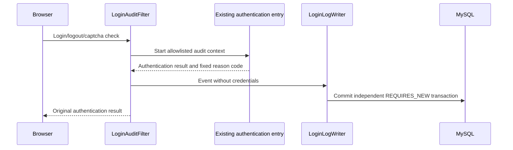

# Login audit and function navigation

## Scope and flow

The function tree has an Application Function List root and four categories: System Settings, Log Audit, Files and Storage, and Scheduling. Existing business codes, role grants and page URLs remain intact. Login snapshots add only directory ancestors of authorised leaves. The application root is not a clickable sidebar page. Workspace, Profile and Message Center remain shortcuts.



Successful logins record confirmed user, tenant and organisation identities. Failed attempts do not trust tenant or organisation claims from the request. Unassigned events require platform audit permission. Successful captcha checks are omitted; failed checks are recorded. Only explicit logout is captured, without adding session-expiry or forced-logout events.

## APIs and permissions

- `POST /auth/loginLog/pageList`: `pageNum`, `pageSize` (maximum100), `scope` (`TENANT` or `UNASSIGNED`), `account` (exact full account), `result` (`SUCCESS`/`FAILED`), `eventType` (`LOGIN`/`LOGOUT`/`CAPTCHA`), exact `ipAddress`, `startTime`, and `endTime`.
- Time format: `yyyy-MM-dd HH:mm:ss`. Defaults to the latest7 days, with a maximum90-day query range. Lists and details exclude records outside retention.
- `GET /auth/loginLog/selectById?logId=...`: rechecks ownership; knowing an ID does not permit cross-tenant access.
- `loginLog:view` permits current-tenant access. `loginLog:platform` additionally permits unassigned events, without granting access to other tenants. Gateway grants for the two API resources remain necessary.
- No log creation, update, manual deletion or export API is exposed.

The database stores a masked account and a digest for exact matching. The digest is excluded from responses. Account, User-Agent and source address handling is bounded; only browser/OS categories are retained. Passwords, tokens, captcha answers, raw request bodies and raw User-Agent values are never part of audit records. A valid server MDC traceId is reused; otherwise a request ID is generated and placed in MDC for this request, restoring the previous context afterwards.

## Configuration and operations

```yaml
peach:
  auth:
    login-audit:
      retention-days: 90
      cleanup-cron: "0 0 3 * * *"
      trusted-proxies: []
```

By default, only the direct peer address is recorded. To trust `X-Forwarded-For`, explicitly configure exact gateway peer IPs in `trusted-proxies`. Trusted hops are removed from right to left until the first untrusted hop; arbitrary client-supplied leftmost addresses are not accepted. Without this configuration, the recorded address may be the gateway rather than the user's public IP.

Cleanup runs daily at03:00 in the application server's local time, in independently committed batches of1000 rows, up to100 batches per run. Reaching the limit emits WARN; failure emits ERROR and is retried on the next run. Retention defaults to90 days and supports1–3650 days. Individual queries remain limited to90 days. Repeated cleanup by multiple instances does not change audit semantics.

Audit storage failures emit ERROR without changing the authentication result. There is no durable compensation queue, so events can be lost during storage outages. Requests rejected by the gateway before reaching auth are outside this filter's coverage.

## Upgrade and verification

Existing environments upgrade through shared Flyway migrations at application startup. Back up the database before deployment; see [Database migrations](../../peach-database/README.en-US.md). `sql/migrations/20261122_login_audit_navigation.sql` remains a historical archive; manual execution and temporary Python tools are no longer required. MySQL DDL can commit implicitly: inspect actual schema and migration history after failure; atomic rollback is not guaranteed.

The migration adds login-log viewing for existing authorization-log viewers. Unassigned-event platform access is initialized only for the default platform tenant/organisation's system administrator. Other auditors require explicit grants through the existing authorization flow. Initialization SQL is equivalent to the migration and also completes the tenant route's function binding.

Restart auth after updating, then sign out and back in to obtain refreshed menus, routes and permission snapshots. Browser logout calls the server first and retains the session for retry if that request fails.

Regression entry points: `LoginAuditTest`, `LoginAuditAuthenticationTest`, and `LoginMenuHierarchyTest`. Set `PEACH_LOGIN_AUDIT_DB_SMOKE=true` to enable `LoginAuditDatabaseTest`. The database test verifies independent transactions and rolled-back cleanup, then removes test records. After building the frontend, run `python scripts/login-audit-smoke.py` (Chrome and Python `websocket-client`) to exercise the UI using local API fixtures.

## Excluded work

System logs are deferred to a future Loki integration; no placeholder page is added. Existing password verification remains unchanged as requested. Audit records describe the current authentication result and do not demonstrate that password verification has been corrected.
