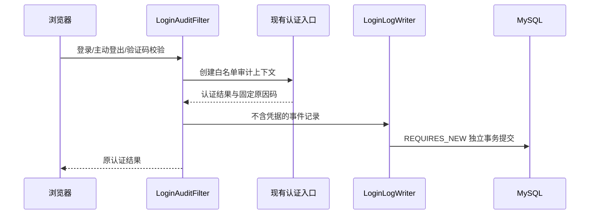

# 登录审计与功能导航

## 范围与数据流

功能树以“功能列表”为根，系统设置、日志审计、文件与存储、任务调度为一级分类。业务编码、角色授权和已有页面地址保持不变；登录快照只补齐已授权叶子的目录祖先。功能列表根不作为侧栏可点击页面；工作台、个人中心和消息中心保留为快捷入口。



成功登录记录已确认的用户、租户、机构；失败尝试不采用请求中的租户或机构声明。无法确认归属的事件仅平台审计权限可见。验证码成功不重复记日志；验证码失败单独记录。仅记录主动登出，不新增会话过期、强制下线事件。

## API 与权限

- `POST /auth/loginLog/pageList`：`pageNum`、`pageSize`（最大100）、`scope`（`TENANT` 或 `UNASSIGNED`）、`account`（完整账户精确匹配）、`result`（`SUCCESS`/`FAILED`）、`eventType`（`LOGIN`/`LOGOUT`/`CAPTCHA`）、`ipAddress`（精确匹配）、`startTime`、`endTime`。
- 时间格式：`yyyy-MM-dd HH:mm:ss`。默认最近7天，单次范围最多90天；查询和详情均不返回保留期外的记录。
- `GET /auth/loginLog/selectById?logId=...`：详情再次校验归属，不能凭主键跨租户读取。
- `loginLog:view`：当前租户查看权限。`loginLog:platform`：额外查询未归属事件；不因此获得其他租户的记录权限。两个 API 仍须具备各自网关 API 资源授权。
- 没有日志新增、修改、手工删除或导出 API。

数据库保存脱敏账户及精确查询摘要；摘要不序列化到响应。账户、User-Agent、来源地址均有限长处理；只保存浏览器/系统类别。密码、Token、验证码、原始请求体和原始 User-Agent 不进入审计记录。追踪ID优先使用有效服务端 MDC traceId，否则生成请求ID并在当前请求 MDC 中使用，完成后恢复原上下文。

## 配置与运维

```yaml
peach:
  auth:
    login-audit:
      retention-days: 90
      cleanup-cron: "0 0 3 * * *"
      trusted-proxies: []
```

默认只记录直连对端地址。确需采信 `X-Forwarded-For` 时，将网关直连对端的确切 IP 加入 `trusted-proxies`；从右向左剥离可信代理，遇到首个不可信跳点即停止，不接受任意客户端提供的最左地址。未配置时看到的可能是网关IP，不应将其解释成用户公网IP。

清理任务按应用服务器本地时间每日03:00执行，每批1000条、独立事务，每轮最多100批；达到批次上限会输出 WARN，失败输出 ERROR，下一轮重试。默认保留90天，可配置1至3650天。查询跨度上限仍为90天。多实例重复清理不改变审计业务语义。

审计写入失败输出 ERROR 告警且不改变认证返回；当前无持久化补偿队列，因此存储故障期间可能丢失审计记录。网关提前拒绝、尚未到达 auth 应用的请求不由此过滤器采集。

## 升级与验证

已有环境由应用启动时的共享 Flyway 迁移升级，部署前备份数据库。操作边界见 [数据库迁移](../../peach-database/README.md)。`sql/migrations/20261122_login_audit_navigation.sql` 保留为历史归档，不再要求手动执行或使用临时 Python 工具。MySQL DDL 可能隐式提交，失败后先核对实际结构与迁移历史，不保证整体回滚。

迁移向已有授权日志访问者补充登录日志查看授权；未归属事件的平台权限仅向默认平台租户、默认机构的系统管理员初始化。其他审计人员须通过现有授权流程显式分配。初始化SQL与增量迁移等价，并补全租户路由的功能关联。

更新后重启 auth 服务，退出并重新登录以获取新的菜单、路由和权限快照。浏览器主动登出会先调用服务端接口，失败时保留当前会话供重试。

回归入口：`LoginAuditTest`、`LoginAuditAuthenticationTest`、`LoginMenuHierarchyTest`；设置 `PEACH_LOGIN_AUDIT_DB_SMOKE=true` 启用 `LoginAuditDatabaseTest`。数据库测试验证独立事务和清理回滚，最终移除测试记录。构建前端后运行 `python scripts/login-audit-smoke.py`（Chrome、Python `websocket-client`），验证本地接口测试数据下的页面流程。

## 本次未实现

系统日志留待 Loki 接入，不添加空页面。现有密码校验实现按要求保持不变；日志反映当前认证链路给出的结果，不能作为密码校验实现已经修正的证明。
