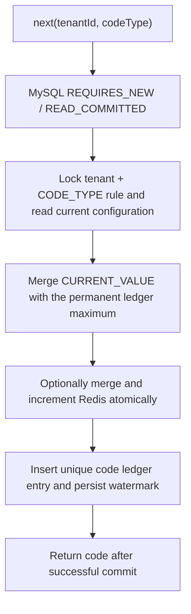

# peach-code

English | [中文](README.md)

Allocate business codes by `TENANT_ID + CODE_TYPE`. MySQL row locks and a permanent ledger enforce durable uniqueness; an optional Redis atomic script synchronizes sequence watermarks under the same row lock.

## Getting started

| Module | Responsibility |
| --- | --- |
| `peach-code-autoconfigure` | API, JDBC allocation transactions, optional Redis coordination, auto-configuration |
| `peach-code-starter` | Minimal application dependency aggregate |
| `peach-code-quickstart` | In-memory demo without infrastructure and JDBC/MySQL/Redis tests |

```xml
<dependency>
    <groupId>com.peach</groupId>
    <artifactId>peach-code-starter</artifactId>
</dependency>
```

Deploy the [rule table](../../../sql/PEACH_CODE_RULE.sql) and [permanent allocation ledger](../../../sql/PEACH_CODE_ISSUED.sql), then provision tenant rules. Auto-configuration requires `JdbcTemplate` and uses a dedicated JDBC transaction manager for that same data source; without JDBC it does not register a default generator. Redis is optional: synchronization activates only when the application supplies Spring Data Redis and a `StringRedisTemplate`. The component does not create a Redis client.

```java
String menuCode = codeGenerator.next(tenantId, "MENU");         // M00001
String roleCode = codeGenerator.next(tenantId, "ROLE");         // R00001
String resourceCode = codeGenerator.next(tenantId, "RESOURCE"); // RES00001
String functionCode = codeGenerator.next(tenantId, "FUNCTION"); // F00001
```

The second argument is a stable type, rather than the output prefix. `MENU / ROLE / RESOURCE / FUNCTION` initially use `M / R / RES / F` and five numeric digits. Codes contain no inserted underscore. Type arguments ignore case; prefixes retain their configured case. Tenant, type and prefix accept 1–32 letters, digits or hyphens, with a letter or digit first.

Direct updates to `CODE_PREFIX`, `MAX_CODE_WIDTH` and `STATUS` apply to allocations that subsequently acquire the rule lock. Issued codes remain unchanged. Width must be 1–18; disabled or missing rules, invalid configuration, overflow and code collisions reject allocation. `ORG_ID` records ownership and does not partition sequences.

## Consistency and failures



- All instances always use one MySQL allocation path. Redis never allocates independently. Timeouts, absence, loss or disablement use the database allocation path while holding the same row lock; Redis catches up with durable state on recovery.
- Redis-ahead watermarks must be committed to MySQL before a code is returned. Database failures throw. A Redis reservation followed by database rollback may leave a gap; uncertain commit outcomes and business rollbacks may also leave gaps. Numbers are not reclaimed.
- The ledger's `(TENANT_ID, CODE_VALUE)` unique constraint guards historical formatting and cross-type prefix collisions. Resolve colliding rules; the component does not silently skip collisions.
- Lowering `CURRENT_VALUE` cannot bypass issued sequence values in the permanent ledger. Retain the ledger forever, including after business deletion. Restore the ledger and watermarks together from backups. Business tables should retain their own unique constraints.
- InnoDB row locks serialize each tenant/type. Database and Redis operations use their configured connection, command and lock-wait timeouts. Database outages never switch allocation to Redis or memory.

```yaml
peach:
  code:
    enabled: true
    redis-enabled: true
    redis-key-prefix: "peach:code:sequence:v2:"
```

These are the defaults. Redis keys contain a SHA-256 tenant digest and stable type, with no TTL. The numeric script preserves exact 18-digit integers.

## Upgrade and verification

Stop all legacy allocators and retries before upgrading. Apply the repository versioned migration, reconcile historical MySQL and Redis maximum watermarks by tenant/type, and seed all historical business codes into the ledger before restoring traffic. Do not mix legacy prefix callers with the new API; replacing the Java dependency alone is insufficient. Previously deleted data and Redis allocations absent from business tables require historical records to reconstruct safe watermarks.

```bash
mvn -pl peach-component/peach-code/peach-code-quickstart -am test
```

Tests cover real H2 transactions/concurrency, immediate rule edits, ledger collisions, rollback gaps and Redis failure recovery, plus Testcontainers MySQL 8.4 locking/fault injection and Redis 7.4 Lua precision/recovery. Container tests explicitly skip without Docker; skipped tests do not establish production MySQL/Redis acceptance. The quickstart in-memory implementation demonstrates the API and does not simulate durable consistency.
