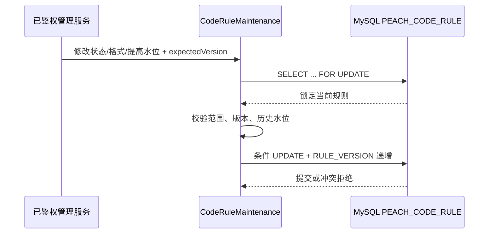

# peach-code

[English](README.en-US.md) | 中文

`peach-code` 为每个 `TENANT_ID + CODE_PREFIX` 分配业务编码。当前唯一发号权威是 **MySQL**，不再在 Redis 和 MySQL 之间切换主路径。

## 模块与使用

| 模块 | 能力 |
| --- | --- |
| `peach-code-autoconfigure` | `CodeGenerator` API、MySQL 事务发号、Spring 自动配置 |
| `peach-code-starter` | 业务接入依赖 |
| `peach-code-quickstart` | 无数据库的内存示例，仅用于公开 API 演示 |

```xml
<dependency>
    <groupId>com.peach</groupId>
    <artifactId>peach-code-starter</artifactId>
</dependency>
```

**启动依赖边界：** 发号器已彻底移除历史 Redis 构造参数与 Spring Data Redis 编译依赖；仅在容器存在 `JdbcTemplate` 时自动装配 `CodeGenerator`，且创建时需要事务管理器。没有数据源的应用不会因本组件自动创建 Bean 而启动失败，但业务如果强制注入 `CodeGenerator`，仍必须正确配置 JDBC 和事务。


部署前执行 [sql/PEACH_CODE_RULE.sql](../../sql/PEACH_CODE_RULE.sql) 创建规则表；每个租户和前缀必须唯一。使用 `CodeGenerator.next(tenantId, prefix)` 获取如 `MENU_00000001` 的编码。

## 发号与故障语义

```text
CodeGenerator.next
  -> MySQL REQUIRES_NEW 事务
  -> SELECT ... FOR UPDATE 锁定 TENANT_ID + CODE_PREFIX
  -> 校验 ENABLE、位数及溢出
  -> 条件 UPDATE CURRENT_VALUE
  -> COMMIT 后返回业务编码
```

- 单一 MySQL 数据源是发号权威。Redis 故障或恢复不会触发另一路发号，也不会造成序号回退。
- 同一租户 + 前缀的发号由 InnoDB 行锁串行化；不同租户和前缀可并发。
- 数据库不可用时抛异常，不自动降级到 Redis 或内存。调用失败但事务已提交可能产生空号；不能保证严格连续。
- 发号事务独立提交，业务回滚不回收编码。业务表仍需建立正确的唯一索引。
- `MAX_CODE_WIDTH` 范围为 1–18，溢出时不提交水位更新。
- `peach.code.enabled` 默认 `true`。历史 `peach.code.redis-enabled` 和 `peach.code.redis-key-prefix` 继续接受配置，但**不再改变发号路径**，后续配置应删除这些历史键。

## 从旧 Redis 主发号升级（必须执行）

**禁止旧 Redis 主发号实例与新 MySQL 唯一发号实例混合运行。**

1. 暂停业务发号和重试任务，等旧实例结束所有在途发号操作。
2. 备份 `PEACH_CODE_RULE` 及历史 Redis 序号；按租户 + 前缀核对 Redis 最大已分配值和 MySQL `CURRENT_VALUE`。
3. 将每条 MySQL 序号提升到不小于对应 Redis 历史最大值；不要将序号回退。并确认没有其他路径在直接修改计数器。
4. 执行重复规则检查：
   ```sql
   SELECT TENANT_ID, CODE_PREFIX, COUNT(*) AS COUNT_ROWS
   FROM PEACH_CODE_RULE
   GROUP BY TENANT_ID, CODE_PREFIX HAVING COUNT(*) > 1;
   ```
5. 清理重复规则并执行 `ALTER TABLE PEACH_CODE_RULE ADD UNIQUE KEY UK_PEACH_CODE_TENANT_PREFIX (TENANT_ID, CODE_PREFIX)`；新建数据库可直接使用当前建表 SQL。
6. 全部替换为新实现后，才恢复发号流量。旧版本不能再恢复运行，除非重新执行完整切换与水位校准。

旧表的 `ORG_ID` 是规则归属字段而非序号隔离维度；当前公开 API 不接受 `ORG_ID`。若同租户+前缀存在多个组织记录，必须先明确保留规则，不应自动合并。

**真实 MySQL 竞争与故障测试：** 新增 `MysqlCodeConcurrentIntegrationTest`，使用 Testcontainers MySQL 8.4 检验两个独立 `PeachCodeGenerator` 在同一租户/前缀下并发 32 次时每个编号只分配一次，并使用 MySQL `BEFORE UPDATE` 故障触发器验证数据库持久化失败时不会从 Redis 或内存继续发号，恢复后水位顺序正确。Docker 不可用时该集成测试会明确跳过；**生产切换前必须完成旧 Redis/MySQL 历史水位、唯一索引和滚动发布排查**，自动化测试不能代替目标库的数据迁移验收。

## 验证与边界

- 运行：`mvn -pl peach-component/peach-code/peach-code-quickstart -am spring-boot:run`
- 测试：`mvn -pl peach-component/peach-code/peach-code-quickstart -am test`
- Quickstart 使用单进程内存发号器，不代表 MySQL 并发、故障或部署迁移已验证。生产验收需在 MySQL 中测试同键竞争、回滚、断库和溢出场景。
- 业务表租户约束、唯一索引和多组织规则清理由业务迁移负责；不要依赖本组件自动修改业务表。

遵循项目 Java 21、Spring Boot 3.5.4、Spring Cloud 2025.0.0 与 Spring Cloud Alibaba 2025.0.0.0 基线；中文 Javadoc、英文日志、UTF-8 无 BOM。

## SaaS 平台级业务编号（建设中）

调用 `CodeGenerator.nextGlobal("ORG")` 等价于 `next("PLATFORM", "ORG")`，业务类型如 `USER`、`TENANT`、`ORG` 和 `ROLE` 必须预先配置平台规则。平台级编号与租户业务编码是不同的命名空间，业务表仍必须建立包含已删除记录的永久唯一索引。

`CodeFormat` 支持安全的前缀、分隔符（`_` / `-`）和 1–18 位序列号预览，例如 `new CodeFormat("org", "_", 6).preview(12)` 返回 `ORG_000012`。预览不会消耗数据库编号；当前 MySQL 发号器仍使用默认下划线和规则表中的宽度。正式发号器现在会读取规则表中的分隔符，预览操作仍不消耗编号。

### 数据库可配置规则格式

规则表新增 `SCOPE_TYPE`（`PLATFORM` 或 `TENANT`）、`CODE_SEPARATOR`（`_` 或 `-`）与 `RULE_VERSION`。发号器使用 `CODE_PREFIX + CODE_SEPARATOR + 补零流水号` 的安全格式，查询到非法规则立即拒绝并回滚事务，不会消耗数据库序号。全局业务 ID 应使用 `PLATFORM` 命名空间并在目标业务表上保持永久唯一；编码规则的修改不得重置 `CURRENT_VALUE`。

示例：对于 `CODE_PREFIX=ORG`、`CODE_SEPARATOR='-'`、`MAX_CODE_WIDTH=5`，下一个序号为 8 时生成 `ORG-00008`。更改现有规则需要与正在发号的实例采用数据库锁和运维审批协调；租户不能修改平台级 `USER_ID` 等系统保留规则。完整管理接口、模板版本审计与前端配置界面仍在本期 IAM 后续任务中实现。

发号器在事务内校验规则 `SCOPE_TYPE` 与命名空间一致（`PLATFORM` 与普通租户严格隔离），并在条件更新中验证非负 `RULE_VERSION`。建表脚本使用 `CHECK` 限制作用域、分隔符、状态、宽度及非负序列。新增 `INVITATION` 平台级业务编号初始规则；此处不表示管理 API、规则变更审计或真实 MySQL 验证已经完成。


### 受控规则维护（服务端 Java API）

当前已实现 `CodeRuleMaintenance`，由 `PeachCodeAutoConfiguration` 在存在 JDBC 数据源时自动提供 `JdbcCodeRuleMaintenance` Bean。它只供**已完成管理员鉴权的内部业务服务**调用，不对浏览器开放 REST 接口。平台级规则由平台管理员控制；普通租户不得修改全局 `USER`、`TENANT`、`ORG` 等规则。

| 操作 | 方法 | 不变式 |
| --- | --- | --- |
| 启停 | `changeStatus(namespace, prefix, enabled, expectedVersion, operatorRefId)` | 保留原水位、按版本递增 |
| 修改格式 | `changeFormat(namespace, prefix, format, expectedVersion, operatorRefId)` | 仅 `CURRENT_VALUE=0` 且前缀不变时允许 |
| 历史水位校准 | `advanceWatermark(namespace, prefix, watermark, expectedVersion, operatorRefId)` | 只能前进、不得超过格式宽度 |

所有修改和发号均在 MySQL 规则行上竞争锁；版本冲突和数据库不可用均拒绝操作。**操作前必须对管理员身份与目标命名空间实施服务端校验**；现阶段尚未开放管理 HTTP API，授权入口留待 IAM 角色能力完成后接入。现有 SQL 对直接使用 DBA 权限篡改计数器不提供防护，生产迁移需限制 DML 权限及审计运维操作。



**审计落地：** 所有实际改变的启停、格式和水位操作，都在同一事务插入 `PEACH_CODE_RULE_AUDIT`，使用 `operatorRefId` 关联可信操作者，保留前后值和版本；审计插入失败导致规则变更回滚。需要在部署前执行 `sql/PEACH_CODE_RULE_AUDIT.sql`（或聚合建表脚本），并禁止业务账号直接删改审计数据。

**剩余验收：** 尚须在真实 MySQL 8.4 环境执行测试、补充管理员授权 HTTP 契约和修改审计运行验证，并完成旧序号迁移验证。本节不表示相关测试已执行通过。
