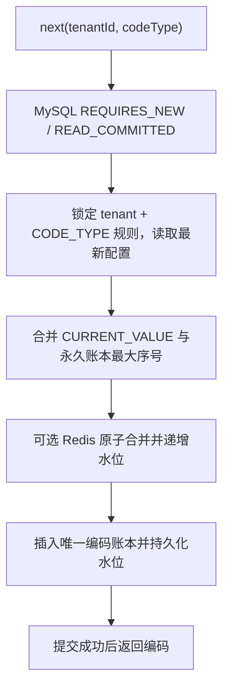

# peach-code

[English](README.en-US.md) | 中文

按 `TENANT_ID + CODE_TYPE` 分配业务编码。MySQL 行锁和永久账本保证持久唯一性，可选 Redis 原子脚本在同一行锁内同步序号水位。

## 接入

| 模块 | 职责 |
| --- | --- |
| `peach-code-autoconfigure` | API、JDBC 事务发号、可选 Redis 协调、自动配置 |
| `peach-code-starter` | 业务最小依赖聚合 |
| `peach-code-quickstart` | 无基础设施的内存演示和 JDBC/MySQL/Redis 测试 |

```xml
<dependency>
    <groupId>com.peach</groupId>
    <artifactId>peach-code-starter</artifactId>
</dependency>
```

先部署 [规则表](../../../sql/PEACH_CODE_RULE.sql) 和 [永久发号账本](../../../sql/PEACH_CODE_ISSUED.sql)，并为租户准备规则。自动配置需要 `JdbcTemplate`，使用同一数据源的专用 JDBC 事务管理器；没有 JDBC 时不注册默认服务。Redis 为可选依赖：应用提供 Spring Data Redis 和 `StringRedisTemplate` 后才启用同步，不自动创建 Redis 客户端。

```java
String menuCode = codeGenerator.next(tenantId, "MENU");         // M00001
String roleCode = codeGenerator.next(tenantId, "ROLE");         // R00001
String resourceCode = codeGenerator.next(tenantId, "RESOURCE"); // RES00001
String functionCode = codeGenerator.next(tenantId, "FUNCTION"); // F00001
```

第二个参数是稳定类型，不是输出前缀。`MENU / ROLE / RESOURCE / FUNCTION` 初始前缀分别为 `M / R / RES / F`、数字宽度为 5；最终编码不添加下划线。类型参数忽略大小写，前缀按规则原样输出；租户、类型、前缀只允许 1–32 位字母、数字或连字符且首位不能为连字符。

直接修改规则 `CODE_PREFIX`、`MAX_CODE_WIDTH`、`STATUS` 会影响随后取得行锁的分配，已签发编码保持不变。宽度为 1–18；停用、缺失规则、非法配置、溢出或编码碰撞均拒绝分配。`ORG_ID` 只是归属字段，不是序号隔离维度。

## 一致性与故障



- 所有实例始终通过同一个 MySQL 分配路径。Redis 不独立发号；超时、缺失、丢失或停用时继续使用持有行锁的数据库分配路径，恢复后向数据库水位追平。
- Redis 超前水位必须写入 MySQL 才能返回编码；数据库失败时抛异常。Redis 已预留但数据库回滚会产生空号，提交结果不明确或业务事务回滚也可能产生空号，不回收序号。
- 账本的 `(TENANT_ID, CODE_VALUE)` 唯一约束保护历史格式和跨类型前缀碰撞。碰撞失败时应调整规则，组件不会跳过冲突掩盖配置问题。
- 降低 `CURRENT_VALUE` 不能越过永久账本中的已签发序号。账本必须永久保留，不得随业务数据删除；从备份恢复必须同时恢复账本和水位。业务表仍应保留其唯一约束。
- 同一租户/类型由 InnoDB 行锁串行化；数据库及 Redis 请求受各自连接、命令和锁等待超时控制。MySQL 不可用时不会切换到 Redis 或内存发号。

```yaml
peach:
  code:
    enabled: true
    redis-enabled: true
    redis-key-prefix: "peach:code:sequence:v2:"
```

以上为默认值。Redis key 使用 SHA-256 租户摘要和稳定类型，不设置 TTL；数字脚本支持精确 18 位整数。

## 升级与验证

升级必须暂停全部旧发号实例和重试，部署仓库版本迁移，按租户/类型校准历史 MySQL 与 Redis 最大水位，并把全部历史业务编码写入账本后再恢复流量。禁止新旧前缀 API 混跑；不能仅更换 Java 依赖。历史已删除数据或 Redis 中未落库的分配不能靠当前业务表重建，必须从历史记录补全水位。

```bash
mvn -pl peach-component/peach-code/peach-code-quickstart -am test
```

测试包括 H2 上的真实事务/并发、配置即时修改、账本碰撞、回滚空号、Redis 故障恢复，以及 Testcontainers MySQL 8.4 行锁/故障注入和 Redis 7.4 Lua 精度/恢复。Docker 不可用时容器测试明确跳过，不能据此声称生产 MySQL/Redis 已验收。Quickstart 内存实现只用于 API 演示，不模拟持久一致性。
