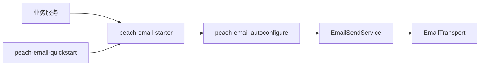

# peach-email

[English](README.en-US.md) | 中文

`peach-email` 统一封装邮件模型、SMTP 传输、Provider 路由、模板、重试和幂等扩展。业务模块通过 `peach-email-starter` 接入。

## 结构

| 模块 | 职责 |
| --- | --- |
| `peach-email-autoconfigure` | 公共 API、SMTP/模板/重试/幂等实现与自动装配 |
| `peach-email-starter` | 业务接入依赖入口 |
| `peach-email-quickstart` | 最小启动与 Provider 配置验证 |



## 接入

```xml
<dependency>
    <groupId>com.peach</groupId>
    <artifactId>peach-email-starter</artifactId>
</dependency>
```

**Starter 运行依赖：** `peach-email-starter` 显式提供 Jakarta Mail、FreeMarker 和 Commons Lang。AutoConfigure 内的 `optional` 仅表示可编译的条件适配，不应由业务服务额外补齐默认 SMTP 和模板引擎所需的类；Quickstart 直接依赖 Starter 验证其运行契约。

Provider 凭据从环境变量、配置中心或密钥服务提供。

### QuickStart

- 模块：[`peach-email-quickstart`](./peach-email-quickstart/)
- 能力样例（注入 `EmailSendService`，默认内存 Mock `EmailTransport`，不外发）：
  - **欢迎邮件**：`send(provider, message)` 同时发送纯文本降级正文与 HTML
  - **幂等发送**：`sendAuto` 相同幂等键第二次调用不再走 Transport
  - **附件**：`EmailMessage` 携带带字节内容的 `Attachment`，Mock 记录附件数量
- 启动后 `EmailDemoRunner` 依次执行；关闭演示：`quickstart.email.demo.enabled=false`
- 端口：无 REST（`web-application-type=none`）
- 运行：`mvn -pl peach-component/peach-email/peach-email-quickstart -am spring-boot:run`
- 测试：`mvn -pl peach-component/peach-email/peach-email-quickstart -am test`

SMTP provider、用户名和授权码只通过环境变量或配置中心提供，QuickStart 不保存真实凭据。模板渲染不在 `sendAuto` 内自动发生，本样例直接设置 HTML。

**SMTP 重试与故障转移：** `SendResult` 保留原有五参数构造器，并增加失败阶段 `EmailFailureKind`：`RETRYABLE_BEFORE_SEND`、`PERMANENT_BEFORE_SEND`、`DELIVERY_UNKNOWN`。只有连接阶段确认未进入 `sendMessage` 的临时故障才会自动重试或切换 Provider；一旦开始 SMTP 投递，失败可能表示服务端已接收，默认停止自动重试并要求人工核查。未知类型的自定义 `EmailTransport` 失败默认按 `DELIVERY_UNKNOWN` 处理。重试指数退避最大 5 分钟，不能用重试伪装邮件“恰好一次”送达。

**并发幂等与容量：** `sendAuto` 在外发前先尝试原子占用幂等键；`SimpleIdempotencyStore` 区分 `IN_FLIGHT`、`SENT`、`UNKNOWN`，只有拥有当前认领令牌的调用可结束认领。SMTP 结果未知时保留占用，后续同键调用不会谎报发送成功；成功则记录至 TTL 到期，确认未发送则释放。默认 `peach.email.idempotency.retention=24h`、`max-entries=10000`，容量用尽会在外发前明确拒绝，清理仅在读写时执行，不创建额外工作线程；`sendAuto` 同进程最多 256 个在途请求。**本地 Store 不能在多实例间保证原子性**，必须使用支持共享 CAS/租约的 `ClaimingIdempotencyStore` 自定义 Bean。老 `IdempotencyStore` 可继续使用，但只具有 JVM 内同键并发保护；直连 `send(provider,message)` 不自动应用本幂等入口。未知结果过期后仍可能重复，必须配合业务调和。

## 边界

- SMTP 密码、授权码、完整收件人列表、正文和附件内容不得进入日志。
- 自动发送需要稳定业务幂等键；生产多实例不能把内存 `IdempotencyStore` 当作持久化保证。
- 重试仅覆盖可恢复故障；认证失败、地址无效和参数错误不盲目重试。
- Provider 故障转移必须评估重复发送风险。
