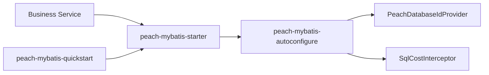

# peach-mybatis

English | [中文](README.md)

`peach-mybatis` provides MyBatis `databaseId` detection, SQL logging, and slow-SQL warnings. A business launch module depends on `peach-mybatis-starter`. Each service still declares its own data source, transaction manager, and `@MapperScan`.

## Structure

| Module | Responsibility |
| --- | --- |
| `peach-mybatis-autoconfigure` | Database detection, SQL logging interceptor, PageHelper settings, and optional Micrometer metrics |
| `peach-mybatis-starter` | Business integration dependency |
| `peach-mybatis-quickstart` | Minimal startup check, not a business template |



## Integration

```xml
<dependency>
    <groupId>com.peach</groupId>
    <artifactId>peach-mybatis-starter</artifactId>
</dependency>
```

When the application creates its own `SqlSessionFactoryBean`, a bean post-processor installs the `DatabaseIdProvider` and interceptors. The official MyBatis auto-configuration collects those beans directly.

A custom `logback-spring.xml` must include the SQL logger appender, otherwise `SQL_LOG` has no destination:

```xml
<include resource="logback/peach-mybatis.xml"/>
```

Do not declare `databaseIdProvider` or the paging and timing plugins again in `mybatis-config.xml`, or the same SQL is logged twice.

## Logging

By default, Preparing keeps `?` and Parameters lists values in placeholder order. With `peach.mybatis.log.executable=true`, Preparing becomes the statement with values substituted and Parameters is omitted. One log event contains only one of the two forms.

Slow SQL, failed statements, and missing-WHERE warnings follow the same switch. DEBUG Preparing text is limited to 4000 characters. Slow SQL and missing-WHERE warnings stay complete.

| Property | Default | Meaning |
| --- | --- | --- |
| `peach.mybatis.enabled` | `true` | Skip database detection and SQL logging when false |
| `peach.mybatis.long-query-time` | `3000` | Slow-SQL threshold in milliseconds |
| `peach.mybatis.jdbc-type-for-null` | `false` | Set the JDBC type of null parameters to NULL when true |
| `peach.mybatis.log.executable` | `false` | Emit executable SQL |
| `peach.mybatis.log.warn-missing-where` | `true` | Warn when UPDATE / DELETE has no WHERE after quotes and comments are removed |
| `peach.mybatis.log.max-sql-length` | `4000` | Maximum DEBUG Preparing length; zero or negative disables truncation |
| `peach.mybatis.log.large-result-threshold` | `5000` | Warn when the row count exceeds this value; zero or negative disables it |
| `peach.mybatis.pagehelper.helper-dialect` | empty | PageHelper detects the dialect once from the current connection |
| `peach.mybatis.pagehelper.auto-runtime-dialect` | `false` | Detect the dialect on every page when true |

Default vendor mapping: MySQL, MariaDB, and DM use `mysql`; PostgreSQL and KingbaseES use `postgresql`; Oracle uses `oracle`; Microsoft SQL Server uses `sqlserver`; H2 uses `h2`. An unrecognized product name fails startup. `peach.mybatis.database-ids` overrides a default with the same vendor name, and the longer vendor name wins.

Executable SQL writes booleans as `true` / `false` and bytes as `X'...'`. Those literals apply to MySQL and PostgreSQL.

When a Micrometer `MeterRegistry` exists, the component records `peach.mybatis.sql` with the full mapper method id and a slow flag. PageHelper auto-configuration stays unloaded when PageHelper is absent from the classpath.

## Quick Start

The sample lives in [`peach-mybatis-quickstart`](./peach-mybatis-quickstart/). It checks that the starter starts and registers database detection plus SQL logging. It does not open a database connection.

```bash
mvn -pl peach-component/peach-mybatis/peach-mybatis-quickstart -am test
```

## Boundaries

- Statements are selected by `databaseId`. The component does not translate one SQL dialect into another.
- Data sources, transaction managers, and mapper scanning stay in the business service.
- `SqlCostInterceptor` wraps the pagination plugin and logs SQL from before pagination rewrites it.
