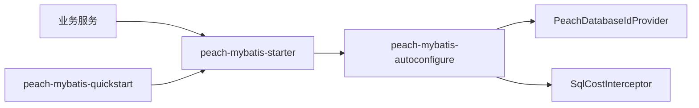

# peach-mybatis

[English](README.en-US.md) | 中文

`peach-mybatis` 提供 MyBatis 多库 `databaseId` 识别、SQL 日志和慢 SQL 告警。业务 launch 引入 `peach-mybatis-starter` 即可使用，数据源、事务管理器和 `@MapperScan` 仍由各服务自己声明。

## 结构

| 模块 | 职责 |
| --- | --- |
| `peach-mybatis-autoconfigure` | 多库识别、SQL 日志拦截器、PageHelper 参数和可选 Micrometer 指标 |
| `peach-mybatis-starter` | 业务接入依赖入口 |
| `peach-mybatis-quickstart` | 最小启动验证，不作为业务模板 |



## 接入

```xml
<dependency>
    <groupId>com.peach</groupId>
    <artifactId>peach-mybatis-starter</artifactId>
</dependency>
```

启动类自己创建 `SqlSessionFactoryBean` 时，后处理器会装上 `DatabaseIdProvider` 和拦截器。使用 MyBatis 官方自动配置时，这些 Bean 会被官方配置直接收集。

自定义 `logback-spring.xml` 需要引入 SQL 日志 appender，否则 `SQL_LOG` 没有输出目标：

```xml
<include resource="logback/peach-mybatis.xml"/>
```

`mybatis-config.xml` 里不要再声明 `databaseIdProvider` 和分页、耗时插件，避免同一条 SQL 被记录两次。

## 日志

默认 Preparing 保留 `?`，Parameters 仅记录参数数量和类型（最多 16 个类型），**不记录参数值**。`peach.mybatis.log.executable=true` 是显式的 DEBUG 排障选项，可能包含敏感值，生产环境不要开启；慢 SQL 与缺少 WHERE 告警始终使用安全的占位符 SQL。

DEBUG、慢 SQL 和缺少 WHERE 的 SQL 文本均限制长度（默认 4000、硬上限 16384），即使配置小于等于 0 也不能关闭限制。超大的字节数组或文本参数不执行可执行 SQL 渲染。

| 配置 | 默认值 | 说明 |
| --- | --- | --- |
| `peach.mybatis.enabled` | `true` | 关闭后不注册多库识别和 SQL 日志 |
| `peach.mybatis.long-query-time` | `3000` | 慢 SQL 阈值，单位毫秒 |
| `peach.mybatis.jdbc-type-for-null` | `false` | 为 `true` 时把空参数的 JDBC 类型设为 NULL |
| `peach.mybatis.log.executable` | `false` | 是否输出可执行 SQL |
| `peach.mybatis.log.warn-missing-where` | `true` | UPDATE / DELETE 去掉引号和注释后没有 WHERE 时告警 |
| `peach.mybatis.log.max-sql-length` | `4000` | 所有 SQL 日志的最大长度；小于等于 0 使用安全默认值，上限 16384 |
| `peach.mybatis.log.large-result-threshold` | `5000` | 返回行数超过该值时告警，小于等于 0 表示关闭 |
| `peach.mybatis.pagehelper.helper-dialect` | 空 | 为空时 PageHelper 按当前连接识别一次 |
| `peach.mybatis.pagehelper.auto-runtime-dialect` | `false` | 为 `true` 时每次分页都重新识别方言 |

默认厂商映射：MySQL、MariaDB、达梦使用 `mysql`，PostgreSQL、人大金仓使用 `postgresql`，Oracle 使用 `oracle`，Microsoft SQL Server 使用 `sqlserver`，H2 使用 `h2`。未识别的产品名会让启动失败。`peach.mybatis.database-ids` 可覆盖同名默认项，更长的厂商名优先匹配。

可执行 SQL 中的布尔值写成 `true` / `false`，二进制写成 `X'...'`。这两种字面量适用于 MySQL 和 PostgreSQL。

存在 Micrometer 的 `MeterRegistry` 时记录 `peach.mybatis.sql`，标签为 Mapper 方法全名和是否慢 SQL。classpath 没有 PageHelper 时，分页自动配置不会加载。

## Quick Start

示例位于 [`peach-mybatis-quickstart`](./peach-mybatis-quickstart/)。它只验证 starter 能启动并注册多库识别与 SQL 日志，不连接数据库。

```bash
mvn -pl peach-component/peach-mybatis/peach-mybatis-quickstart -am test
```

## 边界

- 组件按 `databaseId` 选择语句，不把一条 SQL 改写成另一种数据库方言。
- 数据源、事务管理器和 Mapper 扫描仍由业务服务声明。
- `SqlCostInterceptor` 在分页插件外层，记录的是分页改写前的 SQL。
