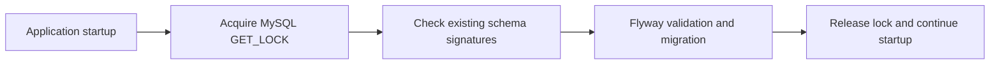

# Peach Database

[中文](README.md)

An application-specific JAR for shared MySQL migrations. Spring Boot runs the same Flyway migrations when the seven JDBC applications start, recording versions in `PEACH_FLYWAY_HISTORY` in the shared database. Spring Boot dependency management determines the Flyway version. This module is not a reusable business Starter.

## Startup and upgrades

Build and deploy applications depending on this module, then start them with their existing datasource configuration. Migration failure prevents readiness. Back up the database before startup; sign in again after upgrading to refresh menus and permission snapshots. Explicitly setting `spring.flyway.enabled=false` disables Boot startup migrations; the deployment operator must then complete compatible migrations separately.



The named lock covers initial adoption checks and the entire migration, with a 120-second acquisition timeout. Empty databases migrate directly. A nonempty database without migration history must contain `PEACH_USER.USER_ID`, `PEACH_TENANT.TENANT_ID` and `PEACH_FUNCTION.FUNC_CODE` before adoption at baseline version 0. These limited signatures are not a complete schema comparison and do not establish compatibility with every historical database. Flyway validates applied versions and checksums for databases with an existing history table.

The V1 Java migration executes the packaged schema and V5 executes system seeds; both provide checksums of their source files. Other versions maintain historical MQ, tenant, task registration, permission, login audit and role workspace changes. Current source and tests define the actual version list.

## SQL maintenance boundary

Before the first rollout, run these commands from the repository root to prepare and check the baseline and deployment mirrors:

```bash
node scripts/sync-database-sql.mjs
node scripts/sync-database-sql.mjs --check
node --test scripts/sync-database-sql.test.mjs
```

The generator sorts top-level table scripts under `sql/` containing CREATE TABLE, excluding `INIT.sql` and `ALL_TABLE_CREATE.sql`. It synchronizes `sql/ALL_TABLE_CREATE.sql` and `deploy-pipline/init/mysql/schema/ALL_TABLE_CREATE.sql`, and copies `sql/INIT.sql` to `deploy-pipline/init/mysql/data/INIT.sql`. `--check` fails on drift without writing files. Names are preserved because both deployment entry points still reference these paths.

**Freeze `sql/ALL_TABLE_CREATE.sql`, `sql/INIT.sql` and released migrations after the first Flyway rollout.** Future changes must add versioned migrations, without changing baseline checksums by editing or regenerating released files. The generator resolves drift before the initial rollout; afterward, `--check` checks mirror consistency. `sql/migrations/` retains historical manual scripts as archives. Normal startup upgrades no longer require running them individually or using temporary Python migration tools.

## Failure handling and cleanup scope

MySQL DDL can commit implicitly, so startup failure does not guarantee an atomic rollback. Preserve backups and migration history, fix the underlying cause, inspect actual schema and data, then decide on restoration or history repair through a controlled procedure. Do not blindly retry modified historical migrations. This module enables migration validation, disables clean, and provides no automatic repair or database cleanup.

The temporary root RocketMQ Compose and broker configuration were removed; the maintained entry remains `deploy-pipline/compose/middleware/docker-compose.yml`. The generated frontend audit report was removed and ignored to avoid committing workstation paths and stale findings. Browser regression scripts, tests and public logging utilities remain to preserve regression evidence and caller compatibility. Operation logs still use an in-memory queue; loss risks from process crashes or sustained database failure remain unchanged. These migrations do not add durable log compensation.

Further reading: [Login audit](../peach-auth/docs/login-audit.en-US.md), [Administration workspace](../peach-auth/docs/admin-workspace.en-US.md).

V5 skips initial administrator, membership and full grant seeding when adopting an existing database, preserving revoked configuration; incremental versions still upgrade system definitions. Hikari `maximumPoolSize` must be at least 3; startup rejects smaller pools before holding the migration lock to avoid pool starvation.
