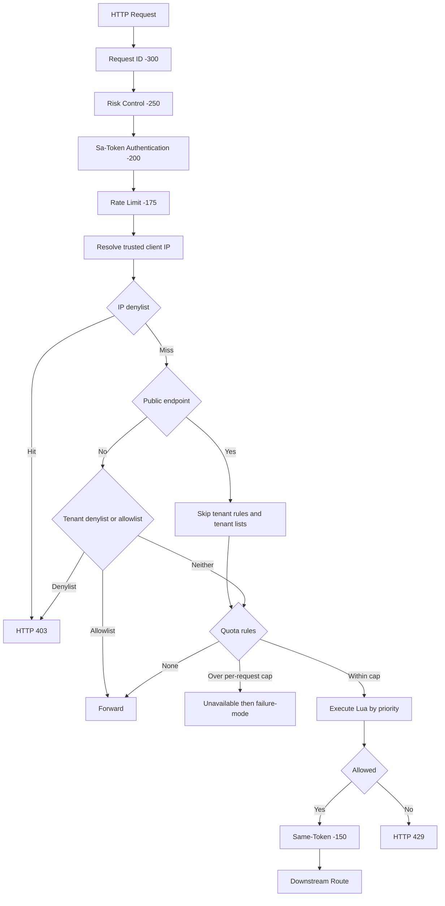

# Gateway Multi-Algorithm Rate Limiting

[中文](rate-limit.md) | English

## 1. Scope

Gateway rate limiting is implemented in peach-gateway-core with a Spring Cloud Gateway GlobalFilter, reactive Lettuce Redis, and Redis Lua scripts.

Six algorithms are supported:

| Algorithm | Behavior | Best fit | Trade-off |
| --- | --- | --- | --- |
| FIXED_WINDOW | Counts requests in fixed time slices | Basic API quotas and statistical throttling | Simple and memory-efficient; can allow boundary bursts |
| SLIDING_WINDOW_LOG | Stores each request timestamp in a sorted set | Login, captcha, payment, or other precise low/medium-volume controls | Accurate sliding window; memory and Redis write cost grow with request count |
| SLIDING_WINDOW_COUNTER | Weights the previous window count with the current window count | High-throughput general APIs | Fixed memory and low overhead; weighted result is approximate |
| TOKEN_BUCKET | Refills tokens at a configured rate and permits a bounded burst | General APIs and burst-tolerant traffic | Average rate and burst capacity are configured independently |
| LEAKY_BUCKET | Leaks accumulated water at a configured rate and rejects overflow | Ingress policing where bursts must be constrained | This implementation is policing: overflow is rejected; no waiting queue is created |
| GCRA | Controls rate and burst using theoretical arrival time | High concurrency and low per-key state | One TAT value per key; rate and burst parameters require deliberate sizing |

Each rule selects its own algorithm.

Six scopes are supported:

| Scope | Redis identity | Meaning |
| --- | --- | --- |
| GLOBAL | Rule ID | All requests matching the rule share one quota |
| IP | Client IP | Requests from the same IP share a quota |
| URI | HTTP Method + URI/matched pattern | Requests to the same endpoint share a quota |
| IP_URI | IP + Method + URI/matched pattern | Each IP has an independent quota per endpoint |
| TENANT | tenantId from Token Session | One tenant shares a quota across endpoints |
| TENANT_URI | tenantId + Method + URI/matched pattern | Each tenant has an independent quota per endpoint |

Rules can also select methods, paths, and route-ids. Values within one selector list are OR-ed; different selector types are AND-ed.

## 2. Request Flow

The rate-limit filter runs at order -175, after Sa-Token authentication (-200) and before Same-Token injection (-150). Requests with no quota rule still pass IP and tenant allow/deny policy first. Public login endpoints skip tenant rules and tenant lists, so a missing token does not become HTTP 401.

Execution semantics:

1. Rules run in ascending priority order.
2. The first rejected rule short-circuits later rules.
3. Rules use independent Redis keys, not a distributed transaction. Earlier quota consumption is not rolled back if a later rule rejects.
4. If all rules allow, response headers describe the matched rule with the lowest remaining ratio. On rejection, headers describe the rejecting rule.
5. Rules and allow/deny lists are published as one immutable configuration snapshot. A failed refresh retains the previous valid snapshot.

## 3. Tenant and Client IP Trust

### Tenant context

Tenant limits read only the current Sa-Token Token Session:

- After successful login, the auth service writes tenantId, orgId, fiscal, and a context version into the current token's Token Session.
- Tenant switching updates the current token's Token Session.
- Gateway reads the Token Session associated with the request token. The blocking Sa-Token DAO lookup runs on boundedElastic, not on the Netty EventLoop.
- Missing Token Sessions are not created during lookup.
- Client headers such as X-Tenant-Id and the user-wide shared profile Hash are not trusted for rate-limit identity.

require-tenant-context defaults to true. If a tenant rule matches but the current Token Session has no tenant ID, the request receives 401; the tenant rule is never silently skipped. When set to false, only tenant rules without context are skipped; other matching rules still run.

### Client IP

- If the TCP peer is not in trusted-proxies, X-Forwarded-For is ignored and the TCP peer address is used.
- If the TCP peer is trusted, the resolver walks X-Forwarded-For from right to left, skipping trusted proxy hops and selecting the first untrusted hop.
- Malformed or oversized forwarding chains fall back to the TCP peer.
- A client cannot change its IP quota by forging forwarding headers.

trusted-proxies accepts IPv4, IPv6, and CIDR values such as 10.20.0.0/16 and 2001:db8:1234::/48.

## 4. Configuration

The prefix is peach.gateway.rate-limit. Runtime configuration belongs in the Nacos peach-gateway.yml. Repository examples keep rate limiting and example rules disabled by default so that unreviewed thresholds do not change existing traffic.

### Minimal enabled example

    peach:
      gateway:
        rate-limit:
          enabled: true
          failure-mode: fail-closed
          max-matched-rules-per-request: 32
          require-tenant-context: true
          trusted-proxies:
            - 10.20.0.0/16
          allowlist-ips: []
          allowlist-tenants: []
          denylist-ips: []
          denylist-tenants: []
          rules:
            - id: global-api
              enabled: true
              scope: GLOBAL
              algorithm: TOKEN_BUCKET
              priority: 10
              methods: [GET, POST, PUT, PATCH, DELETE]
              paths: [/api/**]
              replenish-rate: 1000
              burst-capacity: 2000
              cost: 1
            - id: login-ip
              enabled: true
              scope: IP
              algorithm: SLIDING_WINDOW_LOG
              priority: 20
              methods: [POST]
              paths: [/api/auth/login]
              limit: 10
              window: 60s
              cost: 1
            - id: tenant-api
              enabled: true
              scope: TENANT
              algorithm: GCRA
              priority: 30
              methods: [GET, POST, PUT, PATCH, DELETE]
              paths: [/api/orders/**]
              replenish-rate: 100
              burst-capacity: 200
              cost: 1

### Rule properties

| Property | Type | Default | Applicable algorithms / meaning |
| --- | --- | --- | --- |
| id | String | Required | Globally unique ID, 1–64 letters, digits, dots, underscores, or hyphens |
| enabled | Boolean | true | Whether the rule is active |
| scope | Enum | Required | One of the six scopes |
| algorithm | Enum | TOKEN_BUCKET | One of the six algorithms |
| priority | Integer | 100 | Lower values run first |
| methods | List | Empty | HTTP methods; empty means all, ANY and * are supported |
| paths | List | Empty | Ant-style URI patterns; empty means all paths |
| route-ids | List | Empty | Gateway Route IDs; empty means all routes |
| limit | Integer | 100 | Fixed-window and sliding-window request limit |
| window | Duration | 1s | Fixed-window and sliding-window duration |
| replenish-rate | Double | 100 | Token bucket and GCRA refill/permit rate per second |
| burst-capacity | Integer | 100 | Token bucket, leaky bucket, and GCRA capacity |
| leak-rate | Double | 100 | Leaky bucket drain rate per second |
| cost | Integer | 1 | Per-request quota cost; positive and no greater than the capacity/limit |

### Allowlists and denylists

- allowlist-ips and allowlist-tenants bypass all rate-limit rules.
- denylist-ips and denylist-tenants reject requests with 403.
- Denylists take precedence over allowlists.
- These lists refresh through Nacos. Existing GatewayIpWhitelistGlobalFilter and GatewayRiskControlGlobalFilter access-control behavior remains unchanged.

## 5. Lua Script Sources

Scripts live in peach-gateway-core/src/main/resources/ratelimit/lua/, one file per algorithm.

Source precedence:

1. Per-algorithm URL in scripts.remote-urls.
2. scripts.remote-base-url plus the algorithm script filename.
3. The classpath file under scripts.local-location, only when no remote URL is configured for that algorithm.

When a remote URL is configured, download or SHA-256 validation failure is reported; the loader does not silently fall back to a local script. A `remote-base-url` loads all six algorithms, so SHA-256 values for all six scripts are required. To host only a subset remotely, configure per-algorithm URLs in `remote-urls` and leave the remaining algorithms on the classpath. If initial loading fails while rate limiting is enabled, startup fails rather than running with an unknown script. If a runtime Nacos refresh fails, the previous complete script snapshot remains active. If rate limiting starts disabled and is later enabled through Nacos, quota checks return an unavailable result until all six scripts have loaded. The configured `failure-mode` then applies: FAIL_CLOSED returns 503, while FAIL_OPEN allows traffic. IP/tenant allowlists and denylists remain active. Loading failures are logged; after correcting the remote URL or checksum, a subsequent Nacos refresh can retry.

Remote OSS example:

    scripts:
      remote-base-url: https://cdn.example.com/peach/rate-limit/lua/
      require-remote-checksum: true
      expected-sha256:
        fixed-window: <sha256>
        sliding-window-log: <sha256>
        sliding-window-counter: <sha256>
        token-bucket: <sha256>
        leaky-bucket: <sha256>
        gcra: <sha256>

A pre-signed URL can be configured for an individual algorithm in remote-urls. Production URLs should use HTTPS and must not target link-local or cloud metadata addresses. Loading rejects scripts that touch a second Redis key, disables HTTP redirects, and checks size, connect timeout, read timeout, and SHA-256.

`local-location` accepts `classpath:` or `file:`. A `file:` resource is not watched. After replacing the file on disk, publish a Nacos script-config change or restart the gateway to reload it. The directory should be read-only for the gateway user.

## 6. Responses and Failure Policy

Successful requests may include:

| Header | Meaning |
| --- | --- |
| RateLimit-Limit | Quota limit for the selected rule |
| RateLimit-Remaining | Remaining quota |
| RateLimit-Reset | Seconds until refill/window reset |

Requests over quota receive HTTP 429 and a Retry-After header in seconds. The shared GatewayFilterSupport creates the JSON error body.

When Redis or the rate-limit executor is unavailable:

- FAIL_OPEN: record metrics and a WARN log, then continue forwarding.
- FAIL_CLOSED: record metrics and an ERROR log, then return HTTP 503.
- Missing required tenant context always returns 401, independent of Redis failure mode.
- During dynamic enablement, quota algorithms return an unavailable result and record `scripts-not-ready` until all scripts are loaded successfully. `failure-mode` applies (503 for FAIL_CLOSED, pass-through for FAIL_OPEN); IP/tenant allowlists and denylists remain active.

## 7. Nacos Refresh and Metrics

- RateLimitRuleRegistry listens for EnvironmentChangeEvent, validates the new configuration, and atomically replaces rules, allowlists, and denylists.
- RateLimitScriptLoader reloads scripts only when script properties or the enabled state changes.
- Script snapshots are replaced as a whole; failed reloads keep the previous snapshot.
- Metric names:
  - peach.gateway.rate.limit.requests
  - peach.gateway.rate.limit.execution
- Tags are limited to scope, algorithm, and outcome. IP, tenant, user, URI, and rule ID are not used as tags, preventing high cardinality.

## 8. Redis Cluster and Hot Keys

Every Lua script accesses only KEYS[1], avoiding Redis Cluster cross-slot access. Fixed-window state is stored in one hash key; the Lua script does not construct a second Redis key.

The key prefix is peach:gateway:rate-limit:v2:. IP, tenant, and URI identities are SHA-256 hashed so raw identities are not stored in Redis keys and key length remains bounded.

Strict Global limits inherently share a hot key. If horizontal partitioning is required and quota semantics may change, prefer tenant, IP, or URI scopes rather than sharding a Global key and still claiming exact global enforcement.

## 9. Tests and Verification

Gateway Core tests cover:

- Trusted proxy chains and forged forwarding headers.
- Rule priority, short-circuit rejection, missing tenant context, and allowlist bypass.
- 429 response headers and FAIL_OPEN / FAIL_CLOSED.
- Remote OSS precedence, local script source, SHA-256, and no fallback on remote failure.
- All six algorithms against real Redis through Testcontainers.
- Concurrent quota sharing between two independent Lettuce clients.

Run:

    mvn -pl peach-gateway/peach-gateway-core,peach-auth/peach-auth-service -am verify -Pdevelopment

Docker is required for Testcontainers integration tests.
