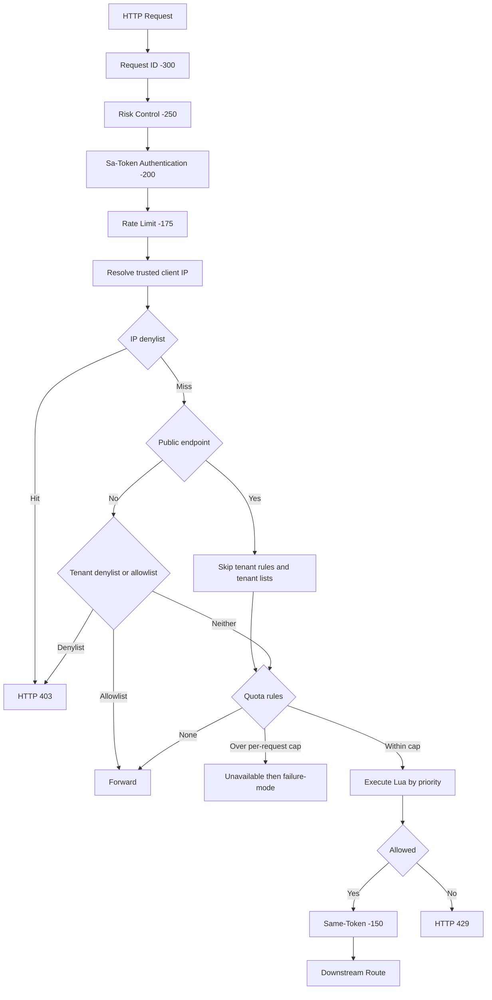

# Gateway 多算法限流

[English](rate-limit.en-US.md) | 中文

## 1. 能力范围

Gateway 限流由 peach-gateway-core 实现，使用 Spring Cloud Gateway GlobalFilter、响应式 Lettuce Redis 和 Redis Lua 脚本。

支持六种算法：

| 算法 | 核心行为 | 适用场景 | 主要取舍 |
| --- | --- | --- | --- |
| FIXED_WINDOW 固定窗口 | 按固定时间片计数 | 普通接口配额、统计型限流 | 实现简单、内存低；窗口边界可能出现双倍突发 |
| SLIDING_WINDOW_LOG 滑动日志 | 保存窗口内每次请求时间 | 登录、验证码、支付等需要精确窗口控制的低/中流量接口 | 窗口边界平滑、精度高；每次请求写 ZSET，内存和 Redis 操作成本较高 |
| SLIDING_WINDOW_COUNTER 滑动计数器 | 当前窗口计数加前一窗口加权计数 | 高吞吐普通 API | 内存固定、开销低；加权估算属于近似值 |
| TOKEN_BUCKET 令牌桶 | 按速率补充令牌，允许有限突发 | 通用 API、允许突发流量的接口 | 平均速率与突发容量可独立控制 |
| LEAKY_BUCKET 漏桶 | 按泄漏速率消耗水量，超容量拒绝 | 希望限制突发并控制平均流量的入口 | 当前实现是 policing：超限直接拒绝，不创建等待队列 |
| GCRA 通用单元计量算法 | 通过理论到达时间控制速率和突发 | 高并发、低状态开销、需要平滑速率约束的 API | 每个限流 Key 只需一个 TAT 状态，参数需要按速率和突发理解 |

算法由每条规则独立选择，不存在全局固定算法。

支持六种限流维度：

| Scope | Redis 身份维度 | 说明 |
| --- | --- | --- |
| GLOBAL | 规则 ID | 所有命中该规则的请求共享一个额度 |
| IP | 客户端 IP | 同一 IP 共享额度 |
| URI | HTTP Method + URI/匹配模式 | 同一接口共享额度 |
| IP_URI | IP + Method + URI/匹配模式 | 每个 IP 对每个接口独立额度 |
| TENANT | Token Session 中的 tenantId | 同一租户跨接口共享额度 |
| TENANT_URI | tenantId + Method + URI/匹配模式 | 每个租户对每个接口独立额度 |

规则还可以配置 methods、paths、route-ids 三种选择器；同一选择器列表内为 OR 关系，不同选择器之间为 AND 关系。

## 2. 请求执行链

限流过滤器顺序为 -175，位于 Sa-Token 鉴权 -200 之后、Same-Token -150 之前。没有配额规则时仍会先执行 IP/租户黑白名单；公开登录接口会跳过租户规则和租户名单，避免无 Token 的登录请求被误返回 401。

执行约束：

1. 规则按 priority 从小到大执行。
2. 一条规则拒绝后立即短路，不再执行后续规则。
3. 多条规则顺序执行，不构成跨 Redis Key 事务；前序规则已消耗的额度不会回滚。
4. 全部通过时，响应头描述剩余额度比例最低的匹配规则；拒绝时描述拒绝规则。
5. 规则和白/黑名单通过不可变配置快照原子替换，刷新失败保留上一份有效快照。

## 3. 租户身份与 IP 安全

### 租户上下文

租户限流只读取当前 Sa-Token Token Session：

- 登录成功后，认证服务写入当前 token 对应的 tenantId、orgId、fiscal 和上下文版本。认证服务在登录时显式设置 Sa-Token `isShare=false`、`isConcurrent=true`，覆盖全局 `sa-token.is-share: true`，确保每次登录发放独立 token，避免不同设备共享 Token Session 后相互覆盖租户上下文。
- 调用租户切换接口后，更新当前 token 的 Token Session。
- Gateway 使用请求中的 token 查询对应 Token Session；查询在 boundedElastic 执行，避免阻塞 Netty EventLoop。
- 读取时不创建缺失的 Token Session。
- 不读取 X-Tenant-Id 等客户端请求头，也不使用按 userId 共享的用户上下文 Hash 作为限流身份。

默认 require-tenant-context: true。如果租户规则匹配但当前 Token Session 没有租户 ID，请求返回 401，不会静默跳过租户规则。设为 false 时，仅跳过缺少租户上下文的租户规则，其他匹配规则仍执行。

### 客户端 IP

- TCP 对端不在 trusted-proxies 中：忽略 X-Forwarded-For，直接使用 TCP 对端地址。
- TCP 对端属于可信代理：解析 X-Forwarded-For，从右向左跳过可信代理，取第一个非可信跳点。
- 转发链非法或过长时退回 TCP 对端地址。
- 不允许通过伪造转发头切换 IP 限流 Key。

trusted-proxies 支持 IPv4、IPv6 和 CIDR，例如 10.20.0.0/16、2001:db8:1234::/48。

## 4. 配置

配置前缀：peach.gateway.rate-limit。运行态配置放在 Nacos 的 peach-gateway.yml。仓库提供的示例默认关闭限流，规则示例也默认禁用，避免未经容量评估直接改变现有流量。

### 最小启用示例

    peach:
      gateway:
        rate-limit:
          enabled: true
          failure-mode: fail-closed
          require-tenant-context: true
          max-matched-rules-per-request: 32
          trusted-proxies:
            - 10.20.0.0/16
          allowlist-ips: []
          allowlist-tenants: []
          denylist-ips: []
          denylist-tenants: []
          rules:
            - id: global-api
              enabled: true
              scope: GLOBAL
              algorithm: TOKEN_BUCKET
              priority: 10
              methods: [GET, POST, PUT, PATCH, DELETE]
              paths: [/api/**]
              replenish-rate: 1000
              burst-capacity: 2000
              cost: 1
            - id: login-ip
              enabled: true
              scope: IP
              algorithm: SLIDING_WINDOW_LOG
              priority: 20
              methods: [POST]
              paths: [/api/auth/login]
              limit: 10
              window: 60s
              cost: 1
            - id: tenant-api
              enabled: true
              scope: TENANT
              algorithm: GCRA
              priority: 30
              methods: [GET, POST, PUT, PATCH, DELETE]
              paths: [/api/orders/**]
              replenish-rate: 100
              burst-capacity: 200
              cost: 1

### 规则属性

| 属性 | 类型 | 默认值 | 适用算法/说明 |
| --- | --- | --- | --- |
| id | String | 必填 | 全局唯一规则 ID，1–64 个字母、数字、点、下划线或连字符 |
| enabled | Boolean | true | 是否启用该规则 |
| scope | Enum | 必填 | 六种限流维度之一 |
| algorithm | Enum | TOKEN_BUCKET | 六种算法之一 |
| priority | Integer | 100 | 数值越小越先执行 |
| methods | List | 空 | HTTP Method；空表示全部，支持 ANY / * |
| paths | List | 空 | Ant 风格 URI 模式；空表示全部路径 |
| route-ids | List | 空 | Gateway Route ID；空表示所有路由 |
| limit | Integer | 100 | 固定窗口、滑动窗口上限 |
| window | Duration | 1s | 固定窗口、滑动窗口窗口长度 |
| replenish-rate | Double | 100 | 令牌桶、GCRA 每秒补充/放行速率 |
| burst-capacity | Integer | 100 | 令牌桶、漏桶、GCRA 容量 |
| leak-rate | Double | 100 | 漏桶每秒泄漏速率 |
| cost | Integer | 1 | 单次请求消耗额度，必须为正数且不能超过容量/上限 |

### 白名单和黑名单

- allowlist-ips、allowlist-tenants：命中后绕过所有限流规则。
- denylist-ips、denylist-tenants：命中后直接返回 403。
- 黑名单优先于白名单。
- 这些列表由 Nacos 动态刷新；已有 GatewayIpWhitelistGlobalFilter 和 GatewayRiskControlGlobalFilter 的访问控制行为保持不变。

## 5. Lua 脚本来源

脚本位于 peach-gateway-core/src/main/resources/ratelimit/lua/，每种算法独立一个文件。

优先级：

1. scripts.remote-urls 中对应算法的独立 URL。
2. scripts.remote-base-url + 算法脚本文件名。
3. 未配置该算法远程 URL 时，读取 scripts.local-location 的 classpath 文件。

配置远程 URL 后，远程下载或 SHA-256 校验失败会报错，不会静默回退本地脚本。配置 `remote-base-url` 时会加载全部六种算法脚本，因此必须提供六种算法各自的 SHA-256；如果只托管部分算法，请使用 `remote-urls` 为这些算法单独配置地址，其余算法读取本地脚本。首次启动时脚本加载失败会阻止限流功能以未知脚本运行；运行时刷新失败保留上一份完整脚本快照。若网关启动时限流关闭，后续通过 Nacos 开启时，配额算法在六种脚本全部加载成功前返回限流服务不可用状态，并按 failure-mode 执行：FAIL_CLOSED 返回 503，FAIL_OPEN 放行请求。IP/租户黑名单和白名单仍正常执行。脚本加载失败会记录错误；在修复远程地址或校验值后，可通过后续 Nacos 配置刷新再次触发加载。

远程 OSS 示例：

    scripts:
      remote-base-url: https://cdn.example.com/peach/rate-limit/lua/
      require-remote-checksum: true
      expected-sha256:
        fixed-window: <sha256>
        sliding-window-log: <sha256>
        sliding-window-counter: <sha256>
        token-bucket: <sha256>
        leaky-bucket: <sha256>
        gcra: <sha256>

也可以在 remote-urls 中为单个算法指定预签名 URL。生产环境使用 HTTPS，并避免把脚本地址指向链路本地地址或云元数据地址。加载阶段会拒绝访问第二个 Redis Key 的脚本，关闭 HTTP 重定向，并校验脚本大小、连接超时、读取超时和 SHA-256。

`local-location` 可以使用 `classpath:` 或 `file:`。`file:` 资源不会被文件监听自动重载；覆盖磁盘文件后，需要发布一次 Nacos 脚本配置或重启网关才会重新读取。部署时该目录应对网关运行用户只读。

## 6. 响应与故障策略

成功请求会返回：

| Header | 含义 |
| --- | --- |
| RateLimit-Limit | 当前展示规则的额度上限 |
| RateLimit-Remaining | 剩余额度 |
| RateLimit-Reset | 距离额度恢复/窗口重置的秒数 |

超限请求返回 HTTP 429，并增加 Retry-After（秒）。统一 JSON 错误体由 GatewayFilterSupport 生成。

Redis 或限流执行器不可用时：

- FAIL_OPEN：记录指标和 WARN 日志，继续转发请求。
- FAIL_CLOSED：记录指标和 ERROR 日志，返回 HTTP 503。
- 缺少必需的租户上下文始终返回 401，不受 Redis 故障策略影响。
- 动态开启限流时，如果脚本尚未全部加载，配额算法返回服务不可用，并按 `failure-mode` 处理：FAIL_CLOSED 返回 503，FAIL_OPEN 放行；同时记录 `scripts-not-ready` 指标。IP/租户白名单和黑名单仍执行，脚本加载成功后自动开始配额检查。

## 7. Nacos 动态刷新与指标

- RateLimitRuleRegistry 监听 EnvironmentChangeEvent，校验后原子替换规则、白名单和黑名单快照。
- RateLimitScriptLoader 仅在脚本配置或限流启用状态变化时重新加载脚本。
- 脚本快照整体替换；加载失败保留上一份脚本。
- 指标名称：
  - peach.gateway.rate.limit.requests
  - peach.gateway.rate.limit.execution
- 标签仅包含 scope、algorithm、outcome；不包含 IP、租户、用户、URI 或规则 ID，避免高基数。

## 8. Redis Cluster 与热点说明

所有 Lua 脚本只访问一个 KEYS[1]，避免 Redis Cluster 跨 Slot。固定窗口使用单 Hash Key 保存窗口 ID 和计数，不在 Lua 中拼接第二个 Redis Key。

Redis Key 前缀为 peach:gateway:rate-limit:v2:；IP、租户、URI 身份使用 SHA-256，避免将原始身份值写入 Redis Key，并限制 Key 长度。

严格 Global 限流天然共享单个热点 Key。若需要水平扩展且能接受配额语义变化，应优先考虑按租户、IP 或 URI 分区，而不是擅自把 Global Key 分片后仍宣称全局精确限流。

## 9. 测试与验证

Gateway Core 测试覆盖：

- 可信代理链和伪造转发头。
- 多规则优先级、拒绝短路、租户上下文缺失和白名单绕过。
- 429 响应头、FAIL_OPEN / FAIL_CLOSED。
- 远程 OSS 优先、本地脚本来源、SHA-256 和远程失败不回退。
- Testcontainers 真实 Redis 六算法执行。
- 两个独立 Lettuce 客户端并发共享同一 Redis 配额。

执行：

    mvn -pl peach-gateway/peach-gateway-core,peach-auth/peach-auth-service -am verify -Pdevelopment

Testcontainers 集成测试需要 Docker。
