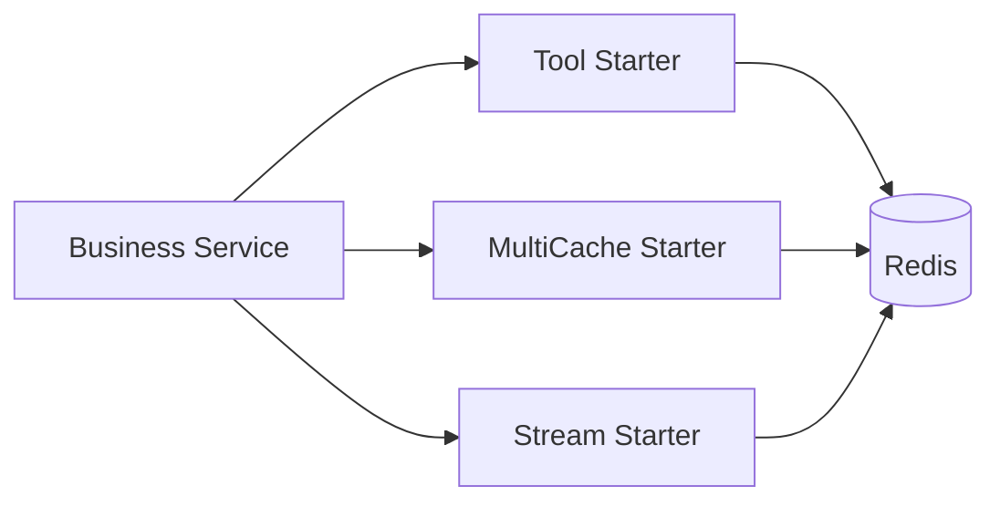

# peach-redis

English | [中文](README.md)

`peach-redis` provides an independent Jedis / Spring Data Redis foundation via `peach-redis-starter`, plus three opt-in feature starters: Tool, MultiCache and Stream. The legacy `peach-redis-common` remains only for external legacy consumers and rollback; internal Maven modules no longer directly depend on it.

## Purpose and compatibility

**Audience:** Spring Boot services needing Redis data structures, Caffeine L1 + Redis L2 caching, or Redis Stream messages. `peach-redis` is a Maven aggregator, **not** one dependency that enables every feature. Select only the needed starter.

**Current baseline:** Java 21 / Spring Boot 3.5.4. The legacy `peach-redis-common` still creates Jedis/templates **and** RedissonClient for compatibility. New Redisson-only services can now use `peach-redisson-starter` without this legacy common module. Internal direct dependencies have migrated; retiring the legacy artifact and verifying mixed-version production rollout remain separate work. This matrix describes what exists on main and the known limitations. See [Issue #18](https://github.com/Ryan-Guizhou/peach-cloud/issues/18) for the redesign.

## ACL, Sentinel and Cluster configuration (Issue #49)

The independent `peach-redis-starter` supports separate credentials for data nodes and Sentinel itself. Do not conflate them. Unset values preserve legacy defaults:

| Property | Default | Meaning |
| --- | --- | --- |
| `peach.redis.username` | blank | Data-node ACL username in standalone, Sentinel and Cluster modes |
| `peach.redis.password` | blank | Data-node password |
| `peach.redis.sentinel-username` | blank | Optional separate Sentinel ACL username |
| `peach.redis.sentinel-password` | blank | Optional separate Sentinel password |
| `peach.redis.ssl-enabled` | `false` | Jedis SSL/TLS flag, independent of Redisson's `ssl-enable` |
| `peach.redis.jedis.max-total` | `128` | Maximum Jedis pool connections |

Redis Cluster requires database `0`; invalid values fail during startup. Both Nacos templates use the same property keys. Put real passwords in a secure configuration source, never the repository. User-provided `RedisConnectionFactory` still wins over the default Jedis factory. See the Issue #47 section below for real topology verification.

## Complete capability matrix

| Module / starter | Main API | Capabilities | Use cases | Current limitation |
| --- | --- | --- | --- | --- |
| Foundation / `peach-redis-starter` (recommended) | `RedisConnectionFactory`, `RedisTemplate`, `StringRedisTemplate` | Independent Jedis, standalone/Sentinel/Cluster, TLS, ACL, pooling, custom-factory backoff | Sa-Token / Tool / cache / Stream | No `RedissonClient`; Cluster DB must be 0; stored format retained, rolling session compatibility still pending |
| Legacy mixed module / `peach-redis-common` (compatibility only) | `RedisConfig` | Historic combined Jedis + Redisson auto-configuration | Older application rollback | No internal direct consumers; do not add to new services; retire only after external migration |
| `peach-redis-tool-starter` | `RedisDao` | String, TTL, Hash, List, Set, ZSet, Pub/Sub and batch deletion | KV, counters, tags, session support | `scan()` supports standalone and all Cluster masters; 10,000 unique keys / 10s by default, throws on overflow; `count` remains a cursor hint; cross-slot deletion stays per-key |
| `peach-redis-multicache-starter` | `MultiCacheManager`, `MultiCacheManagerService`, Spring Cache | Caffeine L1 and Redis L2; TTL jitter; manual and annotation APIs; Pub/Sub invalidation | Product detail, configuration and dictionary caching | Best-effort invalidation, not strong consistency; `clear()` uses bounded deletion; over-limit scans throw and still evict local L1, but Redis L2 may remain; no cross-node strong consistency |
| `peach-redis-stream-starter` | `RedisStreamPushHandler`, `RedisStreamHandler`, `MessageConsumer` | Produce Stream records, group/broadcast consumption, consumer callbacks | Lightweight event messages | Group consumers ACK only on success and retain failures in PEL; opt-in scheduled reclaim, backoff and DLQ are implemented but disabled by default and require fault-injection acceptance |

### Which module should I use?

- **Key enumeration and cleanup:** `RedisDao#scan` returns at most 10,000 unique keys within a 10-second traversal by default; exceeding either bound throws without returning partial results. `deletePattern` rejects unscoped wildcard patterns such as `*` and deletes only after a complete bounded scan. `COUNT` remains a cursor hint; large keyspaces need separate business namespaces.
- **Redis structures:** Tool, or Spring `RedisTemplate` directly if no wrapper is needed.
- **Caffeine L1 behavior:** Strong references are now the default; explicit `WEAK` changes key reference semantics. `putIfAbsent` uses Redis atomic SET NX; cross-node invalidation still uses best-effort Pub/Sub.
- **Local cache acceleration:** MultiCache, with explicit TTL and tolerance for temporary staleness; never rely solely on L1 for real-time authorization.
- **Stream messaging:** Stream; current implementation requires application idempotency and separate recovery arrangements.
- **Distributed locks / bloom filters / delay queues / duplicate suppression:** use [peach-redission](../peach-redission/README.en-US.md), not the Redis Tool.
- **Gateway:** retain the standalone reactive Lettuce setup; avoid blocking Redis calls on WebFlux event-loop threads.

### Bounded Redis Tool SCAN configuration

```yaml
peach:
  redis:
    tool:
      scan:
        max-results: 10000
        timeout-millis: 10000
```

Defaults apply without additional properties; valid ranges are 1–100000 unique keys and 1–60000 milliseconds. Existing `scan(matchKey, count)`, `keys(pattern)` and `deletePattern(pattern, count)` signatures remain unchanged. Limits fail explicitly, not via truncated results. `MultiCache.clear()` evicts its local L1 even if the L2 scan fails; this does not imply all remote Redis values were deleted.

### Minimal Maven dependency (current release)

```xml
<dependency>
    <groupId>com.peach</groupId>
    <artifactId>peach-redis-tool-starter</artifactId>
    <version>${revision}</version>
</dependency>
```

`revision` resolves within the peach-cloud Maven reactor; use an actual published version outside it. Tool / MultiCache / Stream Starters now transitively depend on the independent `peach-redis-starter`, and their Quickstarts no longer explicitly require `peach-redis-common`. Nacos and legacy-data rollout checks remain necessary.

### Minimal configuration (current project convention)

```yaml
peach:
  redis:
    mode: standalone
    host: "${REDIS_HOST:127.0.0.1:6379}"
    password: "${REDIS_PASSWORD:}"
    database: 0
```

Development placeholders only; use a secure secret source in production. Current topology config uses `peach.redis.*`, not `spring.data.redis.*`. MultiCache uses `peach.multicache.*`, and Stream is enabled using **`peach.redis.stream.enable`**, not `enabled`.

### Tool usage example

```java
@Service
@RequiredArgsConstructor
public class ProfileCacheService {
    private final RedisDao redisDao;

    public void cache(String userId, String value) {
        redisDao.vSet("profile:" + userId, value, java.time.Duration.ofMinutes(5));
    }

    public Object find(String userId) {
        return redisDao.vGet("profile:" + userId);
    }
}
```

Uses the existing `RedisDao` API. Production code should standardize key naming, TTL and failure rules and avoid personal data in keys or logs.

### Failure and compatibility policy

| Situation | Recommendation |
| --- | --- |
| Redis unavailable | Ordinary caches may fall back to source; authentication, tokens and CAPTCHA must not be bypassed |
| Multicache subscription disconnected | Local data can become stale; bound L1 TTL; reconnect invalidation and cross-node consistency still need improvement |
| Stream handler fails | Group-mode failures stay pending; optional XPENDING/XCLAIM recovery, backoff and DLQ are disabled by default. Durable business idempotency and failure-injection acceptance remain required |
| Changing Jackson or client driver | Test persisted JSON and existing keys first; do not silently change stored session format |


## Application dependency migration progress (Issue #41)

- **Sa-Token:** its autoconfiguration uses `RedisConnectionFactory`; the Starter transitively includes `peach-redis-starter` rather than the old `peach-redis-common`. Existing session JSON/key formats remain unchanged.
- **Captcha:** its autoconfiguration declares optional Spring Data Redis and Hutool compile dependencies; in-memory captcha storage remains usable independently.
- **Auth / Setting / Message:** service modules use the independent Redis Starter. The Auth launcher removes redundant direct Jedis, Redisson and Spring Data Redis dependencies provided by the Starters.
- **Still to verify:** existing Redis data/session compatibility, login/logout, gateway reactive Lettuce isolation, Nacos deployment profiles and Sentinel/Cluster/TLS rollout in the intended runtime. This batch does not delete the legacy `peach-redis-common`.

## Legacy client dependency cleanup (Issue #43)

Redis Tool / MultiCache / Stream autoconfigure and Quickstart POMs no longer declare optional or direct `peach-redis-common`; `RedisDaoImpl` uses a local Cluster-mode constant rather than depending on the legacy RedisConfig module. Redisson Common / Bloom / DistributedLock / DelayQueue optional legacy dependencies are also removed. Independent client and Tool tests run against real Redis 7.2 in dedicated CI before merging; legacy data, configuration and session rolling-upgrade checks still require explicit production acceptance.

## Structure

| Capability | Autoconfigure | Starter | Quickstart |
| --- | --- | --- | --- |
| Tool | `peach-redis-tool-autoconfigure` | `peach-redis-tool-starter` | `peach-redis-tool-quickstart` |
| MultiCache | `peach-redis-multicache-autoconfigure` | `peach-redis-multicache-starter` | `peach-redis-multicache-quickstart` |
| Stream | `peach-redis-stream-autoconfigure` | `peach-redis-stream-starter` | `peach-redis-stream-quickstart` |



## Selection

- General Redis access: `peach-redis-tool-starter`.
- Local + Redis multi-level caching: `peach-redis-multicache-starter`.
- Redis Stream producer/consumer integration: `peach-redis-stream-starter`.

## Quick Start

Each capability ships a non-web quickstart (`spring.main.web-application-type=none`) that depends only on the matching Starter. Legacy Testcontainers tests may be skipped without Docker; a dedicated Redis 7.2 service-container CI actually exercises Tool and client integration. Provide a development Redis for local demos, or run the IT suite directly.

### Tool

- Module: [`peach-redis-tool-quickstart`](./peach-redis-tool-quickstart/)
- Capability samples (inject `RedisDao`):
  - **String + TTL**: session token save / get / exists / delete
  - **Hash**: user profile write-all, field get, field delete
  - **Set**: user tags add / list / remove
- `RedisToolDemoRunner` runs the demos on startup; disable with `quickstart.redis-tool.demo.enabled=false`
- Run: `mvn -pl peach-middleware/peach-redis/peach-redis-tool-quickstart -am spring-boot:run`
- Test: `mvn -pl peach-middleware/peach-redis/peach-redis-tool-quickstart -am test`

### MultiCache

- Module: [`peach-redis-multicache-quickstart`](./peach-redis-multicache-quickstart/)
- Capability samples (product-detail scenario, two access styles):
  - **CacheManager**: inject the auto-configured `CacheManager`, then explicit `put/get`, miss → load, `evict` then reload
  - **Layered proof**: clear L1 (Caffeine) only, still hit L2 (Redis), refill local, and skip the store
  - **Annotation**: `@EnableCaching` + `@Cacheable` / `@CacheEvict` on the same `CacheManager`
- `MulticacheDemoRunner` runs the demos on startup; tests use `InMemoryProductStore#loadCount` and `clearLocal` to prove the hit path
- Minimal config: `peach.multicache.enabled=true`, `peach.multicache.cache-names` (`product-manager` / `product-annotation`), plus `peach.redis.*`
- Run: `mvn -pl peach-middleware/peach-redis/peach-redis-multicache-quickstart -am spring-boot:run`
- Test: `mvn -pl peach-middleware/peach-redis/peach-redis-multicache-quickstart -am test`
- Disable startup demo: `quickstart.multicache.demo.enabled=false`

### Stream

### Pending recovery and DLQ (Issue #37)

**Real Redis 7.2 recovery acceptance (Issue #51):** `RedisStreamRecoveryServerIntegrationTest` runs against a service container to verify abandoned PEL records are reclaimed through `XPENDING/XCLAIM`, then `XACK` only after a successful callback; failed callbacks remain pending; exhausted attempts persist `sourceId/sourceStream/sourceGroup` in a DLQ before source ACK. CI checks four focused real-Redis tests, including operator replay that preserves source fields and rejects a trimmed source record. Recovery remains disabled by default; this does not prove idempotency during Redis failover or cross-key atomicity.

- **Opt-in**: set `peach.redis.stream.recovery.enabled=true`. Only consumer groups support recovery. The business consumer must implement durable idempotency keyed by the event ID or business key before enabling this feature; broadcast mode is unsupported.
- **Algorithm**: a single scheduled worker pages through `XPENDING` in bounded batches, uses `XCLAIM` to take idle records, increases retry idle time exponentially from `min-idle` to `max-retry-delay`, and XACKs only after a successful business callback.
- **Dead letters**: upon `max-attempts`, append the original ID, source, delivery count and payload to an independent DLQ stream, then XACK the source only after successful persistence. The default is `<source-stream>:dlq`. DLQ XADD and source XACK are **not cross-key atomic**; crashes can duplicate DLQ records. De-duplicate by `sourceId`.
- **Operator replay and counters (Issue #87)**: inject `RedisStreamPendingRecovery`, call `backlog()` for PEL and DLQ counts, or explicitly call `replayDeadLetter(dlqRecordId)` to republish the *original* source fields using a new RecordId. The source/group/ID metadata must match and the source record must still exist (otherwise replay fails). The DLQ audit record remains. Repeated manual calls can duplicate delivery: durable business idempotency is mandatory.
- **Acceptance boundary**: at-least-once only. Redis failover/Cluster and alerting still need target-environment acceptance; this is not exactly-once. Application restarts retain PEL state.

```yaml
peach:
  redis:
    stream:
      enable: true
      consumer-type: group
      recovery:
        enabled: true
        batch-size: 32
        max-attempts: 5
        min-idle: 60s
        max-retry-delay: 15m
        interval: 30s
        # dead-letter-stream: order-status:dlq
```


**Acknowledgment and recovery boundary:** consumer groups XACK only after the business callback succeeds; failures remain pending in the PEL. Each service instance uses a unique consumer name and Spring manages the executor. Optional `XPENDING`/`XCLAIM` recovery, backoff and DLQ exist but are disabled by default; DLQ XADD and source XACK are not atomic across keys, and durable business idempotency is still required.


- Module: [`peach-redis-stream-quickstart`](./peach-redis-stream-quickstart/)
- Capability samples (order-status stream):
  - **Push + Consume**: `RedisStreamPushHandler#push` returns `RecordId`; implement `MessageConsumer` to confirm consume
  - **Idempotency**: replay the same `RecordId` and skip duplicates in business code (accepted=1 / duplicate=1)
- `RedisStreamDemoRunner` runs on startup; disable with `quickstart.stream.demo.enabled=false`
- Minimal config: `peach.redis.stream.enable=true` (`consumer-type=group`), plus `peach.redis.*`
- Run: `mvn -pl peach-middleware/peach-redis/peach-redis-stream-quickstart -am spring-boot:run`
- Test: `mvn -pl peach-middleware/peach-redis/peach-redis-stream-quickstart -am test`

`peach.redis.host` uses `host:port`. Quickstarts share defaults: `password` is empty by default (override via `PEACH_REDIS_PASSWORD`), `database=1`.

## Redis-only foundation (new)

The repository now includes `peach-redis-autoconfigure`, `peach-redis-starter`, and `peach-redis-quickstart`. This foundation uses Spring Data Redis + Jedis and does **not** create `RedissonClient`. Tool, MultiCache and Stream feature Starters now include it. The historical `peach-redis-common` is kept for legacy services until migration acceptance is complete.

| Capability | Entry point | Important contract |
| --- | --- | --- |
| Redis-only / `peach-redis-starter` | `RedisConnectionFactory` / `RedisTemplate` / `StringRedisTemplate` | Jedis default; custom connection factories win; JSON values retain legacy Jackson2JsonRedisSerializer format |
| Tool / `peach-redis-tool-starter` | `RedisDao` | Depends on the new foundation; avoid SCAN on hot or huge keyspaces |
| MultiCache / `peach-redis-multicache-starter` | `MultiCacheManagerService` | Includes Tool, Caffeine and Hutool; invalidation remains best-effort |
| Stream / `peach-redis-stream-starter` | `RedisStreamHandler` | Uses generic `RedisConnectionFactory`, ACKs on success and leaves failures pending; optional Pending recovery, backoff and DLQ are disabled by default |

**Minimal dependency** (version is managed by the project parent POM):

```xml
<dependency>
    <groupId>com.peach</groupId>
    <artifactId>peach-redis-starter</artifactId>
    <version>${revision}</version>
</dependency>
```

**Minimal configuration:** retain `peach.redis.mode / host / password / database`. Set `peach.redis.enabled=false` to disable the new auto-configuration, `peach.redis.ssl-enabled=true` for TLS and `peach.redis.jedis.max-total` for the connection budget. Existing `RedisConnectionFactory` wins; default pool `max-total=128`.

**Shortest path:** from the repository root run `mvn -pl peach-middleware/peach-redis/peach-redis-quickstart -am spring-boot:run`. Run `-am test` on the same module for real Redis integration tests (requires Docker for Testcontainers). The example does not require Redisson. The Sa-Token Starter and Auth/Setting/Message modules now use the independent Redis Starter. Legacy `RedisConfig` remains available for phased rollout; production login and session compatibility have not been fully accepted.

## Real Redis topology integration (Issue #47)

The repository provides an isolated Redis 7.2 CI matrix for **Sentinel (three sentinels, one master, two replicas)**, **Cluster (three masters, three replicas)** and **single-node TLS**. Redis-only, Redisson-only and Redis Tool starters use the actual `peach.redis.*` auto-configuration. Tests verify real KV/TTL, bean isolation, SCAN across Cluster masters, and per-key cross-slot deletion. Surefire XML gates reject skipped, missing or failing suites. TLS uses an ephemeral certificate and explicit Java truststore without disabling certificate verification.

From the repository root on Linux with Docker host networking (Java 21, Maven, openssl and keytool required):

```bash
bash scripts/ci/redis-topology-integration.sh sentinel
bash scripts/ci/redis-topology-integration.sh cluster
bash scripts/ci/redis-topology-integration.sh tls
```

**Acceptance boundary:** These are client connectivity and KV/TTL/SCAN smoke tests, not proof of Sentinel failover, production TLS PKI, rolling compatibility for existing sessions, cross-instance Bloom, missed multi-cache invalidation, or crash recovery for Stream/delay queues. Continue tracking those items in [Epic #18](https://github.com/Ryan-Guizhou/peach-cloud/issues/18).

## Real two-instance invalidation test (Issue #55)

`MultiCacheTwoClientServerIntegrationTest` runs against Redis 7.2 with two independent Jedis connection factories, two `MultiCacheManager` instances and a real Pub/Sub subscriber. After node A updates Redis L2, node B invalidates its Caffeine L1 and reads the new value. Broadcast JSON now follows the legacy Java serialization contract: only cache name and sender are transmitted, never business keys; therefore **remote invalidation clears the whole cacheName L1**. Local and Redis L2 key/value formats remain unchanged. Pub/Sub is best effort, not a strong-consistency guarantee through disconnections. Keep an L1 TTL and do not rely solely on caches for real-time authorization.

## Rollout, acceptance and rollback

For migration steps, Nacos/key/codec/session compatibility checks, CI evidence, failure boundaries and rollback gates, see the [Redis / Redisson migration acceptance runbook](../../docs/redis-redisson/acceptance-and-rollout.en-US.md). Real connectivity smoke tests do not establish production failover safety.

## Sa-Token administrative search safety (Issue #57)

`PeachSaTokenDao#searchData` now uses Redis SCAN instead of blocking KEYS and enumerates all Cluster masters. The default maximum is 50,000 unique matches, configurable through `peach.satoken.dao.search-max-matches`; exceeding it fails rather than truncating results. Avoid high-frequency request-path use. See the [Sa-Token component guide](../peach-satoken/README.en-US.md#redis-session-search-with-bounded-scan-issue-57).

## Legacy/new Redis JSON compatibility test (Issue #65)

A real Redis 7.2 service-container suite compares the value/hash-value bytes produced by the retained legacy `RedisConfig` and the independent `PeachRedisAutoConfiguration` serializers, exercising old-write/new-read, new-write/old-read and TTL on session-like Maps. This only tests both implementations in the current repository; **it does not validate old released SaSession binary fixtures or production rolling upgrades**.

## Pub/Sub reconnection compensation (Issue #67)

On first subscription and every confirmed re-subscription, MultiCache invalidates **only the initialized Caffeine L1 caches in the current JVM**, allowing the next read to reload Redis L2. Redis Pub/Sub cannot replay messages missed while disconnected. A real Redis 7.2 two-Jedis-client integration test stops the subscription, updates L2, confirms stale L1 is possible while offline, and verifies resubscribing clears it. This does **not** provide strong consistency during outages. Bound L1 TTL and use authoritative storage for security or financial decisions.

## Long-lived Sentinel client failover (Issue #69)

Dedicated CI exercises the **same JedisConnectionFactory and RedissonClient instances** before and after actually stopping the isolated Redis Sentinel master container. Without recreating those clients it retries bounded SET/GET/TTL, then checks all three Sentinels agree on the promoted master and reruns the new-client suites. This only uses Redis 7.2 CI containers, not production systems. Passing it validates basic client recovery, **not** in-flight business transaction outcomes, Stream/DelayQueue idempotency, historic Sessions or Redis Cluster failure.

## Respecting the actual remaining Redis L2 TTL (Issue #71)

On local writes or refill from Redis L2, MultiCache reads the key's real Redis PTTL and keeps a bounded local deadline for each Caffeine L1 entry. **An L1 hit makes no Redis call**. If its server TTL deadline has passed or the bounded deadline metadata was evicted, the L1 entry is dropped and Redis is queried again. A PTTL of -1 keeps the configured Caffeine expiration behavior; an unknown PTTL is not cached locally. This also covers late refill shortly before a Redis key expires. Redis keys/codecs and public cache values do not change. External L2 writes or Pub/Sub disconnects still cannot provide strong consistency.

## Redis Cluster master failure injection (Issue #73)

Against an isolated three-master/three-replica Redis 7.2 Cluster, CI stops master port 7001 after healthy topology tests, requires promotion of its original replica, three live masters and `cluster_state:ok`, then performs real redirected SET/GET/TTL and reruns all four independent Jedis, Redisson, Redis Tool and Sa-Token new-client suites. This validates **new connections after promotion**, not recovery of long-lived Cluster clients, in-flight messages, cross-AZ failover or load testing. See [Issue #73](https://github.com/Ryan-Guizhou/peach-cloud/issues/73) for CI evidence.

## Real Redis ACL positive/negative tests (Issue #75)

A dedicated Redis 7.2 CI standalone topology disables the default user and uses an ephemeral randomly generated password for a named ACL account. Independent Jedis, Redisson, Redis Tool and Sa-Token must perform real writes/reads/TTL successfully; anonymous access and an invalid password must be rejected. The temporary password is generated only inside GitHub Actions, never stored in source or Nacos. This proves **single-node data ACL authentication**, not live Sentinel ACL credential rotation, production secret management, mTLS or minimum-privilege policy review.

## Boundaries

- Keys need stable namespaces and required isolation dimensions; sensitive values must not be placed directly in keys/logs.
- Caches define TTL, invalidation, fallback and consistency semantics.
- Stream consumers require business idempotency plus explicit ACK, retry, backlog and failure governance.
- Pub/Sub, Stream and caches must not be documented as strong consistency or Exactly-Once guarantees.

## Six service launch migrations (Issue #45)

The Fileservice, Generator, Message, Setting, Monitor and Scheduled launch modules now explicitly depend on `peach-redis-starter` and `peach-redisson-starter`. Their direct declarations of the legacy `peach-redis-common`, Jedis, Redisson and Spring Data Redis dependencies were removed. Both client types and the `peach.redis.*` configuration contract remain available, without changing existing keys, codecs or stored sessions. Scheduled keeps `peach-redission-distributedlock-starter`. Gateway continues to use its independent reactive Lettuce connection.

**Acceptance boundary:** This POM migration does not establish Sentinel / Cluster / TLS, existing-session rolling compatibility or two-node failure-injection acceptance. The legacy Common module stays in the reactor for remaining consumers until a full reference audit and rollout tests justify removal.
