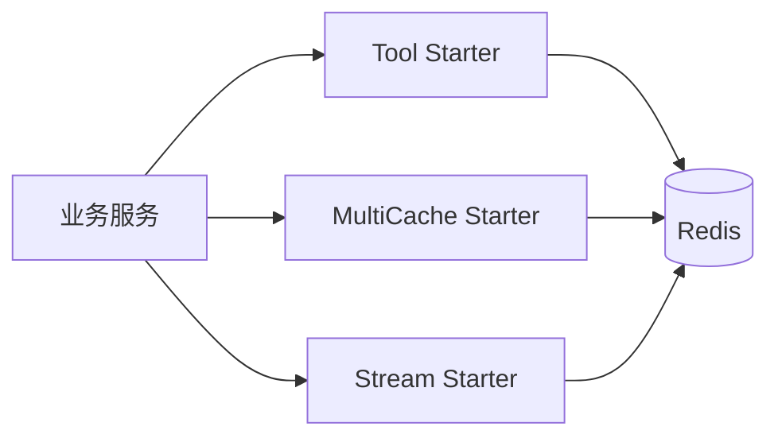

# peach-redis

[English](README.en-US.md) | 中文

`peach-redis` 将 Redis 能力拆成三个独立 Starter：基础工具、多级缓存和 Stream。共享稳定契约放在 `peach-redis-common`。

## 组件定位与版本

**面向谁：** 需要 Redis 数据结构操作、应用级 L1 + Redis L2 缓存或 Redis Stream 消息能力的 Spring Boot 业务服务。这里的 `peach-redis` 是 Maven 聚合模块，不是将全部能力打包的单个依赖。按需要选用对应 Starter，避免将 Stream、缓存和通用 DAO 一并接入。

**当前基线：** Java 21 / Spring Boot 3.5.4；当前 `peach-redis-common` 同时管理 Jedis、模板和 RedissonClient，独立底座尚未完成。以下表格描述 **main 当前已存在的功能**，并标明关键运行约束；后续解耦计划见 [Issue #18](https://github.com/Ryan-Guizhou/peach-cloud/issues/18)。

## 完整能力矩阵

| 模块 / Starter | 核心入口 | 能做什么 | 典型场景 | 当前限制 / 注意事项 |
| --- | --- | --- | --- | --- |
| 连接基础 / `peach-redis-common`（现状，拟迁移） | `RedisTemplate`、`StringRedisTemplate`、`RedisConnectionFactory` | 单机、Sentinel、Cluster；Jedis 连接池与 Jackson JSON 序列化 | 全部 Redis 业务服务 | 当前会额外配置 Redisson；Cluster 不支持非零数据库；序列化协议迁移需兼容旧数据 |
| `peach-redis-tool-starter` | `RedisDao` | String、TTL、Hash、List、Set、ZSet、Pub/Sub 和批量删除 | 会话辅助数据、计数、业务 KV、标签 | `scan()` 当前返回 `null`，依赖扫描的 `keys()` 和按模式删除不可靠；`vSet(key,value,expireTime)` 不是原子 TTL 写入 |
| `peach-redis-multicache-starter` | `MultiCacheManager`、`MultiCacheManagerService`、Spring Cache | Caffeine L1 + Redis L2、TTL 抖动、CacheManager/注解接入、Pub/Sub 失效广播 | 商品详情、相对稳定的配置/字典缓存 | Pub/Sub 是尽力失效而非强一致；`clear()` 受当前扫描缺陷影响；Caffeine 引用强度实现需修正 |
| `peach-redis-stream-starter` | `RedisStreamPushHandler`、`RedisStreamHandler`、`MessageConsumer` | Stream 生产、group/broadcast 消费、消费者回调 | 轻量业务消息、事件处理 | 当前 group 使用 `receiveAutoAck`，异常由监听器捕获；**未实现可靠 pending 自动恢复和失败重试保障** |

### 如何选择

- **仅缓存键值、结构化数据：** 使用 Tool。原生 `RedisTemplate` 可直接满足的场景无需再次封装 DAO。
- **需要本地缓存加速：** 使用 MultiCache，并接受短暂陈旧、设置合理 TTL；安全相关实时授权不要仅依赖本地缓存。
- **需要消息消费：** 使用 Stream；当前版本应自行保证业务幂等及失败恢复，不能视为可靠投递的完整替代方案。
- **需要锁、布隆过滤器、延迟队列、防重复：** 转到 [peach-redission](../peach-redission/README.md)，不要把该能力误归入 Redis Tool。
- **Gateway：** 使用独立响应式 Lettuce；不要通过 Redis Tool 为 WebFlux 事件循环引入阻塞调用。

### 最简依赖（当前版本）

```xml
<dependency>
    <groupId>com.peach</groupId>
    <artifactId>peach-redis-tool-starter</artifactId>
    <version>${revision}</version>
</dependency>
```

`revision` 来自 peach-cloud Maven reactor；脱离 reactor 时换为发布的具体版本。**当前 Starter 依赖闭包尚未治理完成**：仅有该声明不保证外部独立消费工程可启动；仓库 Quickstart 中仍有显式的客户端/common 依赖。后续 [Issue #18](https://github.com/Ryan-Guizhou/peach-cloud/issues/18) 将消除该额外要求。

### 最简配置（当前项目约定）

```yaml
peach:
  redis:
    mode: standalone
    host: "${REDIS_HOST:127.0.0.1:6379}"
    password: "${REDIS_PASSWORD:}"
    database: 0
```

此示例使用开发环境占位信息；生产环境凭据应来自安全配置源。当前拓扑字段是 `peach.redis.*` 而非 `spring.data.redis.*`。多级缓存需额外配置 `peach.multicache.*`，Stream 的启用项是 **`peach.redis.stream.enable`**（不是 `enabled`）。

### 代码示例（Tool）

```java
@Service
@RequiredArgsConstructor
public class ProfileCacheService {
    private final RedisDao redisDao;

    public void cache(String userId, String value) {
        redisDao.vSet("profile:" + userId, value, java.time.Duration.ofMinutes(5));
    }

    public Object find(String userId) {
        return redisDao.vGet("profile:" + userId);
    }
}
```

以上通过已有 `RedisDao` API 演示。建议生产中统一 key 命名、TTL 和故障策略，且避免在 key 或日志中写入个人敏感信息。

### 故障与兼容约定

| 情况 | 处理原则 |
| --- | --- |
| Redis 不可达 | 缓存可按业务回源；凭证、鉴权、验证码等关键路径不应放行 |
| 多级缓存失效订阅掉线 | 本地值可能陈旧，限制 L1 TTL，重连清理和跨实例一致性仍待完善 |
| Stream 处理异常 | 当前实现不等于“失败留 pending”，业务自行建立重试与幂等 |
| 更换 Jackson/客户端 | 先验证旧 Redis JSON 与存量 key 可读，不可直接变更会话协议 |


## 结构

| 能力 | Autoconfigure | Starter | Quickstart |
| --- | --- | --- | --- |
| Tool | `peach-redis-tool-autoconfigure` | `peach-redis-tool-starter` | `peach-redis-tool-quickstart` |
| MultiCache | `peach-redis-multicache-autoconfigure` | `peach-redis-multicache-starter` | `peach-redis-multicache-quickstart` |
| Stream | `peach-redis-stream-autoconfigure` | `peach-redis-stream-starter` | `peach-redis-stream-quickstart` |



## 选择

- 通用 Redis 访问：`peach-redis-tool-starter`。
- 本地 + Redis 多级缓存：`peach-redis-multicache-starter`。
- Redis Stream 消费/生产：`peach-redis-stream-starter`。

## Quick Start

各能力均提供无 Web 端口的 quickstart（`spring.main.web-application-type=none`），依赖对应 starter + `peach-redis-common`，并通过 Testcontainers Redis（`redis:7.2-alpine`）做最小闭环验证。本地演示前提供开发 Redis，或直接跑 IT。

### Tool

- 模块：[`peach-redis-tool-quickstart`](./peach-redis-tool-quickstart/)
- 能力样例（注入 `RedisDao`）：
  - **String + TTL**：会话 token 写入 / 读取 / 存在判断 / 删除
  - **Hash**：用户资料批量写入、按字段读取与字段删除
  - **Set**：用户标签添加 / 列表 / 移除
- 启动后 `RedisToolDemoRunner` 依次执行；关闭演示：`quickstart.redis-tool.demo.enabled=false`
- 运行：`mvn -pl peach-middleware/peach-redis/peach-redis-tool-quickstart -am spring-boot:run`
- 测试：`mvn -pl peach-middleware/peach-redis/peach-redis-tool-quickstart -am test`

### MultiCache

- 模块：[`peach-redis-multicache-quickstart`](./peach-redis-multicache-quickstart/)
- 能力样例（商品详情场景，两种接入方式）：
  - **CacheManager**：注入自动装配的 `CacheManager`，显式 `put/get`、未命中回源、`evict` 后再次回源
  - **分层证明**：仅清 L1(Caffeine) 后仍命中 L2(Redis) 并回填本地，且不回源
  - **注解**：`@EnableCaching` + `@Cacheable` / `@CacheEvict`，同样走该 `CacheManager`
- 启动后 `MulticacheDemoRunner` 依次跑上述演示；测试用 `InMemoryProductStore#loadCount` 与 `clearLocal` 证明命中路径
- 最小配置：`peach.multicache.enabled=true`、`peach.multicache.cache-names`（`product-manager` / `product-annotation`），以及 `peach.redis.*`
- 运行：`mvn -pl peach-middleware/peach-redis/peach-redis-multicache-quickstart -am spring-boot:run`
- 测试：`mvn -pl peach-middleware/peach-redis/peach-redis-multicache-quickstart -am test`
- 关闭启动演示：`quickstart.multicache.demo.enabled=false`

### Stream

- 模块：[`peach-redis-stream-quickstart`](./peach-redis-stream-quickstart/)
- 能力样例（订单状态流）：
  - **Push + Consume**：`RedisStreamPushHandler#push` 拿 `RecordId`，业务实现 `MessageConsumer` 消费确认
  - **幂等**：同一 `RecordId` 回放时业务侧去重（accepted=1 / duplicate=1）
- 启动后 `RedisStreamDemoRunner` 执行；关闭演示：`quickstart.stream.demo.enabled=false`
- 最小配置：`peach.redis.stream.enable=true`（`consumer-type=group`），以及 `peach.redis.*`
- 运行：`mvn -pl peach-middleware/peach-redis/peach-redis-stream-quickstart -am spring-boot:run`
- 测试：`mvn -pl peach-middleware/peach-redis/peach-redis-stream-quickstart -am test`

`peach.redis.host` 格式为 `host:port`。Quickstart 统一默认：`password` 默认为空（通过 `PEACH_REDIS_PASSWORD` 覆盖）、`database=1`。

## 边界

- key 必须有稳定命名空间和必要隔离维度，敏感值不直接进入 key/log。
- 缓存必须明确 TTL、失效、回源和一致性策略。
- Stream 消费必须业务幂等，并明确 ACK、重试、积压和失败治理。
- Pub/Sub、Stream 和缓存都不能被文档包装成强一致或 Exactly-Once。
