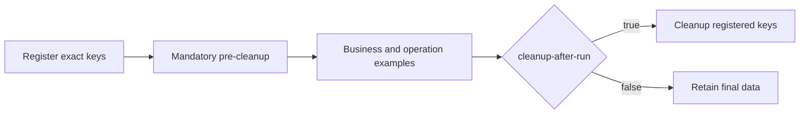

# Redis Tool operations and examples

[中文](./redis-tool-reference.md) | [Overview](../README.en-US.md)

Tool provides synchronous Redis access. The reduced API exposes 71 signatures. Duplicate and deprecated APIs have been removed; key, value and hash-value serialization is unchanged.

## Running and cleanup

```yaml
quickstart:
  redis-tool:
    demo:
      enabled: true
      cleanup-after-run: false
      # run-id: local-demo
peach:
  redis:
    tool:
      scan:
        max-results: 10000
        timeout-millis: 10000
```



- Register every exact data key before mandatory pre-cleanup. If pre-cleanup fails, business examples do not run.
- `cleanup-after-run=false` retains the final state by default. With `true`, cleanup attempts every registered key after success or failure, preserving the original business exception.
- Cleanup uses exact keys, never flushes the database and never scans other runs. The default `run-id` is a random UUID. An explicit ID must contain 1–64 letters, digits, underscores or hyphens; reuse it sequentially, never concurrently. Pre-cleanup removes data for that run ID, not historical runs with different IDs.
- Delete, pop, trim and expiration examples still modify their own data when cleanup is disabled. Some retained keys have no TTL. Inspect them or rerun the same ID with cleanup enabled.
- `enabled=false` disables the Runner and both cleanup phases. Test cleanup is independent.

## Key definitions

Business enums implement `KeyDefinition`, describing templates, module, key/value purpose and owner. Never include credentials in template arguments.

```java
String key = KeyBuilder.from(RedisToolKey.SESSION, runId, sessionId).getRealKey();
redisDao.vSet(key, value, Duration.ofMinutes(30));
```

`RedisToolDemoContext` builds and registers quickstart keys. Channels and delete patterns also use `RedisToolKey`, but are not registered as data keys. Pass the final string to the DAO, not a KeyBuilder object; individual DAO methods do not duplicate KeyDefinition overloads.

## Contracts and limits

- Synchronous APIs propagate connection failures. Do not rely on synchronous results inside Pipeline or Redis transaction callbacks. Missing confirmations are not successful or negative business results.
- Historical Long TTL values use seconds. New `ttl` returns milliseconds: -2 means missing and -1 persistent. New Duration TTL values must be at least 1ms. Conditional writes atomically include TTL and return false when their condition fails.
- `vMultiGet` reads sequentially across slots, preserves input order and null misses, and is not a batch snapshot.
- `sIntersect/sUnion/sDifference` compute client-side from bounded scans. Each input has its own scan budget; cross-slot support does not provide a multi-key snapshot.
- `hmScan/sScan/zScan` preserve deserialized member types. They replace the removed legacy collection scan methods.
- `lRemove(key,count,value)` requires an explicit non-null value. COUNT=0 removes all matches in one command. Deduplicate-and-push APIs were removed; explicitly composing removal and push is not atomic.
- Ranks start at zero. Rank ranges are inclusive and accept negative indices. Score pagination requires nonnegative offset and positive count. `zAddAll` and `zIncrementScore` reject NaN and infinity; query boundaries accept infinity.
- `scan` uses bounded SCAN. Defaults are 10000 unique results and 10000ms; valid ranges are 1–100000 and 1–60000ms. COUNT is only a hint; traversal budgets do not replace network timeouts. SCAN is not a snapshot.
- Pattern deletion requires a fixed business prefix and finishes bounded scanning before deletion. Scan overflow starts no deletion; deletion failures may leave partially deleted data. Cluster deletion is per-key across slots.
- Full reads are for collections whose size is already limited. Use bounded scans or pagination for larger data. Pub/Sub is not reliable messaging; the demo checks delivery and destroys its subscriber in finally.

## Removed API migration

This change removes 18 redundant or deprecated signatures without compatibility wrappers. External callers must migrate and recompile. The seconds-based `vSet` remains because repository business code uses it. No Redis data migration is required.

| Removed entry | Replacement |
| --- | --- |
| `keys(pattern)` | `scan(pattern, count)` |
| `hscan / sscan / zscan` | `hmScan / sScan / zScan` |
| `vSetUpdate(key, seconds)` | `expire(key, Duration.ofSeconds(seconds))` |
| `expire(key, seconds)` | `expire(key, Duration.ofSeconds(seconds))` |
| `hmDel(key, field)` | `hmDelete(key, field)` |
| `hmSetIncrement(key, field, delta)` | `hmIncrement(key, field, delta)` |
| `lLeftIndexFirst / lRightIndexFirst` | `lindex(key, 0) / lindex(key, -1)` |
| `lRange(key)` | `lRange(key, start, end)` |
| `lRemove(key, count)` | `lRemove(key, count, value)` |
| `lRemove(key, value)` | `lRemove(key, 0, value)` |
| `lLeftPush / lRightPush(key, value, boolean)` | `lRemove(key, 0, value) + lLeftPush / lRightPush(key, value)` |
| `delete(String[])` | `delete(Set)` |
| `convertAndSend(String, String)` | `convertAndSend(String, Object)` |
| `rangeByScore(key, min, max)` | `zRangeByScore(key, min, max, offset, count)` |

Collection scan replacements preserve deserialized types: callers of old `sscan` must explicitly convert members if string representations are required. The Duration `expire` returns false on a missing key; the removed seconds overload threw. `hmDelete` and `hmIncrement` expose concrete numeric results. String messages still compile against the retained Object publisher. The unused protected `getRedisSerializer()` helper was also removed.

## Complete coverage matrix

All 71 public signatures are listed below, mapped to methods in `RedisToolOperationsExample`. Some Key/TTL methods execute in `stringAndTtl`.

| Signature | Result | Execution group |
| --- | --- | --- |
| `existsKey(Object key)` | `boolean` | `stringAndTtl` |
| `delete(Object key)` | `boolean` | `keyAndScan` |
| `deletePattern(Object pattern, Integer count)` | `long` | `keyAndScan` |
| `delete(Set keys)` | `long` | `keyAndScan` |
| `scan(String matchKey, Integer count)` | `Set<Object>` | `keyAndScan` |
| `ttl(String key)` | `long` | `stringAndTtl` |
| `expire(String key, Duration timeout)` | `boolean` | `stringAndTtl` |
| `persist(String key)` | `boolean` | `stringAndTtl` |
| `vSet(Object key, Object value)` | `boolean` | `stringAndTtl` |
| `vSet(Object key, Object value, Long expireTime)` | `boolean` | `stringAndTtl` |
| `vSet(Object key, Object value, Duration expire)` | `boolean` | `stringAndTtl` |
| `vGet(Object key)` | `Object` | `stringAndTtl` |
| `increaseNum(String key, long fromIndex)` | `long` | `stringAndTtl` |
| `decreaseNum(String key, long decIndex)` | `long` | `stringAndTtl` |
| `vMultiGet(List<String> keys)` | `List<Object>` | `stringAndTtl` |
| `vSetIfAbsent(String key, Object value, Duration ttl)` | `boolean` | `stringAndTtl` |
| `vSetIfPresent(String key, Object value, Duration ttl)` | `boolean` | `stringAndTtl` |
| `vGetAndDelete(String key)` | `Object` | `stringAndTtl` |
| `hmSet(Object key, Object hashKey, Object value)` | `void` | `hash` |
| `hmSetAll(Object key, Map<Object, Object> map)` | `void` | `hash` |
| `hmGet(Object key)` | `Map<Object, Object>` | `hash` |
| `hmGet(Object key, Object hashKey)` | `Object` | `hash` |
| `hmHasKey(String key, String field)` | `boolean` | `hash` |
| `hmSize(String key)` | `long` | `hash` |
| `hmMultiGet(String key, List<String> fields)` | `List<Object>` | `hash` |
| `hmDelete(String key, String... fields)` | `long` | `hash` |
| `hmIncrement(String key, String field, long delta)` | `long` | `hash` |
| `hmIncrement(String key, String field, double delta)` | `double` | `hash` |
| `hmScan(String key, Integer count)` | `Map<Object, Object>` | `hash` |
| `lSize(Object k)` | `long` | `list` |
| `lindex(Object key, long index)` | `Object` | `list` |
| `lLeftPush(Object k, Object v)` | `void` | `list` |
| `lLeftPushAll(Object k, List<Object> lst)` | `void` | `list` |
| `lRightPush(Object k, Object v)` | `void` | `list` |
| `lRightPushAll(Object k, List<Object> lst)` | `void` | `list` |
| `lLeftPop(Object k)` | `Object` | `list` |
| `lRightPop(Object k)` | `Object` | `list` |
| `lRemove(Object k, long count, Object v)` | `long` | `list` |
| `lRange(Object k, long start, long end)` | `List<Object>` | `list` |
| `lSet(String key, long index, Object value)` | `void` | `list` |
| `lTrim(String key, long start, long end)` | `void` | `list` |
| `sAdd(Object key, Object value)` | `void` | `set` |
| `sMembers(Object key)` | `Set<Object>` | `set` |
| `sRandomMember(String key)` | `Object` | `set` |
| `sPop(String key)` | `Object` | `set` |
| `sRemove(String key, Object... values)` | `void` | `set` |
| `sAddAll(String key, Object... values)` | `long` | `set` |
| `sIsMember(String key, Object value)` | `boolean` | `set` |
| `sSize(String key)` | `long` | `set` |
| `sIntersect(String key, String otherKey)` | `Set<Object>` | `set` |
| `sUnion(String key, String otherKey)` | `Set<Object>` | `set` |
| `sDifference(String key, String otherKey)` | `Set<Object>` | `set` |
| `sScan(String key, Integer count)` | `Set<Object>` | `set` |
| `zAdd(Object key, Object value, double scoure)` | `void` | `sortedSet` |
| `zAddAll(String key, Map<Object, Double> scores)` | `long` | `sortedSet` |
| `zRemove(String key, Object... values)` | `long` | `sortedSet` |
| `zScore(String key, Object value)` | `Double` | `sortedSet` |
| `zIncrementScore(String key, Object value, double delta)` | `double` | `sortedSet` |
| `zRank(String key, Object value)` | `Long` | `sortedSet` |
| `zReverseRank(String key, Object value)` | `Long` | `sortedSet` |
| `zRange(String key, long start, long end)` | `Set<Object>` | `sortedSet` |
| `zReverseRange(String key, long start, long end)` | `Set<Object>` | `sortedSet` |
| `zRangeWithScores(String key, long start, long end)` | `Set<ZSetOperations.TypedTuple<Object>>` | `sortedSet` |
| `zRangeByScore(String key, double min, double max, long offset, long count)` | `Set<Object>` | `sortedSet` |
| `zReverseRangeByScore(String key, double min, double max, long offset, long count)` | `Set<Object>` | `sortedSet` |
| `zSize(String key)` | `long` | `sortedSet` |
| `zCount(String key, double min, double max)` | `long` | `sortedSet` |
| `zRemoveRange(String key, long start, long end)` | `long` | `sortedSet` |
| `zRemoveRangeByScore(String key, double min, double max)` | `long` | `sortedSet` |
| `zScan(String key, Integer count)` | `Map<Object, Double>` | `sortedSet` |
| `convertAndSend(String topic, Object message)` | `void` | `publishAndSubscribe` |

The real Redis scenario records invoked Method objects and compares them with `RedisDao.getDeclaredMethods()`, covering overloads separately.

## Verification

- Default: `mvn -pl peach-middleware/peach-redis/peach-redis-tool-quickstart -am test`. Testcontainers skips without Docker do not prove real Redis behavior.
- External standalone: set `RUN_REDIS_CLIENT_IT=true`; `REDIS_TOOL_IT_HOST` overrides `127.0.0.1:6379`. Use a dedicated unauthenticated database=0 instance.
- Cluster: set `RUN_REDIS_TOPOLOGY_IT=true`, `REDIS_TOPOLOGY_MODE=cluster` and `REDIS_TOPOLOGY_HOSTS`. The topology suite also executes the full operation and cleanup scenario.
- Lifecycle unit tests cover pre-cleanup failure, suppressed cleanup failures and namespace validation. Autoconfiguration tests cover binding, invalid budgets and custom DAO backoff.

## Source and test evidence

- [RedisDao](../peach-redis-tool-autoconfigure/src/main/java/com/peach/redis/tool/RedisDao.java)
- [RedisToolOperationsExample](../peach-redis-tool-quickstart/src/main/java/com/peach/redis/tool/quickstart/example/RedisToolOperationsExample.java)
- [RedisToolDemoRunner](../peach-redis-tool-quickstart/src/main/java/com/peach/redis/tool/quickstart/runner/RedisToolDemoRunner.java)
- [RedisToolScenarioAssertions](../peach-redis-tool-quickstart/src/test/java/com/peach/redis/tool/quickstart/RedisToolScenarioAssertions.java)
