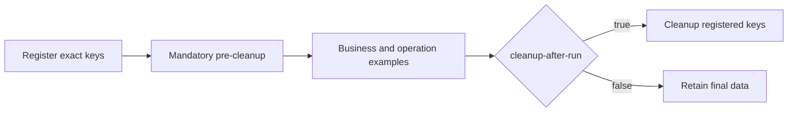

# Redis Tool 操作与示例参考

[English](./redis-tool-reference.en-US.md) | [返回入口](../README.md)

Tool 提供同步 Redis 数据访问。精简后保留 71 个方法签名，重复及废弃接口已删除；Key、Value 和 Hash Value 的序列化方式保持不变。

## 运行与清理

```yaml
quickstart:
  redis-tool:
    demo:
      enabled: true
      cleanup-after-run: false
      # run-id: local-demo
peach:
  redis:
    tool:
      scan:
        max-results: 10000
        timeout-millis: 10000
```



- 每次运行先登记本次使用的全部精确 Key，再强制清理；前置清理失败则停止业务执行。
- `cleanup-after-run=false` 为默认值，保留执行后的最终状态；设为 `true` 时，成功或异常结束均尝试清理全部登记键。
- 清理只使用精确键，不清空数据库，不扫描删除其他运行的数据。后置清理失败不覆盖已有业务异常。
- `run-id` 默认随机 UUID；可指定 1–64 位字母、数字、下划线或连字符。同一标识可串行重复运行，不可并行复用。固定标识的前置清理会删除该标识对应的示例旧数据，不负责清理其他标识的历史运行。
- 保留数据仍受示例自身行为影响：删除、弹出、裁剪及过期照常执行。不是每个键都会保留；部分保留键没有 TTL，需自行检查或通过同一标识再次运行并开启后置清理。
- `enabled=false` 不执行 Runner，包括前置和后置清理；测试自身的清理不受此开关影响。

## Key 定义

具体业务枚举实现 `KeyDefinition`，统一维护模板、模块编码、Key/Value 用途和维护人；业务实例参数不包含凭据或其他敏感内容。

```java
String key = KeyBuilder.from(RedisToolKey.SESSION, runId, sessionId).getRealKey();
redisDao.vSet(key, value, Duration.ofMinutes(30));
```

quickstart 的 `RedisToolDemoContext` 统一构建并登记 Key。通道和删除模式也来自 `RedisToolKey`，但不作为数据键登记。DAO 接收最终字符串，不直接接收 `KeyBuilder` 对象；不为每个操作复制 KeyDefinition 重载。

## 契约和边界

- API 为同步调用；连接失败传播异常。不支持在 Pipeline 或 Redis 事务回调中依赖这些同步返回值。未知确认结果不等同于未命中或成功。
- 历史 Long TTL 单位为秒；新 `ttl` 返回毫秒，-2 表示不存在，-1 表示永久。新增 Duration TTL 至少 1ms。条件写入原子携带 TTL，NX 失败或 XX 未命中返回 false。
- `vMultiGet` 保留输入顺序和未命中的 null，逐键执行以支持 Cluster 跨槽，不是批次快照。
- `sIntersect/sUnion/sDifference` 在客户端基于有界 `sScan` 结果计算，支持跨槽，不保证多键快照。每个输入集合分别受扫描预算约束。
- `hmScan/sScan/zScan` 保留反序列化成员类型，替代已删除的旧集合扫描接口。
- `lRemove(key,count,value)` 必须显式传入非 null 匹配值，count=0 通过单次 LREM 删除全部匹配值。去重入队接口已删除，业务显式组合删除与入队时仍不具备整体原子性。
- 排名从 0 开始，排名范围的首尾均包含；支持负索引。ZSet 分值分页要求 offset 非负、count 为正；`zAddAll` 和 `zIncrementScore` 拒绝 NaN/Infinity，区间查询允许无穷端点。
- `scan` 使用有界 SCAN。默认最多 10000 个唯一结果、遍历预算 10000ms，可配置范围分别为 1–100000 和 1–60000ms；COUNT 只是提示，预算不替代网络超时，结果不是快照。
- 模式删除拒绝无固定业务前缀的通配。先完成有界扫描再删除；扫描超限不开始删除，删除阶段失败可能已删除部分数据。Cluster 跨槽删除逐键执行。
- 全量成员及范围读取仅适用于已限制容量的小集合；大集合使用有界扫描或分页。Pub/Sub 不是可靠消息，示例订阅器验证接收并在 finally 中关闭。

## 已删除接口迁移

本次直接删除 18 个重复或废弃签名，不保留兼容包装；仓库外调用方需按下表迁移后重新编译。秒数版 `vSet` 因仓库业务正在使用而保留。不涉及 Redis 存量数据迁移。

| 删除入口 | 替代方式 |
| --- | --- |
| `keys(pattern)` | `scan(pattern, count)` |
| `hscan / sscan / zscan` | `hmScan / sScan / zScan` |
| `vSetUpdate(key, seconds)` | `expire(key, Duration.ofSeconds(seconds))` |
| `expire(key, seconds)` | `expire(key, Duration.ofSeconds(seconds))` |
| `hmDel(key, field)` | `hmDelete(key, field)` |
| `hmSetIncrement(key, field, delta)` | `hmIncrement(key, field, delta)` |
| `lLeftIndexFirst / lRightIndexFirst` | `lindex(key, 0) / lindex(key, -1)` |
| `lRange(key)` | `lRange(key, start, end)` |
| `lRemove(key, count)` | `lRemove(key, count, value)` |
| `lRemove(key, value)` | `lRemove(key, 0, value)` |
| `lLeftPush / lRightPush(key, value, boolean)` | `lRemove(key, 0, value) + lLeftPush / lRightPush(key, value)` |
| `delete(String[])` | `delete(Set)` |
| `convertAndSend(String, String)` | `convertAndSend(String, Object)` |
| `rangeByScore(key, min, max)` | `zRangeByScore(key, min, max, offset, count)` |

集合扫描替代接口保留反序列化类型；原 `sscan` 调用方如果依赖字符串表示，需要自行转换。Duration 版 `expire` 对不存在的键返回 false，删除的秒数重载原本抛异常。`hmDelete` 和 `hmIncrement` 提供明确的数值结果。String 消息仍可直接传给保留的 Object 发布接口。未使用的 protected `getRedisSerializer()` 辅助方法也已删除。

## 完整覆盖矩阵

下表列出当前 71 个公开方法签名。方法对应 `RedisToolOperationsExample` 中的执行分组；`stringAndTtl` 同时覆盖部分 Key/TTL 方法。

| 方法签名 | 返回类型 | 执行分组 |
| --- | --- | --- |
| `existsKey(Object key)` | `boolean` | `stringAndTtl` |
| `delete(Object key)` | `boolean` | `keyAndScan` |
| `deletePattern(Object pattern, Integer count)` | `long` | `keyAndScan` |
| `delete(Set keys)` | `long` | `keyAndScan` |
| `scan(String matchKey, Integer count)` | `Set<Object>` | `keyAndScan` |
| `ttl(String key)` | `long` | `stringAndTtl` |
| `expire(String key, Duration timeout)` | `boolean` | `stringAndTtl` |
| `persist(String key)` | `boolean` | `stringAndTtl` |
| `vSet(Object key, Object value)` | `boolean` | `stringAndTtl` |
| `vSet(Object key, Object value, Long expireTime)` | `boolean` | `stringAndTtl` |
| `vSet(Object key, Object value, Duration expire)` | `boolean` | `stringAndTtl` |
| `vGet(Object key)` | `Object` | `stringAndTtl` |
| `increaseNum(String key, long fromIndex)` | `long` | `stringAndTtl` |
| `decreaseNum(String key, long decIndex)` | `long` | `stringAndTtl` |
| `vMultiGet(List<String> keys)` | `List<Object>` | `stringAndTtl` |
| `vSetIfAbsent(String key, Object value, Duration ttl)` | `boolean` | `stringAndTtl` |
| `vSetIfPresent(String key, Object value, Duration ttl)` | `boolean` | `stringAndTtl` |
| `vGetAndDelete(String key)` | `Object` | `stringAndTtl` |
| `hmSet(Object key, Object hashKey, Object value)` | `void` | `hash` |
| `hmSetAll(Object key, Map<Object, Object> map)` | `void` | `hash` |
| `hmGet(Object key)` | `Map<Object, Object>` | `hash` |
| `hmGet(Object key, Object hashKey)` | `Object` | `hash` |
| `hmHasKey(String key, String field)` | `boolean` | `hash` |
| `hmSize(String key)` | `long` | `hash` |
| `hmMultiGet(String key, List<String> fields)` | `List<Object>` | `hash` |
| `hmDelete(String key, String... fields)` | `long` | `hash` |
| `hmIncrement(String key, String field, long delta)` | `long` | `hash` |
| `hmIncrement(String key, String field, double delta)` | `double` | `hash` |
| `hmScan(String key, Integer count)` | `Map<Object, Object>` | `hash` |
| `lSize(Object k)` | `long` | `list` |
| `lindex(Object key, long index)` | `Object` | `list` |
| `lLeftPush(Object k, Object v)` | `void` | `list` |
| `lLeftPushAll(Object k, List<Object> lst)` | `void` | `list` |
| `lRightPush(Object k, Object v)` | `void` | `list` |
| `lRightPushAll(Object k, List<Object> lst)` | `void` | `list` |
| `lLeftPop(Object k)` | `Object` | `list` |
| `lRightPop(Object k)` | `Object` | `list` |
| `lRemove(Object k, long count, Object v)` | `long` | `list` |
| `lRange(Object k, long start, long end)` | `List<Object>` | `list` |
| `lSet(String key, long index, Object value)` | `void` | `list` |
| `lTrim(String key, long start, long end)` | `void` | `list` |
| `sAdd(Object key, Object value)` | `void` | `set` |
| `sMembers(Object key)` | `Set<Object>` | `set` |
| `sRandomMember(String key)` | `Object` | `set` |
| `sPop(String key)` | `Object` | `set` |
| `sRemove(String key, Object... values)` | `void` | `set` |
| `sAddAll(String key, Object... values)` | `long` | `set` |
| `sIsMember(String key, Object value)` | `boolean` | `set` |
| `sSize(String key)` | `long` | `set` |
| `sIntersect(String key, String otherKey)` | `Set<Object>` | `set` |
| `sUnion(String key, String otherKey)` | `Set<Object>` | `set` |
| `sDifference(String key, String otherKey)` | `Set<Object>` | `set` |
| `sScan(String key, Integer count)` | `Set<Object>` | `set` |
| `zAdd(Object key, Object value, double scoure)` | `void` | `sortedSet` |
| `zAddAll(String key, Map<Object, Double> scores)` | `long` | `sortedSet` |
| `zRemove(String key, Object... values)` | `long` | `sortedSet` |
| `zScore(String key, Object value)` | `Double` | `sortedSet` |
| `zIncrementScore(String key, Object value, double delta)` | `double` | `sortedSet` |
| `zRank(String key, Object value)` | `Long` | `sortedSet` |
| `zReverseRank(String key, Object value)` | `Long` | `sortedSet` |
| `zRange(String key, long start, long end)` | `Set<Object>` | `sortedSet` |
| `zReverseRange(String key, long start, long end)` | `Set<Object>` | `sortedSet` |
| `zRangeWithScores(String key, long start, long end)` | `Set<ZSetOperations.TypedTuple<Object>>` | `sortedSet` |
| `zRangeByScore(String key, double min, double max, long offset, long count)` | `Set<Object>` | `sortedSet` |
| `zReverseRangeByScore(String key, double min, double max, long offset, long count)` | `Set<Object>` | `sortedSet` |
| `zSize(String key)` | `long` | `sortedSet` |
| `zCount(String key, double min, double max)` | `long` | `sortedSet` |
| `zRemoveRange(String key, long start, long end)` | `long` | `sortedSet` |
| `zRemoveRangeByScore(String key, double min, double max)` | `long` | `sortedSet` |
| `zScan(String key, Integer count)` | `Map<Object, Double>` | `sortedSet` |
| `convertAndSend(String topic, Object message)` | `void` | `publishAndSubscribe` |

真实 Redis 验证会记录实际调用的 Method，并与 `RedisDao.getDeclaredMethods()` 比较，因此方法名相同但参数不同的重载也必须被演示覆盖。

## 验证入口

- 默认：`mvn -pl peach-middleware/peach-redis/peach-redis-tool-quickstart -am test`。Testcontainers 缺少 Docker 时会跳过，不能视为真实 Redis 已通过。
- 外部单机服务：设置 `RUN_REDIS_CLIENT_IT=true`，可用 `REDIS_TOOL_IT_HOST` 覆盖默认 `127.0.0.1:6379`。测试使用无认证、database=0 的专用实例。
- Cluster：设置 `RUN_REDIS_TOPOLOGY_IT=true`、`REDIS_TOPOLOGY_MODE=cluster`、`REDIS_TOPOLOGY_HOSTS`。拓扑测试同时运行完整操作和清理验证。
- 清理生命周期单元测试覆盖前置失败阻断、后置失败保留原异常和命名空间约束；自动配置测试覆盖配置绑定、预算校验与自定义 DAO 退让。

## 源码与测试证据

- [RedisDao](../peach-redis-tool-autoconfigure/src/main/java/com/peach/redis/tool/RedisDao.java)
- [RedisToolOperationsExample](../peach-redis-tool-quickstart/src/main/java/com/peach/redis/tool/quickstart/example/RedisToolOperationsExample.java)
- [RedisToolDemoRunner](../peach-redis-tool-quickstart/src/main/java/com/peach/redis/tool/quickstart/runner/RedisToolDemoRunner.java)
- [RedisToolScenarioAssertions](../peach-redis-tool-quickstart/src/test/java/com/peach/redis/tool/quickstart/RedisToolScenarioAssertions.java)
