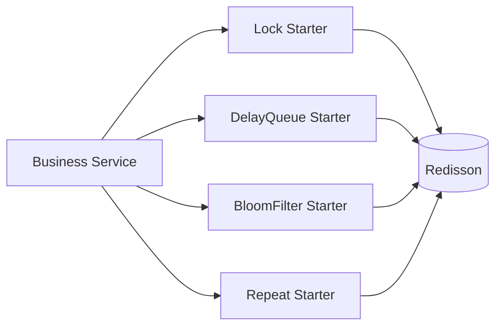

# peach-redission

English | [中文](README.md)

`peach-redission` (historical artifact/directory spelling retained for compatibility) provides four independent Redisson-based starters: distributed lock, delay queue, bloom filter and repeat guard. Shared Redisson foundations live in `peach-redission-common`.

## Purpose and compatibility

**Redisson is a Redis client with higher-level distributed data structures and coordination primitives.** The project's `peach-redission` is a Maven aggregator for locks, duplicate submission protection, delayed queues and segmented bloom filters. Choose the feature Starter you need. The historical directory/artifact and some Java package spellings use `redission`; **this is not a separate client product**.

**Current baseline:** Java 21 / Spring Boot 3.5.4 / Redisson 3.50.0. New `peach-redisson-autoconfigure` and `peach-redisson-starter` allow Redisson-only services without `peach-redis-common` or Jedis. When legacy `RedisConfig` is present, the new configuration backs off from its existing `RedissonClient`; migrating the old mixed configuration is a follow-up stage. See [Issue #18](https://github.com/Ryan-Guizhou/peach-cloud/issues/18).

## Sentinel ACL and Cluster safeguards (Issue #49)

The independent `peach-redisson-starter` retains `peach.redis.mode / host / username / password` and adds optional `peach.redis.sentinel-username` and `peach.redis.sentinel-password` for Sentinel-specific credentials. Leaving these blank preserves existing behavior. Redisson TLS continues to use `peach.redis.redisson.ssl-enable`, independently of Jedis `peach.redis.ssl-enabled`. A nonzero database in Cluster mode fails at startup rather than silently accessing database zero. Production ACL, certificates and failover still require separate acceptance. The two Nacos templates share the same names and must never embed real credentials.

## Complete capability matrix

| Capability / starter | Public API | Current functionality | Example use | Current limitation |
| --- | --- | --- | --- | --- |
| Redisson client foundation / `peach-redisson-starter` | `RedissonClient` / `PeachRedissonAutoConfiguration` | Independent single/Sentinel/Cluster, SSL, pools, custom-bean backoff | Redisson-only services | Preserves `peach.redis.*` and JsonJacksonCodec; production TLS/topology integration validation is still required |
| Shared support / `peach-redission-common` | `RedissionDataHandle`, `LockInfoHandleFactory`, `LocalCacheLock` | Redisson KV wrapper, lock-key resolution, local mutex support | Internal shared lock/repeat support | Not an independent Redisson client foundation; local lock expiry and TimeUnit conversion are problematic |
| `peach-redission-distributedlock-starter` | `@DistrbutedLock`, `DistributedLockTemplate`, `DistributedLocker` | Reentrant, fair, read/write lock strategies; annotation or programmatic locking; wait timeout | Inventory, account state, scheduler coordination | Historic annotation spelling; distinguish watchdog and explicit lease; retain database guards for critical operations |
| `peach-redission-repeat-starter` | `@RepeatLimit` | Restrict concurrent submissions per business key, or reject repeats for a post-success window | Checkout, form submit, duplicate execution | Current code logs but suppresses failure to persist the success flag; not transactional idempotency |
| `peach-redission-delayqueue-starter` | `DelayQueueContext` (legacy), `RedisDelayQueueV2` (isolated new protocol) | Delayed delivery; optional V2 atomic claims, leases/heartbeats/fencing, ACK, bounded retries, DLQ/replay | Order expiry, delayed notifications | V2 is opt-in and does not migrate legacy queues; the legacy take→processing crash window persists; neither is exactly-once |
| `peach-redission-bloomfilter-starter` | `BloomFilterService`, `BloomStatus`, `KeyNamingStrategy` / `BloomScalePolicy` / `CodecProvider` SPIs | Membership pre-check, batch add/query, segmented scaling, status/clear, extension SPI | SKU and content prefilters | Counters are per segment; old counters are lazily approximated from filter bits; segment lists are loaded from Redis to avoid stale cross-node negatives; authoritative lookup remains required |

### Which module should I use?

- **Lock:** use `DistributedLockTemplate` or annotation for resources shared across service instances; business side effects still need idempotency or version checks.
- **Duplicate submit:** `@RepeatLimit` rejects repeated requests in a window; payment/order creation also requires uniqueness and durable idempotency.
- **Delayed tasks:** the legacy protocol still has a take→processing crash window; new applications can opt into the isolated V2 atomic state machine, subject to the migration and failure tests below.
- **Segment metadata migration:** New counters include a segment identifier; the old shared counter remains for rollback. On first access an old segment's count is estimated with `count()` (approximate), and segment names are no longer cached as an uninvalidated local snapshot. Validate mixed-version rollout and rollback.
- **Membership prefilter:** Bloom filters reduce unnecessary lookups, but positive results require authoritative lookup; errors reading Redis metadata must not mean “definitely absent”.
- **RedisTemplate / Stream / Caffeine + Redis caching:** use [peach-redis](../peach-redis/README.en-US.md).

### Minimal Maven dependency (current repository)

```xml
<dependency>
    <groupId>com.peach</groupId>
    <artifactId>peach-redission-distributedlock-starter</artifactId>
    <version>${revision}</version>
</dependency>
```

Lock, repeat guard, bloom, and delay queue Starters now transitively include `peach-redisson-starter`, without requiring explicit `peach-redis-common` or Jedis. The new auto-configuration backs off when the user supplies `RedissonClient`. Existing applications may retain the legacy `RedisConfig` compatibility path. Use an actual published version outside the Maven reactor.

### Minimal development configuration

```yaml
peach:
  redis:
    mode: standalone
    host: "${REDIS_HOST:127.0.0.1:6379}"
    password: "${REDIS_PASSWORD:}"
    database: 0
    redisson:
      enabled: true
```

The new Redisson-only configuration and legacy RedisConfig retain the same `peach.redis.*` topology fields and the default JsonJacksonCodec. Keep passwords out of logs and independently validate TLS/Sentinel/Cluster in the intended Redis deployment.

### Minimal programmatic lock example

```java
@Service
@RequiredArgsConstructor
public class InventoryService {
    private final DistributedLockTemplate lockTemplate;

    public void updateStock(String sku, Runnable action) {
        lockTemplate.run("stock", sku, action);
    }
}
```

Lock names follow current business naming rules; do not change keys during rolling upgrades or old/new instances may no longer coordinate. This example does not replace database transactions or durable consistency.

### Reliability and data migration boundaries

| Situation | Current interpretation |
| --- | --- |
| Redis disconnect / lock acquisition failure | Stop critical unprotected actions; do not silently downgrade to JVM-local locking |
| Failure to persist duplicate guard | Business work may have succeeded without the guard; investigate and enforce business idempotency |
| Delayed-queue worker crash | Old “reliable” queue has a dequeue-to-processing window; a new protocol needs migration and fault-injection validation |
| Bloom segment metadata unavailable | Do not use a negative response for irreversible business decisions; query the source of truth |
| Changing lock keys, codec or message payloads | Validate stored data, queue state, mixed-version rollout and rollback before deployment |


## Redisson dependency-closure cleanup (Issue #43)

`peach-redission-common`, Bloom, DistributedLock and DelayQueue autoconfigure modules no longer declare optional `peach-redis-common`. Feature Starters use `peach-redisson-starter`. Legacy `RedisConfig` stays available for existing installations, but is no longer a new Starter dependency.

## Structure

**Dependency model:** each feature Starter → `peach-redisson-starter` → `peach-redisson-autoconfigure` → RedissonClient. `peach-redission-common` remains the historical shared lock naming / utility module, not an independent client factory.


| Capability | Autoconfigure | Starter | Quickstart |
| --- | --- | --- | --- |
| Distributed Lock | `peach-redission-distributedlock-autoconfigure` | `peach-redission-distributedlock-starter` | `peach-redission-distributedlock-quickstart` |
| Delay Queue | `peach-redission-delayqueue-autoconfigure` | `peach-redission-delayqueue-starter` | `peach-redission-delayqueue-quickstart` |
| Bloom Filter | `peach-redission-bloomfilter-autoconfigure` | `peach-redission-bloomfilter-starter` | `peach-redission-bloomfilter-quickstart` |
| Repeat Guard | `peach-redission-repeat-autoconfigure` | `peach-redission-repeat-starter` | `peach-redission-repeat-quickstart` |



## Quick Start

Each capability ships a non-web quickstart (`spring.main.web-application-type=none`). The four capability Quickstarts no longer explicitly depend on `peach-redis-common`; their feature Starters now pull in the Redisson client foundation. Provide a development Redis for local demos, or run the Testcontainers IT suite (`redis:7.2-alpine`).

### Distributed Lock

- Module: [`peach-redission-distributedlock-quickstart`](./peach-redission-distributedlock-quickstart/)
- Dependency: `peach-redission-distributedlock-starter` (transitively brings `peach-redisson-starter`, `peach-redission-common`, AOP and Caffeine; older Quickstart duplicates may be cleaned separately)
- Capability samples (inventory deduct):
  - **Annotation**: `@DistrbutedLock` protects stock deduct
  - **Template**: inject `DistributedLockTemplate` for programmatic deduct
  - **Concurrency proof**: two threads compete with short `waitTime` (1 success / 1 failure)
- `DistributedLockDemoRunner` runs on startup; disable with `quickstart.distributedlock.demo.enabled=false`
- Run: `mvn -pl peach-middleware/peach-redission/peach-redission-distributedlock-quickstart -am spring-boot:run`
- Test: `mvn -pl peach-middleware/peach-redission/peach-redission-distributedlock-quickstart -am test`

### Delay Queue

### Delay queue V2 (experimental, opt-in)

V2 leaves legacy `RDelayedQueue` / `RBlockingQueue` data untouched. The new `RedisDelayQueueV2` API uses the independent `peach:dq2:{topic}:*` key namespace so every key for a topic shares one Redis Cluster hash slot. Nine Lua scripts live in `src/main/resources/lua/delayqueue-v2/`, not embedded in Java.

**State machine:** `scheduled → processing (lease + fencing token) → completed`; failures return to `scheduled` for retry or enter `DLQ`. Expired leases are atomically reclaimed. Enqueue requires a stable `messageId`; claims allocate monotonically increasing fencing tokens and only the current token can ACK or renew a lease. **At-least-once, not exactly-once**: business systems must enforce durable idempotency and fencing independently. Active callbacks get heartbeat lease extensions, but failures can still cause duplicate execution.

```yaml
peach:
  delay:
    queue:
      legacy-enabled: false # Disable only in new deployments; keep true for legacy upgrades
      v2:
        enabled: true
        worker-count: 4
        batch-size: 16
        max-attempts: 5
        poll-interval: 500ms
        lease: 2m
        retry-initial: 5s
        retry-max: 5m
        completed-retention: 7d
        max-payload-bytes: 65536
```

```java
@RequiredArgsConstructor
@Service
public class OrderExpiryService {
    private final RedisDelayQueueV2 queue;

    public void schedule(String orderId) {
        queue.offer("order-expiry", orderId, orderId, Duration.ofMinutes(30));
    }

    public void start(ConsumerTask handler) {
        queue.start("order-expiry", handler); // handler.topic() == "order-expiry"
    }
}
```

**Migration and acceptance:** V2 does not automatically copy old tasks. Stop legacy production first and drain the old queue or perform an approved explicit migration after reconciling legacy processing and DLQ state. Test retries, lease expiry, stale ACK, duplicates, Redis Cluster/failover and rollback in a separate environment. Do not have both protocols process the same business task. Inspect `deadLetterPayload` before `replayDeadLetter` and audit the operator. Completed deduplication entries expire by retention; permanent business idempotency remains separate. Passing a standalone Maven build is not production reliability acceptance.


- Module: [`peach-redission-delayqueue-quickstart`](./peach-redission-delayqueue-quickstart/)
- Capability samples (order timeout):
  - **Single message**: `DelayQueueContext#sendMessage` with short delay + implement `ConsumerTask` to confirm consume
  - **Multi message**: under reliable-queue config, send several messages and confirm all are consumed
- `DelayQueueDemoRunner` runs on startup; disable with `quickstart.delayqueue.demo.enabled=false`
- Minimal config: `peach.delay.queue.*` (example uses `isolation-region-count=1`, `use-reliable-queue=true`) plus `peach.redis.*`; consumer bootstrap needs `peach-initialize-starter`
- Run: `mvn -pl peach-middleware/peach-redission/peach-redission-delayqueue-quickstart -am spring-boot:run`
- Test: `mvn -pl peach-middleware/peach-redission/peach-redission-delayqueue-quickstart -am test`

### Bloom Filter

- Module: [`peach-redission-bloomfilter-quickstart`](./peach-redission-bloomfilter-quickstart/)
- Capability samples (inject `BloomFilterService`, product SKU pre-filter):
  - **Membership**: `initNamespace` + `add` + `mightContain` (present / absent)
  - **Batch**: `addAll` / `mightContainAll`
  - **Status and clear**: `status` / `segments` / `clear`
- `BloomFilterDemoRunner` runs on startup; disable with `quickstart.bloomfilter.demo.enabled=false`
- Minimal config: `peach.redis.bloom.enabled=true` (enabled by default) plus capacity/FPP settings, and `peach.redis.*`
- Run: `mvn -pl peach-middleware/peach-redission/peach-redission-bloomfilter-quickstart -am spring-boot:run`
- Test: `mvn -pl peach-middleware/peach-redission/peach-redission-bloomfilter-quickstart -am test`

### Repeat Guard

- Module: [`peach-redission-repeat-quickstart`](./peach-redission-repeat-quickstart/)
- Dependency: `peach-redission-repeat-starter` (transitively brings distributed locks and Redisson foundation; `peach-redis-common` is not required)
- Capability samples (order submit, public API is `@RepeatLimit`):
  - **Same-key reject**: second submit with the same requestId throws `IllegalStateException`
  - **Different-key isolation**: different requestIds do not interfere
- `RepeatDemoRunner` runs on startup; disable with `quickstart.repeat.demo.enabled=false`
- Run: `mvn -pl peach-middleware/peach-redission/peach-redission-repeat-quickstart -am spring-boot:run`
- Test: `mvn -pl peach-middleware/peach-redission/peach-redission-repeat-quickstart -am test`

`peach.redis.host` uses `host:port`. Quickstarts share defaults: `password` is empty by default (override via `PEACH_REDIS_PASSWORD`), `database=1`.

## Repeat guard and lock lifecycle fixes

- `RedissionDataHandle#getDuration(long, TimeUnit)` now preserves `NANOSECONDS`, `MICROSECONDS`, `MILLISECONDS` and other units instead of silently treating subsecond durations as seconds.
- `LocalCacheLock` retains `getLock(key, fair)` but uses 256 bounded fair lock stripes, avoiding expiration of held lock objects. Unrelated keys can contend on the same stripe.
- `@RepeatLimit` now uses only the distributed Redisson lock for cross-instance exclusion. If the success marker cannot be persisted **after the business action succeeds**, the caller receives an explicit uncertain-result exception rather than false success. **Do not retry blindly**; query the durable order/idempotency state first.

## Real Redis topology integration (Issue #47)

The dedicated Redis 7.2 CI matrix exercises the independent `peach-redisson-starter` against Sentinel, Cluster (three masters, three replicas) and TLS. It verifies RedissonClient bean isolation, real Bucket writes/reads, TTL and deletion alongside Jedis and Redis Tool. See the [Redis topology integration instructions](../peach-redis/README.en-US.md#real-redis-topology-integration-issue-47) for commands, enforced non-skipped Surefire checks and limitations. This smoke test does **not** prove distributed-lock mutual exclusion during failover, exactly-once for delay queue V2, or cross-instance Bloom behavior.

## Bloom segment test with two independent clients (Issue #55)

`BloomTwoClientServerIntegrationTest` uses real Redis 7.2 and two independent `RedissonClient` instances. Node B reads the old segment directory before node A expands; after expansion, B must discover the new segment, find the inserted elements and report independent per-segment counts. Bloom filters still have false positives and provide only a pre-filter. This test does not establish failover safety or strong consistency under very high concurrency.

## Boundaries

- Distributed locks protect the smallest critical section and do not replace database uniqueness, transactions or state validation.
- Delay-queue consumers handle duplicates, retry and business idempotency.
- A bloom-filter "might exist" result requires authoritative lookup and cannot decide authorization, balance or uniqueness by itself.
- Repeat-guard keys come from stable business semantics and do not replace real idempotency design.
- Historical `redission` spelling is compatibility-only and is not a naming template for new modules.
