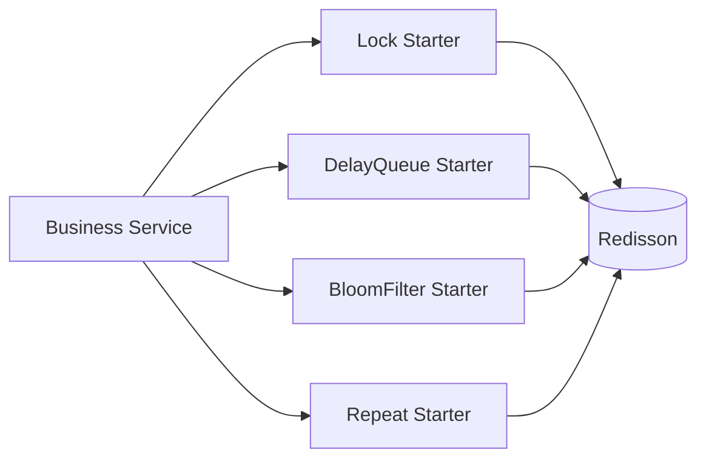

# peach-redission

English | [中文](README.md)

`peach-redission` (historical artifact/directory spelling retained for compatibility) provides four independent Redisson-based starters: distributed lock, delay queue, bloom filter and repeat guard. Shared Redisson foundations live in `peach-redission-common`.

## Purpose and compatibility

**Redisson is a Redis client with higher-level distributed data structures and coordination primitives.** The project's `peach-redission` is a Maven aggregator for locks, duplicate submission protection, delayed queues and segmented bloom filters. Choose the feature Starter you need. The historical directory/artifact and some Java package spellings use `redission`; **this is not a separate client product**.

**Current baseline:** Java 21 / Spring Boot 3.5.4 / Redisson 3.50.0. At present `peach-redis-common/RedisConfig` creates the client, so a Redisson-only application is not yet proven free of Spring Data/Jedis; the independent `peach-redisson-starter` is a planned target. See [Issue #18](https://github.com/Ryan-Guizhou/peach-cloud/issues/18).

## Complete capability matrix

| Capability / starter | Public API | Current functionality | Example use | Current limitation |
| --- | --- | --- | --- | --- |
| Shared support / `peach-redission-common` | `RedissionDataHandle`, `LockInfoHandleFactory`, `LocalCacheLock` | Redisson KV wrapper, lock-key resolution, local mutex support | Internal shared lock/repeat support | Not an independent Redisson client foundation; local lock expiry and TimeUnit conversion are problematic |
| `peach-redission-distributedlock-starter` | `@DistrbutedLock`, `DistributedLockTemplate`, `DistributedLocker` | Reentrant, fair, read/write lock strategies; annotation or programmatic locking; wait timeout | Inventory, account state, scheduler coordination | Historic annotation spelling; distinguish watchdog and explicit lease; retain database guards for critical operations |
| `peach-redission-repeat-starter` | `@RepeatLimit` | Restrict concurrent submissions per business key, or reject repeats for a post-success window | Checkout, form submit, duplicate execution | Current code logs but suppresses failure to persist the success flag; not transactional idempotency |
| `peach-redission-delayqueue-starter` | `DelayQueueContext`, `ConsumerTask` | Delayed delivery, partitioned consumption, retry and dead-letter support | Order expiry, delayed notifications | `RBlockingQueue.take()` to processing registration is not atomic; crash window can lose messages; no exactly-once guarantee |
| `peach-redission-bloomfilter-starter` | `BloomFilterService`, `BloomStatus`, `KeyNamingStrategy` / `BloomScalePolicy` / `CodecProvider` SPIs | Membership pre-check, batch add/query, segmented scaling, status/clear, extension SPI | SKU and content prefilters | Counters are per segment; old counters are lazily approximated from filter bits; segment lists are loaded from Redis to avoid stale cross-node negatives; authoritative lookup remains required |

### Which module should I use?

- **Lock:** use `DistributedLockTemplate` or annotation for resources shared across service instances; business side effects still need idempotency or version checks.
- **Duplicate submit:** `@RepeatLimit` rejects repeated requests in a window; payment/order creation also requires uniqueness and durable idempotency.
- **Delayed tasks:** appropriate only when the application tolerates duplicates and has its own recovery; finish Queue V2 protocol before relying on stronger recovery.
- **Segment metadata migration:** New counters include a segment identifier; the old shared counter remains for rollback. On first access an old segment's count is estimated with `count()` (approximate), and segment names are no longer cached as an uninvalidated local snapshot. Validate mixed-version rollout and rollback.
- **Membership prefilter:** Bloom filters reduce unnecessary lookups, but positive results require authoritative lookup; errors reading Redis metadata must not mean “definitely absent”.
- **RedisTemplate / Stream / Caffeine + Redis caching:** use [peach-redis](../peach-redis/README.en-US.md).

### Minimal Maven dependency (current repository)

```xml
<dependency>
    <groupId>com.peach</groupId>
    <artifactId>peach-redission-distributedlock-starter</artifactId>
    <version>${revision}</version>
</dependency>
```

This is an example of the feature Starter coordinates, **not a guarantee** that the current Starter closes all its runtime dependencies. The existing distributed-lock Quickstart explicitly adds `peach-redis-common`, `peach-redission-common`, AOP and Caffeine. The redesign will make the Starter self-sufficient. Use an actual published version outside the Maven reactor.

### Minimal development configuration

```yaml
peach:
  redis:
    mode: standalone
    host: "${REDIS_HOST:127.0.0.1:6379}"
    password: "${REDIS_PASSWORD:}"
    database: 0
    redisson:
      enabled: true
```

Current Redisson and business Jedis share `peach.redis.*` topology fields. Keep passwords out of logs and independently validate TLS/Sentinel/Cluster in the intended Redis deployment.

### Minimal programmatic lock example

```java
@Service
@RequiredArgsConstructor
public class InventoryService {
    private final DistributedLockTemplate lockTemplate;

    public void updateStock(String sku, Runnable action) {
        lockTemplate.run("stock", sku, action);
    }
}
```

Lock names follow current business naming rules; do not change keys during rolling upgrades or old/new instances may no longer coordinate. This example does not replace database transactions or durable consistency.

### Reliability and data migration boundaries

| Situation | Current interpretation |
| --- | --- |
| Redis disconnect / lock acquisition failure | Stop critical unprotected actions; do not silently downgrade to JVM-local locking |
| Failure to persist duplicate guard | Business work may have succeeded without the guard; investigate and enforce business idempotency |
| Delayed-queue worker crash | Old “reliable” queue has a dequeue-to-processing window; a new protocol needs migration and fault-injection validation |
| Bloom segment metadata unavailable | Do not use a negative response for irreversible business decisions; query the source of truth |
| Changing lock keys, codec or message payloads | Validate stored data, queue state, mixed-version rollout and rollback before deployment |


## Structure

| Capability | Autoconfigure | Starter | Quickstart |
| --- | --- | --- | --- |
| Distributed Lock | `peach-redission-distributedlock-autoconfigure` | `peach-redission-distributedlock-starter` | `peach-redission-distributedlock-quickstart` |
| Delay Queue | `peach-redission-delayqueue-autoconfigure` | `peach-redission-delayqueue-starter` | `peach-redission-delayqueue-quickstart` |
| Bloom Filter | `peach-redission-bloomfilter-autoconfigure` | `peach-redission-bloomfilter-starter` | `peach-redission-bloomfilter-quickstart` |
| Repeat Guard | `peach-redission-repeat-autoconfigure` | `peach-redission-repeat-starter` | `peach-redission-repeat-quickstart` |



## Quick Start

Each capability ships a non-web quickstart (`spring.main.web-application-type=none`). Because many autoconfigure dependencies such as `peach-redis-common` are optional, quickstarts declare them explicitly. Provide a development Redis for local demos, or run the Testcontainers IT suite (`redis:7.2-alpine`).

### Distributed Lock

- Module: [`peach-redission-distributedlock-quickstart`](./peach-redission-distributedlock-quickstart/)
- Dependencies: `peach-redission-distributedlock-starter` + `peach-redis-common` (also `peach-redission-common`, `spring-boot-starter-aop`, `caffeine`)
- Capability samples (inventory deduct):
  - **Annotation**: `@DistrbutedLock` protects stock deduct
  - **Template**: inject `DistributedLockTemplate` for programmatic deduct
  - **Concurrency proof**: two threads compete with short `waitTime` (1 success / 1 failure)
- `DistributedLockDemoRunner` runs on startup; disable with `quickstart.distributedlock.demo.enabled=false`
- Run: `mvn -pl peach-middleware/peach-redission/peach-redission-distributedlock-quickstart -am spring-boot:run`
- Test: `mvn -pl peach-middleware/peach-redission/peach-redission-distributedlock-quickstart -am test`

### Delay Queue

- Module: [`peach-redission-delayqueue-quickstart`](./peach-redission-delayqueue-quickstart/)
- Capability samples (order timeout):
  - **Single message**: `DelayQueueContext#sendMessage` with short delay + implement `ConsumerTask` to confirm consume
  - **Multi message**: under reliable-queue config, send several messages and confirm all are consumed
- `DelayQueueDemoRunner` runs on startup; disable with `quickstart.delayqueue.demo.enabled=false`
- Minimal config: `peach.delay.queue.*` (example uses `isolation-region-count=1`, `use-reliable-queue=true`) plus `peach.redis.*`; consumer bootstrap needs `peach-initialize-starter`
- Run: `mvn -pl peach-middleware/peach-redission/peach-redission-delayqueue-quickstart -am spring-boot:run`
- Test: `mvn -pl peach-middleware/peach-redission/peach-redission-delayqueue-quickstart -am test`

### Bloom Filter

- Module: [`peach-redission-bloomfilter-quickstart`](./peach-redission-bloomfilter-quickstart/)
- Capability samples (inject `BloomFilterService`, product SKU pre-filter):
  - **Membership**: `initNamespace` + `add` + `mightContain` (present / absent)
  - **Batch**: `addAll` / `mightContainAll`
  - **Status and clear**: `status` / `segments` / `clear`
- `BloomFilterDemoRunner` runs on startup; disable with `quickstart.bloomfilter.demo.enabled=false`
- Minimal config: `peach.redis.bloom.enabled=true` (enabled by default) plus capacity/FPP settings, and `peach.redis.*`
- Run: `mvn -pl peach-middleware/peach-redission/peach-redission-bloomfilter-quickstart -am spring-boot:run`
- Test: `mvn -pl peach-middleware/peach-redission/peach-redission-bloomfilter-quickstart -am test`

### Repeat Guard

- Module: [`peach-redission-repeat-quickstart`](./peach-redission-repeat-quickstart/)
- Dependencies: `peach-redission-repeat-starter` + `peach-redission-distributedlock-starter` + `peach-redis-common` (also `peach-redission-common`, `spring-boot-starter-aop`, `caffeine`)
- Capability samples (order submit, public API is `@RepeatLimit`):
  - **Same-key reject**: second submit with the same requestId throws `IllegalStateException`
  - **Different-key isolation**: different requestIds do not interfere
- `RepeatDemoRunner` runs on startup; disable with `quickstart.repeat.demo.enabled=false`
- Run: `mvn -pl peach-middleware/peach-redission/peach-redission-repeat-quickstart -am spring-boot:run`
- Test: `mvn -pl peach-middleware/peach-redission/peach-redission-repeat-quickstart -am test`

`peach.redis.host` uses `host:port`. Quickstarts share defaults: `password` is empty by default (override via `PEACH_REDIS_PASSWORD`), `database=1`.

## Boundaries

- Distributed locks protect the smallest critical section and do not replace database uniqueness, transactions or state validation.
- Delay-queue consumers handle duplicates, retry and business idempotency.
- A bloom-filter "might exist" result requires authoritative lookup and cannot decide authorization, balance or uniqueness by itself.
- Repeat-guard keys come from stable business semantics and do not replace real idempotency design.
- Historical `redission` spelling is compatibility-only and is not a naming template for new modules.
