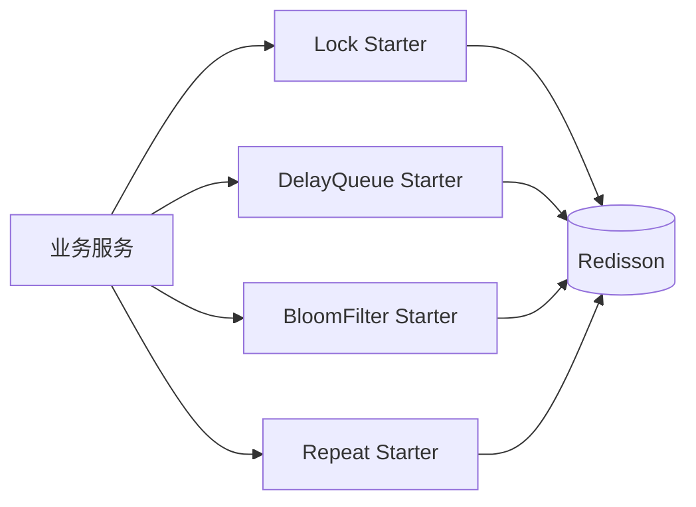

# peach-redission

[English](README.en-US.md) | 中文

`peach-redission`（保留历史 artifact/目录拼写）基于 Redisson 提供四个独立能力 Starter：分布式锁、延迟队列、布隆过滤器和防重复。共享 Redisson 基础契约位于 `peach-redission-common`。

## 组件定位与兼容性

**Redisson 是 Redis 之上的高级数据结构和协调客户端**；本项目的 `peach-redission` 是 Maven 聚合模块，提供分布式锁、提交防重、延迟队列和分段布隆过滤器。各能力以独立 Starter 形式提供，按需选用。历史目录、artifactId 与部分 Java 包名拼写为 `redission`，**不代表另一个客户端产品**。

**当前基线：** Java 21 / Spring Boot 3.5.4 / Redisson 3.50.0。新增 `peach-redisson-autoconfigure` 和 `peach-redisson-starter`，只需要 Redisson 的服务可不引入 `peach-redis-common` / Jedis。若旧 `RedisConfig` 同时存在，新自动装配会退让给现有 `RedissonClient`；旧混合装配将在后续阶段迁移。参见 [Issue #18](https://github.com/Ryan-Guizhou/peach-cloud/issues/18)。

## Sentinel ACL 与 Cluster 保护（Issue #49）

独立 `peach-redisson-starter` 沿用 `peach.redis.mode / host / username / password`，新增可选 `peach.redis.sentinel-username`、`peach.redis.sentinel-password`，仅在 Sentinel 认证信息与数据节点不同时配置；默认空值保持旧行为。Redisson TLS 的开关仍为 `peach.redis.redisson.ssl-enable`（与 Jedis 的 `peach.redis.ssl-enabled` 不同）。Cluster 不支持数据库非零值，本配置会启动失败而非悄悄落在数据库 0。实际生产 ACL、证书与故障切换仍需环境验收。两份 Nacos 模板保持相同键名，禁止写入真实凭据。

## 完整能力矩阵

| 能力 / Starter | 对外入口 | 当前功能 | 典型用途 | 当前限制 |
| --- | --- | --- | --- | --- |
| Redisson 客户端底座 / `peach-redisson-starter` | `RedissonClient` / `PeachRedissonAutoConfiguration` | 独立 Redisson 客户端装配、支持 single/Sentinel/Cluster、SSL、连接池和自定义 Bean 退让 | Redisson-only 服务 | 保留 `peach.redis.*` 配置与 JsonJacksonCodec，生产 TLS/多拓扑需单独集成验证 |
| 基础支撑 / `peach-redission-common` | `RedissionDataHandle`、`LockInfoHandleFactory`、`LocalCacheLock` | Redisson KV 封装、锁名解析、局部互斥支撑 | 锁/防重内部共享组件 | 不创建客户端；TimeUnit 精度与持锁对象生命周期已修复；固定 256 个本地锁条带可能造成不同 key 竞争 |
| `peach-redission-distributedlock-starter` | `@DistrbutedLock`、`DistributedLockTemplate`、`DistributedLocker` | 可重入、公平、读写锁策略；注解和编程式保护；锁等待超时 | 库存、账户状态、调度协调 | `@DistrbutedLock` 保留历史拼写；看门狗/显式 lease 的语义必须区分；关键操作还需数据库约束 |
| `peach-redission-repeat-starter` | `@RepeatLimit` | 同业务 key 限制并发或成功后窗口防重 | 下单、提交表单、避免重复执行 | 成功标记持久化失败会抛出结果不确定异常；必须先核对持久业务状态，不能盲目重试 |
| `peach-redission-delayqueue-starter` | `DelayQueueContext`（旧协议）、`RedisDelayQueueV2`（独立新协议） | 延迟投递；可选 V2 原子认领、租约/心跳/fencing、ACK、有限重试、DLQ/重放 | 订单超时、定时通知 | V2 默认关闭且不自动迁移旧队列；旧协议仍有崩溃窗口；两者均不承诺 exactly-once |
| `peach-redission-bloomfilter-starter` | `BloomFilterService`、`BloomStatus`、`KeyNamingStrategy` / `BloomScalePolicy` / `CodecProvider` SPI | 成员预判、批量添加/查询、分段扩容、状态/清理、SPI 扩展 | SKU、内容去重预过滤 | 分段计数已按段隔离，旧计数通过位图近似回填，段目录每次从 Redis 获取；Bloom 仍不能替代权威数据源 |

### 如何选择

- **锁：** 对多个服务实例的同一资源使用 `DistributedLockTemplate` 或注解；临界区外部副作用需要幂等/状态版本控制。
- **提交防重：** `@RepeatLimit` 针对短时间重复请求；支付/订单创建必须保留数据库唯一约束与幂等记录。
- **延迟任务：** 旧协议保持兼容但有取出→登记崩溃窗口；新项目可显式启用独立 V2 原子状态机，并按下面迁移和故障测试要求验收。
- **分段元数据兼容：** 新分段计数键包含分段名；旧共享计数键保留用于回滚。旧段首次访问会用 Bloom 位图 `count()` 估计真实数量（这是近似值）；段目录不再使用无法跨节点失效的本地快照。升级时应验证新旧实例并存及回滚。
- **大规模成员预判：** Bloom Filter 可减少无效查询，但“可能存在”必须回源验证；Redis 元数据异常不能按“必然不存在”处理。
- **普通 Redis Template / Stream / Caffeine 多级缓存：** 请使用 [peach-redis](../peach-redis/README.md)。

### 最简 Maven 依赖（当前仓库）

```xml
<dependency>
    <groupId>com.peach</groupId>
    <artifactId>peach-redission-distributedlock-starter</artifactId>
    <version>${revision}</version>
</dependency>
```

锁、防重、布隆和延迟队列 Starter 已传递 `peach-redisson-starter`，无需额外手工引入 `peach-redis-common` 或 Jedis；`peach-redisson-autoconfigure` 会在用户已提供 `RedissonClient` 时退让。历史工程仍可继续使用旧 `RedisConfig` 作为兼容路径。外部 Maven 工程需要使用仓库实际发布版本替换 `revision`。

### 最简开发配置

```yaml
peach:
  redis:
    mode: standalone
    host: "${REDIS_HOST:127.0.0.1:6379}"
    password: "${REDIS_PASSWORD:}"
    database: 0
    redisson:
      enabled: true
```

新 Redisson-only 装配和旧 RedisConfig 共享 `peach.redis.*` 拓扑字段，具备相同默认 JsonJacksonCodec。不要在日志写入密码；配置的 TLS、Sentinel、Cluster 行为应在目标 Redis 拓扑完成独立验证。

### 最小编程式锁示例

```java
@Service
@RequiredArgsConstructor
public class InventoryService {
    private final DistributedLockTemplate lockTemplate;

    public void updateStock(String sku, Runnable action) {
        lockTemplate.run("stock", sku, action);
    }
}
```

锁名称会按现有业务规则拼接，升级期间不能擅自更改 key 命名以免滚动发布时新旧实例锁域分裂。这个示例也不代表锁能替代数据库事务和最终一致性。

### 可靠性与数据迁移边界

| 情况 | 当前应如何理解 |
| --- | --- |
| Redis 断连/获取锁失败 | 必须阻止未受保护的关键操作继续执行，不自动降为 JVM 内本地锁 |
| 防重执行标记写入失败 | 抛出结果不确定异常；业务可能已成功，必须先查询数据库幂等记录并对账，不能盲目重试 |
| 延迟队列进程崩溃 | 旧版可靠队列仍存在取出→登记窗口；新可靠协议必须先完成迁移与故障测试 |
| Bloom Filter 分段信息异常 | 不能依赖 negative 结果做不可逆业务决策，先通过权威数据源确认 |
| 更改锁名、codec 或消息格式 | 必须先验证存量数据/队列及跨版本滚动发布与回滚，不能仅以代码编译成功为准 |


## Redisson 依赖闭包收敛（Issue #43）

`peach-redission-common`、Bloom、DistributedLock 和 DelayQueue autoconfigure 已移除对 `peach-redis-common` 的可选依赖，能力 Starter 使用独立 `peach-redisson-starter`。旧 `RedisConfig` 保留供存量应用回滚，不代表新 Starter 仍依赖旧客户端。

## 结构

**两层依赖模型：** 每个能力 Starter → `peach-redisson-starter` → `peach-redisson-autoconfigure` → RedissonClient。`peach-redission-common` 保留历史公共锁名 / 工具类，但不再承担独立客户端工厂的职责。


| 能力 | Autoconfigure | Starter | Quickstart |
| --- | --- | --- | --- |
| Distributed Lock | `peach-redission-distributedlock-autoconfigure` | `peach-redission-distributedlock-starter` | `peach-redission-distributedlock-quickstart` |
| Delay Queue | `peach-redission-delayqueue-autoconfigure` | `peach-redission-delayqueue-starter` | `peach-redission-delayqueue-quickstart` |
| Bloom Filter | `peach-redission-bloomfilter-autoconfigure` | `peach-redission-bloomfilter-starter` | `peach-redission-bloomfilter-quickstart` |
| Repeat Guard | `peach-redission-repeat-autoconfigure` | `peach-redission-repeat-starter` | `peach-redission-repeat-quickstart` |



## Quick Start

各能力均提供无 Web 端口的 quickstart（`spring.main.web-application-type=none`）。四个能力 Quickstart 已不再显式依赖 `peach-redis-common`，其底座由各能力 Starter 间接引入。本地演示前提供开发 Redis，或直接跑 Testcontainers IT（`redis:7.2-alpine`）。

### Distributed Lock

- 模块：[`peach-redission-distributedlock-quickstart`](./peach-redission-distributedlock-quickstart/)
- 依赖：`peach-redission-distributedlock-starter`（内部传递 `peach-redisson-starter`、`peach-redission-common`、AOP、Caffeine；旧 Quickstart 的显式冗余依赖可逐步清理）
- 能力样例（库存扣减）：
  - **注解**：`@DistrbutedLock` 保护扣库存
  - **Template**：注入 `DistributedLockTemplate` 编程式扣库存
  - **并发证明**：双线程短 `waitTime` 竞争同一把锁（1 成功 / 1 失败）
- 启动后 `DistributedLockDemoRunner` 执行；关闭演示：`quickstart.distributedlock.demo.enabled=false`
- 运行：`mvn -pl peach-middleware/peach-redission/peach-redission-distributedlock-quickstart -am spring-boot:run`
- 测试：`mvn -pl peach-middleware/peach-redission/peach-redission-distributedlock-quickstart -am test`

### Delay Queue

### 延迟队列 V2（实验性、默认关闭）

V2 不修改旧 `RDelayedQueue` / `RBlockingQueue` 数据协议；新增 `RedisDelayQueueV2` API 使用独立 `peach:dq2:{topic}:*` 键空间，确保同主题所有 Redis Cluster key 位于同一哈希槽。9 份 Lua 脚本保存在 `src/main/resources/lua/delayqueue-v2/`，不会把脚本正文硬编码在 Java 中。

**状态机：** `scheduled → processing (lease + fencing token) → completed`；执行失败时进入 `scheduled` 重试或 `DLQ`；租约过期由回收脚本重排入队。入队要求稳定 `messageId`，认领产生单调递增 fencing token；只有持有有效 token 的任务能 ACK 或更新租约。V2 回调仍是 **at-least-once**，必须在数据库或外部资源侧校验幂等与 fencing。消费者任务长时间执行时后台心跳续约，客户端或 Redis 故障时仍可能重复执行。

```yaml
peach:
  delay:
    queue:
      legacy-enabled: false # 仅全新应用才关闭旧协议 Bean；已有服务迁移前保持 true
      v2:
        enabled: true
        worker-count: 4
        batch-size: 16
        max-attempts: 5
        poll-interval: 500ms
        lease: 2m
        retry-initial: 5s
        retry-max: 5m
        completed-retention: 7d
        max-payload-bytes: 65536
```

```java
@RequiredArgsConstructor
@Service
public class OrderExpiryService {
    private final RedisDelayQueueV2 queue;

    public void schedule(String orderId) {
        queue.offer("order-expiry", orderId, orderId, Duration.ofMinutes(30));
    }

    public void start(ConsumerTask handler) {
        queue.start("order-expiry", handler); // handler.topic() 返回 "order-expiry"
    }
}
```

**迁移与验收：** 旧队列任务不会自动复制到 V2。先停止旧队列的新增生产，等待历史任务排空或经审批执行显式迁移，核对旧 processing / 死信；再在独立环境验证重试、租约失效、陈旧 ACK、重复任务、Redis Cluster/主从故障及回滚。旧/新协议不要同时消费同一业务任务。重放前通过 `deadLetterPayload` 检查内容，调用 `replayDeadLetter` 并记录操作者；`completed` 去重记录按保留周期清理，业务侧的永久幂等记录必须独立维护。不能将单机编译通过视为生产级可靠性验收。


- 模块：[`peach-redission-delayqueue-quickstart`](./peach-redission-delayqueue-quickstart/)
- 能力样例（订单超时）：
  - **单消息**：`DelayQueueContext#sendMessage` 短延迟投递 + 实现 `ConsumerTask` 消费确认
  - **多消息**：可靠队列配置下连续投递多条并全部消费确认
- 启动后 `DelayQueueDemoRunner` 执行；关闭演示：`quickstart.delayqueue.demo.enabled=false`
- 最小配置：`peach.delay.queue.*`（示例 `isolation-region-count=1`、`use-reliable-queue=true`），以及 `peach.redis.*`；消费初始化依赖 `peach-initialize-starter`
- 运行：`mvn -pl peach-middleware/peach-redission/peach-redission-delayqueue-quickstart -am spring-boot:run`
- 测试：`mvn -pl peach-middleware/peach-redission/peach-redission-delayqueue-quickstart -am test`

### Bloom Filter

- 模块：[`peach-redission-bloomfilter-quickstart`](./peach-redission-bloomfilter-quickstart/)
- 能力样例（注入 `BloomFilterService`，商品 SKU 预过滤）：
  - **成员判断**：`initNamespace` + `add` + `mightContain`（存在 / 不存在）
  - **批量**：`addAll` / `mightContainAll`
  - **状态与清理**：`status` / `segments` / `clear`
- 启动后 `BloomFilterDemoRunner` 依次执行；关闭演示：`quickstart.bloomfilter.demo.enabled=false`
- 最小配置：`peach.redis.bloom.enabled=true`（缺省启用）及容量/FPP 等，以及 `peach.redis.*`
- 运行：`mvn -pl peach-middleware/peach-redission/peach-redission-bloomfilter-quickstart -am spring-boot:run`
- 测试：`mvn -pl peach-middleware/peach-redission/peach-redission-bloomfilter-quickstart -am test`

### Repeat Guard

- 模块：[`peach-redission-repeat-quickstart`](./peach-redission-repeat-quickstart/)
- 依赖：`peach-redission-repeat-starter`（会传递分布式锁和 Redisson 基础依赖；不必手工添加 `peach-redis-common`）
- 能力样例（下单防重复，公开能力为 `@RepeatLimit`）：
  - **同 key 拒绝**：同一 requestId 第二次提交抛出 `IllegalStateException`
  - **不同 key 隔离**：不同 requestId 互不影响
- 启动后 `RepeatDemoRunner` 执行；关闭演示：`quickstart.repeat.demo.enabled=false`
- 运行：`mvn -pl peach-middleware/peach-redission/peach-redission-repeat-quickstart -am spring-boot:run`
- 测试：`mvn -pl peach-middleware/peach-redission/peach-redission-repeat-quickstart -am test`

`peach.redis.host` 格式为 `host:port`。Quickstart 统一默认：`password` 默认为空（通过 `PEACH_REDIS_PASSWORD` 覆盖）、`database=1`。

## 防重与锁生命周期修复

- `RedissionDataHandle#getDuration(long, TimeUnit)` 现保留 `NANOSECONDS`、`MICROSECONDS`、`MILLISECONDS` 等精度，不再错误按秒转换。
- `LocalCacheLock` 保留公共 `getLock(key, fair)` 入口，但实现改为固定 256 个公平锁条带，避免过期淘汰已锁定对象；不同 key 可能共享同一条带。
- `@RepeatLimit` 只以 Redisson 分布式锁作为跨实例互斥保障，不再依赖进程内锁预检查。业务执行成功后，如成功标记无法持久化，将明确抛出“业务已执行但防重状态未知”的异常，不再假装成功。**接到该异常不能盲目重试**，必须查询业务幂等记录/订单状态并对账。

## 真实 Redis 多拓扑集成验收（Issue #47）

`peach-redisson-starter` 的独立客户端与 Redis Tool/Jedis 底座现有专用 CI 矩阵，对 Redis 7.2 Sentinel、Cluster（三主三副本）与 TLS 执行真实读写测试，验证 RedissonClient 的 Bean 隔离、Bucket TTL 与删除。具体命令、Surefire 强制不跳过的检查及限制见 [Redis 多拓扑验证说明](../peach-redis/README.md#真实-redis-多拓扑集成验收issue-47)。该测试**不证明** Redisson 分布式锁主节点故障期间的互斥、不保证延迟队列 V2 在 Redis 故障切换时 exactly-once，也不覆盖 Bloom 跨实例行为。

## 两个独立客户端的布隆分段验证（Issue #55）

`BloomTwoClientServerIntegrationTest` 通过真实 Redis 7.2 与两个独立 `RedissonClient` 检查分段扩容：节点 B 在节点 A 扩容前读取旧目录，A 扩容后 B 必须识别新增段、包含新增元素且统计各段独立计数。布隆过滤器仍有假阳性，结果仅作快速预筛；该测试不等于 Redis 故障切换或高并发强一致证明。

## 独立 Worker 恢复与批量并发验收（Issue #59）

`DelayQueueV2ServerIntegrationTest` 增加真实 Redis 7.2 的双 RedissonClient / 双 `RedisDelayQueueV2` 测试：Worker A 认领后停止且不 ACK，租约过期由 Worker B 回收、重新认领并产生更大的 fencing token；旧 token 无权 ACK，新持有者成功确认。另以两个独立 Worker 并行消费 64 条消息，检查稳定 ID 去重、完成计数和无残留 processing。专用 CI 通过 Surefire 校验全部 6 项测试实际运行。

**范围限制：** Worker A 在测试中主动停止，用于模拟丢失租约，并非真实 `kill -9`；这批并不验证 Redis 主从切换、跨存储事务的 fencing、10k 并发 soak、旧协议排空或混合版本升级。默认关闭与 Lua/Redis key 协议保持不变，业务持久化幂等仍不可省略。

## 部署、验收与回滚

分步迁移、Nacos/Redis key/codec/Sa-Token session 兼容检查、实际 CI 测试证据、故障边界与回滚门禁见 [Redis / Redisson 迁移验收手册](../../docs/redis-redisson/acceptance-and-rollout.md)。真实连通性冒烟测试不代表生产 Redis 故障切换验收。

## 长生命周期 Sentinel 客户端故障恢复（Issue #69）

专项 CI 使用原有 `JedisConnectionFactory` / `RedissonClient` 实例完成真实读写，**实际停止隔离 Sentinel 主节点**，选主后不重建客户端，在有界期限内重试并验证 SET/GET/TTL；随后执行原有的三 Sentinel 共识及新客户端回归测试。仅执行本仓库 Redis 7.2 容器，不操作生产。通过这项测试可以确认对应客户端实例的基础写读恢复，但无法证明执行中业务事务、Stream / DelayQueue 消息幂等、真实历史 Session、Redis Cluster 故障等场景。

## Redis Cluster 主节点故障演练（Issue #73）

在独立 Redis 7.2 CI 的三主三副本 Cluster 中，健康拓扑验收后实际停止 7001 主节点，确认它的原副本晋升、存活主节点数量恢复为 3、`cluster_state:ok`，再进行真实重定向 SET/GET/TTL 和四套 Jedis、Redisson、Redis Tool、Sa-Token 新客户端集成测试。该测试验证故障后的集群恢复与**新连接**，不能替代长连接原位重连、消息处理中的故障窗口、跨 AZ 容灾或高并发压测。见 [Issue #73](https://github.com/Ryan-Guizhou/peach-cloud/issues/73)，以专项 CI 结果判定是否通过。

## 边界

- 分布式锁只保护最小临界区，不替代数据库唯一约束、事务和状态校验。
- 延迟队列消费者必须处理重复、失败重试和业务幂等。
- 布隆过滤器“可能存在”需要回查权威数据源，不能直接用于授权、余额或唯一性最终判断。
- 防重复 key 必须来自稳定业务语义，不能替代真正的幂等设计。
- 历史 `redission` 拼写只做兼容，不作为新增模块命名模板扩散。
