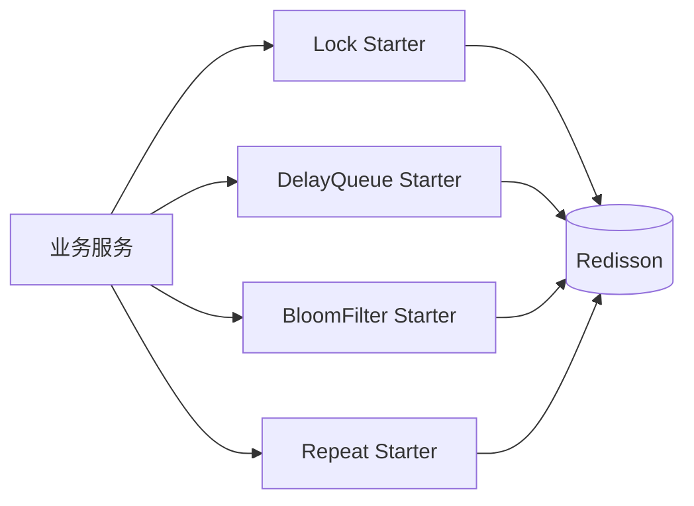

# peach-redission

[English](README.en-US.md) | 中文

`peach-redission`（保留历史 artifact/目录拼写）基于 Redisson 提供四个独立能力 Starter：分布式锁、延迟队列、布隆过滤器和防重复。共享 Redisson 基础契约位于 `peach-redission-common`。

## 组件定位与兼容性

**Redisson 是 Redis 之上的高级数据结构和协调客户端**；本项目的 `peach-redission` 是 Maven 聚合模块，提供分布式锁、提交防重、延迟队列和分段布隆过滤器。各能力以独立 Starter 形式提供，按需选用。历史目录、artifactId 与部分 Java 包名拼写为 `redission`，**不代表另一个客户端产品**。

**当前基线：** Java 21 / Spring Boot 3.5.4 / Redisson 3.50.0。当前客户端仍由 `peach-redis-common/RedisConfig` 创建，尚不能证明 Redisson-only Starter 完全脱离 Spring Data/Jedis；独立 `peach-redisson-starter` 为待实现目标。参见 [Issue #18](https://github.com/Ryan-Guizhou/peach-cloud/issues/18)。

## 完整能力矩阵

| 能力 / Starter | 对外入口 | 当前功能 | 典型用途 | 当前限制 |
| --- | --- | --- | --- | --- |
| 基础支撑 / `peach-redission-common` | `RedissionDataHandle`、`LockInfoHandleFactory`、`LocalCacheLock` | Redisson KV 封装、锁名解析、局部互斥支撑 | 锁/防重内部共享组件 | 不是独立 Redisson 客户端底座；本地锁过期淘汰和 TimeUnit 转换存在风险 |
| `peach-redission-distributedlock-starter` | `@DistrbutedLock`、`DistributedLockTemplate`、`DistributedLocker` | 可重入、公平、读写锁策略；注解和编程式保护；锁等待超时 | 库存、账户状态、调度协调 | `@DistrbutedLock` 保留历史拼写；看门狗/显式 lease 的语义必须区分；关键操作还需数据库约束 |
| `peach-redission-repeat-starter` | `@RepeatLimit` | 同业务 key 限制并发或成功后窗口防重 | 下单、提交表单、避免重复执行 | 成功后设置防重标记失败时当前只告警；不等于事务幂等 |
| `peach-redission-delayqueue-starter` | `DelayQueueContext`、`ConsumerTask` | 延迟投递、分区消费、重试与死信管理组件 | 订单超时、定时业务通知 | 当前 `RBlockingQueue.take()` 和 processing 记录不是原子操作，存在崩溃丢消息窗口；不能承诺 exactly-once |
| `peach-redission-bloomfilter-starter` | `BloomFilterService`、`BloomStatus`、`KeyNamingStrategy` / `BloomScalePolicy` / `CodecProvider` SPI | 成员预判、批量添加/查询、分段扩容、状态/清理、SPI 扩展 | SKU、内容去重预过滤 | 分段计数已按段隔离，旧计数通过位图近似回填，段目录每次从 Redis 获取；Bloom 仍不能替代权威数据源 |

### 如何选择

- **锁：** 对多个服务实例的同一资源使用 `DistributedLockTemplate` 或注解；临界区外部副作用需要幂等/状态版本控制。
- **提交防重：** `@RepeatLimit` 针对短时间重复请求；支付/订单创建必须保留数据库唯一约束与幂等记录。
- **延迟任务：** 适用于可以容忍重复且业务自行恢复的延迟处理；有强可靠性要求时先完成队列 V2 协议改造。
- **分段元数据兼容：** 新分段计数键包含分段名；旧共享计数键保留用于回滚。旧段首次访问会用 Bloom 位图 `count()` 估计真实数量（这是近似值）；段目录不再使用无法跨节点失效的本地快照。升级时应验证新旧实例并存及回滚。
- **大规模成员预判：** Bloom Filter 可减少无效查询，但“可能存在”必须回源验证；Redis 元数据异常不能按“必然不存在”处理。
- **普通 Redis Template / Stream / Caffeine 多级缓存：** 请使用 [peach-redis](../peach-redis/README.md)。

### 最简 Maven 依赖（当前仓库）

```xml
<dependency>
    <groupId>com.peach</groupId>
    <artifactId>peach-redission-distributedlock-starter</artifactId>
    <version>${revision}</version>
</dependency>
```

这是能力 Starter 的坐标示例，不代表 **当前** 单独引入就满足所有运行时依赖。现有分布式锁 Quickstart 还明确补充 `peach-redis-common`、`peach-redission-common`、AOP、Caffeine 等依赖；这些在组件解耦后才会由 Starter 自身闭合。外部 Maven 工程需要使用仓库实际发布版本替换 `revision`。

### 最简开发配置

```yaml
peach:
  redis:
    mode: standalone
    host: "${REDIS_HOST:127.0.0.1:6379}"
    password: "${REDIS_PASSWORD:}"
    database: 0
    redisson:
      enabled: true
```

当前 Redisson 与业务 Jedis 共享 `peach.redis.*` 拓扑字段。不要在日志写入密码；配置的 TLS、Sentinel、Cluster 行为应在目标 Redis 拓扑完成独立验证。

### 最小编程式锁示例

```java
@Service
@RequiredArgsConstructor
public class InventoryService {
    private final DistributedLockTemplate lockTemplate;

    public void updateStock(String sku, Runnable action) {
        lockTemplate.run("stock", sku, action);
    }
}
```

锁名称会按现有业务规则拼接，升级期间不能擅自更改 key 命名以免滚动发布时新旧实例锁域分裂。这个示例也不代表锁能替代数据库事务和最终一致性。

### 可靠性与数据迁移边界

| 情况 | 当前应如何理解 |
| --- | --- |
| Redis 断连/获取锁失败 | 必须阻止未受保护的关键操作继续执行，不自动降为 JVM 内本地锁 |
| 防重执行标记写入失败 | 业务可能已成功但防重保护失效；必须调查和业务幂等兜底 |
| 延迟队列进程崩溃 | 旧版可靠队列仍存在取出→登记窗口；新可靠协议必须先完成迁移与故障测试 |
| Bloom Filter 分段信息异常 | 不能依赖 negative 结果做不可逆业务决策，先通过权威数据源确认 |
| 更改锁名、codec 或消息格式 | 必须先验证存量数据/队列及跨版本滚动发布与回滚，不能仅以代码编译成功为准 |


## 结构

| 能力 | Autoconfigure | Starter | Quickstart |
| --- | --- | --- | --- |
| Distributed Lock | `peach-redission-distributedlock-autoconfigure` | `peach-redission-distributedlock-starter` | `peach-redission-distributedlock-quickstart` |
| Delay Queue | `peach-redission-delayqueue-autoconfigure` | `peach-redission-delayqueue-starter` | `peach-redission-delayqueue-quickstart` |
| Bloom Filter | `peach-redission-bloomfilter-autoconfigure` | `peach-redission-bloomfilter-starter` | `peach-redission-bloomfilter-quickstart` |
| Repeat Guard | `peach-redission-repeat-autoconfigure` | `peach-redission-repeat-starter` | `peach-redission-repeat-quickstart` |



## Quick Start

各能力均提供无 Web 端口的 quickstart（`spring.main.web-application-type=none`）。autoconfigure 中 `peach-redis-common` 等依赖多为 optional，quickstart 需显式引入。本地演示前提供开发 Redis，或直接跑 Testcontainers IT（`redis:7.2-alpine`）。

### Distributed Lock

- 模块：[`peach-redission-distributedlock-quickstart`](./peach-redission-distributedlock-quickstart/)
- 依赖：`peach-redission-distributedlock-starter` + `peach-redis-common`（另需 `peach-redission-common`、`spring-boot-starter-aop`、`caffeine`）
- 能力样例（库存扣减）：
  - **注解**：`@DistrbutedLock` 保护扣库存
  - **Template**：注入 `DistributedLockTemplate` 编程式扣库存
  - **并发证明**：双线程短 `waitTime` 竞争同一把锁（1 成功 / 1 失败）
- 启动后 `DistributedLockDemoRunner` 执行；关闭演示：`quickstart.distributedlock.demo.enabled=false`
- 运行：`mvn -pl peach-middleware/peach-redission/peach-redission-distributedlock-quickstart -am spring-boot:run`
- 测试：`mvn -pl peach-middleware/peach-redission/peach-redission-distributedlock-quickstart -am test`

### Delay Queue

- 模块：[`peach-redission-delayqueue-quickstart`](./peach-redission-delayqueue-quickstart/)
- 能力样例（订单超时）：
  - **单消息**：`DelayQueueContext#sendMessage` 短延迟投递 + 实现 `ConsumerTask` 消费确认
  - **多消息**：可靠队列配置下连续投递多条并全部消费确认
- 启动后 `DelayQueueDemoRunner` 执行；关闭演示：`quickstart.delayqueue.demo.enabled=false`
- 最小配置：`peach.delay.queue.*`（示例 `isolation-region-count=1`、`use-reliable-queue=true`），以及 `peach.redis.*`；消费初始化依赖 `peach-initialize-starter`
- 运行：`mvn -pl peach-middleware/peach-redission/peach-redission-delayqueue-quickstart -am spring-boot:run`
- 测试：`mvn -pl peach-middleware/peach-redission/peach-redission-delayqueue-quickstart -am test`

### Bloom Filter

- 模块：[`peach-redission-bloomfilter-quickstart`](./peach-redission-bloomfilter-quickstart/)
- 能力样例（注入 `BloomFilterService`，商品 SKU 预过滤）：
  - **成员判断**：`initNamespace` + `add` + `mightContain`（存在 / 不存在）
  - **批量**：`addAll` / `mightContainAll`
  - **状态与清理**：`status` / `segments` / `clear`
- 启动后 `BloomFilterDemoRunner` 依次执行；关闭演示：`quickstart.bloomfilter.demo.enabled=false`
- 最小配置：`peach.redis.bloom.enabled=true`（缺省启用）及容量/FPP 等，以及 `peach.redis.*`
- 运行：`mvn -pl peach-middleware/peach-redission/peach-redission-bloomfilter-quickstart -am spring-boot:run`
- 测试：`mvn -pl peach-middleware/peach-redission/peach-redission-bloomfilter-quickstart -am test`

### Repeat Guard

- 模块：[`peach-redission-repeat-quickstart`](./peach-redission-repeat-quickstart/)
- 依赖：`peach-redission-repeat-starter` + `peach-redission-distributedlock-starter` + `peach-redis-common`（另需 `peach-redission-common`、`spring-boot-starter-aop`、`caffeine`）
- 能力样例（下单防重复，公开能力为 `@RepeatLimit`）：
  - **同 key 拒绝**：同一 requestId 第二次提交抛出 `IllegalStateException`
  - **不同 key 隔离**：不同 requestId 互不影响
- 启动后 `RepeatDemoRunner` 执行；关闭演示：`quickstart.repeat.demo.enabled=false`
- 运行：`mvn -pl peach-middleware/peach-redission/peach-redission-repeat-quickstart -am spring-boot:run`
- 测试：`mvn -pl peach-middleware/peach-redission/peach-redission-repeat-quickstart -am test`

`peach.redis.host` 格式为 `host:port`。Quickstart 统一默认：`password` 默认为空（通过 `PEACH_REDIS_PASSWORD` 覆盖）、`database=1`。

## 边界

- 分布式锁只保护最小临界区，不替代数据库唯一约束、事务和状态校验。
- 延迟队列消费者必须处理重复、失败重试和业务幂等。
- 布隆过滤器“可能存在”需要回查权威数据源，不能直接用于授权、余额或唯一性最终判断。
- 防重复 key 必须来自稳定业务语义，不能替代真正的幂等设计。
- 历史 `redission` 拼写只做兼容，不作为新增模块命名模板扩散。
