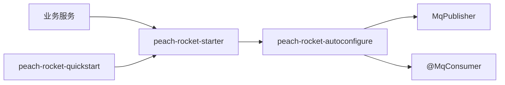

# peach-rocket

[English](README.en-US.md) | 中文

`peach-rocket` 是 RocketMQ 业务接入 starter，提供统一发送、事件路由、动态消费者、消费幂等、异常处理、事务消息、Topic 管理、payload 加密和 Outbox 可靠消息能力。

`peach-rocket-starter` 会聚合 RocketMQ Spring Boot 与 Topic Admin 运行时依赖；业务模块不需要重复声明 `rocketmq-spring-boot-starter` 或 `rocketmq-tools`。仅直接依赖 autoconfigure 时，RocketMQ 客户端或管理类缺失会使相关自动配置安全退场，但这种方式不作为业务接入入口。

## 结构

| 子模块 | 职责 |
| --- | --- |
| `peach-rocket-autoconfigure` | 核心 API、自动配置、默认实现和 SPI |
| `peach-rocket-starter` | 对业务模块暴露的 starter |
| `peach-rocket-jdbc` | 可选 JDBC Outbox/幂等持久化模块，需显式启用 |
| `peach-rocket-quickstart` | 订单发布-消费、顺序发布与内存幂等能力样例 |



## 完整能力矩阵（当前代码能力）

| 能力 | 默认行为 | 生产接入与边界 |
| --- | --- | --- |
| 普通同步/异步/单向消息 | `MqPublisher` | 同步按 Broker SEND_OK 判断；单向仅表示提交，不保证 ACK |
| 顺序与延迟消息 | `publishOrderly` / `publishDelay` | 顺序需固定 shardingKey；延迟使用经典 RocketMQ 1–18 级 |
| 动态消费者 | `@MqConsumer` | 并发/顺序、集群/广播模式及 Topic/Tag 过滤 |
| 消费幂等 | 默认单实例内存 Store | 生产建议 `peach-rocket-jdbc` 或外部带 Owner Token 的持久化实现 |
| 失败处理和重试 | 分类 + 自定义失败回执 SPI | SKIP 仅在持久化回执成功后 ACK；否则交给 Broker 重试 |
| 本地事务/事务消息 | 事务发布处理器 | 与持久化 Outbox 属于不同可靠性机制 |
| Outbox 可靠发送 | 默认关闭 | 生产需要业务事务内持久化、JDBC 租约与 Owner Token；at-least-once |
| Outbox 同步、顺序、延迟 | JDBC 保留发送选项 | 严格全局排序需额外按业务键串行化，不应跨实例无序领取 |
| 发送/消费容量限制 | 消费线程 + 有界 inflight | 进程级背压；超限不 ACK；可选受管虚拟线程并行 Outbox |
| 消息加密 | 默认关闭 | AES-GCM + keyId 多密钥轮换，安全配置源注入密钥 |
| Topic 管理 | 默认禁止自动创建 | 生产按最小权限预建 Topic；勿给业务应用管理权限 |
| 链路与指标 | 可选接入 peach-observability | Trace Context 透传；低基数 Micrometer 计数/耗时，默认不记录业务键 |

## 可观测性与告警建议

引入 `peach-observability-starter` 并在运行环境提供 `MeterRegistry` 后，自动注册可选 `MqMetrics` 实现；没有监控依赖时自动使用 NOOP。重要指标名称及标签：

| 指标 | 类型 | 标签 | 建议告警方向 |
| --- | --- | --- | --- |
| `peach.rocket.publish.total` | Counter | 固定 `mode` / `outcome` | 发送失败、Broker 拒绝持续增多 |
| `peach.rocket.publish.duration` | Timer | 固定 `mode` / `outcome` | 发送 RTT 的高分位恶化 |
| `peach.rocket.consume.total` | Counter | 固定 `outcome` | 消费失败比例上升 |
| `peach.rocket.consume.duration` | Timer | 固定 `outcome` | 业务 Handler 耗时接近租约 |
| `peach.rocket.outbox.total` | Counter | 固定 `outcome` | `send_failed` 或 `ack_failed` 积累 |
| `peach.rocket.consumer.backpressure.total` | Counter | 无 | 业务执行容量长期饱和 |

指标 **不允许**使用 `messageId`、业务 Key、租户 ID、消费者 Bean 名称或自定义 Topic 作为动态标签，以免导致时序数无限增长。应配合 Broker 消费堆积、DLQ、JDBC 待发条数、租约过期数和存储连接池监控。消息内容、token 与密钥不得进入日志；Tracing 使用现有 `MqTraceContextPropagator`。

## 真实 Broker 验收（需外部 RocketMQ 环境）

`peach-rocket-quickstart` 提供 opt-in 的 `RocketBrokerEndToEndTest`，默认单测不连接 Broker。真实验收需预先部署 NameServer/Broker，并创建 `dev-biz-order` Topic，确保消费者 Group 有订阅权限。示例：

```bash
export PEACH_ROCKET_BROKER_TEST=true
mvn -B -ntp -pl peach-middleware/peach-rocket/peach-rocket-quickstart -am \
  -Dtest=RocketBrokerEndToEndTest -Dsurefire.failIfNoSpecifiedTests=false \
  -Drocketmq.name-server=127.0.0.1:9876 test
```

测试会通过真实 Producer 发布 created 与 paid 事件，等待对应 Consumer 在 Broker 下完成回调。必须由真实运行结果确认，**Repository Governance/Maven 单测、装配测试不代表已通过 Broker 端到端验证**。如果环境无法连接 Broker，此项保持「未验证」，不能虚报成功。发布前另外验证数据库 SQL 迁移、重复投递、重试/DLQ、停机/恢复、消费组位点及长时间堆积压力。

## 核心对象

| 对象 | 说明 |
| --- | --- |
| `MqPublisher` | 统一发送入口 |
| `@MqEvent` | 事件 topic、tag、key、version 路由声明 |
| `@MqConsumer` | 动态消费者声明 |
| `MqMessageHandler<T>` | 消费处理接口 |
| `MqConsumeContext` | 消费上下文 |
| `MqSendOptions` | 单次发送覆盖参数 |
| `MqTransactionHandler<T>` / `@MqTransaction` | 事务消息处理 |
| `MqIdempotentStore` | 消费幂等 SPI |
| `MqOutboxStore` | Outbox 存储 SPI |
| `MqPayloadEncryptor`、`MqEncryptionPolicy`、`MqKeyProvider` | payload 加密 SPI |
| `MqTraceContextPropagator` | 可选的 MQ 链路上下文传播 SPI |

## 接入

```xml
<dependency>
    <groupId>com.peach</groupId>
    <artifactId>peach-rocket-starter</artifactId>
</dependency>
```

配置基线：

```yaml
rocketmq:
  name-server: 127.0.0.1:9876
  producer:
    group: order-service-producer

peach:
  rocket:
    enabled: true
    namespace: dev
    app-name: order-service
    naming:
      topic-prefix: biz
      topic-separator: "-"
      auto-prefix-env: true
    consumer:
      dynamic-register: true
      enable-idempotent: true
    topic:
      auto-create: false
    outbox:
      enabled: false
```

## 发送与消费

```java
@MqEvent(topic = "order", tag = "created", key = "#orderId")
public class OrderCreatedEvent {
    private String orderId;
}

@Service
@RequiredArgsConstructor
public class OrderEventPublisher {

    private final MqPublisher mqPublisher;

    public void publish(OrderCreatedEvent event) {
        mqPublisher.publish(event);
    }
}
```

```java
@Component
@MqConsumer(topic = "order", tag = "created", consumerGroup = "order-created-consumer")
public class OrderCreatedConsumer implements MqMessageHandler<OrderCreatedEvent> {
    @Override
    public void handle(OrderCreatedEvent message, MqConsumeContext context) {
        // handle message
    }
}
```

**Outbox 可靠性：** `MqOutboxStore` 增加兼容的 `claimPending(batchSize)` 和携带令牌的 `markSent(MqOutboxClaim)` / `markFailed(MqOutboxClaim)` 方法。默认旧存储实现可以沿用现有 `findPending`，但持久化 JDBC Store 必须实现认领者令牌校验；Dispatcher 现使用该入口。外部发送与数据库确认之间不存在分布式原子事务，仍为 at-least-once。

**内存 Outbox 仅限开发环境：** 默认 `InMemoryMqOutboxStore` 保留现有发送接口，但最多缓存 `1024` 条、每条载荷不超过 `65536` 字节，终态保持 `24h`（读写时惰性清理），认领租约 `5m`；配置分别为 `peach.rocket.outbox.in-memory-max-entries`、`in-memory-max-payload-bytes`、`in-memory-retention`、`in-memory-lease`。多 Dispatcher 通过 `claimPending` 原子领取并以令牌完成 ACK/FAIL，失败重试有界且没有后台清理线程。容量耗尽拒绝新消息，绝不删除未发送消息。**内存 Store 重启丢数据**，生产开启 `peach.rocket.outbox.require-durable=true` 并提供 JDBC 等持久化实现，缺失会启动失败；即使持久化仍是 at-least-once。

### 生产端消息额度与背压

Producer 的**编码后信封**默认上限为 4 MiB，业务 Header（含业务 Key）最多 64 项、64 KiB；单个 Producer 实例最多 1024 个同时发送中的请求，等待额度超过 200ms 直接拒绝。配额仅在**本地 JVM/Producer 实例**生效，不取代 Broker 的消息大小限制或集群全局限流。

| 配置（`peach.rocket.producer.*`） | 默认值 |
| --- | --- |
| `max-payload-bytes` | `4194304`（4 MiB） |
| `max-header-count` | `64` |
| `max-header-bytes` | `65536`（64 KiB） |
| `max-inflight` | `1024` |
| `inflight-acquire-timeout` | `200ms` |

同步/单向发送在调用退出时释放额度；**异步发送只在 SDK 成功/失败回调，或 SDK 提交同步失败时释放额度**，对并发竞争做幂等释放，避免重复释放或回调前释放。配额饱和时抛出 `MqException`，由调用方负责限速/重试；不能误记为 Broker 已确认。事务 Producer 独立管理自身额度与生命周期。配置变动需评估业务消息大小和 Broker 限额。

## 消费并发背压与优雅停机

动态消费者沿用 RocketMQ SDK 自有消费工作线程，不为消息处理额外创建固定线程池或无界队列；所有动态 Consumer 共享进程内执行额度。在 `peach.rocket.consumer.max-inflight` 达到上限或 `inflight-acquire-timeout` 超时后，并发模式返回 `RECONSUME_LATER`，顺序模式返回 `SUSPEND_CURRENT_QUEUE_A_MOMENT`，**不确认未处理的消息**。现有消息幂等逻辑仍需启用，并且 Broker 重投次数、DLQ 策略应根据业务负载配置。

| 配置项（`peach.rocket.consumer.*`） | 默认值 | 含义 |
| --- | --- | --- |
| `consume-thread-min` / `consume-thread-max` | `1` / `20` | 单个 SDK Consumer 内部工作线程范围 |
| `max-dynamic-consumers` | `64` | 单 JVM 最多动态注册的消费者数量，超限在启动前失败 |
| `max-inflight` | `128` | 同一应用实例中所有动态 Consumer 的业务执行总并发上限 |
| `inflight-acquire-timeout` | `200ms` | 等待执行额度的最长时间；可设为 `0ms` 立即拒绝 |
| `shutdown-drain-timeout` | `30s` | 停机时禁止新回调并等待已有业务执行的最长时间 |

启动中某个消费者失败，将回滚之前已启动的实例并清理当前失败实例。关闭时尽最大努力释放全部 Consumer；若业务 Handler 超过停机等待时间，系统会记录告警并继续关闭 SDK，**不保证超时的业务执行已完成**，因此必须保留持久化幂等与重试机制。约束为**单 JVM 实例级别**，不能替代 Broker 配额、跨实例全局流控或生产数据库容量治理。此处无须把 RocketMQ SDK 管理的工作线程替换成虚拟线程；其他异步业务应使用项目现有虚拟线程组件。

**可选并行 Outbox I/O：** 默认串行扫描发送，避免在没有容量规划时增加 Broker 与 JDBC 压力。需要并发发送普通消息时，显式设置 `peach.rocket.outbox.parallel-enabled=true`，并让 `executor-bean-name` 指向 `peach-virtual-thread` 预先注册的 **受管有界** `ExecutorService` Bean（默认 `rocket-outboxVirtualExecutor`）。示例：

```yaml
peach:
  virtual-thread:
    groups:
      rocket-outbox:
        max-concurrency: 8
        max-pending: 32
        backpressure: REJECT
  rocket:
    outbox:
      enabled: true
      parallel-enabled: true
      executor-bean-name: rocket-outboxVirtualExecutor
```

Dispatcher 对已认领消息提交 Future 并等待本批结果；虚拟线程分组拒绝任务时通过 Owner Token 将消息标记为失败、交给正常重试，不会 ACK 或丢弃。含顺序分片键或延迟选项的整批消息强制走串行路径，避免并行引入额外重排。**阶段四已支持顺序和延迟模式的实际 Broker 发送，但跨实例并发认领不保证全局严格顺序。** 分组应根据 Broker、数据库连接池和发送 RTT 调整，禁止设置无界 pending。

## 消息协议、消费组和密钥轮换

- **泛型 Payload**：`MqConsumerInvoker` 支持继承实现的 `MqMessageHandler<List<Order>>`；普通/安全 Jackson Codec 使用完整 `Type` 解码。旧自定义 Codec 的 `decode(byte[], Class)` 接口保留，参数化类型需要实现新 `decode(byte[], Type)`。
- **消费组**：`peach.rocket.naming.auto-prefix-consumer-group` 默认 `false`，维持现有 Group 和消费位点；启用后组名为 `namespace + separator + group-prefix + separator + 原组名`。**生产切换应先规划消费者位点与旧幂等记录迁移**，不可直接改组名。
- **密钥轮换**：`peach.rocket.security.keys` 按 keyId 存储多把密钥；当前 `key-id` 加密，新旧密文按信封中各自的 keyId 解密。未知 keyId 拒绝，不回退到其他密钥。旧版单密钥 `security.key` 仅兼容活动 keyId。所有密钥通过安全配置源/环境变量注入。

```yaml
peach:
  rocket:
    naming:
      auto-prefix-consumer-group: false
    security:
      enabled: true
      encrypt-payload: true
      base64-key: true
      key-id: current
      keys:
        current: ${MQ_KEY_CURRENT_B64}
        previous: ${MQ_KEY_PREVIOUS_B64}
```

## JDBC Outbox 发送选项与迁移

JDBC Outbox 保存并恢复 `SEND_MODE`、`SHARDING_KEY`、`DELAY_LEVEL`、`HEADERS` 和 `SEND_TIMEOUT_MS`，Dispatcher 根据类型使用 RocketMQ 普通、顺序或延迟发送 API。禁止同时设置顺序分片键和延迟配置。失败时仍遵循 token-scoped 重试/ACK 语义。

**部署前提：** 已有数据库先暂停 Outbox Dispatcher，并执行 [20261113_rocket_outbox_send_options.sql](../../sql/migrations/20261113_rocket_outbox_send_options.sql) 的非破坏性迁移；新环境使用更新的 [MQ_OUTBOX_EVENT.sql](../../sql/MQ_OUTBOX_EVENT.sql)。之后再部署服务。旧记录无超时字段时使用默认超时。headers 以 JSON 明文存储在数据库中，禁止放入密钥、Token 等敏感值。**分片键能保证路由到同一 Broker 队列，不能保证多实例并发认领情况下的全局严格顺序。**

## SPI 覆盖

- 路由：`MqRouteResolver`，默认基于注解解析。
- 编解码：`MqMessageCodec`。
- 幂等：`MqIdempotentStore`、`MqIdempotentKeyResolver`。
- 错误处理：`MqErrorHandler`、`MqExceptionClassifier`。
- 加密：`MqKeyProvider`、`MqPayloadEncryptor`、`MqEncryptionPolicy`。
- Outbox：`MqOutboxStore`、`MqOutboxPublisher`、`MqOutboxReplayService`。
- 链路上下文：`MqTraceContextPropagator`；未接入 Tracing 时默认使用空实现。

生产环境优先通过 `@Bean` 覆盖内存幂等、内存 Outbox 等默认实现。

## Quick Start

[`peach-rocket-quickstart`](./peach-rocket-quickstart/) 默认连接本机 `127.0.0.1:9876` NameServer 与对应 Broker（`web-application-type: none`），通过 starter 提供的真实 `MqPublisher` 跑通订单闭环。需要 Java 21，并确保 Broker 对客户端可达；默认关闭 Topic 自动创建，请提前准备当前命名配置对应的 `dev-biz-order` Topic。

- 能力样例：
  - **发布-消费**：`MqPublisher.publish` 订单创建事件，Broker 按 topic+tag 异步投递给消费者
  - **顺序发布**：`publishOrderly` 使用稳定 `orderId` 作为 `shardingKey`，paid 消费者使用 `ORDERLY` 模式
  - **消费幂等**：starter 默认 `InMemoryMqIdempotentStore`，同一键 `tryStart + markSuccess` 后再次 `tryStart` 被拒绝
- 启动后 `RocketDemoRunner` 依次执行，每次发布最多等待 60 秒确认对应订单已消费，超时则启动失败；关闭演示：`quickstart.rocket.demo.enabled=false`
- 事务消息、Outbox 和多消息顺序保证不在本样例验证范围内
- 构建：`mvn -pl peach-middleware/peach-rocket/peach-rocket-quickstart -am package -DskipTests`
- 运行：`java -jar peach-middleware/peach-rocket/peach-rocket-quickstart/target/peach-rocket-quickstart-1.0.0-SNAPSHOT.jar`
- 测试：`mvn -pl peach-middleware/peach-rocket/peach-rocket-quickstart -am test`

离线演示可在上述运行命令末尾添加 `--spring.profiles.active=in-process`；该 profile 关闭 Peach Rocket 自动配置并排除 `RocketMQAutoConfiguration`，仅在此模式装配进程内发布器与内存幂等存储，不连接 Broker。自动化能力测试固定使用此 profile；另有装配测试验证真实模式选择 `RocketMqPublisher`，传输层使用替身。

## 生产边界

- 默认内存幂等和内存 Outbox 只适合开发或单实例测试。
- 生产环境不要开启无治理的 Topic 自动创建。
- 顺序消息必须提供稳定的 `shardingKey`。
- Outbox 是可靠投递机制，不替代业务最终一致性状态机。
- 失败重试可能重复调用外部系统，消费者必须具备幂等语义。
- RocketMQ NameServer、Broker 和控制台不由本模块部署。
- 引入 `peach-observability-starter` 后，标准 Trace Context 会自动写入消息头，消费端恢复父上下文并创建 Consumer Span；不要在业务代码手工设置 `traceparent`。

## 构建与验证

```bash
mvn -f "peach-middleware/peach-rocket/pom.xml" test
mvn -f "peach-middleware/peach-rocket/pom.xml" clean package -DskipTests -Pdevelopment
```

## 排障指南

| 现象 | 检查点 | 处理方式 |
| --- | --- | --- |
| `MqPublisher` 未注入 | 是否引入 `peach-rocket-starter`；`peach.rocket.enabled` 是否开启 | 检查依赖和自动配置条件 |
| 消费者未注册 | `@MqConsumer` Bean 是否被扫描；`dynamic-register` 是否开启 | 检查包扫描和配置 |
| 重复消费 | 幂等 key 是否稳定；幂等存储是否生产可用 | 覆盖 `MqIdempotentStore` |
| 事务消息不回查 | `@MqTransaction` 和 `MqTransactionHandler` 是否匹配 | 检查事务处理器注册 |
| Outbox 堆积 | dispatcher 是否运行；存储状态是否可更新 | 检查 `MqOutboxStore` 和调度日志 |
| 启动提示缺少 `RocketMQTemplate` | 是否只传递了 autoconfigure、最终运行包是否包含 RocketMQ Spring | 使用 `peach-rocket-starter` 并重新构建最终应用 |
| 开启 Topic 自动创建后缺少 `DefaultMQAdminExt` | 最终运行包是否包含 `rocketmq-tools` | 升级并使用最新 `peach-rocket-starter`，重新构建最终应用 |

## 项目约定

- 后端文档统一遵循当前 peach-cloud 基线：Java 21、Spring Boot 3.5.4、Spring Cloud 2025.0.0、Spring Cloud Alibaba 2025.0.0.0。
- 前端文档仅适用于 peach-cloud-front，该目录是独立的 Vue 3 + Vite + TypeScript 工程，不属于 Maven reactor。
- 源码、脚本、SQL 和 Markdown 均保持 UTF-8 无 BOM；不要把 target/、.flattened-pom.xml、依赖缓存或 IDE 文件写入源码结构。
- README 中的命令、类名、配置项和示例必须能从当前仓库验证；不得写入真实密钥、token、私钥、生产密码、签名 URL 或完整敏感报文。
