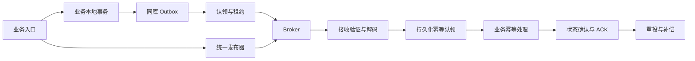

# peach-rocket 生产就绪审计与整改方案

> 审计日期：2026-11-13。审计基线：`532b4ecc0740f4b2e1f98d58d908ebe5918258cb`，分支 `feature/transaction-seata-at-starter` 及当日工作区。状态：**整改待实施，生产验收未通过**。
>
> 本文交付问题清单、整改建议、迁移约束及验收标准，没有修复业务实现。完成文档、单元测试通过或启用加密均不能替代生产验收，也不能证明系统不存在未知漏洞。

> **历史审计快照（2026-11-13）**：此文保留发现问题时的证据和原始实施建议，不代表 PR #199 当前代码。当前模块**尚未投产**，已删除历史表迁移、旧协议降级和无认领 token 的兼容路径；现行实施规范请以 [生产整改状态](production-remediation-status.md)、[实施计划](production-hardening-plan.md)及 [部署手册](production-operations.md) 为准。

## 1. 结论与使用方式

当前模块具备消息接入、事务消息、Outbox、JDBC 幂等、限流及加密等基础能力，但存在已复现的安全和功能缺陷，以及需要生产配置和真实集群验证才能关闭的可靠性缺口。**不建议直接用于扣款、库存、调度指令等关键业务的分布式生产环境。**

本文共登记 **24 项整改项**，包括代码缺陷、条件性风险、接入契约和验收缺口；这不是“24 个已可被远程利用的漏洞”。处理规则如下：

- **P1**：上线阻断项。必须修复并验证；条件性风险只有在对应功能明确禁用、配置能强制阻止误用且有验证证据时才能按“不适用”关闭。
- **P2**：必须在受影响功能上线前完成。若延期，需要明确负责人、适用范围、补偿措施和到期时间；不能将未完成项记录为已修复。
- **已复现**：在当前编译产物和实际依赖上执行本地探针确认；不表示已完成真实 Broker 攻击测试。
- **代码确认**：由当前实现直接确认的行为或缺少的约束。
- **版本命中**：解析出的依赖版本落入官方公告范围；实际可达性、部署暴露面仍需验证。
- **待环境验证**：代码或测试不能证明的运行保证。

关闭任一整改项必须附上：修复提交、回归用例、环境/版本、实际结果、兼容和迁移记录、负责人及复核人。本文所有整改项初始状态均为 **OPEN**。

## 2. 扫描范围、方法与限制

### 2.1 范围

| 范围 | 本次覆盖 |
| --- | --- |
| `peach-rocket-autoconfigure` | 69 个主源码文件；公共契约、装配、路由、发送、消费、事务、加密、幂等、Outbox、资源及生命周期路径；20 个测试类的测试入口与执行结果 |
| `peach-rocket-jdbc` | 3 个主源码文件、2 个测试类；真实 SQL 文本、认领/确认条件、自动装配 |
| `peach-rocket-starter` | 聚合依赖及生产运行依赖面 |
| `peach-rocket-quickstart` | 11 个主源码文件、4 个测试类、真实/进程内配置边界 |
| 数据库 | 两张 MQ 表及认领令牌、发送超时迁移脚本 |
| 调用影响面 | Scheduler 的 JDBC Store 继承适配、指令派发/结果上报入口；Observability 的 Trace/Metrics 适配入口。此处仅做接口影响面核查，不代表 Scheduler 全模块已通过审计 |
| 依赖与构建 | 根 POM、依赖 BOM、三个模块解析依赖树、169 组外部 Maven 包名/版本清单、部分官方安全公告 |
| 文档 | 中英文 README、SQL 链接及示例描述与工作区源码的一致性；现有 SQL 链接可解析到仓库根目录 |

本轮开始时工作区已有 `RocketDemoRunner.java` 修改及未跟踪的 `logs/`，未覆盖或还原。测试以当时工作区为准；报告不能仅靠 checkout 基线提交复现该文件的本地修改。

### 2.2 方法

1. 从公共入口跟踪到发送、持久化、Broker 回调、业务处理和确认路径，核对异常、重试、并发和关闭行为。
2. 检查 SQL 参数绑定、唯一约束、owner token、时间来源、状态迁移和兼容方法。
3. 使用 JDK 21 编译并执行模块测试；额外运行无真实凭据、无外部副作用的本地缺陷探针。
4. 导出实际依赖树，人工核对可访问的维护者安全公告；尝试 OSV 批量查询并记录失败。
5. 将建议与现有能力分别标记；本文提出的新接口、配置项和协议版本均为 **Planned**，不能直接照抄为当前已支持功能。

### 2.3 尚未完成的覆盖

- 未连接真实 Broker、NameServer、MySQL、KMS 或生产集群；未执行生产渗透、故障注入、压测和备份恢复演练。
- OSV HTTPS 查询失败：PowerShell 连接被关闭、curl 的 Schannel 报凭据错误、Node fetch 失败。**169 组包版本仅完成清点，未完成全量漏洞库匹配**；没有“零漏洞”扫描结果。
- 当前环境未发现可直接使用的 `semgrep`、`gitleaks`、`trivy`、`grype`、`osv-scanner` 命令；本次代码审查不等价于这些工具的完整 SAST/SCA/Secret Scan。
- 未完成 Git 历史密钥扫描、最终业务应用/镜像 SBOM、操作系统和 JDK 漏洞扫描。Starter 的依赖树不能代替最终部署产物的依赖树。
- 最小真实 Broker 测试因缺少显式启用条件而跳过；没有把跳过视为通过。

## 3. 当前已实现能力与保证边界

| 能力 | 当前实现 | 生产边界 |
| --- | --- | --- |
| 统一发送 | 同步、异步、单向、顺序、经典级别延迟、事务入口 | 单向发送没有 Broker 确认；返回成功不证明消费者业务完成 |
| 路由与协议 | `@MqEvent`、Topic/Tag/Key、命名前缀、信封与泛型 Payload | 前缀是命名规则，不是 ACL；版本和信封校验存在缺口 |
| 消费 | 动态注册、并发/顺序、集群/广播、失败重投 | 广播不适合照搬集群模式的重试/共享幂等假设 |
| 幂等 | 内存/JDBC、原子认领、owner token、过期接管 | token 保护状态更新，不保护所有外部副作用；默认仍可能装配内存 Store |
| Outbox | 内存/JDBC、认领、重试、失败重放、超时恢复 | 与 Broker 没有分布式原子提交；跨实例严格顺序未实现 |
| 事务消息 | 半消息、本地事务回调、Broker 回查适配 | 业务必须持久化事务结果并支持跨实例回查；带 Key 路径存在确定性缺陷 |
| 加密 | AES-GCM、随机 IV、密钥长度校验、按 keyId 轮换 | 仅保护载荷；接收策略、元数据认证、初始化校验需整改 |
| 资源治理 | 普通 Producer 消息/Header 限额与发送额度、消费额度、内存容量 | 不能替代全局配额；Outbox/接收解码的限制不完整 |
| 观测 | Trace、Metrics、异常分类及失败记录 SPI | 指标 SPI 不是告警系统；默认失败记录器不会持久化失败工单 |

当前总体可靠性模型是 **at-least-once + 业务幂等 + 可追踪补偿**，不得宣称 Exactly-Once。



图中的“同库事务”“接收验证”“业务幂等”包含调用方责任及待整改约束，并非当前框架自动保证。

## 4. 整改总表

| ID | 优先级 | 问题 | 证据状态 | 主要责任 |
| --- | --- | --- | --- | --- |
| RKT-01 | P1 | 发送 Key 可进入完整 SpEL 执行环境 | 已复现；外部可利用性取决于输入来源 | 框架、业务 |
| RKT-02 | P1 | 强制发送加密时接收端仍接受明文 | 已复现 | 框架 |
| RKT-03 | P1 | 加密信封元数据可篡改，未核对实际路由 | 已复现、代码确认 | 框架 |
| RKT-04 | P1 | 手工创建的 SDK 客户端未统一接入认证/TLS | 代码确认；真实集群待验证 | 框架、平台 |
| RKT-05 | P1 | 已知受影响依赖、版本不一致及扫描覆盖缺口 | 版本命中；部分可达性未确认 | 依赖维护、平台 |
| RKT-06 | P1 | 完整异常链和业务 Key 可能泄露敏感数据 | 代码确认；泄露取决于实际输入 | 框架、业务 |
| RKT-07 | P1 | 事务消息设置业务 Key 后发送前抛异常 | 已复现 | 框架 |
| RKT-08 | P1 | 消费租约与业务副作用之间没有完整隔离 | 代码确认；故障场景待验证 | 框架、业务 |
| RKT-09 | P1 | 默认幂等键可能误去重或漏去重 | 已复现部分场景、代码确认 | 框架、业务 |
| RKT-10 | P1 | Outbox 与业务事务的原子性依赖调用方 | 接入契约缺口 | 框架、业务 |
| RKT-11 | P1 | Outbox 批量认领可能在发送结束前过期 | 代码确认 | 框架 |
| RKT-12 | P1 | 顺序 Outbox 缺少跨实例及失败阻塞保证 | 已有实现边界；关键顺序业务受影响 | 框架、业务 |
| RKT-13 | P1 | 持久化/认领能力验证不足，旧入口可绕过 fencing | 代码确认 | 框架、SPI 实现方 |
| RKT-14 | P1 | 广播与共享幂等/可靠重试语义冲突 | 条件性风险、SDK 源码确认 | 框架、业务 |
| RKT-15 | P1 | Group、订阅、环境和首次消费位点需要统一治理 | 接入及迁移缺口 | 框架、平台、业务 |
| RKT-16 | P1 | 损坏的 Outbox 行可能拖累整批消息 | 代码确认；需真实数据库复现 | 框架、运维 |
| RKT-17 | P1 | 接收、Outbox 和编码阶段资源限制不完整 | 代码确认 | 框架、平台 |
| RKT-18 | P2 | Outbox 信封忽略事件版本及生产者应用 | 已复现 | 框架 |
| RKT-19 | P2 | JDBC 有效期、时间、长度及归档契约不完整 | 代码确认、数据库配置待验证 | 框架、DBA |
| RKT-20 | P2 | 默认发送超时覆盖配置，事务超时未统一 | 已复现部分路径、代码确认 | 框架 |
| RKT-21 | P1 | 失败闭环、重放权限、积压告警尚需生产接入 | SPI/运维能力缺口 | 框架、平台、业务 |
| RKT-22 | P2 | 事务/Outbox/异步停机需要统一排空验收 | 代码确认、待环境验证 | 框架、平台 |
| RKT-23 | P1 | 缺少真实数据库、多实例、故障及安全验收 | 测试覆盖缺口 | QA、平台 |
| RKT-24 | P2 | 演示文档与工作区执行路径存在偏差 | 代码与文档核对确认 | 文档维护 |

## 5. 安全整改

### RKT-01：限制 Key 表达式执行能力

**证据：** [AnnotationMqRouteResolver](../peach-rocket-autoconfigure/src/main/java/com/peach/rocket/route/AnnotationMqRouteResolver.java) 的 `resolveKey` 使用 `StandardEvaluationContext`，单次 `options.key` 与注解表达式共用解析路径。

**影响/触发：** 不可信输入进入以 `#` 开头的 Key 时，可访问超出属性取值所需的 Java 能力。本地探针成功调用静态方法修改了探针进程的测试属性；没有执行系统命令。当前未证明存在外部请求到该参数的攻击链。

**整改：** 将运行时显式 Key 定义为字面值；注解若继续支持表达式，采用属性读取白名单和受限求值环境，拒绝类型、构造器、方法调用、`class` 导航和 Bean 引用。梳理 Scheduler 的 `.key(executionId)` 等调用方，保留字面值语义。不要仅凭首字符判断安全。

**验收/迁移：** 正常 `#orderId` 属性取值和字面 Key 保持可用；方法/类型/构造调用明确拒绝。盘点已有复杂表达式并给出迁移清单；测试输入不得触发进程启动或文件/网络访问。

### RKT-02：接收端独立强制加密策略

**证据：** [SecureJacksonMqMessageCodec](../peach-rocket-autoconfigure/src/main/java/com/peach/rocket/codec/SecureJacksonMqMessageCodec.java) 的 `decode` 在 `encrypted=false` 时直接转换明文 Payload，没有执行接收强制策略。

**影响/触发：** 即使 `encrypt-payload=true`，可写入消息的主体仍可构造明文信封进入处理链。本地探针已确认。发送侧加密配置不能视为接收侧拒绝明文的安全控制。

**整改：** 新增独立的接收安全策略，使用实际订阅路由及预期业务类型判断是否必须加密；校验算法白名单、keyId、字段组合及解密器存在性。对未配置密钥、策略要求加密但组件缺失等情况启动失败或发送前失败，禁止静默退化。

**验收/迁移：** 必须加密的 Topic 拒绝明文、缺失标记、未知算法和不完整元数据；可兼容历史明文的范围必须显式列出并设截止时间。先部署兼容接收端，再切换发送端，最后关闭旧协议接收。

### RKT-03：认证信封元数据并核对 Broker 路由

**证据：** [AesGcmMqPayloadEncryptor](../peach-rocket-autoconfigure/src/main/java/com/peach/rocket/security/AesGcmMqPayloadEncryptor.java) 未调用 `updateAAD`；[MqConsumerInvoker](../peach-rocket-autoconfigure/src/main/java/com/peach/rocket/consumer/MqConsumerInvoker.java) 从信封读取 Topic/Tag/Key；[Registrar](../peach-rocket-autoconfigure/src/main/java/com/peach/rocket/consumer/DynamicRocketMqConsumerRegistrar.java) 未向调用器传递完整的实际 Broker 路由供核对。

**影响/触发：** 本地探针修改密文信封的 Topic/Key 后仍可解密，可能改变业务上下文与去重结果。共享对称密钥的主体也具有生成消息的能力；AES-GCM 不提供独立的生产者身份授权。

**整改：** 设计显式版本化的认证信封，对事件 ID、路由、协议/事件版本、来源及安全相关 Header 使用规范化编码绑定 AAD；对敏感身份、租户字段使用可信来源并核验授权。把实际 Broker 元数据传给消费验证层，处理正常消息与重试 Topic 的映射规则。保留 Broker ACL，不能用信封中的 `producerApp` 代替身份认证。

**验收/迁移：** 任一受保护字段改变后拒绝处理；不兼容版本、路由不匹配、密钥错误和密文截断均不得进入 Handler。AAD 协议需要“读新旧、写旧 → 读新旧、写新 → 只读新”的滚动策略，不能直接修改旧密文解密规则。

### RKT-04：统一所有客户端的认证与传输安全

**证据：** [动态 Consumer](../peach-rocket-autoconfigure/src/main/java/com/peach/rocket/consumer/DynamicRocketMqConsumerRegistrar.java) 使用 `new DefaultMQPushConsumer(group)`；[事务 Producer](../peach-rocket-autoconfigure/src/main/java/com/peach/rocket/transaction/RocketMqTransactionMessageProducer.java) 使用 `new TransactionMQProducer(group)`；[Topic Admin](../peach-rocket-autoconfigure/src/main/java/com/peach/rocket/topic/RocketMqTopicAdmin.java) 使用无 Hook 构造。未看到统一传入认证 Hook、应用 TLS/namespace 等客户端设置。

**影响/触发：** 普通模板与独立客户端可能具有不同安全配置，在受保护集群连接失败或使用非预期传输模式。SDK 的全局系统属性也可能影响 TLS，本次未验证具体部署属性，不能断言所有场景均为明文。该缺口不代表服务端 ACL 可被绕过；禁止以关闭 Broker ACL 解决兼容问题。

**整改：** 基于实际 RocketMQ Spring 2.3.3 / Client 5.3.2 的 API 建立统一客户端配置适配，覆盖 Consumer、事务 Producer、Admin 和普通模板；凭据由安全配置源提供。生产 TLS 必须验证信任链及服务身份；管理凭据与业务读写凭据分离，Topic 默认继续关闭自动创建。Admin 开启时不得随意覆盖生产队列数和权限。

**验收：** 在真实开启 ACL/TLS 的 Broker 上验证四类客户端；错误凭据、未授权 Topic/Group、非受信证书和错误服务身份均失败；凭据轮换可用且没有日志泄漏。将依赖库无法满足的安全要求登记为阻断项。

### RKT-05：收敛依赖并完成供应链安全检查

**证据：** [依赖 BOM](../../../peach-dependencies/pom.xml)、[Starter POM](../peach-rocket-starter/pom.xml) 及本次 `dependency:tree`。以下是已核对的最小集合，不是全部漏洞清单。

| 当前解析版本 | 官方依据及结论 | 整改要求 |
| --- | --- | --- |
| `protobuf-java` / `protobuf-java-util 3.20.1` | [CVE-2024-7254](https://github.com/protocolbuffers/protobuf/security/advisories/GHSA-735f-pc8j-v9w8)：恶意嵌套输入可导致拒绝服务；当前版本受影响 | 公告列出的 3.x 修复起点为 3.25.5；选择当前受维护且通过兼容验证的版本，不能只满足这一个历史修复点 |
| `protobuf-java 3.20.1` | [CVE-2022-3171](https://github.com/protocolbuffers/protobuf/security/advisories/GHSA-h4h5-3hr4-j3g2)：解析资源消耗风险，当前版本早于修复分支 | 同时检查生成代码与 runtime；仅升级 runtime 不足以覆盖所有历史问题 |
| `netty-codec-http2 4.1.123.Final` | [CVE-2025-55163](https://github.com/netty/netty/security/advisories/GHSA-prj3-ccx8-p6x4)：官方列出当前版本受影响，4.1 分支修复起点为 4.1.124.Final | 统一升级 Netty BOM；确认是否实际暴露 HTTP/2 处理路径，不能把版本命中直接写成 RocketMQ TCP 可被远程利用 |
| `fastjson2 2.0.43`，兼容层/扩展 `2.0.58` | [2.0.65 官方发布说明](https://github.com/alibaba/fastjson2/releases/tag/2.0.65) 包含 AutoType 授权和解析健壮性修复；当前组件族版本也不一致 | 统一兼容层、core、extension；关闭不必要的 AutoType；检查 SDK 内部和业务调用可达性，完成升级回归 |
| `grpc-netty-shaded 1.53.0` | 依赖中包含独立 shaded 网络栈，单独升级外部 Netty 不能证明它同步修复 | 对 shaded 内容单独扫描并与 gRPC 兼容版本一起升级 |
| RocketMQ Client/Common/Remoting/Tools `5.3.2`，ACL `5.3.1`；OTel `1.49.0` 与 Prometheus exporter `1.29.0-alpha` | 解析依赖存在跨组件版本不一致 | 做依赖收敛和运行兼容检查；不直接推断为已发生链接错误 |

**补充整改：** 评估将 `rocketmq-tools` 从所有业务 Starter 默认运行依赖中剥离为显式管理能力；先做兼容和装配测试。根 POM 的仓库地址默认使用 HTTP，生产构建应通过受控 HTTPS 制品源及完整性校验，不在日志或文档展示凭据。对最终应用生成 CycloneDX/SPDX SBOM，执行全量 SCA、Secret Scan、镜像/JDK 扫描；发布门禁应在漏洞库不可用或数据过期时明确失败。

**验收：** 所有高危/严重版本命中被修复，或附有可达性、补偿措施和限期复核的正式结论；安全门禁记录工具/数据库版本和时间。对 BOM 变更执行 Scheduler、Observability 和实际业务应用的回归。禁止未经兼容验证直接升级到某个“最新”大版本。

### RKT-06：控制日志与遥测泄露

**证据：** [DefaultMqErrorHandler](../peach-rocket-autoconfigure/src/main/java/com/peach/rocket/error/DefaultMqErrorHandler.java)、消费注册器及发送/Outbox 错误路径输出完整 Throwable；多处成功日志输出业务 Key。Jackson 错误或业务异常的 message/cause 可能包含输入片段或敏感业务值。

**整改：** 对生产默认错误日志采用错误码、异常类型及非敏感定位字段；异常链、Key、Header、Payload 必须经过统一脱敏策略。敏感 Key 使用不可逆摘要或安全关联 ID。Trace/Metrics exporter、失败记录与日志采集端执行相同的数据最小化规则。

**验收：** 使用测试标记值覆盖 JSON 解析、业务异常、嵌套 cause/suppressed、发送失败、密钥错误和 Trace 导出路径；原文不得出现在任何日志和遥测产物中。保留足够的非敏感信息支持定位。

## 6. 分布式可靠性整改

### RKT-07：修复事务消息的保留属性写入

**证据：** [RocketMqTransactionMessageProducer](../peach-rocket-autoconfigure/src/main/java/com/peach/rocket/transaction/RocketMqTransactionMessageProducer.java) 已通过 `Message(topic, tag, key, body)` 设置 Key，又调用 `putUserProperty(MessageConst.PROPERTY_KEYS, key)`。

**影响：** 当前 SDK 抛出 `RuntimeException: The Property<KEYS> is used by system, input another please`。通过真实 `sendTransaction` 入口和 Mock SDK 探针确认，设置非空业务 Key 后根本没有进入 `sendMessageInTransaction`。现有事务测试只覆盖生命周期，未覆盖该发送路径。

**整改/验收：** 使用 SDK 的系统属性专用入口，删除重复用户属性写入；统一 Header 保留字段校验。补充有/无 Key、非法 Header、正常半消息、本地提交/回滚/UNKNOWN、进程重启后回查测试。区分“半消息发送成功”和“本地事务已提交”，当前 `MqSendResult.success` 只基于 `SEND_OK`，业务不得把它当作最终提交结果。

### RKT-08：消费租约不等于业务副作用 fencing

**证据：** [JdbcMqIdempotentStore](../peach-rocket-jdbc/src/main/java/com/peach/rocket/jdbc/JdbcMqIdempotentStore.java) 租约固定 300 秒且没有续租入口；[MqConsumerInvoker](../peach-rocket-autoconfigure/src/main/java/com/peach/rocket/consumer/MqConsumerInvoker.java) 先执行 `handler.handle`，后单独 `markSuccess`。

**影响：** A 处理超过租约，B 接管后 A 仍可能完成外部副作用；token 只能拒绝旧状态写入。业务提交后、幂等成功记录前崩溃，也可能导致再次执行。这是 at-least-once 的关键边界，不能仅增加租约时间后宣布消除重复。

**整改：** 业务使用唯一事件/操作 ID、数据库唯一约束和条件状态迁移；同库场景使业务变更与完成凭据在同一事务提交。外部系统必须接收相同幂等 ID，或由本地 Outbox 驱动可补偿请求。长任务使用受控续租及失租检查；真正需要 fencing 的资源必须核验有序 epoch/版本，随机 owner token 不能替代它。

**验收：** 覆盖执行超过租约、GC/进程暂停、失租恢复、业务提交后 kill、确认数据库故障和外部请求超时。允许消息重复送达，禁止重复业务扣减；无法保证的外部副作用必须进入可追踪补偿。

### RKT-09：分离业务查询 Key 与事件幂等 ID

**证据：** [DefaultMqIdempotentKeyResolver](../peach-rocket-autoconfigure/src/main/java/com/peach/rocket/idempotent/DefaultMqIdempotentKeyResolver.java) 优先使用 `topic:tag:key`；无 Key 时使用 `context.messageId`。[调用器](../peach-rocket-autoconfigure/src/main/java/com/peach/rocket/consumer/MqConsumerInvoker.java) 优先把 Broker ID 放入该上下文。

**影响：** 同一订单、同一 Tag 的两个合法事件可能被误判为一个；Outbox 重发同一信封时若 Broker ID 改变且无业务 Key，则去重键改变，本地探针已确认后者。分隔符拼接也需要避免不同字段组合出现歧义。

**整改：** 引入稳定、不可由不可信消息随意伪造的事件 ID 契约；默认使用事件 ID + 消费者业务作用域，业务查询 Key 单独保留。一个业务只执行一次的规则由业务操作 ID/状态机表达。为租户、事件类型、版本的作用域建立明确规范。

**验收/迁移：** 同一事件重复发布和 Broker 重投只产生一次业务效果；同一订单的不同合法事件都执行；跨租户和分隔符碰撞测试通过。旧/新幂等记录需双读或受控切换，不能清空后直接上线。

### RKT-10：明确 Outbox 本地事务契约

**证据：** [DefaultMqOutboxPublisher](../peach-rocket-autoconfigure/src/main/java/com/peach/rocket/outbox/DefaultMqOutboxPublisher.java) 直接调用 Store 保存；[JDBC 装配](../peach-rocket-jdbc/src/main/java/com/peach/rocket/jdbc/PeachRocketJdbcAutoConfiguration.java) 使用可用 `JdbcTemplate`。框架没有强制核验业务事务及同一事务资源。

**整改：** 为“随业务事务发布”提供显式契约及启动/调用校验，核对 TransactionManager、DataSource 和 JdbcTemplate 的实际绑定；业务和 Outbox 使用同一个可参与本地事务的数据库资源。保留无业务事务的独立消息发布场景，但清楚命名和说明。禁止“业务提交后再插 Outbox”或“业务事务尚未提交先发 Broker”的伪原子方案。

**验收：** 业务回滚时 Outbox 不存在，提交时两者同时可见；模拟插入失败、连接池耗尽、进程崩溃和多数据源错误选择。核对 Scheduler 指令派发和结果上报调用方，不能仅给 Publisher 增加一个新事务就宣称与上游事务原子。

### RKT-11：让 Outbox 租约覆盖真实投递生命周期

**证据：** [JdbcMqOutboxStore](../peach-rocket-jdbc/src/main/java/com/peach/rocket/jdbc/JdbcMqOutboxStore.java) 每批一次性认领，固定五分钟回收；[Dispatcher](../peach-rocket-autoconfigure/src/main/java/com/peach/rocket/outbox/MqOutboxDispatcher.java) 串行或提交受管执行器后等待 Future，没有租约续期与逐条发送前失租校验。

**影响：** 例如 500 条串行消息每条耗时 3 秒，末尾消息尚未开始发送时租约已可能到期；等待执行器的时间同样消耗租约。旧执行者仍可向 Broker 发送，ACK token 只能阻止它改数据库。

**整改：** 按可用发送能力小批领取、使用可配置和有上限的租约、受控续租及失租检查；领取数量同时考虑发送 RTT、重试、排队和数据库时间。过期恢复必须记录次数和停滞告警，避免长期无界恢复。Broker ACK 与 Store ACK 不确定时保留 at-least-once 及业务幂等。

**验收：** 两实例、慢 Broker、大批次、执行器排队、断网和进程暂停下，旧 owner 无权更新新认领；重复发送能被业务去重，待处理消息不会永久卡住。

### RKT-12：明确并实现需要的顺序保证

**证据：** [Dispatcher](../peach-rocket-autoconfigure/src/main/java/com/peach/rocket/outbox/MqOutboxDispatcher.java) 只保证当前批次串行，失败后继续下一条；[JDBC claim](../peach-rocket-jdbc/src/main/java/com/peach/rocket/jdbc/JdbcMqOutboxStore.java) 按更新时间领取，没有分片序号或前驱屏障。

**整改：** 当前能力仅按同一 shardingKey 选择队列。若关键业务要求严格顺序，采用每聚合根单调序号、分片独占派发和前驱完成屏障；前序失败/确认不确定时阻止同分片后续消息，消费者也校验业务版本。队列扩缩容和重试策略必须纳入顺序契约。

**验收：** 多实例并发插入/派发、第一条失败、发送成功但 DB ACK 失败、故障接管、Broker 队列变化时，业务顺序符合契约。若不实现严格模式，生产配置必须拒绝将其用于声明要求严格顺序的流程。

### RKT-13：生产 Store 必须验证持久化和认领能力

**证据：** [核心装配](../peach-rocket-autoconfigure/src/main/java/com/peach/rocket/autoconfigure/PeachRocketAutoConfigure.java)、[Outbox 装配](../peach-rocket-autoconfigure/src/main/java/com/peach/rocket/autoconfigure/PeachRocketOutboxAutoConfigure.java) 默认允许内存实现。幂等 verifier 排除内存并检查 `supportsOwnerFencing`；Outbox verifier 仅排除内存类。[Store 兼容默认方法](../peach-rocket-autoconfigure/src/main/java/com/peach/rocket/outbox/MqOutboxStore.java) 可以返回空 token；JDBC 仍暴露无 owner 的更新方法。

**整改：** 用显式能力声明和 Store 契约测试验证持久化、原子领取、token ACK/FAIL、恢复及事务参与能力；生产 fail-closed。旧无 owner 方法逐步弃用并阻止影响活跃认领；适配旧 SPI 时不得假装满足新能力。生产部署显式打开已有强制持久化开关，并验证没有通过消费者注解或全局开关关闭必要幂等。

**验收/影响面：** 自定义非持久化包装类、旧版 SPI、空 token、错误 Store、多数据源缺失、数据库不可达都不能静默启动为“可靠模式”；Scheduler 两个继承 Store 和自动装配测试同步回归。

### RKT-14：广播必须有独立消费和失败契约

**证据：** `@MqConsumer` 暴露 BROADCASTING；[调用器](../peach-rocket-autoconfigure/src/main/java/com/peach/rocket/consumer/MqConsumerInvoker.java) 的共享幂等作用域没有实例标识。RocketMQ 5.3.2 [并发消费实现](https://github.com/apache/rocketmq/blob/rocketmq-all-5.3.2/client/src/main/java/org/apache/rocketmq/client/impl/consumer/ConsumeMessageConcurrentlyService.java) 的广播失败分支与集群模式的发送回重试不同。

**影响：** 需要“每个实例都执行”的广播若共用持久化幂等表，后续实例可能被第一个实例的成功记录跳过；广播失败不能假设 Broker 会按集群模式重投。

**整改/验收：** 可靠业务默认使用 CLUSTERING。广播需要独立定义接收身份、持久化位点、实例级幂等及本地失败补偿；不满足条件的组合启动失败。用两实例共享数据库验证每个预期接收者都执行，并覆盖接收失败与实例重建。

### RKT-15：统一 Group、订阅和位点治理

**证据：** [RocketMqNaming](../peach-rocket-autoconfigure/src/main/java/com/peach/rocket/support/RocketMqNaming.java) 默认不加 Group 前缀，含 `%` 的名称跳过前缀；[Registrar](../peach-rocket-autoconfigure/src/main/java/com/peach/rocket/consumer/DynamicRocketMqConsumerRegistrar.java) 按 Bean 创建 Consumer，使用 `CONSUME_FROM_LAST_OFFSET`，没有本地 Group/订阅一致性校验；事务 Group 默认固定为 `peach-rocket-transaction-producer`。

**整改：** 校验同 Group 的 Topic、Tag、模式和 Handler 语义一致；环境与服务命名由平台统一分配并由 ACL 实施隔离。首次消费位置需要显式业务决策和部署记录；事务 Group 的成员必须具有相同回查能力且能查询共享持久化事务结果。无匹配处理器的事务发送应在发半消息前拒绝。按实际 SDK namespace 规则处理 `%`，禁止把命名前缀当权限边界。

**验收/迁移：** 新旧环境不串组；同组不同订阅失败；重启保持既有位点；新组对历史消息的处理符合约定。切 Group/前缀时迁移消费位点与幂等作用域；事务实例故障后可由兼容实例完成回查，不依赖本机内存。

### RKT-16：隔离损坏的 Outbox 记录

**证据：** [JdbcMqOutboxStore](../peach-rocket-jdbc/src/main/java/com/peach/rocket/jdbc/JdbcMqOutboxStore.java) 先把整批改为 SENDING，再在 `OutboxRowMapper` 中解析 Header JSON、Base64、发送模式等；单行解析异常可使本批查询抛错，Dispatcher 收不到可逐条处理的 claim。

**整改：** 单条解码失败应隔离并持久化脱敏错误和处置状态，不拖累其他有效记录；状态更新使用当前 claim token。隔离状态和重放规则需要数据库迁移；运维不能直接改库后跳过认领协议。

**验收：** 在真实数据库插入损坏 Header、Base64、模式、超长字段和不兼容历史记录，确认有效消息继续投递；问题记录可查询、告警和修复，不进行无限恢复循环。

## 7. 资源、协议与运维整改

### RKT-17：补齐消息全链路资源预算

**证据：** 普通 Producer 和事务发送调用 [MqProducerMessageGuard](../peach-rocket-autoconfigure/src/main/java/com/peach/rocket/producer/MqProducerMessageGuard.java)，[Outbox Publisher](../peach-rocket-autoconfigure/src/main/java/com/peach/rocket/outbox/DefaultMqOutboxPublisher.java) / Dispatcher 未复用。调用器在解码前没有对应的模块级 body/Header 限额，普通发送先序列化再获取发送 Permit。

**整改：** 统一编码后体积、Header 数量/字节、业务 Key、Topic/Tag/shardingKey 长度和保留字段策略；在接收解码前限制总字节，JSON 使用受控深度、字符串/集合长度和数字预算，兼顾共享 ObjectMapper 的安全配置。对编码/加密阶段增加有界资源准入，Outbox 发送也受全局容量规划约束；SDK 拉取缓存另行验证。

**验收：** 大消息、深层 JSON、大量小字段、Header 注入和并发编码被有界拒绝，不产生无界内存增长或成功 ACK。内部字段最终值必须参与限额计算，不能通过自定义 `KEYS` Header 绕过真实 Key 的字节统计。

### RKT-18：统一各发送模式的信封

**证据：** [DefaultMqOutboxPublisher](../peach-rocket-autoconfigure/src/main/java/com/peach/rocket/outbox/DefaultMqOutboxPublisher.java) 固定 `producerApp=null`、`version=1`；普通/事务发送读取应用名和 `@MqEvent.version`。本地探针以 version=7 的事件确认了差异。

**整改/验收：** 抽取统一信封构造约定；明确协议版本与业务事件版本的区别，保留事件 ID 与来源，校验预期业务类型而非根据报文类型名动态加载类。同一事件通过普通、事务、Outbox 发送时关键字段一致；旧记录按其原始版本解码，不批量强改为新版本。

### RKT-19：补齐数据库时间、保留期和数据约束

**证据：** [JDBC 幂等](../peach-rocket-jdbc/src/main/java/com/peach/rocket/jdbc/JdbcMqIdempotentStore.java) 新 claim 使用数据库时间及固定租约，成功记录没有使用 `context.expire()` 到期；旧入口另有应用本地时间路径。[Outbox save](../peach-rocket-jdbc/src/main/java/com/peach/rocket/jdbc/JdbcMqOutboxStore.java) 使用 JVM 本地时间，领取条件使用 DB `NOW(3)`。两张 [幂等表](../../../sql/MQ_CONSUME_RECORD.sql) / [Outbox 表](../../../sql/MQ_OUTBOX_EVENT.sql) 未显式声明字符排序规则与引擎。

**整改：** 区分处理租约、成功去重保留期、失败/发送记录归档期；统一权威时间和数据库/JDBC 会话时区。按可重放窗口设计保留期；分批归档终态，禁止删除活跃和未发送数据。确认事务引擎、大小写敏感唯一性、字符集与索引预算；对幂等键 256、Group 128、业务 Key 128 等 DDL 长度做发送/消费前校验或无歧义摘要映射。当前 SQL 使用 MySQL 方言，不能根据“JDBC”名称推定支持 PostgreSQL、H2 等数据库；生产必须声明并验证具体数据库版本。

**验收：** JVM 与数据库不同时区/有时钟偏移时行为正确；大小写不同的合法事件不误合并；超长输入明确拒绝；并发 claim 的数据库锁/死锁重试可控；大数据量查询计划和归档后重放符合契约。

### RKT-20：统一超时配置语义

**证据：** [MqSendOptions.Builder](../peach-rocket-autoconfigure/src/main/java/com/peach/rocket/core/MqSendOptions.java) 默认填入 3000ms，[RocketMqPublisher.prepareOptions](../peach-rocket-autoconfigure/src/main/java/com/peach/rocket/producer/RocketMqPublisher.java) 仅在值不大于零时使用配置。探针将配置改为 9 秒，默认 publish 仍向 SDK 传入 3000ms。事务发送未将单次 timeout 应用到独立 Producer。

**整改/验收：** 使用明确的“未指定”状态，定义单次覆盖优先于统一默认；为事务 SDK 映射实际支持的超时与重试设置。默认发送、显式覆盖、Outbox 恢复和事务发送均验证有效值；异常值启动/调用失败。文档说明网络超时不等于发送未成功，重试必须保持事件 ID。

### RKT-21：建立可操作的失败与重放闭环

**证据：** [MqFailureRecorder](../peach-rocket-autoconfigure/src/main/java/com/peach/rocket/error/MqFailureRecorder.java) 默认 NOOP；SKIP 只有记录成功才允许 ACK，这是已有保护。[ReplayService](../peach-rocket-autoconfigure/src/main/java/com/peach/rocket/outbox/DefaultMqOutboxReplayService.java) 只委托 Store；[Metrics](../peach-rocket-autoconfigure/src/main/java/com/peach/rocket/metrics/MqMetrics.java) 不直接提供积压年龄、DLQ 和认领恢复查询。

**整改：** 接入可靠失败记录与补偿工单；明确有限重试、DLQ 保留、积压处理和人工重放负责人。若暴露管理接口，必须有身份认证、租户/Topic 授权、操作审计、速率限制及重复提交保护；当前类本身不是 HTTP 接口，不能将缺少接口鉴权误写成已暴露漏洞。补齐积压数量/最老年龄、FAILED、恢复次数、回查 UNKNOWN、解密失败和 Store ACK 失败告警。

**验收：** 失败记录服务不可用时不静默 ACK；Broker 已确认但数据库 ACK 失败不反向标记发送失败；未经授权不能重放，重复重放不产生重复业务效果。告警必须在演练中实际到达值班系统并完成一次恢复闭环。

### RKT-22：验收所有发送路径的关闭与排空

**证据：** Consumer 已有准入关闭和有界排空；[事务 Producer.stop](../peach-rocket-autoconfigure/src/main/java/com/peach/rocket/transaction/RocketMqTransactionMessageProducer.java) 直接关闭当前 SDK，没有对应业务执行额度排空；[Outbox dispatch](../peach-rocket-autoconfigure/src/main/java/com/peach/rocket/outbox/MqOutboxDispatcher.java) 等待线程中断后返回，已提交任务可能仍在执行。普通异步回调与 Spring SDK 关闭顺序需联动验证。

**整改/验收：** 明确拒绝新请求、停止扫描、排空已提交任务、关闭 SDK/执行器的顺序及总超时；失租任务不得继续假定拥有认领。平台终止宽限期覆盖应用关闭预算。验证 SIGTERM/强杀、异步 callback 未返回、事务本地执行中和 Outbox 排队中断；超时任务通过租约/重投恢复，不宣称强行取消可撤销已发生副作用。

### RKT-23：建立生产验收门禁

**证据：** [真实 Broker 测试](../peach-rocket-quickstart/src/test/java/com/peach/rocket/quickstart/RocketBrokerEndToEndTest.java) 需要 `PEACH_ROCKET_BROKER_TEST=true`，本次跳过；[JDBC 测试](../peach-rocket-jdbc/src/test/java/com/peach/rocket/jdbc/JdbcMqOutboxSendOptionsTest.java) 使用 Mock。当前测试不能证明 MySQL SQL/锁语义、跨实例故障恢复、ACL/TLS、事务回查及严格顺序。

**整改/验收：** 建立第 10 节场景矩阵并纳入发布流水线；发布必须能识别测试跳过。补上最终业务包/镜像、Broker 部署及实际数据库版本的安全和恢复验证。没有真实环境报告时，该项保持 OPEN。

### RKT-24：同步工作区演示与验收描述

**证据：** 工作区 `RocketDemoRunner.run` 已注释顺序/幂等演示和普通消费等待，与 README“依次执行并等待”不一致。该文件是本轮开始前已有的本地修改，属于当前工作区快照的偏差，不能据此断言基线提交的演示也有同样问题。

**整改：** 对工作区演示描述注明差异，后续由调用方决定恢复执行还是同步文档，禁止将仅发布成功日志作为消费成功证据。README 中英文同步更新，新报告提供入口；不覆盖本次开始前已有的 Runner 修改。

**验收：** 新增报告链接、相对路径和代码围栏检查通过；最终 quickstart 说明与实际执行路径一致。

## 8. 建议实施顺序与兼容约束

以下为整改建议，不是已批准或已实施的接口设计。涉及公共 API/SPI、协议和数据库契约的具体变更，在实施前应形成确认后的 Implementation Contract。

| 阶段 | 范围 | 可交付结果 | 退出条件 |
| --- | --- | --- | --- |
| A：消除确定性缺陷 | RKT-01/02/04/06/07/17/18/20；RKT-05 依赖计划 | 受限路由、正确事务 Key、安全接收/日志/资源限制、客户端安全适配、配置一致性 | 本地回归和真实认证/TLS 测试通过，兼容清单明确 |
| B：收敛一致性契约 | RKT-03/08/09/10/11/12/13 | 认证信封、稳定事件 ID、业务幂等接入、事务 Outbox、租约恢复、顺序模式、Store 契约 | 同库/跨实例/重投/故障测试通过 |
| C：完成生产运营 | RKT-14/15/16/19/21/22/24 | 广播限制、命名/位点、坏行隔离、归档、失败补偿、排空、文档 | 演练、容量与权限审查记录齐全 |
| D：发布验收 | RKT-05/23 及全部未关闭项 | 最终产物 SBOM、安全报告、集群故障和恢复报告 | 第 11 节发布清单全部满足 |

各阶段可先关闭无需协议变化的局部缺陷；阶段完成不自动授权生产发布。

### 8.1 Implementation Contract 草案

- **Goal**：生产环境中消息来源受控、敏感数据受保护、业务副作用幂等、失败可恢复且有可验证记录。
- **Scope**：Rocket 公共入口、SDK 客户端、编解码、幂等/Outbox/JDBC、必要 SQL 迁移、测试、部署基线；回归 Scheduler/Observability 接口影响面。
- **Non-goals**：不承诺 Exactly-Once；不由通用 Starter 自动解决任意外部系统的事务；不把本次审计扩写成全仓库安全认证。
- **Compatibility**：保留必要旧 SPI 适配，但生产模式不得接受缺少持久化/认领能力的实现；版本化处理信封和幂等键。
- **Constraints**：Java 21；以最终实际 BOM 为准；构造器注入；敏感信息禁止写日志；数据库操作必须参数化；有界并发与关闭。
- **Migration**：数据库扩展、消费者先升级、生产者切换、幂等记录过渡、位点管理、密钥保留和回滚边界必须有步骤。
- **Verification**：本地回归、真实 ACL/TLS、MySQL、多实例、故障恢复、负载、安全扫描、最终业务包回归及平台验收。
- **Risks**：协议新旧混跑、旧消费者不识别新信封、旧 Store 绕过 fencing、重复副作用、顺序吞吐下降、依赖升级兼容性。

### 8.2 数据库与滚动发布

1. 记录最终数据库引擎/版本/隔离级别/时区/字符排序规则，备份并验证恢复。保存当前 Group 位点、活跃 claim 与待发送数量。
2. **现行决策替代原建议**：模块尚未投产，不执行旧版 owner token 或 Outbox 发送选项迁移；使用最终建表 SQL 初始化。
3. 新增事件 ID、租约、隔离状态等字段时先做向后兼容扩展和回填，验证索引耗时；SQL 变更尚未在本次实现。
4. fencing 行为变更期间，旧无 token 写入者不能与新实现无约束混跑；需要排空、暂停相关 Dispatcher 或隔离流量后切换。
5. 新信封采用接收端先兼容、新发送端后切换的顺序；保留能解密历史 Outbox/DLQ 的旧密钥直至重放窗口结束。
6. 新版已经产生旧版无法理解的信封或数据后，应用不能简单回滚旧包；按兼容矩阵关闭新写入，再使用兼容读端回退。禁止删除未发送事件或清空幂等表作为回滚办法。

## 9. 当前可用的生产配置约束

以下只展示当前确实存在的属性，**不足以单独使系统达到生产要求**。必须显式引入 `peach-rocket-jdbc`、配置正确的业务数据源并执行匹配 DDL；当前默认 Starter 不包含 JDBC 持久化模块。

```yaml
peach:
  rocket:
    enabled: true
    namespace: prod
    app-name: your-service
    jdbc:
      enabled: true
    consumer:
      enable-idempotent: true
      require-durable-idempotency: true
    outbox:
      enabled: true
      require-durable: true
      parallel-enabled: false
    topic:
      auto-create: false
```

该示例没有擅自更改 Consumer Group 前缀开关，以免隐式迁移位点。生产安全配置需要独立完成：NameServer/Broker 网络隔离与最小 ACL、经过验证的 TLS、密钥安全注入与轮换、数据库最小权限、禁止业务账号管理 Topic、DLQ/备份保留策略。不要将尚未实现的“强制接收加密”“统一 TLS 客户端工厂”等写成现有配置。

## 10. 必须补齐的生产验收矩阵

建议基线为至少两个应用实例共享生产同类数据库和持久化 Broker 拓扑。负载、恢复时间与延迟阈值由业务 SLO 在实施前确定，不能把下表建议当作本次实测结果。

| 验收组 | 必测场景 | 通过标准 |
| --- | --- | --- |
| 安全输入 | 明文降级、AAD 篡改、错误 keyId/算法、截断密文、非法类型/版本 | Handler 不执行；记录脱敏失败并可追踪 |
| 表达式 | 属性读取、字面 Key、类型/构造/方法/Bean 引用 | 合法旧用法迁移明确；越权求值拒绝 |
| ACL/TLS | 四类客户端、正确/错误身份、未授权 Topic/Group、证书错误、轮换 | 权限与传输策略一致；错误身份不能读写 |
| 消费幂等 | 双实例同时消费、租约到期接管、失租后恢复、业务提交后 kill | 重复投递不产生重复业务效果；旧 owner 不能覆盖状态 |
| Outbox 事务 | 提交、回滚、插入失败、多数据源误配、业务提交前后 kill | 业务与事件原子可见；不丢失已提交业务对应事件 |
| Outbox 不确定结果 | Broker 收到但响应丢失、Store ACK 失败、恢复后重发 | 不假确认；可恢复；消费者幂等 |
| 顺序 | 同分片双实例、前序失败、ACK 不确定、队列调整 | 业务声明的顺序规则成立，否则拒绝启用严格顺序场景 |
| 事务消息 | 有/无 Key、本地 COMMIT/ROLLBACK/UNKNOWN、执行实例退出、异实例回查 | 半消息与持久化业务结果一致；无处理器提前拒绝 |
| Group/广播 | 不一致订阅、首次消费位置、切组、广播加共享 Store | 启动/迁移契约明确；每个预期接收者执行正确 |
| 数据库 | 实际 MySQL SQL、竞争、死锁、唯一键/大小写、时区、长 Key | 原子认领；有界失败；无误去重/截断 |
| 坏行隔离 | 非法 Header JSON/Base64/模式、历史数据 | 正常记录继续前进；坏记录隔离并告警 |
| 资源 | 超大 body/Header、深层 JSON、并发编码、执行器拒绝、DB 连接耗尽 | 内存/线程/连接有界；无静默丢失或成功 ACK |
| 故障恢复 | Broker 主节点故障、NameServer 部分不可达、网络分区、数据库重启 | 达到已约定 RTO/RPO；不丢失已承诺持久化的事件 |
| 关闭 | 优雅终止、宽限期不足、强杀、异步/事务/Outbox 在途 | 任务排空或明确恢复；无重复业务效果 |
| 运维 | DLQ、FAILED 重放、未授权管理请求、日志泄密标记、告警 | 全流程可追踪、权限正确、脱敏、值班闭环 |
| 供应链 | 最终应用 SBOM、依赖/镜像/JDK/历史密钥扫描、数据库过期 | 阻断未处置漏洞、扫描失败与过期报告 |
| 容量 | 业务峰值及约定余量、持续稳定性、积压后恢复 | 在 SLO 内；给出内存/CPU/连接/延迟/积压曲线和容量上限 |

## 11. 发布批准清单

- [ ] 所有适用 P1 已关闭，附复现用例由失败到通过的记录；条件性关闭有强制配置和测试证据。
- [ ] 适用 P2 已完成或有经责任人确认的限期风险处置，未完成项不影响已声明能力。
- [ ] 真实 Broker、真实数据库和两个以上实例的矩阵报告齐全；发布流水线不把 skipped 当 passed。
- [ ] 最终业务副作用有明确幂等/补偿负责人和数据库或下游证明。
- [ ] 最终应用、镜像、JDK 和历史密钥扫描完成，数据库版本/扫描时间可追溯；未处置漏洞阻断发布。
- [ ] ACL、TLS、密钥轮换、日志脱敏和管理重放授权实际验收通过。
- [ ] Broker 持久化、复制/确认策略和数据库高可用满足业务 RPO/RTO，不能仅凭应用收到 SEND_OK 推定零丢失。
- [ ] 迁移、位点、新旧信封/幂等记录、灰度和回滚演练通过。
- [ ] DLQ、积压、FAILED、失租、UNKNOWN 及数据库 ACK 失败告警能触达值班人员；恢复工单实际演练通过。
- [ ] README、配置 metadata、SQL、quickstart、运维文档与最终代码保持一致。
- [ ] 框架负责人、业务负责人、平台/DBA、QA 与安全复核人留下具体版本的验收记录。

## 12. 本次实际验证记录

### 12.1 构建与测试

在仓库根目录执行，使用本机 JDK `21.0.11`；默认 PATH 中的 JDK 8 被项目 Enforcer 正确拒绝，切换后完成验证。

```powershell
$env:JAVA_HOME = 'C:/Program Files/Java/jdk-21.0.11'
$env:Path = "$env:JAVA_HOME/bin;$env:Path"
mvn -B -ntp -o -pl peach-middleware/peach-rocket/peach-rocket-jdbc,peach-middleware/peach-rocket/peach-rocket-quickstart -am test '-DfailIfNoTests=false'
node scripts/verify-changes.mjs
```

| 项目 | 实际结果 |
| --- | --- |
| autoconfigure | 44 tests，0 failures，0 errors，0 skipped |
| JDBC | 4 tests，0 failures，0 errors，0 skipped |
| quickstart | 7 tests，0 failures，0 errors，1 skipped |
| 合计 | **54 通过，1 跳过；Maven BUILD SUCCESS** |
| 真实 Broker 测试 | 未设置显式启用条件，跳过；未验证 Broker 端到端行为 |
| 仓库门禁 | `node scripts/verify-changes.mjs` 通过，包括 README 双语同步和文档检查 |
| 新文档专项检查 | 对本报告及两份 README 单独检查 UTF-8 无 BOM、代码围栏与相对链接，全部通过 |

测试证明已有用例可通过，不证明本文列出的缺陷不存在。

### 12.2 本地探针

探针基于当次 Surefire 的实际 classpath，使用临时 Java 源文件运行；Mock 仅替代外部 SDK I/O，不替代被审计入口。测试数据均为临时样本，不使用生产密钥，不访问业务系统。

| 探针 | 结果 |
| --- | --- |
| 设置 `security.enabled=true`、`encrypt-payload=true`，向安全 Codec 输入明文信封 | 接收成功，确认 RKT-02 |
| 正常加密后仅修改信封 Topic/Key，保留密文 | 仍可解密，确认 RKT-03 |
| 通过 options.key 的表达式设置探针 JVM 中的测试属性 | 成功，确认 RKT-01 的超范围 Java 调用能力 |
| 通过真实 `sendTransaction` 入口发送非空业务 Key，SDK 使用替身 | 发送前因保留 KEYS 属性抛异常，SDK 发送调用次数为零，确认 RKT-07 |
| 将 producer.default-timeout 设为 9 秒，调用默认 publish | SDK 实际收到 3000ms，确认 RKT-20 |
| version=7 事件经 Outbox 发布后解码 | version=1、producerApp=null，确认 RKT-18 |
| 同一无业务 Key 信封分别使用两个 Broker messageId 求幂等键 | 得到不同键，确认 RKT-09 |

这些探针用于确认当前缺陷，不能替代修复后的拒绝/正确行为回归测试。关键复现步骤已列出，后续应转为受版本管理的测试；临时 target 证据会在 clean 时移除。

### 12.3 依赖检查

```powershell
mvn -B -ntp -pl peach-middleware/peach-rocket/peach-rocket-jdbc,peach-middleware/peach-rocket/peach-rocket-quickstart -am org.apache.maven.plugins:maven-dependency-plugin:3.8.1:tree '-DoutputFile=target/production-dependency-tree.txt' '-DappendOutput=false'
```

命令执行成功；对 autoconfigure、JDBC 和 quickstart 的树去重后得到 169 组外部包名/版本，包含测试/编译期依赖，不能全部视为最终运行依赖。已核对的官方公告见 RKT-05；OSV 批量查询失败，未产生有效的全量 SCA 通过报告。

本地临时证据保存在模块及子模块的 `target/`：依赖树、`production-dependency-inventory.json`、失败状态的 `production-osv-results.json`、本轮 Maven 日志与额外探针。它们不作为需提交的源文件，也不是后续版本持续有效的安全证明。

## 13. 关键证据索引

| 结论范围 | 当前仓库证据 |
| --- | --- |
| 配置默认值与校验 | [PeachRocketProperties](../peach-rocket-autoconfigure/src/main/java/com/peach/rocket/autoconfigure/PeachRocketProperties.java)、[configuration metadata](../peach-rocket-autoconfigure/src/main/resources/META-INF/additional-spring-configuration-metadata.json) |
| 普通发送/额度/预算 | [RocketMqPublisher](../peach-rocket-autoconfigure/src/main/java/com/peach/rocket/producer/RocketMqPublisher.java)、[Admission](../peach-rocket-autoconfigure/src/main/java/com/peach/rocket/producer/MqProducerAdmission.java)、[Guard](../peach-rocket-autoconfigure/src/main/java/com/peach/rocket/producer/MqProducerMessageGuard.java) |
| 安全、路由和消费 | [security](../peach-rocket-autoconfigure/src/main/java/com/peach/rocket/security/)、[codec](../peach-rocket-autoconfigure/src/main/java/com/peach/rocket/codec/)、[route](../peach-rocket-autoconfigure/src/main/java/com/peach/rocket/route/)、[consumer](../peach-rocket-autoconfigure/src/main/java/com/peach/rocket/consumer/) |
| Store 和 SQL | [JDBC](../peach-rocket-jdbc/src/main/java/com/peach/rocket/jdbc/)、[消费 DDL](../../../sql/MQ_CONSUME_RECORD.sql)、[Outbox DDL](../../../sql/MQ_OUTBOX_EVENT.sql) |
| 自动装配与兼容 SPI | [autoconfigure](../peach-rocket-autoconfigure/src/main/java/com/peach/rocket/autoconfigure/)、[幂等 SPI](../peach-rocket-autoconfigure/src/main/java/com/peach/rocket/idempotent/MqIdempotentStore.java)、[Outbox SPI](../peach-rocket-autoconfigure/src/main/java/com/peach/rocket/outbox/MqOutboxStore.java) |
| 调用影响面 | [Scheduler Rocket JDBC](../../../peach-component/peach-scheduler/peach-scheduler-transport-rocket/src/main/java/com/peach/scheduler/rocket/jdbc/)、[指令派发](../../../peach-scheduled/peach-scheduled-service/src/main/java/com/peach/scheduler/service/RocketJobDispatcher.java)、[结果上报](../../../peach-component/peach-scheduler/peach-scheduler-transport-rocket/src/main/java/com/peach/scheduler/rocket/RocketExecutionResultReporter.java) |
| 测试能力边界 | [核心测试](../peach-rocket-autoconfigure/src/test/java/com/peach/rocket/)、[JDBC 测试](../peach-rocket-jdbc/src/test/java/com/peach/rocket/jdbc/)、[quickstart 测试](../peach-rocket-quickstart/src/test/java/com/peach/rocket/quickstart/) |

每次实现或依赖变更后应重跑对应验证并更新关闭记录；本文的结论仅适用于所标记的审计快照。
